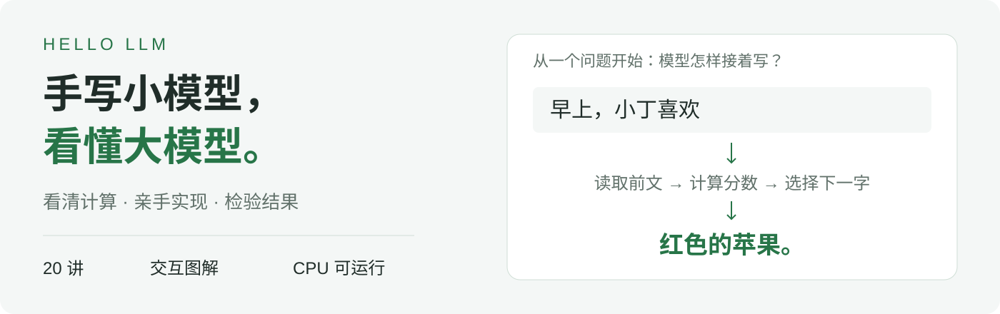

  <picture>
    <source media="(max-width: 600px) and (prefers-color-scheme: dark)" srcset="assets/hello-llm-cover-mobile-dark.svg">
    <source media="(max-width: 600px)" srcset="assets/hello-llm-cover-mobile.svg">
    <source media="(prefers-color-scheme: dark)" srcset="assets/hello-llm-cover-dark.svg">
    
  </picture>

<h1 align="center">Hello LLM</h1>

20 讲图解与代码 · 23 支视频 · 浏览器直接训练

  
  

  
  
  

<a href="README.en.md">English</a>

## 从一个神经元，到能生成文字的小模型

Hello LLM 是「好好用 AI」原创的语言模型入门课程。沿着一个 **92,352 参数的小模型**，把神经元、梯度、注意力、预训练、生成与问答微调串起来。

不要求先学过 Python 或深度学习，可以从图解和网页实验开始。全部代码可在 CPU 上运行。每讲配有图解、视频、代码和练习。

<picture>
  <source media="(max-width: 600px)" srcset="assets/model-results-mobile.svg">
  
</picture>

**动手试试：** [改一改神经元的输入](https://daviddingxu.github.io/hello-llm/course/01.html#python-lab) · [在浏览器训练小模型](https://daviddingxu.github.io/hello-llm/course/20.html#training-lab)

## 课程目录

导读：[课程介绍](chapters/intro/README.md) · [开篇导学](chapters/00-introduction/README.md)

### 让数值网络学起来

| 讲次 | 这一讲要解决的问题 | 视频 |
| :--- | :--- | :--- |
| 01 | [神经元：模型接着写字，底下先算什么？](chapters/01-neuron/README.md) | [6:19](https://daviddingxu.github.io/hello-llm/course/01.html#lesson-video) |
| 02 | [向量与矩阵：算两个数，要复制两遍代码吗？](chapters/02-vectors-and-matrices/README.md) | [5:13](https://daviddingxu.github.io/hello-llm/course/02.html#lesson-video) |
| 03 | [非线性：四行规则，为什么乘加函数做不到？](chapters/03-nonlinearity/README.md) | [4:30](https://daviddingxu.github.io/hello-llm/course/03.html#lesson-video) |
| 04 | [梯度：方向对了，为什么也会越改越差？](chapters/04-gradients/README.md) | [5:14](https://daviddingxu.github.io/hello-llm/course/04.html#lesson-video) |
| 05 | [反向传播：9个参数，难道要逐个试？](chapters/05-backpropagation/README.md) | [5:44](https://daviddingxu.github.io/hello-llm/course/05.html#lesson-video) |
| 06 | [训练循环：更新500次，四条预测会怎样？](chapters/06-training-loop/README.md) | [5:31](https://daviddingxu.github.io/hello-llm/course/06.html#lesson-video) |

### 把文字接进来

| 讲次 | 这一讲要解决的问题 | 视频 |
| :--- | :--- | :--- |
| 07 | [Embedding：文字怎样变成网络的输入？](chapters/07-embeddings/README.md) | [4:23](https://daviddingxu.github.io/hello-llm/course/07.html#lesson-video) |
| 08 | [Softmax：分数怎样变成下一字的概率？](chapters/08-softmax/README.md) | [4:41](https://daviddingxu.github.io/hello-llm/course/08.html#lesson-video) |
| 09 | [训练目标：一句话怎样变成可学习的题？](chapters/09-training-targets/README.md) | [4:32](https://daviddingxu.github.io/hello-llm/course/09.html#lesson-video) |

### 读取前文，组装模型

| 讲次 | 这一讲要解决的问题 | 视频 |
| :--- | :--- | :--- |
| 10 | [注意力：预测下一字，怎样读到前文？](chapters/10-attention/README.md) | [4:37](https://daviddingxu.github.io/hello-llm/course/10.html#lesson-video) |
| 11 | [因果掩码：并行训练为什么不算偷看答案？](chapters/11-causal-mask/README.md) | [4:09](https://daviddingxu.github.io/hello-llm/course/11.html#lesson-video) |
| 12 | [多头注意力：各个头分别读向哪里？](chapters/12-multi-head-attention/README.md) | [4:16](https://daviddingxu.github.io/hello-llm/course/12.html#lesson-video) |
| 13 | [RoPE：模型怎样知道先后顺序？](chapters/13-rope/README.md) | [4:58](https://daviddingxu.github.io/hello-llm/course/13.html#lesson-video) |
| 14 | [SwiGLU：读完前文以后，还要怎么算？](chapters/14-swiglu/README.md) | [4:01](https://daviddingxu.github.io/hello-llm/course/14.html#lesson-video) |
| 15 | [残差与RMSNorm：为什么留一条原路？](chapters/15-residual-and-rmsnorm/README.md) | [4:26](https://daviddingxu.github.io/hello-llm/course/15.html#lesson-video) |
| 16 | [完整模型：跟着“欢”这个字走一遍](chapters/16-transformer/README.md) | [4:42](https://daviddingxu.github.io/hello-llm/course/16.html#lesson-video) |

### 预训练、生成与微调

| 讲次 | 这一讲要解决的问题 | 视频 |
| :--- | :--- | :--- |
| 17 | [预训练：训练题熟了，新题为什么更差？](chapters/17-pretraining/README.md) | [5:39](https://daviddingxu.github.io/hello-llm/course/17.html#lesson-video) |
| 18 | [生成：一句话究竟做了几次选择？](chapters/18-generation/README.md) | [4:50](https://daviddingxu.github.io/hello-llm/course/18.html#lesson-video) |
| 19 | [监督微调：会续写，为何还不会回答？](chapters/19-fine-tuning/README.md) | [6:21](https://daviddingxu.github.io/hello-llm/course/19.html#lesson-video) |
| 20 | [全流程：把预训练、微调和生成串起来](chapters/20-full-workflow/README.md) | [6:29](https://daviddingxu.github.io/hello-llm/course/20.html#lesson-video) |

读完进入[结束篇](chapters/end/README.md)。逐讲代码见[课程与代码索引](docs/COURSE.md)。

## 配套资源

[运行代码](docs/GETTING_STARTED.md) · [视频课程](docs/VIDEOS.md) · [实验记录](code/EXPERIMENTS.md)

## 参与贡献

遇到问题或发现勘误，欢迎[提交 Issue](https://github.com/DavidDingXu/hello-llm/issues/new/choose)。贡献方式见[贡献指南](CONTRIBUTING.md)，本地阅读与网站维护见[构建说明](docs/BUILD.md)。如果课程对你有帮助，欢迎 **Star** 关注更新。

作者：**DavidDingXu** · 公众号「**好好用 AI**」

## 许可

代码采用 [PolyForm Noncommercial 1.0.0](LICENSE)，原创教材、图解、视频与数据采用 [CC BY-NC 4.0](LICENSE-CONTENT)，供非商业学习、修改与分享。详见[许可说明](LICENSING.md)。

## 友链

[LINUX DO](https://linux.do/)
