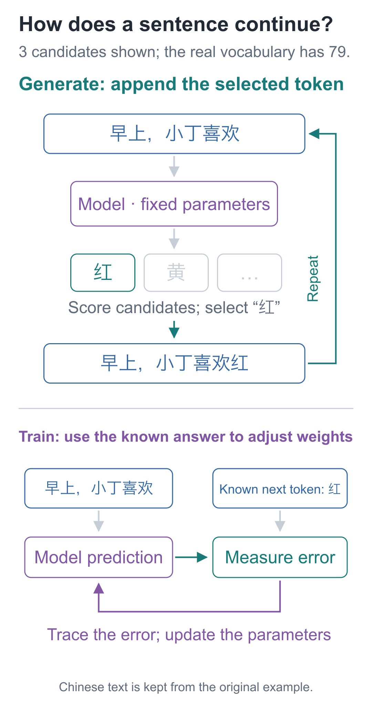

# Before We Begin | Test the Finished Model, Then Build It from Scratch

Build a Small Model, Understand Large Models · Opening article

Give a randomly initialized model and a trained model the same opening:

```text
早上，小丁喜欢
```

The text means “In the morning, Xiaoding likes.” The newly initialized model continues with the nonsensical string “色檬葡最爱梨吴爱”. After training, it continues with “红色的苹果。” (“red apples.”).

Now try a different task:

```text
问：小丁喜欢什么水果？
答：
```

This asks, “What fruit does Xiaoding like?” The model that just continued the sentence now produces “我爱吃香蕉。” (“I love eating bananas.”). The sentence is complete, but the fruit is wrong. It has encountered apples. Why does asking a question make it fail?

This is the small language model we are going to build: starting from random numbers, we will train it to continue text, then train it to answer simple questions of this kind.

## Break one sentence into one choice at a time

“红色的苹果。” does not emerge from the model all at once.

Given “早上，小丁喜欢”, the model first scores candidate characters. The generation procedure selects “红” and appends it to the input:

```text
早上，小丁喜欢红
```

Using the same parameters, it calculates again and selects “色”. Then come “的”, “苹”, “果”, and “。”. Generation stops only when it selects the end marker.

**Choose the next item from the existing text, then append that choice to the input.** This is how a whole passage is written, step by step.



The upper half shows the model being used; the lower half shows it being trained. During training, the original sentence supplies the correct next character. The model predicts first, then adjusts its internal numbers according to the difference between that prediction and the correct answer. The step predicting “红” must not read “红” in advance—that would amount to copying the answer.

This course treats one character as one prediction unit. More generally, models use tokens: a token can be a character, a word, or part of a word. We begin with characters so that each step can be pointed back to the original sentence.

## The change is in the numbers

If all we wanted was a fixed fruit for each of eight people, a dictionary would be simpler. We train a model here to investigate how the same calculation program can learn different input–output relationships from examples by changing its parameters.

The generation code has no branch that looks up “小丁” (Xiaoding) and returns “苹果” (apple). The person–fruit relationships are in the training examples. Training repeatedly adjusts the model's parameters so that the correct following characters become more likely to be selected.

Our model has 92,352 parameters. Its calculation rules, including multiplication and addition, do not change between before and after training. The saved numbers change. To understand training, we can start with a smaller question: **how can adjusting a few numbers inside a function bring its result closer to a target?**

## A model that continues text still has to learn question format

During pretraining, the model practices short sentences about people, fruits, and colors. Question–answer format requires another set of examples, such as:

```text
问：小丁喜欢什么水果？
答：红色的苹果。
```

We continue training from the pretrained parameters, this time focusing the scoring on the answer portion. This is the supervised fine-tuning we will perform. The computational network stays the same, and the task remains next-character prediction.

After the actual fine-tuning run, the wording above and all eight held-out question wordings receive correct answers. But expanding the old-continuation check to all 256 tasks reveals 32 regressions. We will unpack these results later: which numbers did fine-tuning change, and why can improving a new behavior also affect an old one?

## Which questions guide the course?

The first six lessons make a numerical network learn. Lessons 07–09 introduce text and build the first character prediction model. That model exposes a specific limitation: even when the input contains different names, its predictions are identical.

Lessons 10–16 address that problem by adding preceding context, order, and the required computational components, then assembling the complete model. Lessons 17–19 use that same model for pretraining, character-by-character generation, and question–answer fine-tuning. In Lesson 20, you first deliberately change inputs and labels to test whether you can explain the results. You then use a different dataset containing new characters and independently connect the vocabulary, training process, and result checks.

Not peeking at the answer follows directly from next-character prediction. Position representations and the organization of model blocks, however, admit different designs. As each concrete design appears, we will examine the problem it solves and why we chose it here.

## How to read alongside the code

When you meet a new component, first recalculate a small example along one path in its diagram, then inspect how the code implements it. Logging and file handling in the full project can be read later.

Spend a few minutes in each lesson changing one number: predict the result, then run the code. If your prediction is wrong, return to the first step where the results diverge. On a first reading, follow the main explanation. Longer hand calculations and derivations are in optional sections; return to them when you need to check a step.

## First, calculate a 4 on your own computer

Download and extract the [companion code](https://github.com/DavidDingXu/hello-llm). Open a terminal in the directory containing `tiny_lm`, `lessons`, and `requirements.txt`, then run:

```bash
# Start with one neuron example; no third-party packages are needed.
python -m lessons.l01
```

Look for `加偏置：5 - 1 = 4` in the output: it means “add bias: 5 − 1 = 4.” The program then prints the results of changing the input and bias. If it cannot find `lessons`, first check that your terminal is in the code directory just described.

The course uses `python` to mean the interpreter running the examples. On macOS, you can use `python3`; on Windows, you can use `py`. Lessons 01–05 use only the Python standard library. Before Lesson 06, follow the [installation instructions](https://github.com/DavidDingXu/hello-llm/blob/main/code/README.md) to install the runtime dependencies. Use the same interpreter to install dependencies and run the code.

Lesson 01 does not yet process a whole sentence. We reduce the input to `[2, 1]` and see how a few adjustable numbers first produce 4, then make it become 5.

[Code and installation instructions](https://github.com/DavidDingXu/hello-llm) · [Actual run records](https://github.com/DavidDingXu/hello-llm/blob/main/code/EXPERIMENTS.md)

<!-- chapter-navigation:start -->

---

[← Course introduction](../intro/README.en.md) · [Contents](../../README.en.md#course-contents) · [Neurons →](../01-neuron/README.en.md)

<!-- chapter-navigation:end -->
