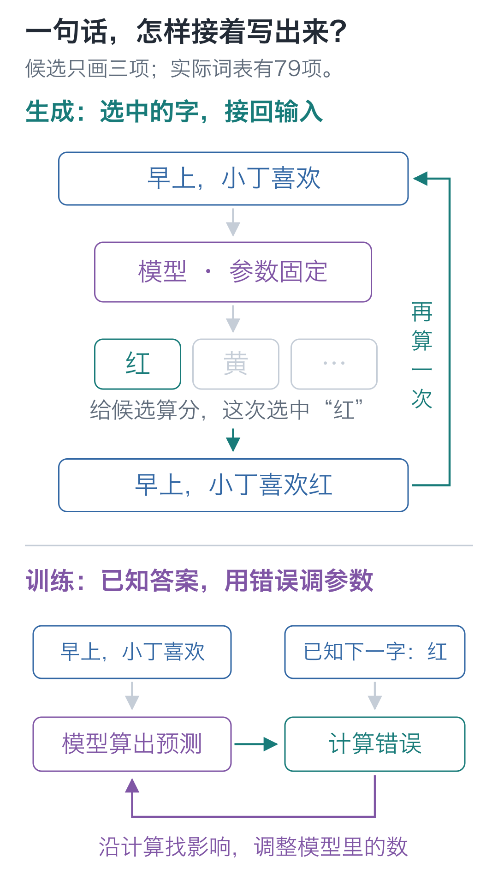

# 开篇词｜先给成品出两道题，再从零把它造出来

手写小模型，看懂大模型 · 开篇词

给随机初始化的模型和训练后的模型输入同一句开头：

```text
早上，小丁喜欢
```

刚初始化的模型接出了“色檬葡最爱梨吴爱”。训练以后，它接上了“红色的苹果。”。

再换一道题：

```text
问：小丁喜欢什么水果？
答：
```

刚才会续写的模型，却接出了“我爱吃香蕉。”。句子完整，水果却错了。它见过苹果，为什么换成提问就不行了？

我们要造的就是这个小语言模型：从一组随机的数开始，把它训练到能续写，再训练到能回答这种简单问题。

## 先把一句话拆成一次选择

“红色的苹果。”没有一次性从模型里冒出来。

给定“早上，小丁喜欢”，模型先为候选字符算分。生成程序选中“红”，把它接回输入：

```text
早上，小丁喜欢红
```

再用同一套参数计算，选出“色”。接着是“的、苹、果、。”，最后选到结束标记才停止。

**根据已有文字选下一项，再把选中的项接回去。** 一整段文字就这样逐步写出来。



图中上半部分是使用模型，下半部分是训练模型。训练时，原句已经给出正确的下一字。模型先预测，再根据预测与正确答案之间的差别，调整内部的数。预测“红”的这一步不能提前读取“红”，否则就成了抄答案。

本栏把一个字符作为一个预测单位。更一般的模型会使用 token：它可能是一个字、一个词或词的一部分。先按字符拆分，是为了能把每一步直接指回原句。

## 变化藏在那些数里

如果只为这八个人返回固定水果，写一个字典更省事。这里选择训练模型，是为了看清：同一个计算程序，怎样通过改变参数，从例子中形成不同的输入输出关系。

生成程序没有按“小丁”查出“苹果”的分支。人物与水果的对应关系放在训练样本里；训练过程反复调整模型中的参数，使正确的后续字符更容易被选中。

本模型共有 92,352 个参数。训练前后，乘加等计算规则没有换，保存下来的这些数变了。要理解训练，可以先看一个更小的问题：**怎样只调函数里的几个数，就让结果更接近目标？**

## 会续写，还要学怎样接问题

预训练时，模型练的是人物、水果和颜色的短句。问答格式需要另一批示例，例如：

```text
问：小丁喜欢什么水果？
答：红色的苹果。
```

我们从预训练得到的参数继续训练，这次重点给答案部分评分。这就是本栏要做的监督微调。计算网络仍是原来的网络，下一字预测也还在继续。

实际微调后，上面的问法与八条留出的新问法都答对了。但把旧续写扩成完整256题检查，仍有32题退化。这些结果会在后面逐项展开：微调改了哪些数，为什么新行为改善了，旧行为也可能受到影响？

## 接下来，我们沿着哪些问题往前走

前六讲先让一个数值网络学起来。第07—09讲接入文字，做出第一个字符预测模型。它会暴露一个很具体的限制：输入中明明有不同人名，预测却完全相同。

第10—16讲沿着这个问题接入前文、补上顺序与各个计算组件，最后装成完整模型。第17—19讲使用这同一个模型完成预训练、逐字生成和问答微调。第20讲先故意改输入、改标签，检验自己能否解释结果，再换一份含新字符的数据，独立接好词表、训练和结果核对。

不能偷看答案，是下一字预测的直接要求；怎样表示位置、怎样组织模型块，则有不同做法。遇到具体设计时，我们会比较它解决了什么问题，为什么这里选它。

## 怎样跟着代码读

遇到新组件，先沿图中的一条路径重算小例子，再看代码怎样实现它。完整工程里的日志和文件处理可以稍后读。

每讲留几分钟改一个数：先猜结果，再运行。如果猜错，就回到结果开始不同的那一步。读正文时，先走完主线；较长的手算核对和推导放在选读中，卡住时再回来看。

## 先在自己的电脑上算出一个4

下载[配套代码](https://github.com/DavidDingXu/hello-llm)并解压，进入仓库的 `code/` 目录，在能看到 `tiny_lm`、`lessons` 和 `requirements.txt` 的位置打开终端，运行：

```bash
# 第一次只运行一个神经元的算例，无需安装第三方包。
python -m lessons.l01
```

输出中应能找到 `加偏置：5 - 1 = 4`，随后会打印改输入、改偏置的结果。若提示找不到 `lessons`，先检查终端是否位于刚才的代码目录。

本栏用 `python` 表示运行课程的解释器；macOS 可以使用 `python3`，Windows 可以使用 `py`。第01—05讲只用Python标准功能，第06讲前再按[安装说明](https://github.com/DavidDingXu/hello-llm/blob/main/code/README.md)安装运行依赖。安装依赖和运行代码要使用同一个解释器。

第一讲先不处理整句话。我们把输入缩成 `[2, 1]`，看看几个可调的数，怎样先算出 4，再让它变成 5。

[配套代码与安装说明](https://github.com/DavidDingXu/hello-llm) · [实际运行记录](https://github.com/DavidDingXu/hello-llm/blob/main/code/EXPERIMENTS.md)

<!-- chapter-navigation:start -->

---

[← 课程介绍](../intro/README.md) · [课程目录](../../README.md#课程目录) · [神经元 →](../01-neuron/README.md)

<!-- chapter-navigation:end -->
