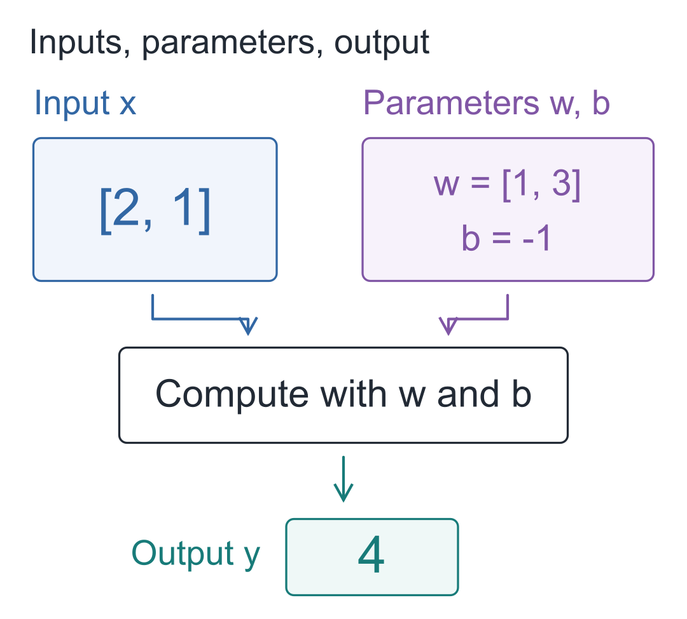
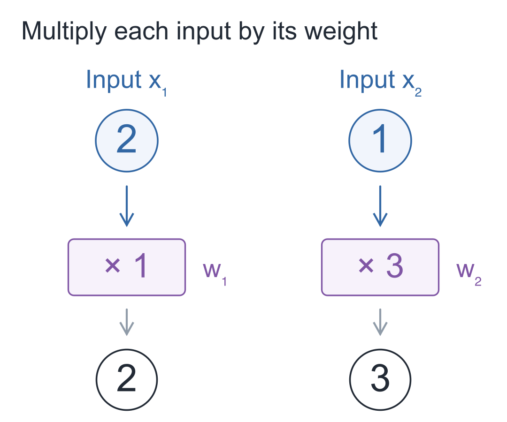
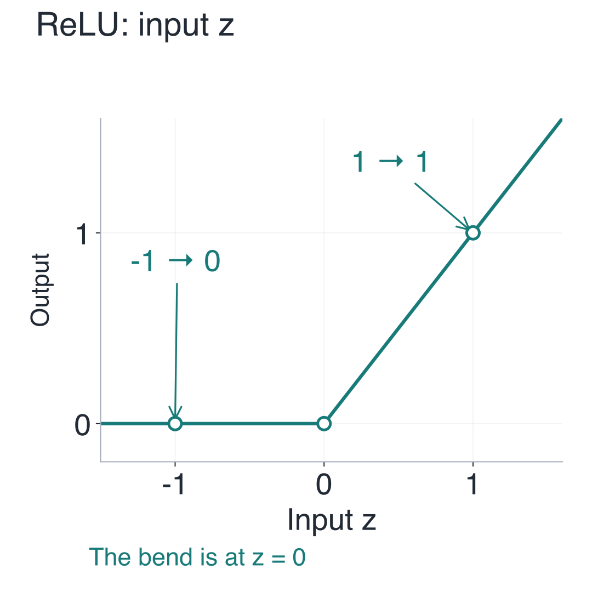
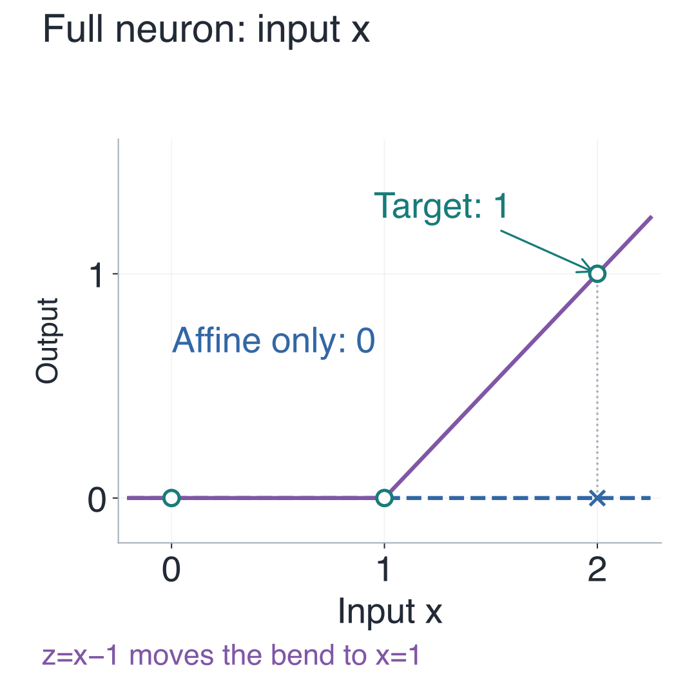
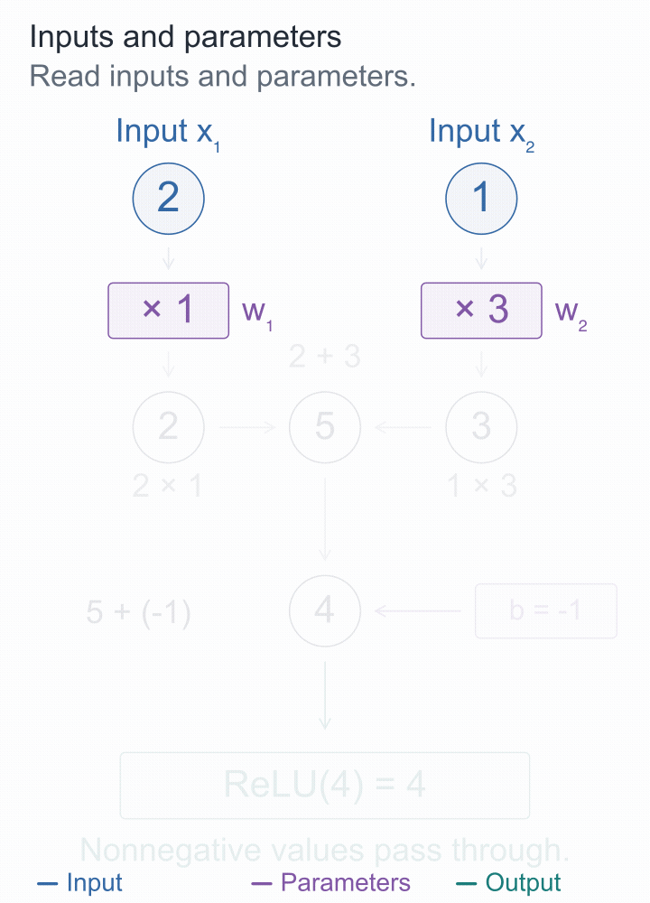
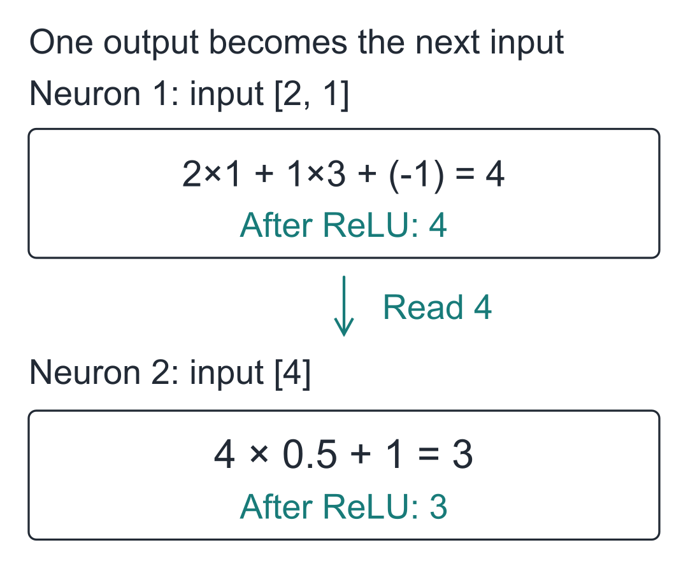
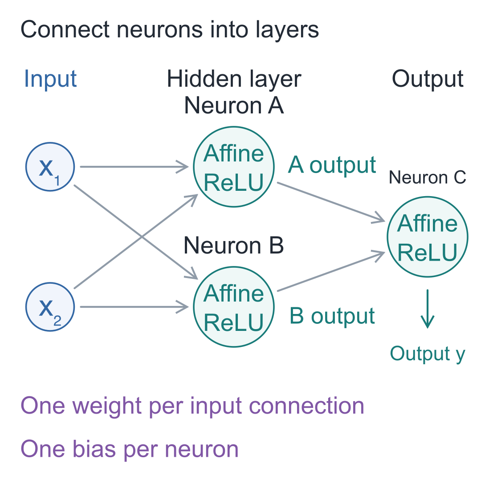

# 01 | Neurons: What Does a Model Calculate Before It Writes the Next Character?

Build a Small Model, Understand Large Models · Lesson 01

Given “早上，小丁喜欢” (“In the morning, Xiaoding likes”), the small language model we trained continues with “红色的苹果。” (“red apples.”).

The generation program contains no special continuation rule for this particular phrase. A few hundred short sentences about people, fruit, and colors were used in training and changed its saved parameters. It can continue familiar sentences, but it also makes mistakes when the wording changes. The [experiment log](https://github.com/DavidDingXu/hello-llm/blob/main/code/EXPERIMENTS.md) preserves these results.

Why can changing only the parameters change the output while the calculation stays the same? Instead of tracing an entire sentence, let us shrink the input to two numbers and see how to turn an output of 4 into 5.

## To change the result, first identify the adjustable numbers

- **Input `[2, 1]`:** the two data values supplied for this calculation.
- **Weights `[1, 3]`:** the multipliers paired with the two inputs.
- **Bias `−1`:** a number added after summing the products.

Together, the weights and bias are called **parameters**. Taking inputs and using these parameters to calculate one number is the basic job of an artificial neuron.

Inputs change with the data; parameters are stored by the model and determine how it processes that data. We will set the parameters by hand here and adjust them based on errors during training later. During text generation, the parameters stay fixed.



## First, calculate that 4

Call the two inputs `x₁` and `x₂`, and their corresponding weights `w₁` and `w₂`. The subscripts are just indices: the first input goes with the first weight, and the second with the second.

The first path calculates **2 × 1 = 2**; the second calculates **1 × 3 = 3**.



A weight is simply a multiplier. It can be a fraction or a negative number, making this input's contribution larger, smaller, or opposite in sign.

Next, add the two products: **2 + 3 = 5**.

Then add the bias −1: **5 + (−1) = 4**.

Calling the bias `b` and the result so far `z`, we get:

**z = x₁ × w₁ + x₂ × w₂ + b = 4**

Why include a bias? When all inputs are 0, the sum of the products must be 0. The bias lets us adjust that result independently.

## Some tasks remain impossible, however freely we adjust the parameters

Parameters can change the output above, but some requirements cannot be met by any choice of parameters. Switch to a single input `x`: the output should be 0 when `x` is at most 1, and otherwise should equal only the amount above 1.

| Input x | Required output |
| --- | --- |
| 0 | 0 |
| 1 | 0 |
| 2 | 1 |

Can **y = w × x + b** alone meet all three requirements?

An input of 0 must produce 0, forcing **b = 0**. An input of 1 must also produce 0, forcing **w = 0**.

With both parameters determined, an input of 2 can only give **0 × 2 + 0 = 0**, not the required 1. Choosing different parameters would violate the first two requirements.

Adjusting parameters to bring outputs closer to targets is called **fitting**. These three targets cannot all be fitted exactly; the restriction comes from the form of the function.

Could adding another function get around this? Suppose we first calculate `a=x−1`, then `y=2×a+1`. Expanding gives:

**y = 2 × (x − 1) + 1 = 2 × x − 1**

This still means “multiply the input by a number, then add a number.” Changing parameters only changes the combined multiplier and offset. Stacking more such operations still cannot meet all three targets.

Here, multiply-and-add means **multiplying inputs by fixed weights, summing the products, and adding a bias**. We need a way to treat inputs differently in different intervals.

## Clamp negative values to 0, and the three targets line up

The missing behavior is specific: the first part must stay at 0, and only the second part should start increasing. Apply this rule to the multiply-and-add result `z`:

**ReLU(z) = max(0, z)**

`max(0, z)` chooses the larger of 0 and `z`: negative values become 0, and nonnegative values are kept. This function is called **ReLU**, a type of **activation function**.



A bent line cannot be represented by one straight line. That is the **nonlinearity** we need. Nonlinearity can also come from a smooth curve; a piecewise straight line makes the arithmetic easier here.

For the three targets above, choose weight **w=1** and bias **b=−1**:

**z = 1 × x − 1**

Then pass `z` to ReLU:

**y = ReLU(z) = ReLU(x − 1)**

| Input x | z=x−1 | Output y |
| --- | --- | --- |
| 0 | −1 | 0 |
| 1 | 0 | 0 |
| 2 | 1 | 1 |



The two plots have different horizontal axes. In the first, the horizontal axis is **z**, the result after multiply-and-add; the vertical axis is ReLU's output, and the bend is at **z=0**. In the second, the horizontal axis is the original input **x**, and the vertical axis is the whole neuron's output. Because we first calculate `z=x−1`, the bend appears at **x=1**. Find an input along the horizontal axis and move up to the curve to read its output. The bias has moved the bend; the ReLU rule has not changed.

The dots in the second plot are the targets. The blue line is determined by the first two targets and always outputs 0. With ReLU, the purple bent line passes through all three dots. We chose these parameters by hand; later, the training program will search for them.

## Return to that 4 and turn it into editable code

For the original input `[2, 1]`, the multiply-and-add result `z=4` is positive, so ReLU leaves it at 4.



To pause and check the numbers, open the [complete static diagram](images/en/07-完整计算.png), or move forward and backward in the [step-by-step demo](https://daviddingxu.github.io/hello-llm/chapters/01-neuron/walkthrough.en.html).

Calling the final output `y`, the formula and numbers together are:

**y = ReLU(x₁w₁+x₂w₂+b) = ReLU(2×1+1×3−1) = 4**

Multiply corresponding items and accumulate the products, and the same code can handle one, two, or more inputs:

```python
def neuron(inputs, weights, bias=0.0):
    """输入列表与权重逐项配对，加偏置、做 ReLU，返回一个数。"""
    if len(inputs) != len(weights) or not inputs:
        raise ValueError("输入与权重必须非空且等长")

    total = 0.0
    # 同一位置的输入乘自己的权重，再把各项贡献加起来。
    for value, weight in zip(inputs, weights):
        total += value * weight
    z = total + bias
    # ReLU 只改变负数；它的规则固定，可调的是 weights 和 bias。
    return max(0.0, z)

# 本次输入为 [2, 1]，参数是权重 [1, 3] 和偏置 -1。
print(neuron([2, 1], [1, 3], -1))  # 4.0
```

`inputs`, `weights`, and `bias` correspond to `x`, `w`, and `b`. `zip` pairs each input with its weight; the loop multiplies them, and `total += ...` accumulates the products. Finally, add the bias and apply ReLU. The initial check prevents unmatched weights or empty lists. Save this as `neuron.py` and run it using only standard Python features.

### What happens when you change one number?

Once the code prints 4, first try changing only the bias from −1 to 0. Then restore it and change the second input from 1 to 2. Change only one thing at a time:

| Change | Multiply-and-add calculation | Output |
| --- | --- | --- |
| Original example | 2×1 + 1×3 − 1 | 4 |
| x₂: 1 → 2 | 2×1 + 2×3 − 1 | 7 |
| b: −1 → 0 | 2×1 + 1×3 + 0 | 5 |

Increasing the second input by 1 increases the output by 3, because that input is first multiplied by its weight of 3. All three results are positive, so ReLU keeps each unchanged.

## Can one result be passed to the same function again?

Pass the first output, 4, back into `neuron`, using a weight of 0.5 and a bias of 1:

```python
# 沿用上一段的 neuron；前一个输出成为后一个神经元的输入。
first = neuron([2, 1], [1, 3], -1)
# 后一个神经元有自己的权重和偏置，并未修改前一个的参数。
second = neuron([first], [0.5], 1)
print(first, second)  # 4.0 3.0
```



The second neuron still performs multiply-and-add followed by ReLU, but now it has only one input. Several neurons can each use their own parameters to produce a set of intermediate numbers, often called **features**. Their roles must be understood within the whole network; we cannot assume in advance that one number represents “apple” or “grammar.”

Put two neurons side by side and pass their outputs to a third, and you get the following network:



- **Input layer:** the two points hold data and perform no additional calculation.
- **Hidden layer:** A and B sit between the inputs and the final output. They read the same inputs and calculate using their own parameters.
- **Output layer:** C takes the outputs of A and B as its two inputs and continues the calculation. This diagram also uses ReLU at C.

Each connection entering a neuron corresponds to one weight; crossing lines perform no calculation. In the next lesson, we will express parallel calculations like A and B as a matrix to obtain a layer's multiple outputs at once.

## Three short exercises

1. Keep the main example's inputs `[2, 1]` and weights `[1, 3]`, but change the bias to −6. What is `z`? What is the final output?
2. In the single-input counterexample, keep the weight at 1 and change the bias from −1 to −2. Where does the bend move? What is the output for an input of 2?
3. In the final network diagram, how many weights and biases are there? Do the two input points count as adjustable parameters?

For the first exercise, set the bias to −6 in the interactive demo. For the second, check with `neuron([2], [1], -2)`.

<details class="answer" markdown="1">
<summary>Reference answers</summary>

Answers: For the first exercise, `z=2×1+1×3−6=−1`, so the output is **0**. For the second, `z=x−2`; the bend moves to **x=2**, and an input of 2 produces **0**. The output becomes positive only above 2. For the third, A and B each have two incoming weights, and C has two more: **6 weights** in total. A, B, and C each have a bias: **3 biases**, making **9 adjustable parameters** altogether. The input points are data.

</details>

To have the companion program print this lesson's calculations, run the following from the `code` directory:

```bash
# 在配套代码目录运行本讲实验，核对正文中的结果。
python -m lessons.l01
```

On macOS, you can use `python3`; on Windows, you can also use `py -m lessons.l01`. See the [companion code](https://github.com/DavidDingXu/hello-llm/blob/main/code/README.md) for full installation and execution instructions.

Companion resources: [Entry point](https://github.com/DavidDingXu/hello-llm/blob/main/code/lessons/l01.py) · [Interactive demo](https://daviddingxu.github.io/hello-llm/chapters/01-neuron/walkthrough.en.html) · [Actual model experiments](https://github.com/DavidDingXu/hello-llm/blob/main/code/EXPERIMENTS.md)

Source navigation: [scalar.py · neuron](https://github.com/DavidDingXu/hello-llm/blob/main/code/tiny_lm/scalar.py#L22).

<!-- chapter-navigation:start -->

---

[← Before we begin](../00-introduction/README.en.md) · [Contents](../../README.en.md#course-contents) · [Vectors and Matrices →](../02-vectors-and-matrices/README.en.md)

<!-- chapter-navigation:end -->
