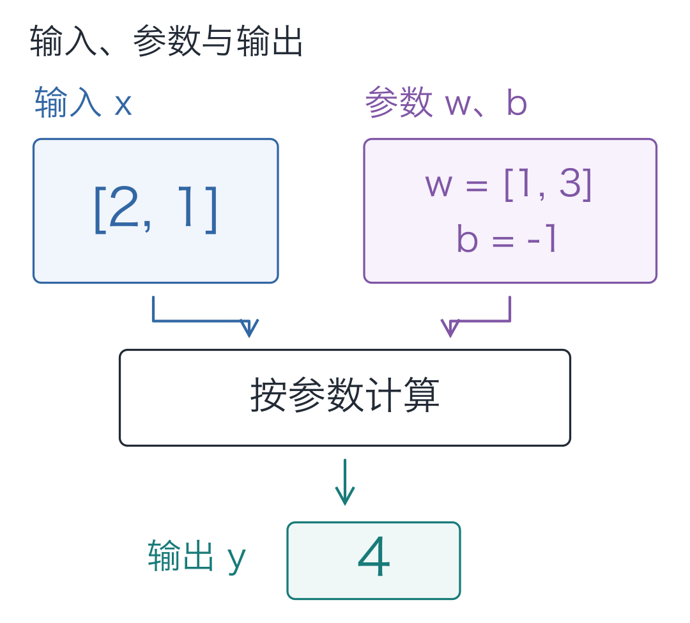
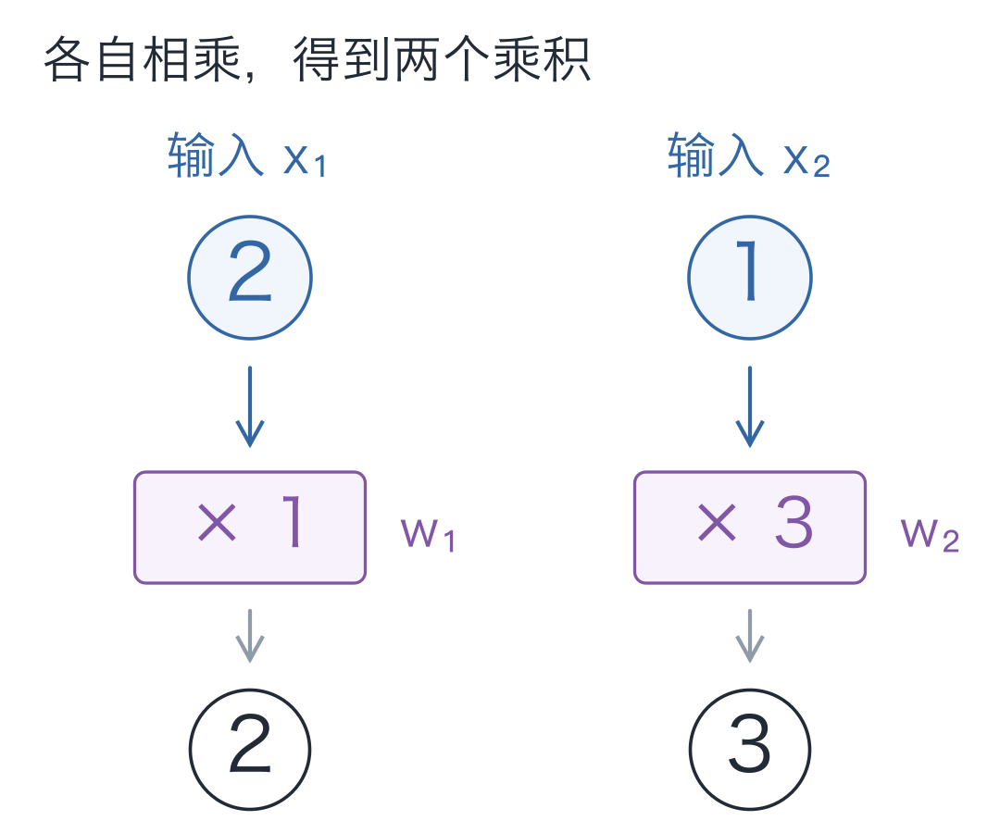
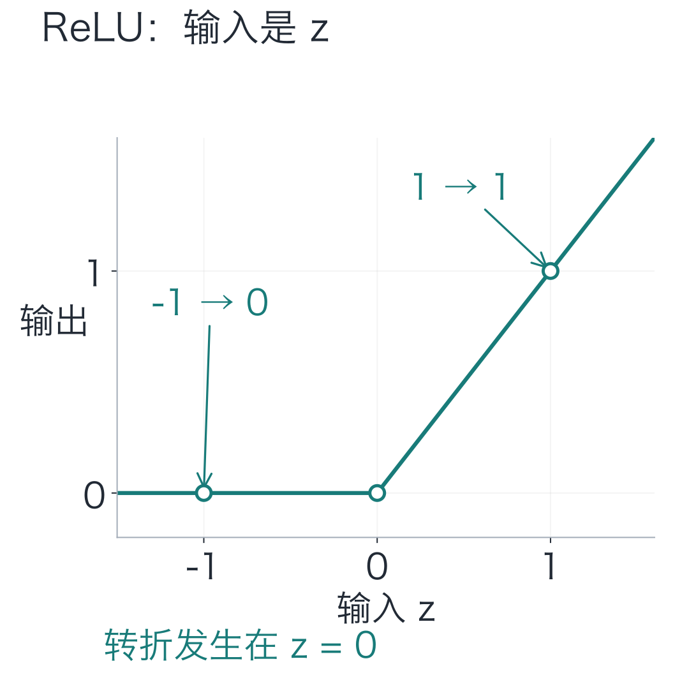
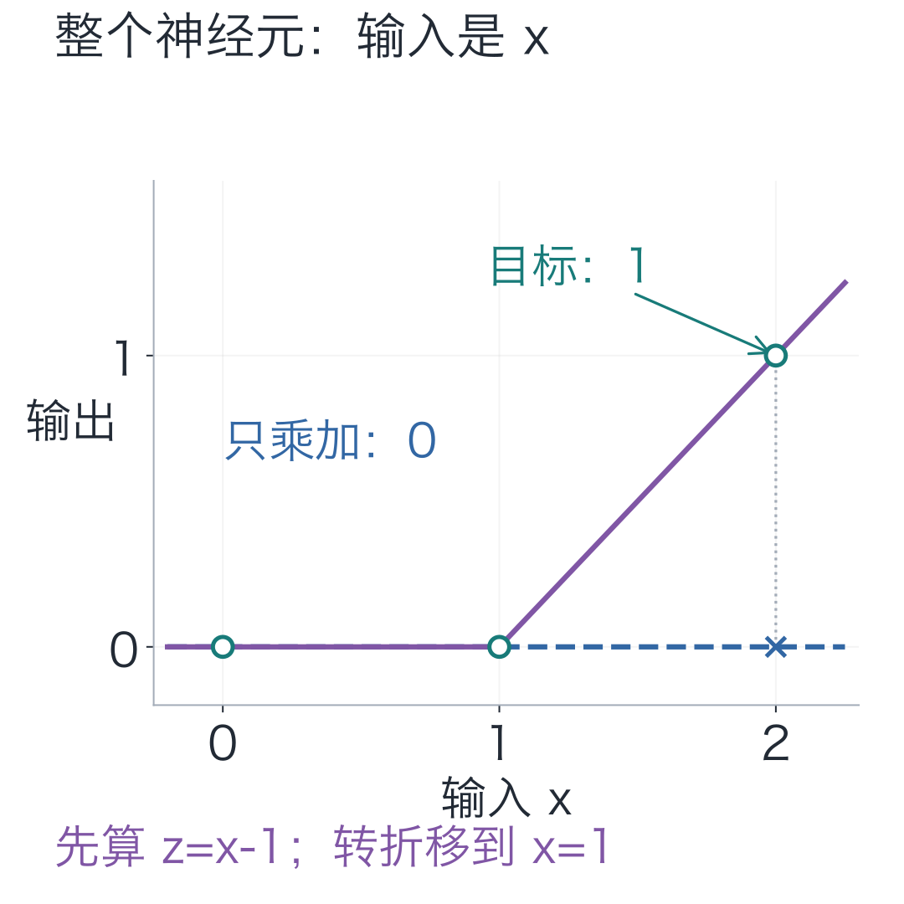
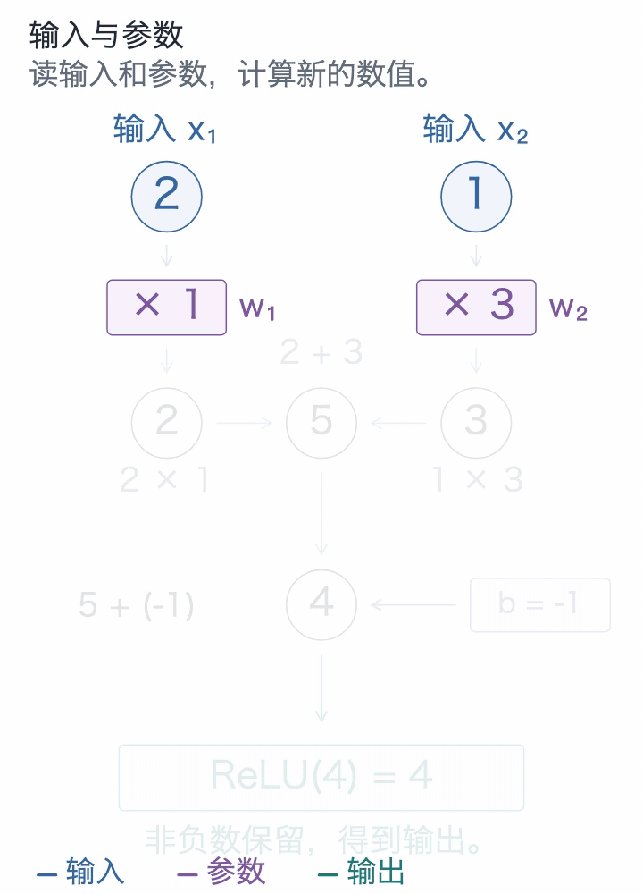
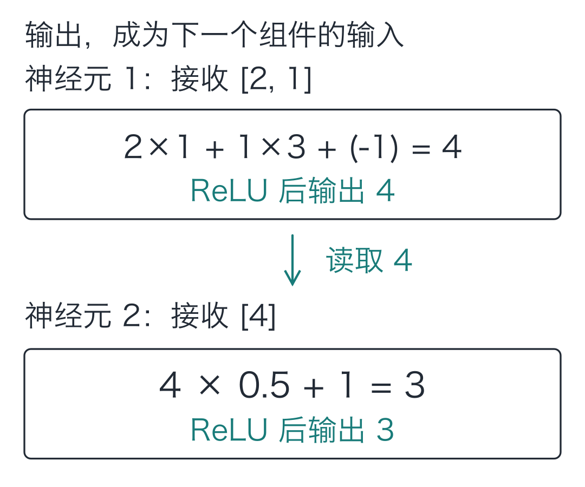
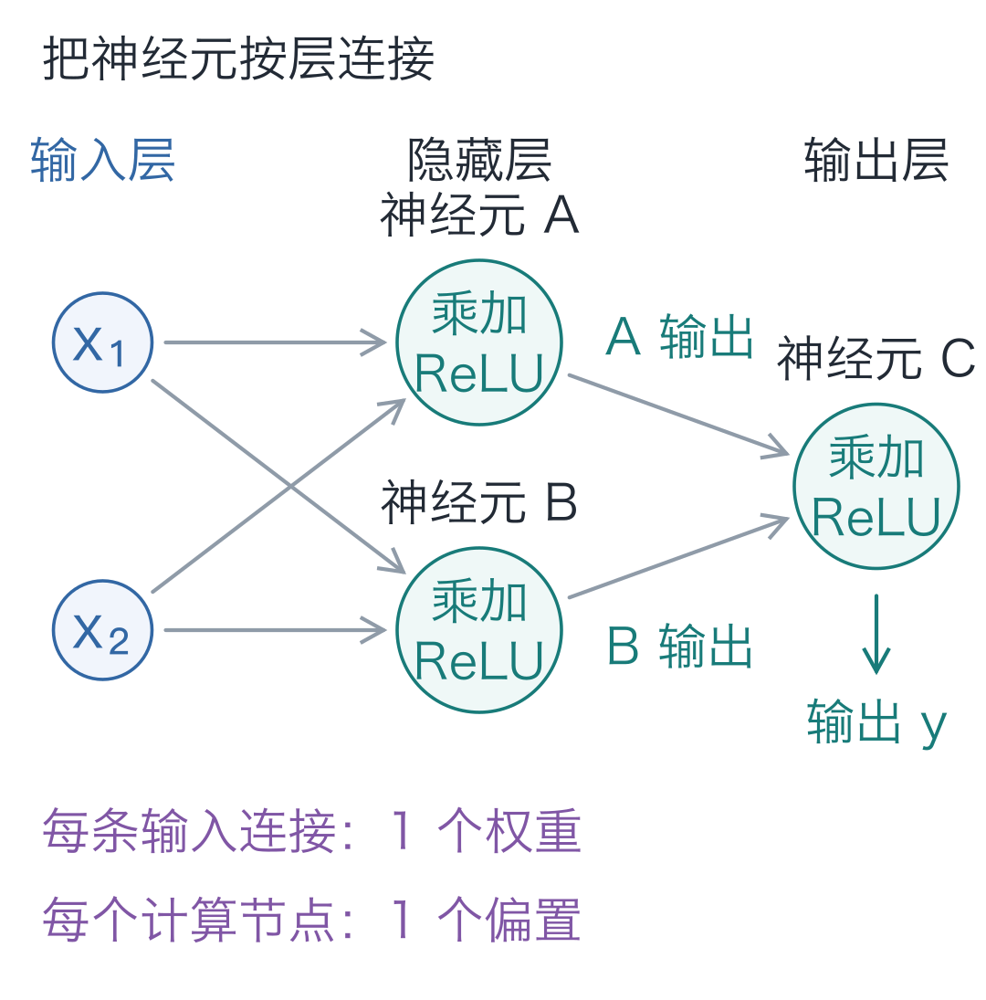

# 01｜神经元：模型接着写字，底下先算什么？

手写小模型，看懂大模型 · 第 01 讲

输入“早上，小丁喜欢”，我们自己训练的小语言模型会接着生成“红色的苹果。”

生成程序里没有为这半句话单独写一条续写规则。几百条人物、水果和颜色短句参与了训练，改变了它保存的参数。它能续写熟悉的句子，换个说法也会错，[实验记录](https://github.com/DavidDingXu/hello-llm/blob/main/code/EXPERIMENTS.md)保留了这些结果。

计算步骤不变，只改参数，为什么就能改变输出？先不追整句话，把输入缩成两个数，看看怎样让一个结果从 4 变成 5。

## 结果要变，先找出哪些数能调

- **输入 `[2, 1]`：** 本次送进来的两项数据。
- **权重 `[1, 3]`：** 两项输入各自配上的乘数。
- **偏置 `−1`：** 乘积相加之后，再加上的一个数。

权重和偏置合起来，叫作**参数**。接收输入、按这些参数算出一个数，是人工神经元的基本工作。

输入随数据变化；参数由模型保存，决定怎样处理数据。这里先手工指定参数，后面训练时根据错误调整；生成文字时参数固定。



## 先算出这个 4

把两项输入记作 `x₁`、`x₂`，对应权重记作 `w₁`、`w₂`。下标只是编号：第一项输入配第一项权重，第二项配第二项。

第一条路径算 **2 × 1 = 2**；第二条路径算 **1 × 3 = 3**。



权重就是乘数，可以是小数或负数，用来放大、缩小或改变这一项贡献的正负号。

接着，把两个乘积相加：**2 + 3 = 5**。

再加偏置 −1：**5 + (−1) = 4**。

把偏置记作 `b`，把目前这个计算结果记作 `z`，就得到：

**z = x₁ × w₁ + x₂ × w₂ + b = 4**

为什么还需要偏置？输入全为 0 时，乘积之和一定是 0。偏置让这个结果也能独立调整。

## 允许随便调参数，也有做不到的事

上面的输出能靠参数改变，但有些要求，怎样调参数也做不到。换成单个输入 `x`，要求不超过 1 时输出 0，超过 1 时只输出超出的部分：

| 输入 x | 需要的输出 |
| --- | --- |
| 0 | 0 |
| 1 | 0 |
| 2 | 1 |

只用 **y = w × x + b**，能同时满足吗？

输入 0 要输出 0，迫使 **b = 0**。接着，输入 1 也要输出 0，又迫使 **w = 0**。

两个参数确定后，输入 2 只能得到 **0 × 2 + 0 = 0**，无法得到要求的 1。换别的参数，就会破坏前两条要求。

调整参数，让输出接近目标，叫作**拟合**。这三个目标无法同时精确拟合，限制来自函数形式。

再接一个函数，能绕过这个限制吗？假设先算 `a=x−1`，再算 `y=2×a+1`。展开后：

**y = 2 × (x − 1) + 1 = 2 × x − 1**

仍然是“输入乘一个数，再加一个数”。换参数只会改变合并后的乘数和加数，继续堆叠也无法满足这三个目标。

这里的乘加指**输入乘固定权重，再求和、加偏置**。我们还需要让不同区间的输入得到不同处理。

## 让负数停在 0，三个目标就接上了

缺少的变化很具体：前半段要一直为 0，后半段才开始增长。对乘加结果 `z` 增加这条规则：

**ReLU(z) = max(0, z)**

`max(0, z)` 取 0 和 `z` 中较大的数：负数变成 0，非负数保留。这个函数叫 **ReLU**，是一种**激活函数**。



折线无法用一条直线表示，这就是所需的**非线性**。它也可以来自平滑曲线；这里用折线便于手算。

对刚才三个目标，取权重 **w=1**、偏置 **b=−1**：

**z = 1 × x − 1**

再把 `z` 交给 ReLU：

**y = ReLU(z) = ReLU(x − 1)**

| 输入 x | z=x−1 | 输出 y |
| --- | --- | --- |
| 0 | −1 | 0 |
| 1 | 0 | 0 |
| 2 | 1 | 1 |



两张图的横轴不同：前图是乘加后的 **z**，纵轴是 ReLU 输出，转折在 **z=0**；后图是原始输入 **x**，纵轴是整个神经元输出。因为先算 `z=x−1`，转折就落在 **x=1**。沿横轴找输入，向上到曲线即可读输出；偏置移动了转折位置，ReLU 规则没变。

后图圆点是目标。蓝线由前两个目标确定，一直输出 0；加上 ReLU 后，紫色折线经过了三个点。这次参数是手工挑出的，后面再让训练程序来寻找它们。

## 回到那个 4，把它变成能改的代码

原来 `[2, 1]` 的乘加结果 `z=4` 为正，经过 ReLU 仍然是 4。



需要停下来核对，可以打开[完整静态图](images/07-完整计算.png)，或在[逐步演示](https://daviddingxu.github.io/hello-llm/chapters/01-neuron/walkthrough.html)里前进、后退。

把最后输出记作 `y`，公式与数字合起来是：

**y = ReLU(x₁w₁+x₂w₂+b) = ReLU(2×1+1×3−1) = 4**

逐项相乘再累加，就能处理一项、两项或更多项输入：

```python
def neuron(inputs, weights, bias=0.0):
    """输入列表与权重逐项配对，加偏置、做 ReLU，返回一个数。"""
    if len(inputs) != len(weights) or not inputs:
        raise ValueError("输入与权重必须非空且等长")

    total = 0.0
    # 同一位置的输入乘自己的权重，再把各项贡献加起来。
    for value, weight in zip(inputs, weights):
        total += value * weight
    z = total + bias
    # ReLU 只改变负数；它的规则固定，可调的是 weights 和 bias。
    return max(0.0, z)

# 本次输入为 [2, 1]，参数是权重 [1, 3] 和偏置 -1。
print(neuron([2, 1], [1, 3], -1))  # 4.0
```

`inputs、weights、bias` 对应 `x、w、b`。`zip` 把对应输入和权重配对，循环相乘，`total += ...` 累加；最后加偏置、做 ReLU。开头的检查防止漏配权重或传入空列表。保存成 `neuron.py` 即可运行，只需 Python 标准功能。

### 改一个数，结果怎样变

代码跑出 4 后，先试着只把偏置 −1 改成 0。再改回去，把第二项输入从 1 改成 2。每次只改一处：

| 改动 | 乘加计算 | 输出 |
| --- | --- | --- |
| 原例子 | 2×1 + 1×3 − 1 | 4 |
| x₂：1 → 2 | 2×1 + 2×3 − 1 | 7 |
| b：−1 → 0 | 2×1 + 1×3 + 0 | 5 |

第二项输入增加 1，输出就增加 3，因为这一份输入要先乘权重 3。三个结果为正，ReLU 都保留原值。

## 一个结果，能不能再交给同一个函数？

把第一个输出 4 再交给 `neuron`，权重取 0.5，偏置取 1：

```python
# 沿用上一段的 neuron；前一个输出成为后一个神经元的输入。
first = neuron([2, 1], [1, 3], -1)
# 后一个神经元有自己的权重和偏置，并未修改前一个的参数。
second = neuron([first], [0.5], 1)
print(first, second)  # 4.0 3.0
```



第二个仍执行乘加与 ReLU，只是输入变为一项。多个神经元可以各用一组参数，产生一组中间数，常称为**特征**。它们的作用要放在整个网络中看，不能预先认定某个数代表“苹果”或“语法”。

把两个神经元并排放，它们的输出再交给第三个，就得到下面的网络：



- **输入层：** 两个点只放数据，不额外计算。
- **隐藏层：** A、B 位于输入与最终输出之间，读取同一组输入，各用自己的参数计算。
- **输出层：** C 把 A、B 的输出作为两项输入继续计算，图中也采用 ReLU。

每条进入神经元的连线对应一个权重，交叉点不计算。下一讲把 A、B 这样的并排计算写成矩阵，一次得到一层的多个输出。

## 三道小题

1. 主算例的输入 `[2, 1]`、权重 `[1, 3]` 不变，偏置改成 −6。`z` 是多少？最后输出是多少？
2. 单输入反例中，权重仍取 1，偏置从 −1 改成 −2。转折位置移到哪里？输入 2 时输出是多少？
3. 最后的网络结构图中，有几个权重、几个偏置？两个输入点算不算可调参数？

第一题可在交互演示中把偏置调到 −6；第二题可用 `neuron([2], [1], -2)` 核对。

<details class="answer" markdown="1">
<summary>参考答案</summary>

答案：第一题，`z=2×1+1×3−6=−1`，输出 **0**。第二题，`z=x−2`，转折移到 **x=2**，输入 2 时输出 **0**，超过 2 才有正输出。第三题，进入 A、B 各有两条权重，进入 C 有两条，共 **6 个权重**；A、B、C 各有一个偏置，共 **3 个偏置**，合计 **9 个可调参数**。输入点是数据。

</details>

想让配套程序打印本讲的计算，进入 `code` 目录运行：

```bash
# 在配套代码目录运行本讲实验，核对正文中的结果。
python -m lessons.l01
```

macOS 可以用 `python3`，Windows 也可以用 `py -m lessons.l01`。完整安装与运行说明见[配套代码](https://github.com/DavidDingXu/hello-llm/blob/main/code/README.md)。

配套入口：[运行入口](https://github.com/DavidDingXu/hello-llm/blob/main/code/lessons/l01.py) · [交互演示](https://daviddingxu.github.io/hello-llm/chapters/01-neuron/walkthrough.html) · [真实模型实验](https://github.com/DavidDingXu/hello-llm/blob/main/code/EXPERIMENTS.md)

源码导航：[scalar.py · neuron](https://github.com/DavidDingXu/hello-llm/blob/main/code/tiny_lm/scalar.py#L22)。

<!-- chapter-navigation:start -->

---

[← 开篇词](../00-introduction/README.md) · [课程目录](../../README.md#课程目录) · [向量与矩阵 →](../02-vectors-and-matrices/README.md)

<!-- chapter-navigation:end -->
