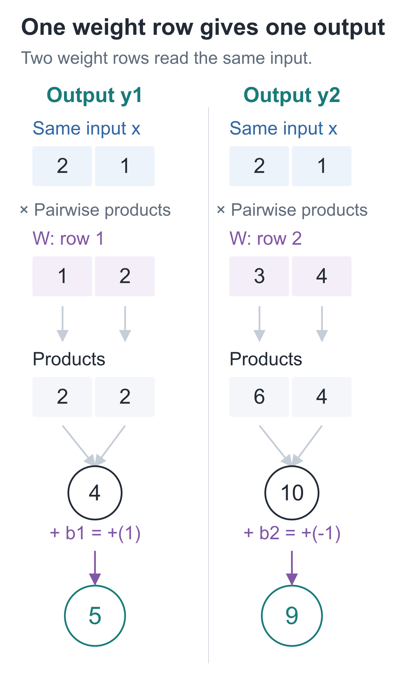
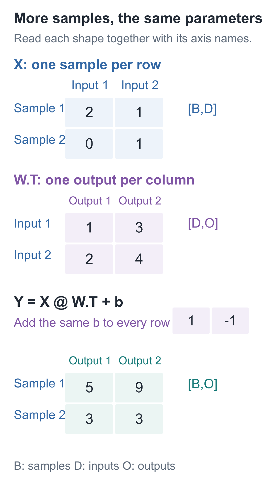

# 02 | Vectors and Matrices: Do Two Outputs Require Two Copies of the Code?

Build a Small Model, Understand Large Models · Lesson 02

Start with two familiar multiply-and-add expressions:

**2×1 + 1×2 + 1 = 5**

**2×3 + 1×4 − 1 = 9**

Both use the input `[2, 1]`; different parameters produce two different results. If we wanted a thousand results, we could copy a thousand lines. But adding one input would then require editing every line, and missing one might not trigger an immediate error.

Put the parameters in lists and let a loop read each group. Then the calculation needs to be written only once. Vectors and matrices organize exactly these kinds of numbers.

## Arrange the two parameter groups in a table

Call the repeated input `x`, place the two sets of weights in `W`, and put the two biases in `b`:

```text
x = [2, 1]
W = [[1, 2],
     [3, 4]]
b = [1, -1]
```

The first weight row `[1, 2]`, paired with the first bias 1, produces `y₁=5`. The second row `[3, 4]`, paired with the second bias −1, produces `y₂=9`.

Both parameter groups read the same input. Calculating the first output does not pass 5 to the second group; their results sit side by side as this layer's output `[5, 9]`.



Read the first parameter row first: multiply the first input cell by the first cell in this row, and the second by the second; then sum them and add this row's bias. The second row repeats the same rule. The connections here show numbers being read and multiplied; neither output depends on the other's calculation.

If you change only the first row of `W`, the second output should remain 9. Try it to check. We will leave out ReLU in this lesson so that we can see exactly which multiply-and-add operations use each parameter group.

## In the program, this table is a matrix

A single number, such as 2, is called a **scalar**. An ordered collection of numbers, such as `[2, 1]`, can represent a **vector**. Each item in a vector is also called a component.

A “two-dimensional vector” has two components here. Their order matters, because each component is multiplied by its own weight.

A table of rows of equal length is a **matrix**. Our `W` has two rows and two columns, so its shape is written `[2, 2]`.

| Object | Shape | Meaning of each position |
| --- | --- | --- |
| x | `[2]` | Two input components |
| W | `[2, 2]` | Rows select outputs; columns select inputs |
| b | `[2]` | One bias for each output |
| y | `[2]` | This layer's two results |

**One matrix row contains the complete set of weights for one output.** We use this convention throughout the series; the PyTorch parameters later will use the same orientation.

Mathematical notation often numbers two components 1 and 2; Python starts at 0. Thus the second input is `x[1]`, and the weight in the first row and second column is `W[0][1]`. An index only locates a value; it does not introduce a new operation.

## One loop calculates one output

Set the bias aside for a moment. The first weight group and input calculate:

**2×1 + 1×2 = 4**

Multiplying corresponding components of two equal-length vectors and summing the products is called a **dot product**. It takes two collections of numbers and returns one number.

Each output follows the same rule: take the dot product of the input and one weight row, then add the corresponding bias. One more parameter row gives one more output.

If the input has `D` components and we want `O` outputs, then:

```text
x：[D]
W：[O, D]
b：[O]
y：[O]
```

`D` is the number of input components, and `O` is the number of outputs. They are counts, not weights to be trained.

Why must the number of columns in `W` equal the number of input components? Each row must pair component by component with the entire input. Two inputs and three weights leave one weight with no input to multiply. Truncating a list just to keep the program running silently changes the calculation we defined.

Written compactly, this is:

**y = Wx + b**

This uses the mathematical column-vector convention: `x` is arranged vertically, each row of `W` multiplies its corresponding components, and the results are arranged vertically too. Expanding it gives exactly the two expressions above.

Many programs call this layer, including its bias, `linear`, and we use that name too. Strictly speaking, a transformation with a bias is an **affine transformation**; it is a linear transformation in this sense only when the bias is 0.

## Without copying expressions, do we still get 5 and 9?

The following code uses only standard Python features. Copy it into a file and run it. `dot` implements the dot product; `linear` reads one parameter row at a time to calculate one output.

```python
def dot(left, right):
    """Multiply two equal-length vectors element by element and sum to return a scalar."""
    if not left or len(left) != len(right):
        raise ValueError("点积的两组数必须非空且等长")
    total = 0.0
    for a, b in zip(left, right):
        total += a * b
    return total


def linear(inputs, weights, biases):
    """Combine a [D] input with [O,D] weights and [O] biases to return an [O] output."""
    if not weights or len(weights) != len(biases):
        raise ValueError("每个输出需要一行权重和一个偏置")
    outputs = []
    # Each parameter row reads the same complete input; outputs do not feed into one another.
    for row, bias in zip(weights, biases):
        outputs.append(dot(inputs, row) + bias)
    return outputs


# Each row of W corresponds to an output, each column to an input; b matches the outputs.
x = [2, 1]
W = [[1, 2], [3, 4]]
b = [1, -1]
print(dot(x, W[0]))       # 4.0
print(linear(x, W, b))    # [5.0, 9.0]
```

`zip` pairs values, the loop multiplies and adds, and `append` puts each row's result into the output list in order. The checks constrain the number of biases and, through `dot`, each row's length, preventing a matrix row from being one item short.

The printed result is still `[5, 9]`. To add a third output later, add only a weight row and a bias. In the companion project, `scalar.forward` combines the dot product and bias, and `scalar.linear` calls it for each row. It performs the same calculation.

## Does another input sample require another copy of the parameters?

We just added outputs. Now consider a different request: process one more input, `[0, 1]`, using the original parameters. Predict its result before running:

```python
# Reuse linear, W, and b from above; each row is a sample, and both samples share parameters.
samples = [[2, 1], [0, 1]]
outputs = [linear(sample, W, b) for sample in samples]
print(outputs)  # [[5.0, 9.0], [3.0, 3.0]]
```

The second input can also be checked by hand: `0×1+1×2+1=3`, and `0×3+1×4−1=3`.

A collection of samples processed together is called a **batch**. If `B` is the number of samples, the input shape is `[B, D]`. Here it is `[2, 2]`: the first axis selects a sample, and the second selects an input component within that sample.



Read this diagram along both axes: moving between rows changes the sample, while moving between columns changes the feature. The input and weights happen to both have shape `[2, 2]` here, but they mean different things. Always read shapes together with their axis names.

`X` places each sample horizontally. In matrix multiplication, a row on the left is paired with a column on the right, so we turn each weight row in `W` into a column. This is called **transposition**, written `W.T`:

```text
W = [[1, 2],       W.T = [[1, 3],
     [3, 4]]              [2, 4]]
```

Transposition swaps row and column positions without changing the values. Thus, when we use tensors later, the same layer will be written:

**Y = X @ W.T + b**

`@` means matrix multiplication. The first cell of output `Y` is still `2×1+1×2+1=5`; the algorithm has not changed. Bias `b` is added to each sample's output, so input `[B, D]` and weights `[O, D]` produce `[B, O]`.

The Python lists used in this lesson do not directly support this `@` syntax. Our loops already implement its full meaning. In Lesson 06, tensors will let the library perform these multiply-and-add operations.

Increasing the number of samples means processing more inputs of the same length. Increasing the number of features means adding a component to every input, which requires adding a weight to every weight group. These are different changes.

## Check by changing the numbers

1. In the main example, change only `W[0][1]` from 2 to 5. What are the two outputs? Does the second output change, and why?
2. One input has shape `[2]`, the weights have shape `[3, 2]`, and the biases have shape `[3]`. What is the output shape? What if you pass in 4 such samples?
3. If you add a third input component to the main example but keep the original `W`, should the program continue or raise an error?

<details class="answer" markdown="1">
<summary>Reference answers</summary>

Answers: For the first exercise, the first output becomes **2×1+1×5+1=8**, while the second remains **9**. The changed weight belongs to the first row; the second row does not read it. For the second, the output shape is **`[3]`** for one sample and **`[4, 3]`** for the batch. For the third, the program should raise an error: each weight row also needs three components to pair with the three inputs.

</details>

In the next lesson, we will use the four XOR rules to test what a multiply-and-add layer can do.

Run this from the `code` directory:

```bash
# Run this lesson from the companion code directory to check the chapter's results.
python -m lessons.l02
```

Here, `python` refers to the interpreter prepared using the [installation instructions](https://github.com/DavidDingXu/hello-llm/blob/main/code/README.md). Companion resources: [Entry point](https://github.com/DavidDingXu/hello-llm/blob/main/code/lessons/l02.py) · [List-based implementation](https://github.com/DavidDingXu/hello-llm/blob/main/code/tiny_lm/scalar.py)

Source navigation: [scalar.py · linear](https://github.com/DavidDingXu/hello-llm/blob/main/code/tiny_lm/scalar.py#L27).

<!-- chapter-navigation:start -->

---

[← Neurons](../01-neuron/README.en.md) · [Contents](../../README.en.md#course-contents) · [Multiple Layers and Nonlinearity →](../03-nonlinearity/README.en.md)

<!-- chapter-navigation:end -->
