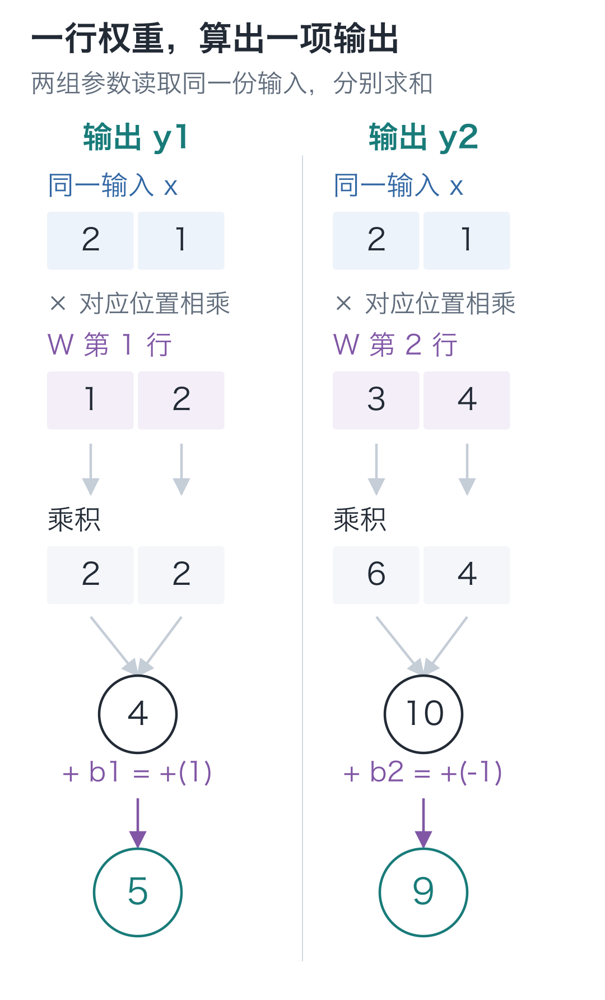
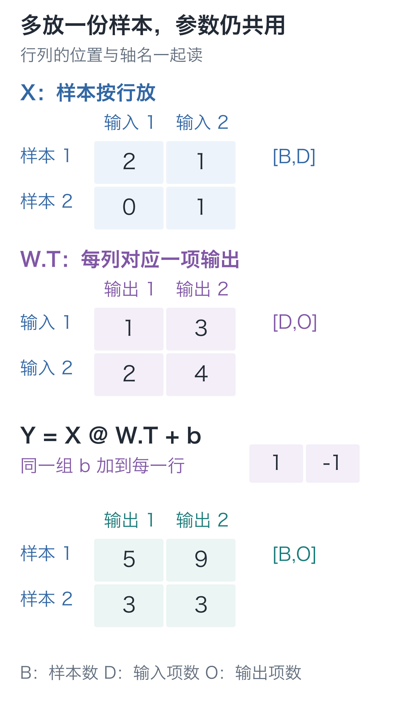

# 02｜向量与矩阵：算两个数，要复制两遍代码吗？

手写小模型，看懂大模型 · 第 02 讲

先写两行熟悉的乘加：

**2×1 + 1×2 + 1 = 5**

**2×3 + 1×4 − 1 = 9**

输入都是 `[2, 1]`，只是参数不同，就得到了两个结果。要一千个结果，也可以复制一千行。可一旦多一项输入，每行都要改，少改一行还未必立刻报错。

把参数放进列表，让循环逐组读取，计算步骤就只需写一份。向量和矩阵正好用来整理这些数。

## 把两组参数排成表

把刚才两行里重复的输入记作 `x`，两组权重放进 `W`，两个偏置放进 `b`：

```text
x = [2, 1]
W = [[1, 2],
     [3, 4]]
b = [1, -1]
```

第一行权重 `[1, 2]` 配第一个偏置 1，算出 `y₁=5`；第二行 `[3, 4]` 配第二个偏置 −1，算出 `y₂=9`。

两组参数读取的是同一份输入。第一个输出算完，并不把 5 交给第二组；它们并排组成这一层的输出 `[5, 9]`。



读图时先看第一行参数：输入的第一格乘这一行的第一格，第二格乘第二格，再汇总、加本行偏置。第二行重复同一规则。这里的连线表示数的读取和乘法，两个输出之间没有计算依赖。

只改 `W` 第一行，第二个输出应该保持 9，可以改数核对。本讲暂不加 ReLU，先看清两组参数分别参与哪些乘加。

## 程序里这张表，就是矩阵

单独的一个数，例如 2，叫作**标量**。把若干数按顺序放在一起，例如 `[2, 1]`，可以表示一个**向量**。向量中每一项也叫一个分量。

“二维向量”表示这里有两项。顺序不能随便换，因为每项都要和自己的权重相乘。

把多行等长的数排成表，就是**矩阵**。本讲的 `W` 有两行、两列，形状写作 `[2, 2]`。

| 对象 | 形状 | 每个位置表示什么 |
| --- | --- | --- |
| x | `[2]` | 两项输入 |
| W | `[2, 2]` | 行选输出，列选输入 |
| b | `[2]` | 每个输出各有一个偏置 |
| y | `[2]` | 这一层的两个结果 |

**矩阵的一行，对应一个输出所用的整组权重。** 这是本专栏始终采用的约定，后面 PyTorch 的参数也按这个方向放。

数学里常把两项编号为 1、2；Python 从 0 编号。所以第二项输入是 `x[1]`，第一行第二列的权重是 `W[0][1]`。下标只帮我们定位，不会增加一种运算。

## 一个循环，算出一个输出

暂时放下偏置。第一组权重与输入的计算是：

**2×1 + 1×2 = 4**

两个等长向量，对应位置相乘再求和，叫作**点积**。它接收两组数，返回一个数。

每个输出都按同一条规则算：输入与一行权重点积，再加对应偏置。多一行参数，就多一个输出。

若输入有 `D` 项、需要 `O` 项输出，那么：

```text
x：[D]
W：[O, D]
b：[O]
y：[O]
```

`D` 是输入项数，`O` 是输出项数。它们是计数，不是待训练的权重。

为什么 `W` 的列数必须等于输入项数？因为每一行都要与完整输入逐项配对。两项输入配三项权重，会多出一个没有输入可乘的数；靠截断列表让程序跑下去，会悄悄改变我们定义的计算。

把这件事写成紧凑公式，就是：

**y = Wx + b**

这里采用数学中的列向量记法：`x` 竖着排，`W` 的每一行与它对应相乘，结果也竖着排。展开后正是前面的两条算式。

很多代码把带偏置的这一层叫 `linear`，本栏也沿用这个名字。严格说，带偏置的变换叫**仿射变换**；偏置为 0 时才是这里所说的线性变换。

## 不复制算式，结果还是 5 和 9 吗？

下面的代码只用 Python 标准功能，复制到一个文件就能运行。`dot` 实现点积，`linear` 每次取一行参数，算出一个输出。

```python
def dot(left, right):
    """两个等长向量逐项相乘并求和，返回一个标量。"""
    if not left or len(left) != len(right):
        raise ValueError("点积的两组数必须非空且等长")
    total = 0.0
    for a, b in zip(left, right):
        total += a * b
    return total


def linear(inputs, weights, biases):
    """[D] 输入配 [O,D] 权重与 [O] 偏置，返回 [O] 输出。"""
    if not weights or len(weights) != len(biases):
        raise ValueError("每个输出需要一行权重和一个偏置")
    outputs = []
    # 每行参数都读取完整的同一份输入，输出之间不串联。
    for row, bias in zip(weights, biases):
        outputs.append(dot(inputs, row) + bias)
    return outputs


# W 每行对应一个输出，每列对应一项输入；b 按输出配对。
x = [2, 1]
W = [[1, 2], [3, 4]]
b = [1, -1]
print(dot(x, W[0]))       # 4.0
print(linear(x, W, b))    # [5.0, 9.0]
```

`zip` 负责配对，循环负责乘加，`append` 将每一行的结果依次装进输出列表。检查既约束偏置数量，也会通过 `dot` 检查每行长度，防止矩阵某一行少一项。

打印结果仍是 `[5, 9]`。以后需要第三个输出，只需再加一行权重和一个偏置。配套工程的 `scalar.forward` 合并点积与偏置，`scalar.linear` 再逐行调用，算的也是这件事。

## 再来一份输入，参数要不要复制？

刚才增加的是输出。现在换个要求：再算一份输入 `[0, 1]`，还用原来那组参数。先判断第二份会得到什么，再运行：

```python
# 沿用前段的 linear、W、b；每行是一份样本，两份样本共用参数。
samples = [[2, 1], [0, 1]]
outputs = [linear(sample, W, b) for sample in samples]
print(outputs)  # [[5.0, 9.0], [3.0, 3.0]]
```

第二份输入的结果也能手算：`0×1+1×2+1=3`，`0×3+1×4−1=3`。

把多份样本放在一起，叫作一个**批次**，英文是 batch。用 `B` 表示样本数，输入形状就是 `[B, D]`。这里是 `[2, 2]`，第一根轴选样本，第二根轴选样本里的输入项。



这张图要沿两根轴读：上下换行是在换样本，左右换列是在换特征。输入和权重在本例恰好都为 `[2, 2]`，但含义不同；看形状时必须连同轴名一起看。

`X` 把每个样本横着放。做矩阵乘法时，左边的行要与右边的列配对，所以把 `W` 的每行权重翻成一列。这叫**转置**，记作 `W.T`：

```text
W = [[1, 2],       W.T = [[1, 3],
     [3, 4]]              [2, 4]]
```

转置只交换行列位置，数值不变。因此，后面使用 Tensor 时，同一层会写成：

**Y = X @ W.T + b**

`@` 表示矩阵乘法。输出 `Y` 的第一个格子仍是 `2×1+1×2+1=5`，没有换算法。偏置 `b` 分别加到每个样本的输出上，所以输入 `[B, D]`、权重 `[O, D]`，最终得到 `[B, O]`。

本讲的 Python 列表不直接支持这个 `@` 写法，循环已经完整实现了它的含义。第 06 讲换成 Tensor 后，再让库执行这些乘加。

增加样本数，是多处理几份同长度输入；增加特征数，是每份输入里多一项，需要给每一组权重都补一项。这两种改变不能混为一谈。

## 改数检查

1. 仍用主算例，只把 `W[0][1]` 从 2 改成 5。两个输出各是多少？第二个输出是否改变，为什么？
2. 一份输入形状为 `[2]`，权重形状为 `[3, 2]`，偏置形状为 `[3]`。输出形状是什么？若放入 4 份这样的样本呢？
3. 主算例增加第三项输入，却保持原来的 `W`，程序应该继续算还是报错？

<details class="answer" markdown="1">
<summary>参考答案</summary>

答案：第一题，第一个输出变成 **2×1+1×5+1=8**，第二个仍是 **9**。修改的权重属于第一行，第二行没有读取它。第二题，单样本输出是 **`[3]`**，批次输出是 **`[4, 3]`**。第三题，应该报错；每行权重也要有三项，才能与三项输入配对。

</details>

下一讲用四条 XOR 规则，检查这样的乘加层能做到什么。

在 `code` 目录运行：

```bash
# 在配套代码目录运行本讲实验，核对正文中的结果。
python -m lessons.l02
```

这里的 `python` 指按[安装说明](https://github.com/DavidDingXu/hello-llm/blob/main/code/README.md)准备的解释器。配套入口：[运行入口](https://github.com/DavidDingXu/hello-llm/blob/main/code/lessons/l02.py) · [列表版实现](https://github.com/DavidDingXu/hello-llm/blob/main/code/tiny_lm/scalar.py)

源码导航：[scalar.py · linear](https://github.com/DavidDingXu/hello-llm/blob/main/code/tiny_lm/scalar.py#L27)。

<!-- chapter-navigation:start -->

---

[← 神经元](../01-neuron/README.md) · [课程目录](../../README.md#课程目录) · [多层与非线性 →](../03-nonlinearity/README.md)

<!-- chapter-navigation:end -->
