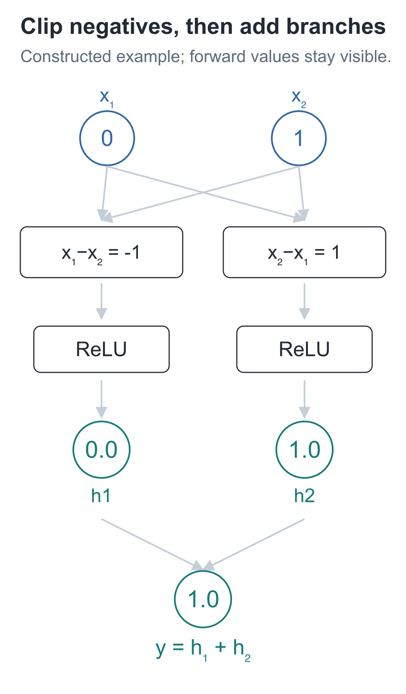
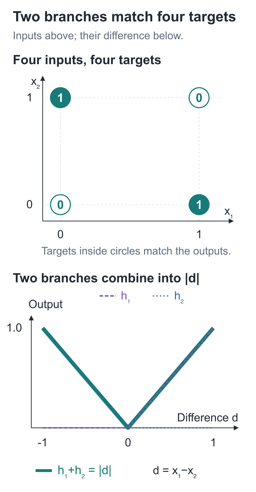

# 03 | Nonlinearity: Why Can Multiply-and-Add Not Express Four Simple Rules?

Build a Small Model, Understand Large Models · Lesson 03

If two inputs are the same, output 0; if they differ, output 1. With `if` statements, this takes only a few lines.

The multiply-and-add function from the previous lesson has more trouble. Can we choose one set of parameters that produces all four results below, without writing a separate rule for each input? Try filling in the weights and bias first.

| x₁ | x₂ | Target output |
| --- | --- | --- |
| 0 | 0 | 0 |
| 0 | 1 | 1 |
| 1 | 0 | 1 |
| 1 | 1 | 0 |

These four rules are called **exclusive OR**, usually written XOR. They make a convenient test for a function: every answer is known, so any unmet requirement is immediately visible.

## The first three rows work, but the fourth does not

The simplest attempt is a multiply-and-add function:

**y = a×x₁ + b×x₂ + c**

Try to fit the table exactly. Input `(0, 0)` must produce 0, forcing `c=0`. Input `(1, 0)` must produce 1, forcing `a=1`. Input `(0, 1)` must also produce 1, forcing `b=1`.

All three parameters are now fixed. The fourth input, `(1, 1)`, can only produce **1+1=2**, although its target is 0. Changing parameters would break the first three requirements.

The first three rows determine the parameters, and the fourth conflicts with them. This affine function cannot meet all four targets exactly.

## Can another layer get around the problem?

In Lesson 01, we expanded two multiply-and-add operations for one input and still obtained a straight line. The same applies to vectors.

If we first calculate `h=Ax+a`, then `y=Bh+b`, substituting the first expression into the second gives:

**y = B(Ax+a)+b = (BA)x + (Ba+b)**

Uppercase `A` and `B` are the two weight matrices; lowercase `a` and `b` are the two biases. All are fixed during this calculation. The combined `BA` is a new set of weights, and `Ba+b` is a new bias. The two layers still combine into one multiply-and-add transformation of the original input.

Copying another multiply-and-add layer therefore brings us back to the same contradiction involving those three parameters. This is where the ReLU introduced in Lesson 01 helps: between multiply-and-add operations, it preserves a bend that cannot be eliminated by expansion.

## Remove negative differences before adding

Look back at the four targets. Equal inputs have a difference of 0. Unequal inputs may have a difference of 1 or −1, and we want both cases to produce positive 1.

We can calculate the difference in both directions. Adding them directly would cancel them, so each branch first removes its negative half.

The first branch calculates `x₁−x₂`, then passes it through the ReLU from Lesson 01:

**h₁ = ReLU(x₁−x₂)**

It keeps the positive difference when `x₁>x₂` and returns 0 otherwise. The second branch reverses the order:

**h₂ = ReLU(x₂−x₁)**

It keeps the positive difference when `x₂>x₁`. Finally, add the two:

**y = h₁+h₂**



Follow one branch all the way through before reading the other: first inspect the subtraction result, then whether ReLU sets it to 0, and finally how the surviving value enters the output layer. With fixed parameters, different inputs can put the same branch in different intervals.

For input `(0, 1)`, the first branch gives `−1`, then 0 after ReLU; the second gives `1`, which remains 1. Adding them gives 1, exactly this row's target.

Place the two multiply-and-add results side by side as `z=[z₁,z₂]`, store their ReLU outputs as `h=[h₁,h₂]`, and finally add the two components of h. The four inputs produce:

| Input | z | h | Output y |
| --- | --- | --- | --- |
| `[0,0]` | `[0,0]` | `[0,0]` | 0 |
| `[0,1]` | `[−1,1]` | `[0,1]` | 1 |
| `[1,0]` | `[1,−1]` | `[1,0]` | 1 |
| `[1,1]` | `[0,0]` | `[0,0]` | 0 |

This time, the fourth row also produces 0, so all four requirements are met. `z` contains the values after multiply-and-add; `h` contains the values after ReLU. Comparing these columns shows exactly where the result changes.

Write both differences using a single variable, `d=x₁−x₂`. The output is `ReLU(d)+ReLU(−d)`: negate the negative half and keep the positive half, giving `|d|` overall.



The line plot's horizontal axis is the **difference `d`**, and its vertical axis shows each branch or their sum. The four-point plot instead uses `x₁` and `x₂` as the two input axes, with targets shown inside the dots. Compare them with the network outputs in the table.

Fractional inputs also produce the absolute difference between the two components, but the four binary rules do not specify targets for these new inputs. We will test this distinction with `[0.5, 1]` at the end.

## Put the two branches back into a network

Arrange the branches as matrices from the previous lesson. The parameters are:

```text
W1 = [[ 1, -1],     b1 = [0, 0]
      [-1,  1]]

W2 = [[1, 1]]       b2 = [0]
```

The first layer has two outputs, `h₁` and `h₂`. Because they sit between the original input and the final output, this is called a **hidden layer**. The second layer reads them and produces one output.

The structure is abbreviated **2→2→1**: two input components, two hidden units, and one output. The two input points hold data and do not receive an additional parameter set. The trainable parameters are `W1`, `b1`, `W2`, and `b2`: `4+2+2+1=9` numbers altogether.

We can explain each hidden value here because we constructed the parameters ourselves. Dimensions in a general network do not automatically correspond to meanings assigned in advance. This example applies ReLU only in the hidden layer; the output layer directly adds the two components.

## Change one line and see whether the behavior disappears

Run the following from the companion code directory to print the four results, then remove ReLU and run it again. The imported `linear` performs multiply-and-add row by row, and `relu` computes `max(0, value)`. Only standard Python features are needed.

```python
from tiny_lm.scalar import linear, relu


def forward(inputs, params):
    """用两层参数计算一份输入，返回预测值和本次的中间结果。"""
    # 第一层每行权重产生一个 z，再逐项经过 ReLU 得到隐藏值。
    z = linear(inputs, params["W1"], params["b1"])
    hidden = [relu(value) for value in z]
    # 输出层读取两个隐藏值；它只做乘加，列表中只有一个结果。
    prediction = linear(hidden, params["W2"], params["b2"])[0]
    # 缓存输入、激活前后数值，后面反向计算会读取它们；这里不改参数。
    cache = {
        "x": list(inputs), "z": z, "h": hidden,
        "prediction": prediction,
    }
    return prediction, cache


# 手工指定两条差值分支的参数；W1 的两行对应两个隐藏单元。
params = {
    "W1": [[1, -1], [-1, 1]], "b1": [0, 0],
    "W2": [[1, 1]], "b2": [0],
}
samples = [[0, 0], [0, 1], [1, 0], [1, 1]]
for x in samples:
    # 四份输入复用同一组参数，分别查看 z、ReLU 后的 h 与最终输出。
    prediction, cache = forward(x, params)
    print(x, cache["z"], cache["h"], prediction)
```

`params` stores the four parameter groups in a dictionary; `params["W1"]` retrieves the first layer's weights. The first layer returns two numbers, and the list comprehension sends each through ReLU. The second layer returns just one number, so `[0]` extracts it.

`cache` is a dictionary of saved intermediate results. Printing it helps us check the calculation now; in Lesson 05, gradient calculations will also use these forward-pass values. **Saving a cache does not adjust parameters.** `forward` calculates from the input all the way to the output; this is called the **forward pass**.

After obtaining `[0, 1, 1, 0]`, keep every parameter unchanged and replace only `hidden = [relu(value) for value in z]` with `hidden = z`. Run it again, and the output becomes:

**y = (x₁−x₂)+(x₂−x₁)=0**

All four results become 0. The negative differences previously removed by ReLU return and cancel the positive differences.

ReLU handles positive and negative values using the same rule for every sample. Combined with these 9 parameters, it makes all four XOR targets achievable at once. The parameters are still chosen by hand; no training has taken place.

## Two exercises with changed numbers

1. Keep ReLU and change the input to `[0.5, 1]`. What are the two branches' `z` and `h` values, and the final output? Is that output uniquely determined by the four training targets?
2. Remove ReLU and try inputs `[0, 1]` and `[1, 0]`. What are the results? Could another set of purely multiply-and-add parameters fit all four XOR targets exactly?

<details class="answer" markdown="1">
<summary>Reference answers</summary>

Answers: For the first exercise, `z=[−0.5, 0.5]`, `h=[0, 0.5]`, and the output is **0.5**. It is determined by the current function and parameters; the four binary targets do not specify an answer for this new input. For the second, both outputs are **0**. Changing parameters still cannot meet all four requirements exactly, because all purely multiply-and-add layers can still be combined into one affine function, and the original contradiction remains.

</details>

Run this from the `code` directory:

```bash
# 在配套代码目录运行本讲实验，核对正文中的结果。
python -m lessons.l03
```

Companion resources: [Entry point](https://github.com/DavidDingXu/hello-llm/blob/main/code/lessons/l03.py) · [Two-layer forward implementation](https://github.com/DavidDingXu/hello-llm/blob/main/code/tiny_lm/manual_mlp.py) · [Environment setup](https://github.com/DavidDingXu/hello-llm/blob/main/code/README.md)

Source navigation: [manual_mlp.py · forward](https://github.com/DavidDingXu/hello-llm/blob/main/code/tiny_lm/manual_mlp.py#L10).

<!-- chapter-navigation:start -->

---

[← Vectors and Matrices](../02-vectors-and-matrices/README.en.md) · [Contents](../../README.en.md#course-contents) · [Gradients and Parameter Updates →](../04-gradients/README.en.md)

<!-- chapter-navigation:end -->
