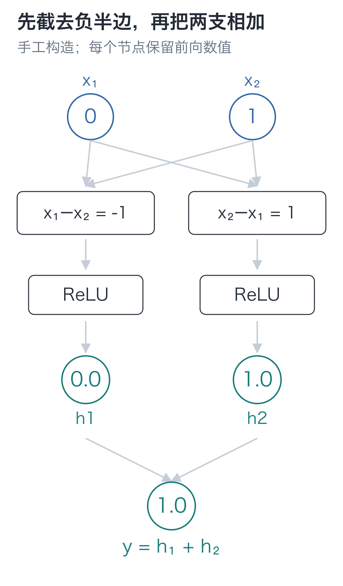
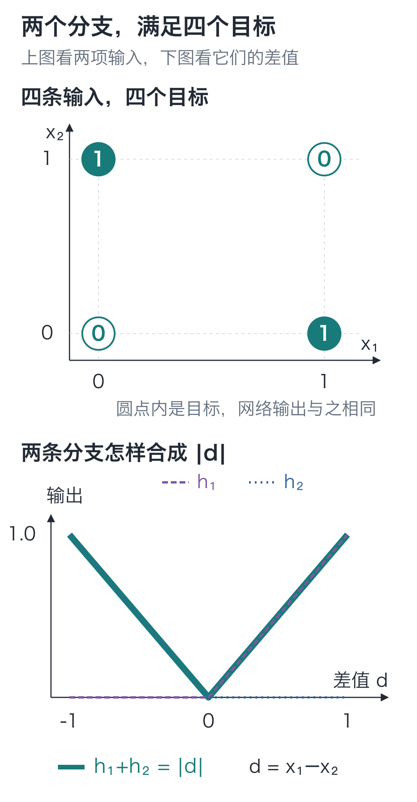

# 03｜非线性：四行规则，为什么乘加函数做不到？

手写小模型，看懂大模型 · 第 03 讲

两个输入相同，输出 0；不同，输出 1。用 `if` 写，几行就结束了。

换成上一讲的乘加函数，事情却没有这么顺。能不能挑出一组参数，不为每一种输入单独写规则，就同时给出下面四个结果？可以先试着填一填权重和偏置。

| x₁ | x₂ | 目标输出 |
| --- | --- | --- |
| 0 | 0 | 0 |
| 0 | 1 | 1 |
| 1 | 0 | 1 |
| 1 | 1 | 0 |

这四条规则叫**异或**，常写作 XOR。用它检查函数很方便：全部答案都已知，哪条没满足立刻看得见。

## 前三行都对，第四行却不对了

最朴素的办法是写一个乘加函数：

**y = a×x₁ + b×x₂ + c**

试着让它精确满足上表。输入 `(0, 0)` 要得到 0，迫使 `c=0`；输入 `(1, 0)` 要得到 1，接着迫使 `a=1`；输入 `(0, 1)` 要得到 1，又迫使 `b=1`。

三个参数已经确定。第四个输入 `(1, 1)` 只能得到 **1+1=2**，目标却是 0。换参数就会破坏前三条要求。

前三条已把参数定死，第四条与它们冲突。这个仿射函数无法精确满足四个目标。

## 再接一层，能绕过去吗？

第一讲用单输入算过：两次乘加展开后，仍是一条直线。现在换成向量也一样。

若先算 `h=Ax+a`，再算 `y=Bh+b`，把第一式代入第二式：

**y = B(Ax+a)+b = (BA)x + (Ba+b)**

大写 `A、B` 是两层权重矩阵，小写 `a、b` 是两层偏置；它们在这次计算中固定。合起来的 `BA` 是一组新权重，`Ba+b` 是一组新偏置。两层仍可合并成对原输入的一次乘加。

所以，再抄一层乘加，最后仍会回到那三项参数的矛盾。第一讲加入的 ReLU 在这里就有用了：它能在乘加之间保留一次无法被展开消掉的转折。

## 相加之前，把负差值截掉

回看四条目标。两项一样时，差值为 0；不一样时，差值可能是 1，也可能是 −1。我们希望这两种情况都得到正的 1。

可以把两个方向的差值各算一遍。直接相加会抵消，所以每条分支先截去负半边。

第一条分支计算 `x₁−x₂`，再交给第01讲认识的 ReLU：

**h₁ = ReLU(x₁−x₂)**

当 `x₁>x₂` 时保留正差值，反过来就变成 0。第二条分支交换顺序：

**h₂ = ReLU(x₂−x₁)**

它在 `x₂>x₁` 时保留正差值。最后相加：

**y = h₁+h₂**



沿图中一条分支读完再换另一条：先看减法结果，再看 ReLU 是否把它置为 0，最后看留下的值怎样进入输出层。参数固定时，同一分支会因输入不同而进入不同区间。

以输入 `(0, 1)` 为例：第一条分支先得 `−1`，ReLU 后是 0；第二条分支先得 `1`，ReLU 后还是 1。两者相加得 1，正好是这一行的目标。

把两个乘加结果并排放成 `z=[z₁,z₂]`，ReLU处理后放成 `h=[h₁,h₂]`，最后将 h 的两项相加。四条输入得到：

| 输入 | z | h | 输出 y |
| --- | --- | --- | --- |
| `[0,0]` | `[0,0]` | `[0,0]` | 0 |
| `[0,1]` | `[−1,1]` | `[0,1]` | 1 |
| `[1,0]` | `[1,−1]` | `[1,0]` | 1 |
| `[1,1]` | `[0,0]` | `[0,0]` | 0 |

这次第四行也得到 0，四条要求同时满足。`z` 是乘加后的值，`h` 是 ReLU 处理后的值；对照这两列，就能找到结果改变的那一步。

再把两个差值都记在一个变量 `d=x₁−x₂` 上，输出就是 `ReLU(d)+ReLU(−d)`：负半边取相反数，正半边保留，整体得到 `|d|`。



折线图横轴是**差值 `d`**，纵轴是各分支或相加后的数值。四点图则以 `x₁、x₂` 为两根输入轴，圆点内标目标；可以与上表的网络输出核对。

小数输入也会得到两项的绝对差，但四条二值规则没有规定新输入的目标。文末会用 `[0.5, 1]` 检查这个区别。

## 把刚才两条分支装回网络

把两条分支排成上一讲的矩阵，参数就是：

```text
W1 = [[ 1, -1],     b1 = [0, 0]
      [-1,  1]]

W2 = [[1, 1]]       b2 = [0]
```

第一层有两个输出，分别是 `h₁、h₂`。它们位于原始输入和最终输出之间，所以这层叫**隐藏层**。第二层读取它们，得到一个输出。

整个结构简写为 **2→2→1**：两项输入、两个隐藏单元、一项输出。输入的两个点只放数据，不另外配一组权重；可训练参数是 `W1、b1、W2、b2`，共 `4+2+2+1=9` 个数。

这里可以逐项解释隐藏值，因为参数是我们亲手构造的。一般网络的各维不会自动对应预先指定的含义。本例只在隐藏层加 ReLU，输出层直接把两项相加。

## 只改一行，看看结果会不会消失

在配套代码目录运行下面的代码，打印四条输入的结果，再去掉 ReLU 重跑。导入的 `linear` 做逐行乘加，`relu` 做 `max(0, value)`，只需 Python 标准功能。

```python
from tiny_lm.scalar import linear, relu


def forward(inputs, params):
    """用两层参数计算一份输入，返回预测值和本次的中间结果。"""
    # 第一层每行权重产生一个 z，再逐项经过 ReLU 得到隐藏值。
    z = linear(inputs, params["W1"], params["b1"])
    hidden = [relu(value) for value in z]
    # 输出层读取两个隐藏值；它只做乘加，列表中只有一个结果。
    prediction = linear(hidden, params["W2"], params["b2"])[0]
    # 缓存输入、激活前后数值，后面反向计算会读取它们；这里不改参数。
    cache = {
        "x": list(inputs), "z": z, "h": hidden,
        "prediction": prediction,
    }
    return prediction, cache


# 手工指定两条差值分支的参数；W1 的两行对应两个隐藏单元。
params = {
    "W1": [[1, -1], [-1, 1]], "b1": [0, 0],
    "W2": [[1, 1]], "b2": [0],
}
samples = [[0, 0], [0, 1], [1, 0], [1, 1]]
for x in samples:
    # 四份输入复用同一组参数，分别查看 z、ReLU 后的 h 与最终输出。
    prediction, cache = forward(x, params)
    print(x, cache["z"], cache["h"], prediction)
```

`params` 用字典保存四组参数，`params["W1"]` 取第一层权重。第一层返回两个数；列表推导式将它们分别送入 ReLU。第二层只返回一个数，所以用 `[0]` 取出这一项。

`cache` 是一个保存中间结果的字典，英文意思是缓存。此时把它打印出来便于核对；第 05 讲计算梯度还会用到这些前向数值。**保存缓存不会调整参数。** `forward` 从输入一路算到输出，这个过程叫**前向计算**。

得到 `[0, 1, 1, 0]` 后，保持全部参数不动，只把 `hidden = [relu(value) for value in z]` 改成 `hidden = z`。再次运行，输出变成：

**y = (x₁−x₂)+(x₂−x₁)=0**

四个结果全变成了 0：之前被 ReLU 截掉的负差值重新回来，把正差值抵消了。

ReLU 按正负数处理，对所有样本使用同一条规则。它与这 9 个参数组合后，四条 XOR 目标才同时得到满足。参数目前仍是手工挑的，尚未训练。

## 两道改数题

1. 保留 ReLU，把输入改成 `[0.5, 1]`。两条分支的 `z、h` 和最终输出分别是多少？这个输出是由四条训练目标唯一决定的吗？
2. 去掉 ReLU，分别输入 `[0, 1]` 和 `[1, 0]`，结果是什么？换一组纯乘加参数，能否精确满足四条 XOR 目标？

<details class="answer" markdown="1">
<summary>参考答案</summary>

答案：第一题，`z=[−0.5, 0.5]`、`h=[0, 0.5]`，输出 **0.5**。它由当前函数和参数决定，四条二值目标没有规定这份新输入的答案。第二题，两个输出都为 **0**；换参数仍不能同时精确满足四条要求，因为所有纯乘加层仍能合并成一个仿射函数，开头的矛盾仍然成立。

</details>

在 `code` 目录运行：

```bash
# 在配套代码目录运行本讲实验，核对正文中的结果。
python -m lessons.l03
```

配套入口：[运行入口](https://github.com/DavidDingXu/hello-llm/blob/main/code/lessons/l03.py) · [两层前向实现](https://github.com/DavidDingXu/hello-llm/blob/main/code/tiny_lm/manual_mlp.py) · [环境说明](https://github.com/DavidDingXu/hello-llm/blob/main/code/README.md)

源码导航：[manual_mlp.py · forward](https://github.com/DavidDingXu/hello-llm/blob/main/code/tiny_lm/manual_mlp.py#L10)。

<!-- chapter-navigation:start -->

---

[← 向量与矩阵](../02-vectors-and-matrices/README.md) · [课程目录](../../README.md#课程目录) · [梯度与参数更新 →](../04-gradients/README.md)

<!-- chapter-navigation:end -->
