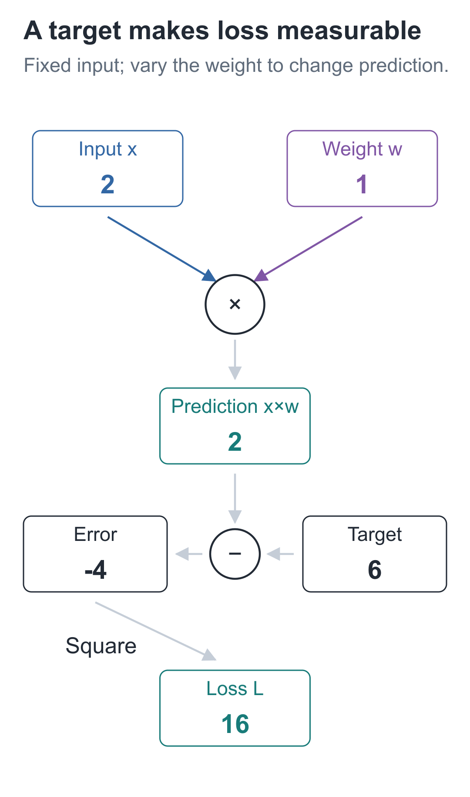
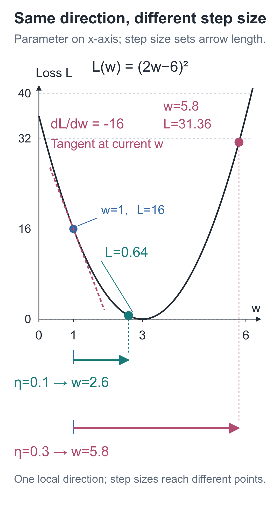
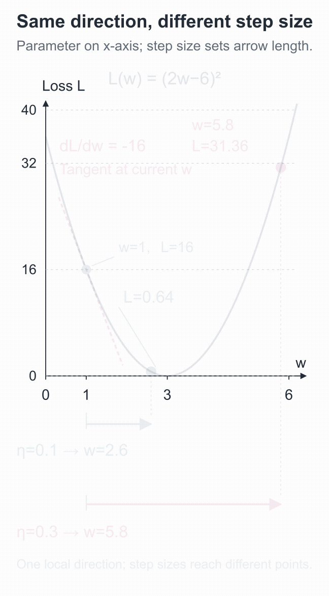
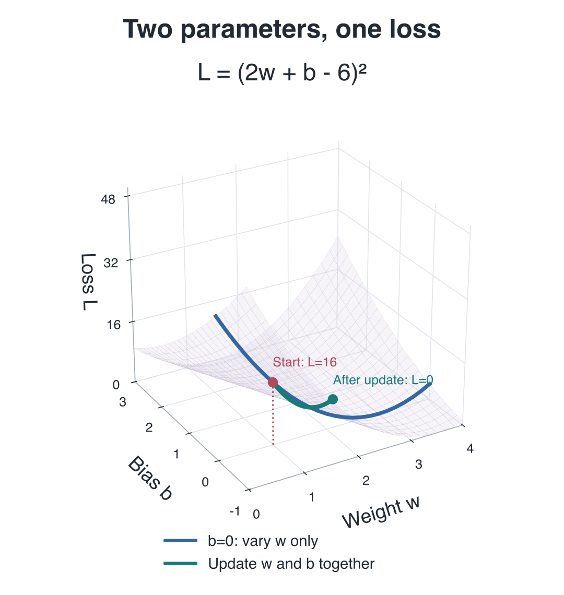

# 04 | Gradients: Why Can an Update in the Right Direction Make Things Worse?

Build a Small Model, Understand Large Models · Lesson 04

The prediction is only 2, while the target is 6. We adjust the parameter in a direction that increases the prediction, but it reaches 11.6—farther from the target than before.

The function is `prediction=2w`: the input stays fixed at 2, and only weight `w` changes. Trying again from the same starting point and in the same direction, but with a smaller step, leaves the prediction at 5.2.

Why do identical directions produce such different results? First, we need a number that lets us compare how wrong a prediction is.

## Equal distances from the target should receive equal scores

Starting at `w=1`, the prediction is 2. Subtracting the target 6 gives −4. If the prediction becomes 10, the difference is 4. Both are equally far from the target, but their signs differ. Across several data points, positive and negative differences might even cancel.

A simple solution is to square the difference:

**L = (prediction−target)²**

`L` is called the **loss**. A larger difference produces a larger square; a prediction exactly equal to the target has loss 0. We can now use the same measure regardless of which side of the target the prediction falls on.

This example has only one prediction, so:

**L(w) = (2w−6)²**

Substituting `w=1` gives **L(1)=(2−6)²=16**.

Calculating the squared error for each of several predictions and taking their average gives the **mean squared error**, or MSE. With only one prediction here, the MSE is simply this square.



The current loss in the diagram is 16. We will compare trial parameter changes against it.

## Move only from 1 to 1.1

Increase only `w` from 1 to 1.1, keeping everything else fixed, and check whether the loss decreases.

The prediction rises from 2 to 2.2, and the loss falls from 16 to **(2.2−6)²=14.44**. Increasing the weight has indeed brought this prediction closer to the target.

But “a decrease of 1.56” does not yet describe the ratio between the parameter change and the loss change. Divide the change in loss by the change in the parameter:

**(14.44−16) ÷ (1.1−1) = −15.6**

Over this short interval, increasing the weight by 1 unit changes the loss by approximately −15.6 units on average. The actual weight increase was only 0.1, so the actual loss change is this rate multiplied by 0.1.

Keep shrinking the trial step:

| Weight change | New weight | New loss | Loss change ÷ weight change |
| --- | --- | --- | --- |
| +0.1 | 1.1 | 14.44 | −15.6 |
| +0.01 | 1.01 | 15.8404 | −15.96 |
| +0.001 | 1.001 | 15.984004 | −15.996 |

As the trial step shrinks, the ratio approaches **−16**, describing the behavior **near** `w=1` more closely.

## Why do these ratios approach −16?

This local rate of change at a particular point is called a **derivative**, written:

**dL/dw = −16, at w=1**

The whole expression `dL/dw` means “the local rate of change of loss with respect to weight.” `L` and `w` identify the two quantities being compared. The negative sign tells us that a small increase in `w` at this point decreases the loss.

It also estimates sufficiently small changes: if `Δw` is small, the loss change is approximately **−16×Δw**. For an increase of 0.01, for example, the estimated loss change is −0.16. The actual change is −0.1596: close, but not identical.

For this example, we can derive the rate directly. Let `δ` denote a small change in the weight:

```text
L(w+δ) = (2w−6+2δ)²
       = (2w−6)² + 4(2w−6)δ + 4δ²

[L(w+δ)−L(w)] / δ = 4(2w−6) + 4δ
```

As `δ` approaches 0, `4δ` on the right approaches 0, leaving:

**dL/dw = 4(2w−6)**

At `w=1`, this is `4×(2−6)=−16`. The expression applies to any `w` in this example, but the derivative's value varies by position. At `w=4`, it is 8; at `w=3`, where the prediction is exactly 6, it is 0.

On a curve, the derivative is the local slope at the current point. It describes nearby changes; it does not promise that moving arbitrarily far in that direction will remain beneficial.

## Back to the opening: why does the same −16 give two different results?

We now know that a small increase in the weight helps when starting from `w=1`. But the derivative describes only the local neighborhood. Adding its full opposite, 16, to the weight would jump to `w=17`, far beyond the position that predicts 6.

We need another positive multiplier to scale the update to a suitable size. This is the **learning rate**, denoted `η`. First, choose `η=0.1`:

**new w = old w − learning rate×derivative**

**w_new = 1−0.1×(−16)=2.6**

The derivative is negative, so subtracting it increases the weight. Run the forward calculation again:

**prediction = 2×2.6=5.2**

**L = (5.2−6)²=0.64**

The loss drops from 16 to 0.64. This update helps, although it has not yet reached this example's optimum, `w=3`.



The horizontal axis is weight `w`, and the vertical axis is loss `L(w)`. Find `w=1` on the curve, then compare where each update lands. The negative derivative sets the arrow's direction; the learning rate also determines its length.

Start again at the original `w=1`, with the same derivative of −16, and change only the learning rate to 0.3. The new weight becomes **5.8**, the prediction becomes 11.6, and the loss becomes **(11.6−6)²=31.36**. This is how the opening update made things worse.

**Even an update in the local downhill direction can increase the loss if the step is too large.**



The animation connects the current point, local slope, and new landing point. In the [interactive demo](https://daviddingxu.github.io/hello-llm/chapters/04-gradients/walkthrough.en.html), pause at the result of each step size and compare where it lands on the curve.

## Does the method still work if we add a bias?

Add an adjustable bias to the prediction: `prediction=2w+b`. To inspect `w`'s effect, temporarily hold `b` fixed; to inspect `b`'s effect, hold `w` fixed.

A rate of change that varies one parameter while keeping the others fixed is called a **partial derivative**, marked with `∂`:

```text
∂L/∂w = 4(prediction−6)
∂L/∂b = 2(prediction−6)
```

At `w=1` and `b=0`, the two partial derivatives are −16 and −8. The weight affects the prediction through the input multiplier 2, while the bias is added directly, so their effects differ.

Put these partial derivatives in their corresponding parameter positions, and we obtain the **gradient**, `[-16, -8]`.

The earlier update experiment changed only `w`, keeping `b` at 0. If we train both parameters together, first calculate both partial derivatives at the same old parameter values, then update both together. The next lesson will develop this in a multilayer network.

## Put both parameters in the same plot

The loss is now **L(w,b)=(2w+b−6)²**. The two horizontal axes represent `w` and `b`, and the height represents loss. Each parameter pair corresponds to one point on the surface.



The blue line fixes `b` at 0, giving the parabola from our earlier weight-only updates. Starting from `w=1` and `b=0`, with learning rate 0.1, applying the gradient `[-16,-8]` to both parameters reaches `w=2.6` and `b=0.8`: the prediction is 6 and the loss is 0. Both parameters jointly determine one height; they do not have separate, unrelated losses.

In the [3D demo](https://daviddingxu.github.io/hello-llm/chapters/04-gradients/lab3d.en.html), rotate the view, adjust each parameter, and compare “update only w” with “update both.” The valley floor is not a single point: any pair satisfying `2w+b=6` has loss 0 on this problem. One training example is not enough to determine these two parameters uniquely.

## In code, rerun with just one learning rate changed

The following code uses only standard Python features. A central difference tries `w+ε` and `w−ε`, then estimates the derivative from the loss difference on the two sides. It is useful for checking hand calculations. Here, `ε` corresponds to `epsilon` in the code; the two trial weights are `2ε` apart, so divide the loss difference by `2ε`.

```python
# Keep the input and target fixed; this example changes only the scalar parameter w.
x, target = 2.0, 6.0


def loss_at(w):
    """Predict using the given weight and return the squared error against the target."""
    prediction = x * w
    return (prediction - target) ** 2


def central_difference(function, w, epsilon=1e-5):
    """Evaluate both sides of the weight and use the loss difference to estimate its derivative."""
    return (function(w + epsilon) - function(w - epsilon)) / (2 * epsilon)


w = 1.0
print("Input, weight, target:", x, w, target)
print("Current prediction and loss:", x * w, loss_at(w))
for delta in [0.1, 0.01, 0.001]:
    # This is the average rate of change over a small interval; smaller delta approaches the local derivative.
    rate = (loss_at(w + delta) - loss_at(w)) / delta
    print("Perturbation, rate of change:", delta, rate)

# Multiply the squared error's derivative with respect to the prediction by x, the prediction's derivative with respect to w.
gradient = 2 * (x * w - target) * x
print("Analytic and finite-difference derivatives:", gradient, central_difference(loss_at, w))

for learning_rate in [0.1, 0.3]:
    # Start both trials from the original w to compare step sizes; do not continue from the first update.
    new_w = w - learning_rate * gradient
    print("Learning rate, new weight, new loss:", learning_rate, new_w, loss_at(new_w))
```

The derivative formula first takes the rate of change of squared error with respect to the difference, `2×(prediction−target)`, then multiplies it by the rate of change of the prediction with respect to the weight, `x`. The next lesson will explain why rates of change multiply along a chain of calculations.

Both learning rates start from the original `w=1`. The code does not use the first update's result as the second update's starting point. Floating-point rounding may affect the final decimal digits, so compare to an appropriate precision.

Finite differences require two extra loss calculations per parameter. A network with 9000 parameters would need 18000 additional calculations for this input. In the next lesson, we will calculate these gradients with backpropagation.

## Two exercises on locality and step size

1. Change only the input from 2 to `x=1`, keeping `w=1`, target 6, and learning rate 0.1. What are the derivative, new weight, and loss after the update? Can you reuse the original derivative of −16?
2. Return to the original input `x=2`, but start at `w=4`. Update only the weight, with learning rate 0.1. What are the derivative, new weight, and new loss?

<details class="answer" markdown="1">
<summary>Reference answers</summary>

Answers: For the first exercise, the current prediction is 1, and the derivative is `2×(1−6)×1=−10`. The new weight is **1−0.1×(−10)=2**, giving a prediction of 2 and loss **(2−6)²=16**. Changing the input changes both the prediction and its rate of change with respect to the weight, so the original −16 cannot be reused. For the second, the derivative is `4×(8−6)=8`, the new weight is **4−0.1×8=3.2**, the prediction is 6.4, and the loss is **0.16**. This time the derivative is positive, so the update decreases the weight.

</details>

Run this from the `code` directory:

```bash
# Run this lesson from the companion code directory to check the chapter's results.
python -m lessons.l04
```

Companion resources: [Entry point](https://github.com/DavidDingXu/hello-llm/blob/main/code/lessons/l04.py) · [Interactive demo](https://daviddingxu.github.io/hello-llm/chapters/04-gradients/walkthrough.en.html) · [Environment setup](https://github.com/DavidDingXu/hello-llm/blob/main/code/README.md)

Source navigation: [experiments.py · lesson04](https://github.com/DavidDingXu/hello-llm/blob/main/code/lessons/experiments.py#L50).

<!-- chapter-navigation:start -->

---

[← Multiple Layers and Nonlinearity](../03-nonlinearity/README.en.md) · [Contents](../../README.en.md#course-contents) · [Backpropagation by Hand →](../05-backpropagation/README.en.md)

<!-- chapter-navigation:end -->
