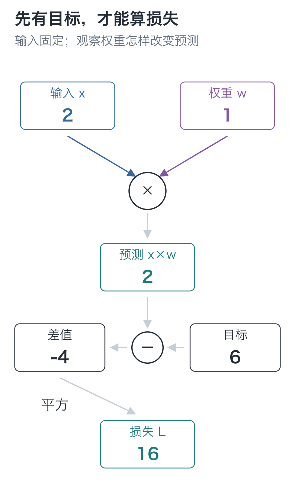
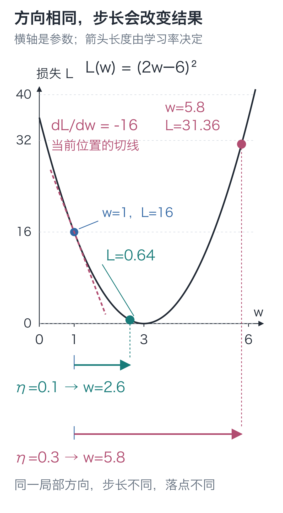
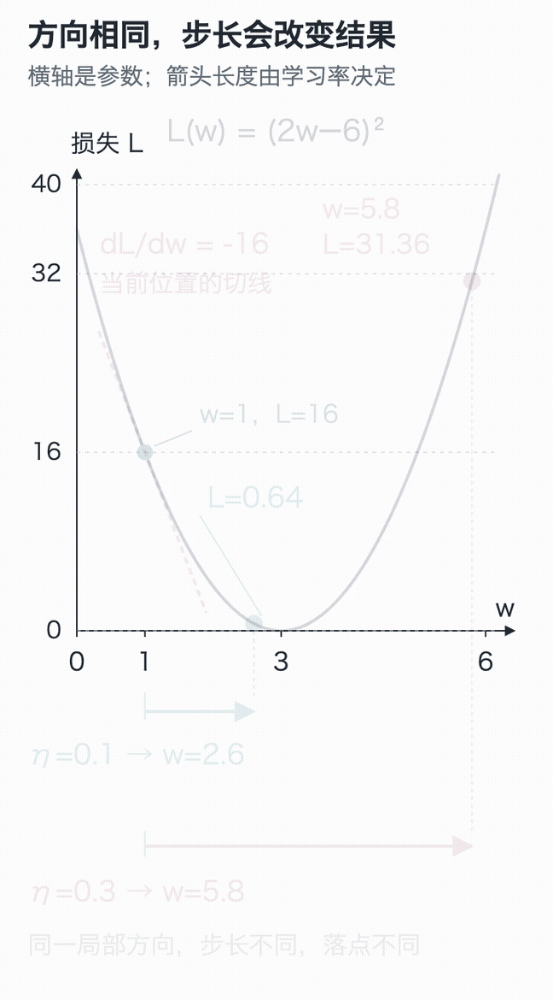
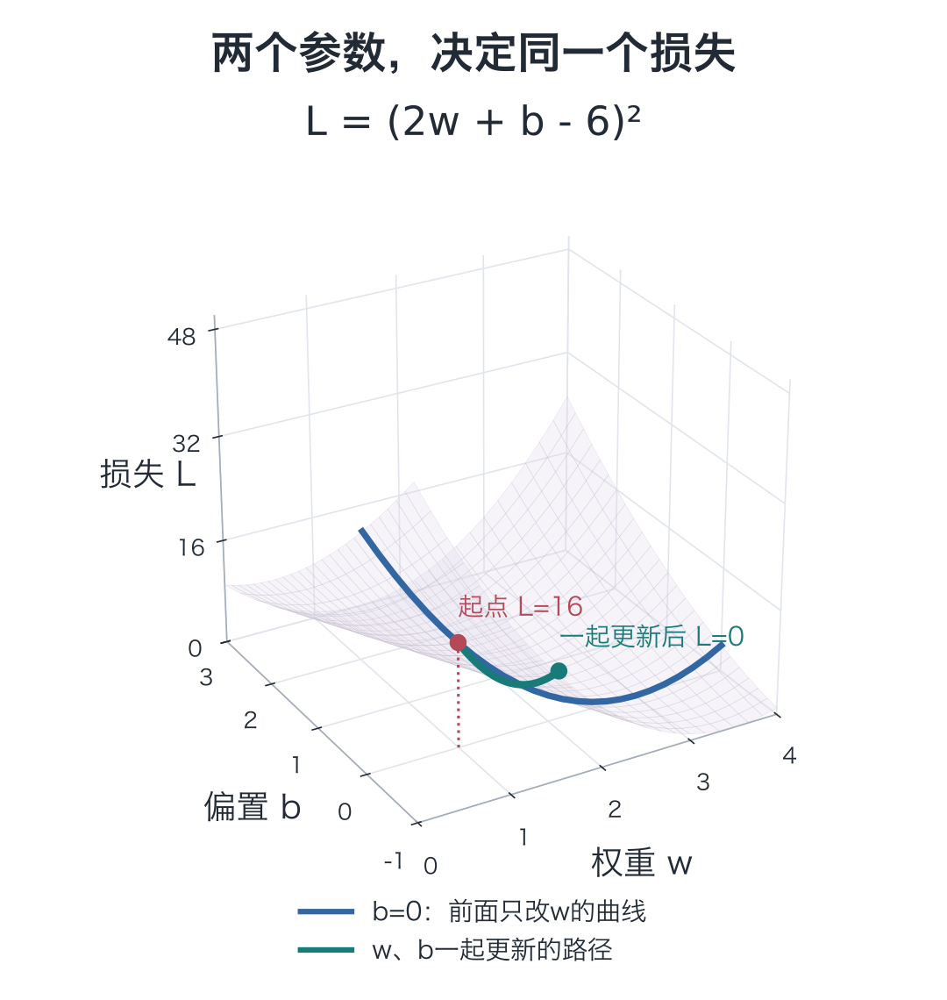

# 04｜梯度：方向对了，为什么也会越改越差？

手写小模型，看懂大模型 · 第 04 讲

预测只有 2，目标是 6。把参数往能增大预测的方向调，结果却到了 11.6，比原来离目标还远。

函数是 `prediction=2w`：输入固定为 2，只改权重 `w`。从同一起点、朝同一方向再试一次，缩小幅度后，预测停在了 5.2。

方向明明相同，为什么结果差这么多？先给“更错了”一个能比较的数字。

## 离目标一样远，分数也应该一样

从 `w=1` 开始，预测为 2，减去目标 6 得到 −4。若预测变成 10，差值是 4；两者离目标一样远，却有正负之分。多条数据的正负差还可能相互抵消。

一种简单办法，是把差值平方：

**L = (prediction−target)²**

`L` 叫作**损失**。差得越远，平方越大；预测恰好等于目标，损失为 0。现在不论预测落在目标哪边，都能用同一把尺比较。

本例只有一个预测，因此：

**L(w) = (2w−6)²**

代入 `w=1`，得到 **L(1)=(2−6)²=16**。

多份预测各自算平方误差再求平均，叫**均方误差**，简称 MSE。这里只有一项，MSE 就是这个平方。



图中当前损失为 16，试改参数后就与它比较。

## 不一下改很远，只从 1 挪到 1.1

只把 `w` 从 1 增加到 1.1，其他条件不变，看损失会不会降低。

预测从 2 变成 2.2，损失从 16 变成 **(2.2−6)²=14.44**。增加权重，确实让这次预测更接近目标了。

但“降低了 1.56”还没有说明参数改动与损失变化的比例。用损失变化除以参数变化：

**(14.44−16) ÷ (1.1−1) = −15.6**

它的含义是：在这小段区间内，权重每增加 1 个单位，损失平均变化约 −15.6 个单位。实际只增加了 0.1，因此损失变化是这个比例乘 0.1。

把尝试的幅度继续缩小：

| 权重变化 | 新权重 | 新损失 | 损失变化÷权重变化 |
| --- | --- | --- | --- |
| +0.1 | 1.1 | 14.44 | −15.6 |
| +0.01 | 1.01 | 15.8404 | −15.96 |
| +0.001 | 1.001 | 15.984004 | −15.996 |

尝试幅度越小，这个比例越接近 **−16**，也就越能反映 `w=1` **附近**的变化。

## 这串比例，为什么越来越接近 −16？

这种在某个位置的局部变化率，叫作**导数**，写成：

**dL/dw = −16，当前 w=1**

`dL/dw` 整体表示“损失相对权重的局部变化率”，`L、w` 标明正在考察哪两个量。负号告诉我们：此时稍微增大 `w`，损失会减小。

它还能估计足够小的改动：若 `Δw` 很小，损失变化约为 **−16×Δw**。例如增加 0.01，估计损失变化为 −0.16；实际是 −0.1596，很接近，但不是完全相等。

这一例可以直接算出变化率从哪来。用 `δ` 表示权重的一小份改动：

```text
L(w+δ) = (2w−6+2δ)²
       = (2w−6)² + 4(2w−6)δ + 4δ²

[L(w+δ)−L(w)] / δ = 4(2w−6) + 4δ
```

当 `δ` 趋近 0，右边的 `4δ` 趋近 0，留下：

**dL/dw = 4(2w−6)**

代入 `w=1`，就是 `4×(2−6)=−16`。这条式子适用于本例任意 `w`，但每个位置的导数值不同。到了 `w=4`，导数变成 8；到了恰好预测为 6 的 `w=3`，导数为 0。

在曲线上，导数就是当前点的局部坡度。它描述附近怎样变化，不承诺沿这个方向走任意远都有效。

## 回到开头：同一个 −16，为什么得到两种结果？

现在知道，从 `w=1` 出发，稍微增加权重有利。但导数只管附近。若把它的相反数 16 整个加到权重上，`w` 就会跳到 17，早已越过让预测等于 6 的位置。

需要再乘一个正数，把一次改动缩到合适幅度。这个数叫**学习率**，记作 `η`。先取 `η=0.1`：

**新 w = 旧 w − 学习率×导数**

**w_new = 1−0.1×(−16)=2.6**

导数为负，减去负数相当于增加权重。重新前向计算：

**prediction = 2×2.6=5.2**

**L = (5.2−6)²=0.64**

损失从 16 降到 0.64。这次更新有效，却还没有到本例的最优值 `w=3`。



曲线横轴是权重 `w`，纵轴是损失 `L(w)`。沿曲线找到 `w=1`，再比较更新后落到哪里；箭头的方向来自负导数，箭头长度还要看学习率。

再从原来的 `w=1` 出发，同一个导数 −16，只把学习率改成 0.3，新权重就变成 **5.8**。预测 11.6，损失 **(11.6−6)²=31.36**。开头那次变差，就是这样发生的。

**沿局部的下降方向更新，也可能因为步子太大而增加损失。**



动图把当前点、局部坡度和新落点接在一起。可以在[交互演示](https://daviddingxu.github.io/hello-llm/chapters/04-gradients/walkthrough.html)里分别停在两种步长的结果，比较它们落到了曲线的哪里。

## 再加一个偏置，这个办法还能用吗？

给预测增加一个可调偏置：`prediction=2w+b`。此时想知道 `w` 的影响，就暂时保持 `b` 不变；想知道 `b` 的影响，就暂时保持 `w` 不变。

这种“其他参数固定，只考察一个参数”的变化率，叫作**偏导数**，用 `∂` 标记：

```text
∂L/∂w = 4(prediction−6)
∂L/∂b = 2(prediction−6)
```

在 `w=1、b=0` 时，两个偏导分别是 −16、−8。权重影响预测的倍率是输入 2，偏置直接加到预测上，所以两者不一样。

把这些偏导按参数的位置放回去，就得到**梯度** `[-16, -8]`。

上面的更新实验仍然只改 `w`，`b` 保持 0。如果改成两个参数一起训练，就要先在同一组旧参数上算好两个偏导，再一起更新；下一讲会在多层网络里展开这件事。

## 把两个参数放到同一张图里

现在损失是 **L(w,b)=(2w+b−6)²**。地面上的两根轴分别放 `w`、`b`，高度放损失：每一组参数都对应曲面上的一个点。



蓝线把 `b` 固定为0，就是前面只改 `w` 时的抛物线。从 `w=1、b=0` 出发，若学习率仍取0.1，这次同时使用梯度 `[-16,-8]`，就会到达 `w=2.6、b=0.8`：预测为6，损失为0。两个参数共同决定同一个高度，并非各有一份互不相干的损失。

可以在[三维演示](https://daviddingxu.github.io/hello-llm/chapters/04-gradients/lab3d.html)里旋转视角、分别调两个参数，再比较“只改w”和“一起改”的结果。谷底不是唯一一点：只要 `2w+b=6`，这一题的损失都是0。只有一条训练题，还不能唯一确定这两个参数。

## 在程序里，只换一个学习率重跑

下面的代码只依赖 Python 标准功能。中心差分分别尝试 `w+ε` 和 `w−ε`，用两边的损失差估计导数，适合核对手算。这里的 `ε` 对应代码里的 `epsilon`；两次尝试的权重相距 `2ε`，所以要用损失差除以 `2ε`。

```python
# 输入与目标固定；本例只调整标量参数 w。
x, target = 2.0, 6.0


def loss_at(w):
    """用给定权重预测，返回它与目标之间的平方误差。"""
    prediction = x * w
    return (prediction - target) ** 2


def central_difference(function, w, epsilon=1e-5):
    """在同一权重两侧各试一次，用损失差估计当前位置的导数。"""
    return (function(w + epsilon) - function(w - epsilon)) / (2 * epsilon)


w = 1.0
print("输入、权重、目标：", x, w, target)
print("当前预测与损失：", x * w, loss_at(w))
for delta in [0.1, 0.01, 0.001]:
    # 这里求小区间内的平均变化率，delta 越小越接近局部导数。
    rate = (loss_at(w + delta) - loss_at(w)) / delta
    print("试改幅度、变化比例：", delta, rate)

# 平方误差对预测的导数，乘预测对 w 的导数 x。
gradient = 2 * (x * w - target) * x
print("公式与差分：", gradient, central_difference(loss_at, w))

for learning_rate in [0.1, 0.3]:
    # 两次都从原来的 w 出发，只比较步长，不把第一次结果接着更新。
    new_w = w - learning_rate * gradient
    print("学习率、新权重、新损失：", learning_rate, new_w, loss_at(new_w))
```

导数公式先算平方误差对差值的变化率 `2×(prediction−target)`，再乘预测对权重的变化率 `x`。下讲会解释为什么串联计算的变化率这样相乘。

两个学习率都从原来的 `w=1` 出发，代码没有把第一次更新的结果当成第二次起点。输出的小数末尾可能有浮点舍入差异，比较时看适当位数。

差分要为每个参数重新计算两次损失。网络有 9000 个参数，就要为这份输入多算 18000 次。下一讲用反向传播计算这些梯度。

## 两道题，检查“局部”与“步长”

1. 只把输入从 2 改成 `x=1`，仍取 `w=1`、目标 6、学习率 0.1。导数、新权重与更新后损失各是多少？能否照搬原来的导数 −16？
2. 回到输入 `x=2` 的原例，改从 `w=4` 出发，仍只更新权重，学习率为 0.1。导数是多少？新权重与损失是多少？

<details class="answer" markdown="1">
<summary>参考答案</summary>

答案：第一题，当前预测为 1，导数为 `2×(1−6)×1=−10`，新权重为 **1−0.1×(−10)=2**，更新后预测为 2，损失为 **(2−6)²=16**。输入改变了预测及预测对权重的变化率，不能照搬原来的 −16。第二题，导数 `4×(8−6)=8`，新权重 **4−0.1×8=3.2**，预测 6.4，损失 **0.16**。这次导数为正，因此往较小的权重更新。

</details>

在 `code` 目录运行：

```bash
# 在配套代码目录运行本讲实验，核对正文中的结果。
python -m lessons.l04
```

配套入口：[运行入口](https://github.com/DavidDingXu/hello-llm/blob/main/code/lessons/l04.py) · [交互演示](https://daviddingxu.github.io/hello-llm/chapters/04-gradients/walkthrough.html) · [环境说明](https://github.com/DavidDingXu/hello-llm/blob/main/code/README.md)

源码导航：[experiments.py · lesson04](https://github.com/DavidDingXu/hello-llm/blob/main/code/lessons/experiments.py#L50)。

<!-- chapter-navigation:start -->

---

[← 多层与非线性](../03-nonlinearity/README.md) · [课程目录](../../README.md#课程目录) · [手写反向传播 →](../05-backpropagation/README.md)

<!-- chapter-navigation:end -->
