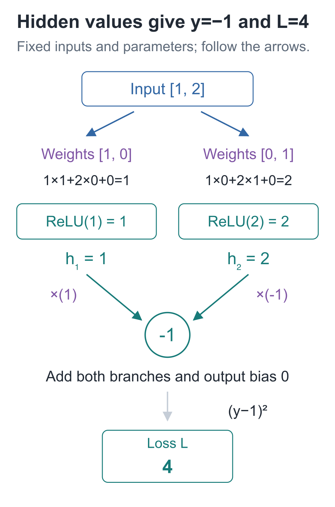
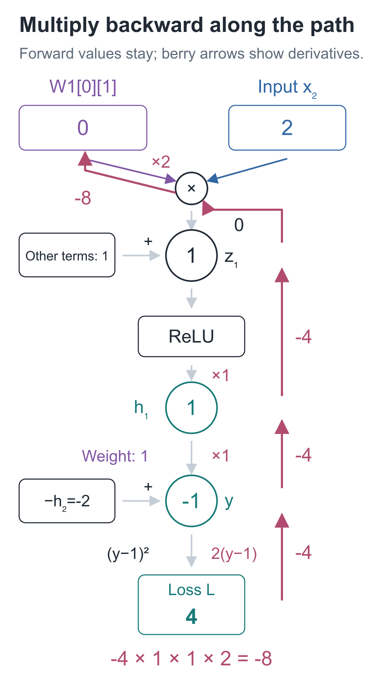
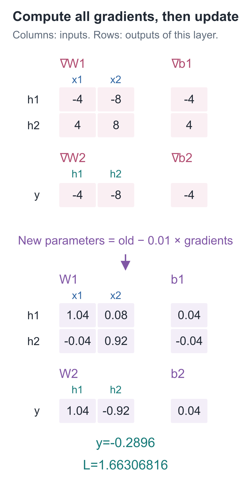
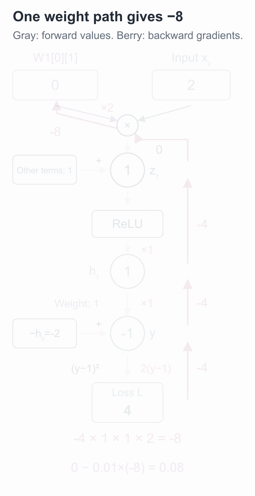
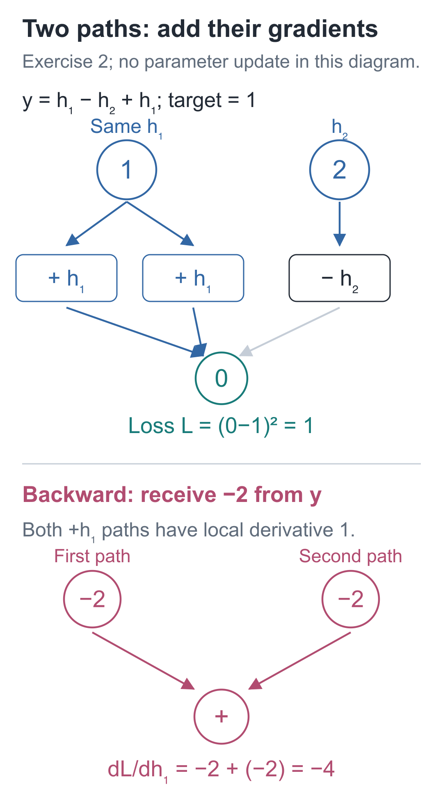

# 05 | Backpropagation: Must We Test All 9 Parameters One by One?

Build a Small Model, Understand Large Models · Lesson 05

A tiny network with only 9 parameters receives `[1, 2]`. It should output 1, but calculates −1. Which parameter should change, and in which direction?

We could use the previous lesson's method: increase and decrease each parameter slightly, calculating the loss each time. For 9 parameters, that means 18 additional forward passes. Larger networks would repeat even more computation.

When the program produced −1, it already calculated the intermediate values along the way. Save those numbers, and we can start with one weight and trace how it affects the loss.

## How did we calculate −1?

Keep Lesson 03's **2→2→1** structure: ReLU in the hidden layer, with only multiply-and-add in the output layer. This time we use a different training example, `[1, 2]→1`. The target 1 is supplied by this example; it is no longer one of the four XOR rules. We also replace the parameters with these initial values:

```text
W1 = [[1, 0],       b1 = [0, 0]
      [0, 1]]
W2 = [[1, -1]]      b2 = [0]
```

The first layer calculates:

```text
z₁ = 1×1 + 2×0 + 0 = 1
z₂ = 1×0 + 2×1 + 0 = 2
h₁ = ReLU(1) = 1
h₂ = ReLU(2) = 2
```

The output layer and squared loss are:

**prediction = 1×1 + 2×(−1) + 0 = −1**

**L = (−1−1)² = 4**

Save this pass's `z`, `h`, and `prediction` first. Next, without changing the input or parameters, use these intermediate values to trace changes.



Follow the arrows to calculate the two hidden values, then check −1 and 4. Every number shown is from this forward pass; the parameters remain at their initial values.

## What happens if that weight with value 0 increases slightly?

Focus on `W1[0][1]`. Python indices start at 0, so this is the **first row, second column**. Its current value is 0, and it connects the second input, 2, to the first hidden unit.

First predict the direction: would a small increase bring the prediction closer to the target 1 or farther away? Call the change `δ` and follow the path:

1. `z₁` increases by `2δ`, because this multiplication also includes input 2.
2. Currently `z₁=1`. A sufficiently small perturbation will not cross 0, so ReLU preserves it and `h₁` also increases by `2δ`.
3. The output layer multiplies `h₁` by weight 1, so the prediction also increases by `2δ`.

The old prediction is −1, so the new one is `−1+2δ`. Therefore:

```text
新损失 = (−1+2δ−1)² = 4−8δ+4δ²
损失变化 / δ = −8+4δ
```

As `δ` approaches 0, **−8** remains. This is `∂L/∂W1[0][1]`.

Repeating this expansion for the other 8 parameters would calculate the final squared-error part 8 more times. Can we reuse it?

## Calculate the final squared-error derivative only once

Start at the final squared error and ask how a small change in the prediction affects the loss. The prediction is −1 and the target is 1, so:

**∂L/∂prediction = 2×(−1−1)=−4**

At this point, a small increase in the prediction changes the loss by approximately −4 times that increase. Pass this known rate backward through the calculation:

| Segment of the calculation | Local rate of change of its output with respect to its input |
| --- | --- |
| `h₁×1` in prediction | 1 |
| h₁=ReLU(z₁), currently z₁=1 | 1 |
| `2×W1[0][1]` in z₁ | 2 |

Multiplying along the chain gives **−4×1×1×2=−8**, matching the full perturbation calculation.

**Multiplying successive local rates of change** is the **chain rule**. Starting at the loss and reusing these rates in reverse calculation order is **backpropagation**. The same −4 can be passed to the other hidden branch without expanding the whole loss again.



We are tracing just one weight path. The numbers on the berry-colored arrows are rates of change of loss with respect to the quantities along the path. The forward values 1 and 2 have not been overwritten, and the weight is still 0.

What about addition? If `s=u+v`, increasing only `u` slightly increases `s` by the same amount. The local derivative of `s` with respect to `u` is therefore 1, and its derivative with respect to `v` is also 1. The gradient arriving at `s` is multiplied by 1 and passed to each input; it is not divided between them.

If the same value branches out and affects the loss along two paths, a small increase changes both paths at once, so their effects must be added. This distinction is easy to reverse: an addition node passes its incoming gradient to each input; when one input receives gradients from multiple paths, those contributions are added. **Multiply along one path; add when paths return to the same value.**

For ReLU, the forward position determines the local derivative: it is 1 when `z>0` and 0 when `z<0`. At `z=0`, there is no unique derivative. Our implementation chooses 0, matching the PyTorch convention used later.

## How does the same −4 reach the other parameters?

Start at the output layer, where `d_output=−4`.

The inputs to its two weights are `h₁=1` and `h₂=2`, so their gradients are `−4×1=−4` and `−4×2=−8`. The output bias is added directly, so its gradient is −4.

To pass back to the two hidden values, multiply by their respective output weights:

**∂L/∂h₁=−4×1=−4**

**∂L/∂h₂=−4×(−1)=4**

Both `z` values are above 0, so ReLU's local derivative is 1, giving `∂L/∂z=[−4, 4]`. Multiply each component by input `[1, 2]` to obtain the corresponding row of first-layer weight gradients.

| Parameter group | Original values | Corresponding gradients |
| --- | --- | --- |
| W2 | `[[1, −1]]` | `[[-4, −8]]` |
| b2 | `[0]` | `[-4]` |
| W1 | `[[1, 0], [0, 1]]` | `[[-4, −8], [4, 8]]` |
| b1 | `[0, 0]` | `[-4, 4]` |

The gradient matrix has the same shape as the parameter matrix, so each gradient maps back to its corresponding parameter. In this example, each weight is used on only one multiplication edge. If a parameter is reused in multiple places, add the contributions it receives from all paths. We will use this in batch training.

The 18 extra forward passes needed for individual trial changes have now been replaced by one reverse-order calculation. The inputs and activation values it needs are still in the cache.

## One update turns −1 into −0.2896

Once all 9 parameter gradients are ready, choose learning rate 0.01 and update them together using `parameter−0.01×gradient`:

```text
W1 = [[ 1.04, 0.08],     b1 = [0.04, -0.04]
      [-0.04, 0.92]]
W2 = [[1.04, -0.92]]     b2 = [0.04]
```

A new forward pass gives hidden values `[1.24, 1.76]`:

**prediction = 1.24×1.04 + 1.76×(−0.92) + 0.04 = −0.2896**

**L = (−0.2896−1)² = 1.66306816**



The upper half of the diagram shows all gradients; the lower half shows the parameters after the joint update. The prediction has not yet reached target 1, but the loss has fallen from 4 to about 1.66. This new result must be recalculated using all the new parameters; the old hidden values cannot be reused.

Why not update each parameter as soon as its gradient is available? Later gradient calculations still read weights associated with the old forward pass. Updating midway would mix gradients from different parameter states within one round.



The animation follows the backward path through `W1[0][1]`. Parameters keep their old values until the update stage. Pause the [interactive demo](https://daviddingxu.github.io/hello-llm/chapters/05-backpropagation/walkthrough.en.html) before the update to check: forward values are unchanged; only gradients have been added.

## Put the reverse-order calculation in a function

Run this from the companion code directory. `forward` reuses Lesson 03's implementation and returns a prediction and cache. `hand_example` returns this lesson's initial parameters, and `step` updates each parameter using the rule above. The new backward calculation is shown in full below.

```python
from tiny_lm.manual_mlp import forward, hand_example, step


def backward(cache, target, params):
    """Read the cached forward values and original parameters; return matching parameter gradients without updating them."""
    # First differentiate the squared loss with respect to the prediction; earlier paths share this result.
    d_output = 2 * (cache["prediction"] - target)
    # To propagate to each hidden value, multiply by its corresponding output weight.
    d_hidden = [d_output * weight for weight in params["W2"][0]]
    # ReLU passes the gradient through for positive inputs and returns 0 for negative inputs and, here, zero.
    d_z = [g if z > 0 else 0.0
           for g, z in zip(d_hidden, cache["z"])]
    return {
        # Weight gradient = gradient received by the unit × input multiplied by that weight.
        "W2": [[d_output * value for value in cache["h"]]],
        # The bias is added directly, so its local derivative is 1 and its gradient equals the unit's incoming gradient.
        "b2": [d_output],
        "W1": [[g * value for value in cache["x"]] for g in d_z],
        "b1": d_z,
    }


# Fix one training example; hand_example supplies the initial parameters listed in the chapter.
x, target = [1.0, 2.0], 1.0
params = hand_example()
prediction, cache = forward(x, params)
gradients = backward(cache, target, params)
print("Prediction and loss:", prediction, (prediction - target) ** 2)
print("Gradients:", gradients)
```

The `d_` prefix is a naming convention; here it means the derivative of loss with respect to that quantity. `d_hidden` multiplies the output gradient by the corresponding weight. `d_z` uses the forward value `z` to decide whether the gradient passes through ReLU. Finally, each layer's weight gradients are “the gradient received by this layer × this layer's input.”

`backward` stores the gradients calculated by these local rules in a new dictionary and **does not modify `params`**. `step` still handles parameter updates.

## Perturb that weight to check −8

Finite differences are slow, but they provide an independent check of the backward code. First, check only the path we traced, `W1[0][1]`, while keeping the other parameters fixed:

```python
# Continue from above; x, target, params, and gradients still refer to the same original forward pass.
epsilon = 1e-5
old_value = params["W1"][0][1]
# Perturb only the weight in the first row, second column; keep every other parameter unchanged.
params["W1"][0][1] = old_value + epsilon
plus = (forward(x, params)[0] - target) ** 2
params["W1"][0][1] = old_value - epsilon
minus = (forward(x, params)[0] - target) ** 2
# Restore the original value, then compare its finite-difference derivative with its backpropagation gradient.
params["W1"][0][1] = old_value
numerical = (plus - minus) / (2 * epsilon)
print("Finite difference and backpropagation:", numerical, gradients["W1"][0][1])
assert abs(numerical - gradients["W1"][0][1]) < 1e-7

# All gradients come from the original parameters; update them together, then recompute the forward pass and hidden values.
step(params, gradients, learning_rate=0.01)
new_prediction, _ = forward(x, params)
print("After the update:", new_prediction, (new_prediction - target) ** 2)
# Approximately -0.2896 and 1.66306816
```

Increase the value slightly, decrease it slightly, and restore it after the calculations. Only then run `step`. Both gradient results are close to −8. The companion program keeps a complete check of all 9 parameters using the same principle.

Finite differences check the calculation **at the current point**. Both `z` values here are far enough from 0 that tiny perturbations do not cross ReLU's bend. At the bend itself, a central difference need not equal the derivative chosen by the program, so the same error threshold is not a suitable correctness test there.

## Two tracing exercises

1. Increase only `W1[0][1]` by 0.001, leaving all other parameters at their initial values. What are the new prediction and loss? Estimate the loss change using gradient −8. How far is the estimate from the actual change?
2. Keep the original parameters, but change the output to `y=h₁−h₂+h₁`, with target still 1. What is the gradient of loss with respect to `h₁`? What would be missed by following only one `h₁` path?

<details class="answer" markdown="1">
<summary>Reference answers</summary>

Answers: For the first exercise, the new prediction is **−0.998**, and the loss is **3.992004**. The gradient estimates a change of `−8×0.001=−0.008`; the actual change is −0.007996, a difference of **0.000004**. For the second, the current `y=0`, so `∂L/∂y=−2`. Each of the two addition paths from `h₁` contributes −2, making the total gradient **−4**. Following only one path misses the other −2; effects from the same value must be added.



There is only one `h₁` at the top of the diagram, branching into two uses below. During backpropagation, both −2 contributions return to it. They must not be averaged to −2, and the later contribution must not overwrite the earlier one.

</details>

In the next lesson, we will switch to PyTorch, first check these hand calculations, and then observe the network's predictions after 500 updates.

Run this from the `code` directory:

```bash
# Run this lesson from the companion code directory to check the chapter's results.
python -m lessons.l05
```

Companion resources: [Entry point](https://github.com/DavidDingXu/hello-llm/blob/main/code/lessons/l05.py) · [Handwritten implementation](https://github.com/DavidDingXu/hello-llm/blob/main/code/tiny_lm/manual_mlp.py) · [Interactive demo](https://daviddingxu.github.io/hello-llm/chapters/05-backpropagation/walkthrough.en.html)

Source navigation: [manual_mlp.py · backward](https://github.com/DavidDingXu/hello-llm/blob/main/code/tiny_lm/manual_mlp.py#L22).

<!-- chapter-navigation:start -->

---

[← Gradients and Parameter Updates](../04-gradients/README.en.md) · [Contents](../../README.en.md#course-contents) · [Making the Network Learn →](../06-training-loop/README.en.md)

<!-- chapter-navigation:end -->
