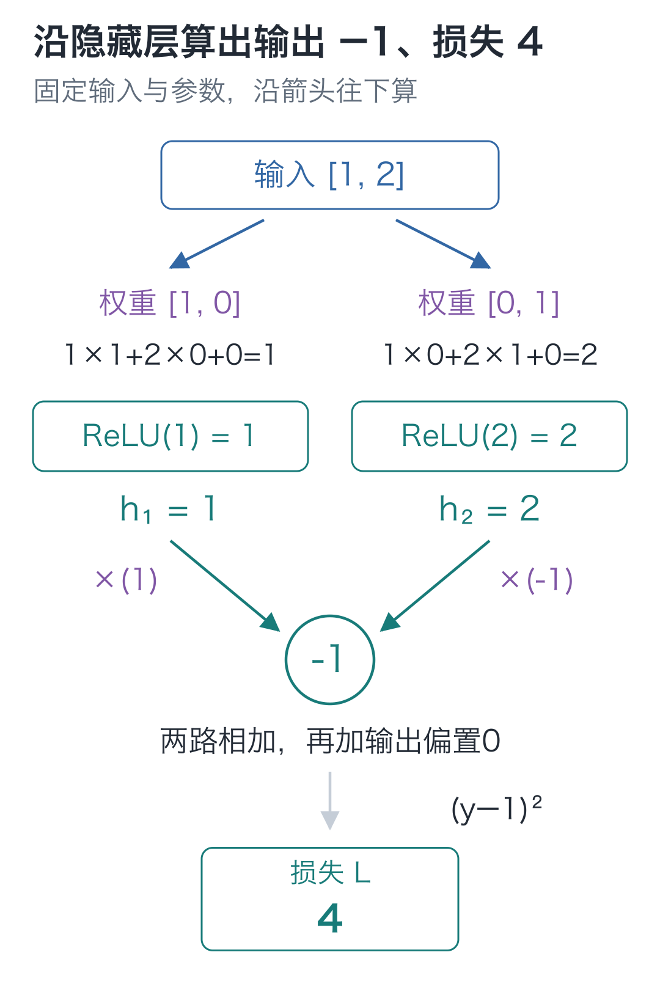
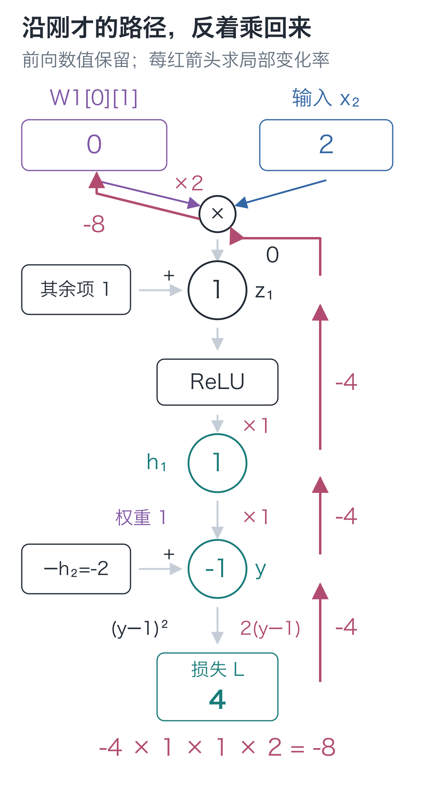
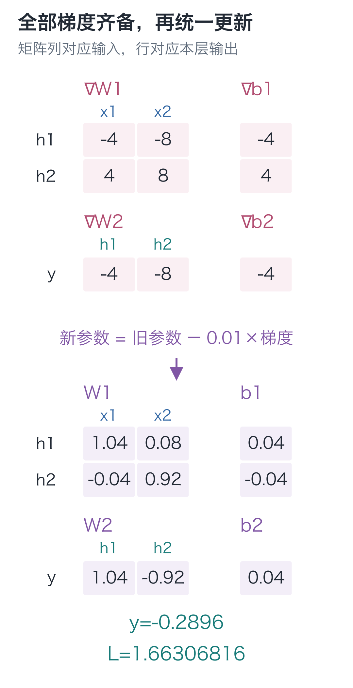
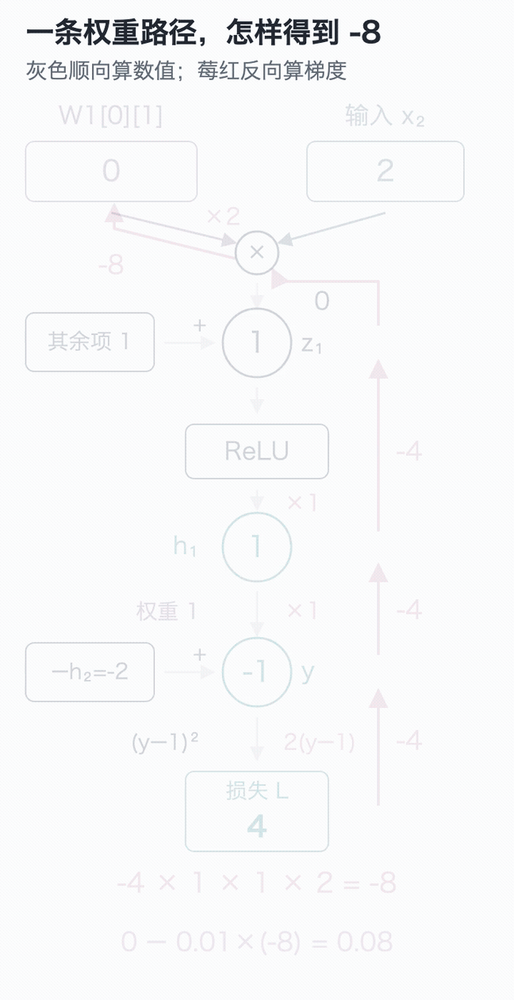
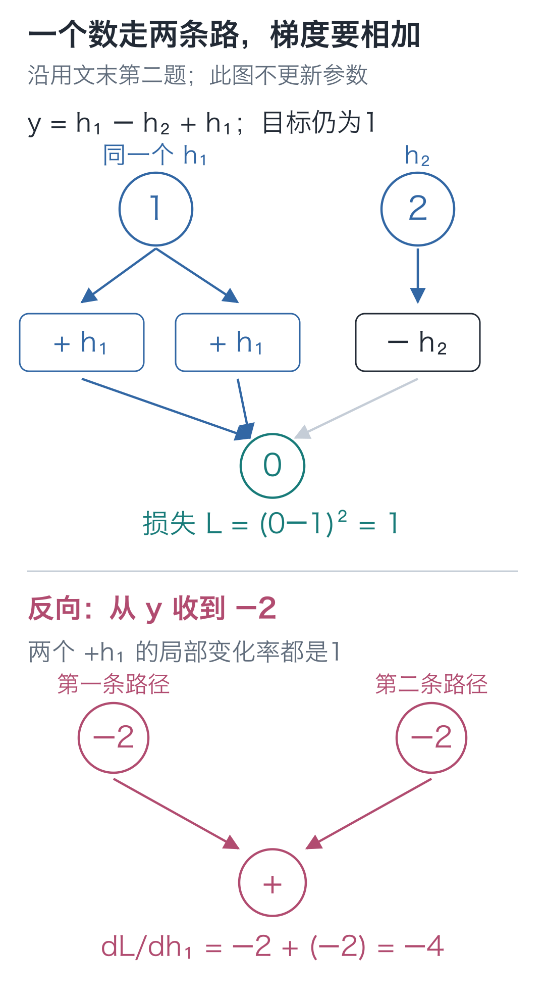

# 05｜反向传播：9个参数，难道要逐个试？

手写小模型，看懂大模型 · 第 05 讲

一个只有 9 个参数的小网络，输入 `[1, 2]`，本该输出 1，却算出了 −1。该改哪一项，往哪边改？

可以照上一讲的方法，把每个参数增加一点、减少一点，各算一次损失。9 个参数，要多算 18 次前向；网络大起来，重复计算会更多。

算出 −1 时，程序已经得到沿途的中间值。把这些数留下，就能从其中一项权重开始，追踪它怎样影响损失。

## −1 是怎样算出来的

沿用第三讲的 **2→2→1** 结构：隐藏层有 ReLU，输出层只做乘加。这次另设一条训练样本 `[1, 2]→1`，目标1由样本给定，不再是前面的四条 XOR 规则。参数也换成下面这组初值：

```text
W1 = [[1, 0],       b1 = [0, 0]
      [0, 1]]
W2 = [[1, -1]]      b2 = [0]
```

第一层分别算出：

```text
z₁ = 1×1 + 2×0 + 0 = 1
z₂ = 1×0 + 2×1 + 0 = 2
h₁ = ReLU(1) = 1
h₂ = ReLU(2) = 2
```

输出层与平方损失为：

**prediction = 1×1 + 2×(−1) + 0 = −1**

**L = (−1−1)² = 4**

这次算出的 `z、h、prediction` 都先保存下来。下一步不换输入、不改参数，就用这些中间值追踪变化。



先顺着箭头算出两个隐藏值，再核对 −1 和 4。图中的数都是本次前向结果，参数还保持初值。

## 那个为 0 的权重，增加一点会怎样？

关注 `W1[0][1]`：Python 从 0 编号，因此它是**第一行第二列**，当前值为 0，负责把第二项输入 2 送进第一个隐藏单元。

先判断方向：它增加一点，会让预测靠近目标 1，还是远离？把这份改动记作 `δ`，沿路径算下去：

1. `z₁` 增加 `2δ`，因为这条乘法还要乘输入 2。
2. 当前 `z₁=1`，足够小的扰动不会跨过 0，ReLU 保留它，所以 `h₁` 也增加 `2δ`。
3. 输出层把 `h₁` 乘权重 1，因此预测也增加 `2δ`。

旧预测是 −1，新预测就是 `−1+2δ`。于是：

```text
新损失 = (−1+2δ−1)² = 4−8δ+4δ²
损失变化 / δ = −8+4δ
```

当 `δ` 趋近 0，留下 **−8**。这就是 `∂L/∂W1[0][1]`。

给其余 8 个参数也这样展开，最后那段平方误差就得再算 8 遍。能否复用它？

## 最后的平方误差，只算一次

从最后的平方误差开始，先算预测变化一点会怎样影响损失。预测为 −1，目标为 1，所以：

**∂L/∂prediction = 2×(−1−1)=−4**

意思是，预测在当前位置增加一点，损失会按约 −4 倍的比例变化。把这个已知比例逆着计算顺序传回去：

| 这一段计算 | 输出对本段输入的局部变化率 |
| --- | --- |
| prediction 中的 `h₁×1` | 1 |
| h₁=ReLU(z₁)，当前 z₁=1 | 1 |
| z₁ 中的 `2×W1[0][1]` | 2 |

串起来就得到 **−4×1×1×2=−8**，与刚才完整扰动的结果一致。

**连续的局部变化率相乘**，叫作**链式法则**。像这样从损失出发，逆着计算顺序复用变化率，就是**反向传播**。刚才算出的 −4 还能交给另一条隐藏分支，不必重新展开整个损失。



这次只追一条权重路径。莓红箭头上的数是损失对沿途各量的变化率；前向的 1、2 没有被改写，权重仍为 0。

加法又怎样处理？若 `s=u+v`，只增加 `u` 一点，`s` 同样增加一点，所以 `s` 对 `u` 的局部变化率是 1，对 `v` 也是 1。来自 `s` 的梯度分别乘 1，传回两边，并没有平均分配。

若同一个数分叉后，沿两条路径影响损失，它增加一点，两条路径会同时变化，影响就要相加。这里容易弄反：加法节点把收到的梯度分别传给输入；同一个输入经多条路径收到梯度时，再把这些贡献加起来。**沿一条路径乘，回到同一个数时加。**

ReLU 则按前向位置决定局部变化率：`z>0` 时为 1，`z<0` 时为 0。`z=0` 处没有唯一导数，本栏实现选 0，与后面的 PyTorch 约定一致。

## 同一个 −4，怎样传到其他参数

从输出层开始，已知 `d_output=−4`。

输出权重前分别是 `h₁=1、h₂=2`，所以两项权重梯度是 `−4×1=−4`、`−4×2=−8`；输出偏置直接加进去，梯度是 −4。

传回两个隐藏值时，要乘各自的输出权重：

**∂L/∂h₁=−4×1=−4**

**∂L/∂h₂=−4×(−1)=4**

两个 `z` 都大于 0，ReLU 的局部变化率为 1，因此 `∂L/∂z=[−4, 4]`。再分别乘输入 `[1, 2]`，就能得到第一层每一行的权重梯度。

| 参数组 | 原值 | 对应梯度 |
| --- | --- | --- |
| W2 | `[[1, −1]]` | `[[-4, −8]]` |
| b2 | `[0]` | `[-4]` |
| W1 | `[[1, 0], [0, 1]]` | `[[-4, −8], [4, 8]]` |
| b1 | `[0, 0]` | `[-4, 4]` |

梯度矩阵与参数矩阵形状相同：每个梯度都能回到自己对应的那个参数。本例各个权重只使用在一条乘法边上；若一个参数被多处复用，要把它从所有路径收到的贡献累加，后面批次训练会用到这一点。

开头逐个试改需要的 18 次额外前向，现在由一次逆序计算替代。用过的输入和激活值都还在缓存里。

## 一次更新，−1 变成了 −0.2896

9 个参数的梯度算齐后，取学习率 0.01，按 `参数−0.01×梯度` 一起更新：

```text
W1 = [[ 1.04, 0.08],     b1 = [0.04, -0.04]
      [-0.04, 0.92]]
W2 = [[1.04, -0.92]]     b2 = [0.04]
```

重新前向计算，得到隐藏值 `[1.24, 1.76]`：

**prediction = 1.24×1.04 + 1.76×(−0.92) + 0.04 = −0.2896**

**L = (−0.2896−1)² = 1.66306816**



图的上半部是全部梯度，下半部是同时更新后的参数。预测仍未到目标 1，但损失已从 4 降到约 1.66。这个新结果必须由全部新参数重新计算，旧隐藏值不能继续沿用。

为什么不算出一项梯度就马上改参数？因为后面求梯度还在读取旧前向对应的权重。中途改动，会让同一轮的梯度来自不同参数状态。



动图沿 `W1[0][1]` 的路径回传，参数保持原值，到更新阶段才变化。在[交互演示](https://daviddingxu.github.io/hello-llm/chapters/05-backpropagation/walkthrough.html)里停到更新前，可以核对：前向数值没有变，新增的只是梯度。

## 把这次逆序计算交给函数

在配套代码目录运行。`forward` 复用第三讲的实现，返回预测和缓存；`hand_example` 返回本讲的初始参数，`step` 按上一节的规则逐项更新。下面完整展开新增的反向计算。

```python
from tiny_lm.manual_mlp import forward, hand_example, step


def backward(cache, target, params):
    """读取旧前向的缓存与参数，返回同形状的参数梯度，不更新参数。"""
    # 先求平方损失对最终预测的导数，供前面的各条路径共用。
    d_output = 2 * (cache["prediction"] - target)
    # 传回隐藏值时，分别乘上连接它们的输出权重。
    d_hidden = [d_output * weight for weight in params["W2"][0]]
    # ReLU 的局部导数：正区间传回原梯度，负区间与本实现的零点传回 0。
    d_z = [g if z > 0 else 0.0
           for g, z in zip(d_hidden, cache["z"])]
    return {
        # 权重梯度 = 该单元收到的梯度 × 这条权重所乘的输入。
        "W2": [[d_output * value for value in cache["h"]]],
        # 偏置直接相加，局部导数为 1，因此保留该单元收到的梯度。
        "b2": [d_output],
        "W1": [[g * value for value in cache["x"]] for g in d_z],
        "b1": d_z,
    }


# 固定一条训练题；hand_example 提供正文列出的那组初始参数。
x, target = [1.0, 2.0], 1.0
params = hand_example()
prediction, cache = forward(x, params)
gradients = backward(cache, target, params)
print("预测与损失：", prediction, (prediction - target) ** 2)
print("梯度：", gradients)
```

`d_` 前缀是变量命名习惯，这里表示损失对该量的导数。`d_hidden` 将输出梯度乘对应权重；`d_z` 按前向 `z` 选择是否通过 ReLU；最后两层权重都用“本层收到的梯度×本层输入”得到结果。

`backward` 把各条局部规则算出的梯度放进新字典，**不修改 `params`**。参数更新仍由 `step` 完成。

## 试改刚才那个权重，核对 −8

差分虽然慢，却能独立核对反向代码。先只检查一路追过来的 `W1[0][1]`，其他参数保持不动：

```python
# 接着上一段，x、target、params、gradients 仍对应同一次旧前向。
epsilon = 1e-5
old_value = params["W1"][0][1]
# 只试改第一行第二列的权重，其余参数保持原值。
params["W1"][0][1] = old_value + epsilon
plus = (forward(x, params)[0] - target) ** 2
params["W1"][0][1] = old_value - epsilon
minus = (forward(x, params)[0] - target) ** 2
# 先恢复原值，再把差分导数与反向得到的同一项梯度比较。
params["W1"][0][1] = old_value
numerical = (plus - minus) / (2 * epsilon)
print("差分与反向：", numerical, gradients["W1"][0][1])
assert abs(numerical - gradients["W1"][0][1]) < 1e-7

# 全部梯度都来自旧参数；统一更新后，重新前向，不能沿用旧隐藏值。
step(params, gradients, learning_rate=0.01)
new_prediction, _ = forward(x, params)
print("更新后：", new_prediction, (new_prediction - target) ** 2)
# 约为 -0.2896、1.66306816
```

先增加一点、再减少一点，算完就恢复原值，最后才执行 `step`。两个结果都接近 −8。完整9参数检查保留在配套程序中，原理与这里相同。

差分核对的是**当前位置**的计算。本例两个 `z` 都离 0 足够远，微小扰动不会跨过 ReLU 转折；若恰好在转折上，中心差分不一定等于程序选定的导数，就不适合按同一个误差阈值判定对错。

## 两道追踪题

1. 只把 `W1[0][1]` 增加 0.001，其他参数保持初值。新预测、损失是多少？用梯度 −8 估计损失变化，与实际差多少？
2. 保持原参数，输出改为 `y=h₁−h₂+h₁`，目标仍为 1。此时损失对 `h₁` 的梯度是多少？只算一条 `h₁` 路径会漏掉什么？

<details class="answer" markdown="1">
<summary>参考答案</summary>

答案：第一题，新预测 **−0.998**，损失 **3.992004**。梯度估计变化为 `−8×0.001=−0.008`，实际为 −0.007996，相差 **0.000004**。第二题，当前 `y=0`，`∂L/∂y=−2`；`h₁` 经两条加法路径各贡献 −2，总梯度为 **−4**。只算一条会漏掉另一路 −2；同一个量的影响需要相加。



图中上方只有一个 `h₁`，向下分出两条使用路径。反向时两份 −2 都回到它；不能把它们平均成 −2，也不能让后到的一份覆盖先到的一份。

</details>

下一讲换用 PyTorch，先核对这次手算，再观察网络经过 500 次更新后的预测。

在 `code` 目录运行：

```bash
# 在配套代码目录运行本讲实验，核对正文中的结果。
python -m lessons.l05
```

配套入口：[运行入口](https://github.com/DavidDingXu/hello-llm/blob/main/code/lessons/l05.py) · [手写实现](https://github.com/DavidDingXu/hello-llm/blob/main/code/tiny_lm/manual_mlp.py) · [交互演示](https://daviddingxu.github.io/hello-llm/chapters/05-backpropagation/walkthrough.html)

源码导航：[manual_mlp.py · backward](https://github.com/DavidDingXu/hello-llm/blob/main/code/tiny_lm/manual_mlp.py#L22)。

<!-- chapter-navigation:start -->

---

[← 梯度与参数更新](../04-gradients/README.md) · [课程目录](../../README.md#课程目录) · [让网络学起来 →](../06-training-loop/README.md)

<!-- chapter-navigation:end -->
