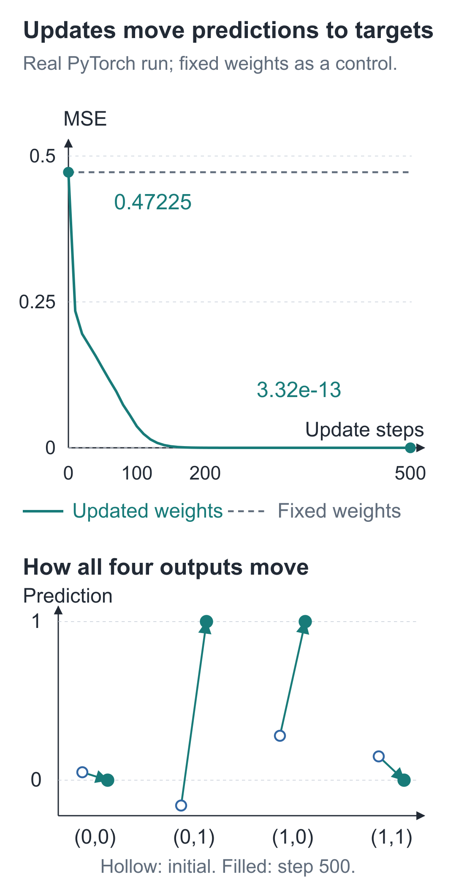
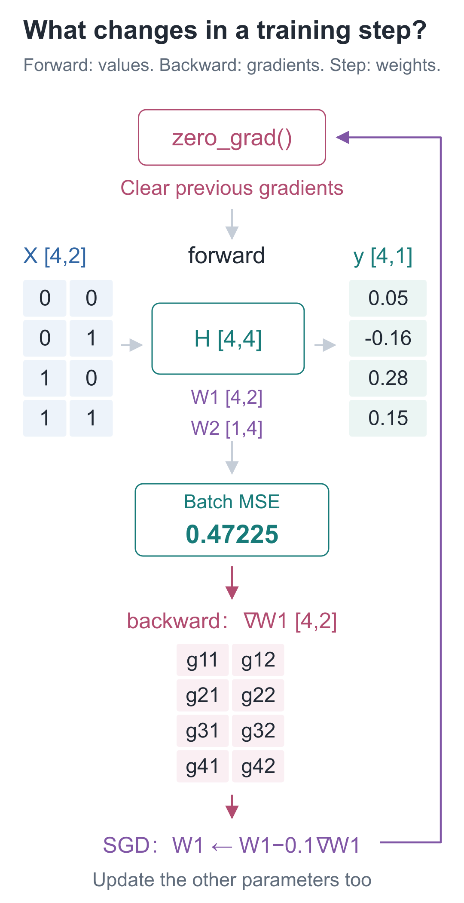
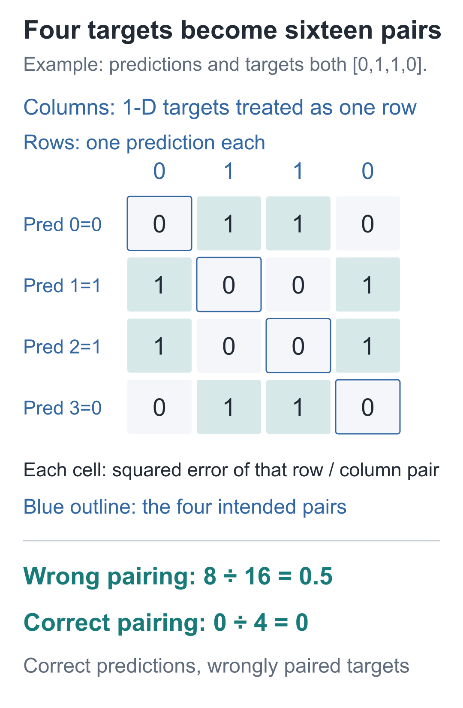

# 06 | The Training Loop: What Happens to Four Predictions After 500 Updates?

Build a Small Model, Understand Large Models · Lesson 06

Feed the network four inputs in the order `[0, 0]`, `[0, 1]`, `[1, 0]`, and `[1, 1]`. It should output `[0, 1, 1, 0]`, but initially gives `[0.05, -0.16, 0.28, 0.15]`.

Look just at the second prediction: it starts at −0.16, reaches 0.7592 after 100 updates, and reaches 0.9999994 after 500. The other three predictions also approach their targets. The inputs and answers never change; the program repeatedly adjusts the same parameters.



The upper plot records the actual training MSE against the number of updates. In the lower plot, open circles show initial predictions and filled circles show their positions after 500 updates. The dashed line for fixed parameters stays at the original loss.

Each update requires newly calculated gradients at the current parameters. As networks grow, manually writing every backward path becomes error-prone, so we will use PyTorch's automatic differentiation. First, check it against the previous lesson's hand calculations; then train on these four inputs.

## With a new tool, does the same example still calculate correctly?

The environment is Python 3.12 with `torch==2.9.1`, running on CPU with float32. The [companion code instructions](https://github.com/DavidDingXu/hello-llm/blob/main/code/README.md) provide installation commands for macOS and Windows. The parameters for our check are still:

```text
W1=[[1,0],[0,1]]，b1=[0,0]
W2=[[1,-1]]，b2=[0]
输入=[1,2]，目标=1
```

Python lists store numbers, while we write loops for multiply-and-add. A PyTorch **tensor** also stores numbers with a shape and provides operations on them. Here, think of it as a multidimensional array with a numerical type and a shape.

We place one sample horizontally, so input `x` is `[[1, 2]]`, with shape `[1, 2]`. The first 1 counts samples; the second 2 counts input components per sample.

The two-layer forward pass is:

```text
hidden = ReLU(x @ W1.T + b1)
prediction = hidden @ W2.T + b2
```

`@` performs matrix multiplication, and `.T` swaps a parameter matrix's rows and columns. With the initial values above, the hidden values should still be `[[1, 2]]`, and the prediction should still be `[[-1]]`.

## Recognize the five actions in one training round

**Clear old gradients → predict with a forward pass → calculate loss → calculate gradients backward → update parameters**

Below, `forward` performs the forward calculation we already know, `backward` corresponds to the previous lesson's reverse calculation, and `SGD` updates parameters. The code also registers parameters and prints values; on your first reading, follow these five actions. Parameters change only in the last step.

## Record the operations we just performed

While executing operations, PyTorch can record which inputs and operations produced each result. These dependencies form a **computation graph**. During the backward pass, it follows the dependencies and applies each operation's local rule.

The current sample's input and target are fixed; the parameters are what we need to adjust. A tensor's `requires_grad=True` setting tells PyTorch to track operations involving it so that gradients with respect to it can be calculated.

Wrap the four tensor groups in a class. `nn.Module` organizes the network, and `nn.Parameter` registers parameters with gradient tracking enabled by default. In the code, `B` counts samples, `D` counts input components per sample, and `H` counts hidden units. After running it, focus first on the gradient for the first row, second entry of `W1`: it should still be the −8 traced in the previous lesson.

```python
import torch
from torch import nn


class TensorMLP(nn.Module):
    """两层网络：一行放一份输入，返回每份输入各自的一项预测。"""
    def __init__(self, params):
        super().__init__()
        # Parameter 登记可训练浮点数；各样本共用这些权重和偏置。
        self.W1 = nn.Parameter(torch.tensor(params["W1"], dtype=torch.float32))
        self.b1 = nn.Parameter(torch.tensor(params["b1"], dtype=torch.float32))
        self.W2 = nn.Parameter(torch.tensor(params["W2"], dtype=torch.float32))
        self.b2 = nn.Parameter(torch.tensor(params["b2"], dtype=torch.float32))

    def forward(self, x):
        # x 为 [B,D]，W1 为 [H,D]；转置后乘加得到 [B,H]，每行都加 b1。
        hidden = torch.relu(x @ self.W1.T + self.b1)
        # 输出层只做乘加，结果为 [B,1]，允许出现负预测。
        return hidden @ self.W2.T + self.b2
```

This class only defines how the network calculates; no training has happened yet. Next, create a model using the previous lesson's initial values and perform the five training actions.

`SGD` is the optimizer used here. Without extra options such as momentum, it applies the update rule we already learned: `parameter−learning rate×gradient`. `model.parameters()` supplies the model's registered parameters to it.

```python
# 沿用手算例的初值，先核对自动求导，再进行后面的四样本实验。
params = {
    "W1": [[1., 0.], [0., 1.]], "b1": [0., 0.],
    "W2": [[1., -1.]], "b2": [0.],
}
model = TensorMLP(params)
# 输入与目标都按行放样本，目标保留 [B,1]，与预测逐项对齐。
x = torch.tensor([[1., 2.]])
target = torch.tensor([[1.]])
optimizer = torch.optim.SGD(model.parameters(), lr=0.01)

# 清除旧 .grad，防止本次反向的结果加到上次梯度上。
optimizer.zero_grad()
prediction = model(x)
# 对每份样本算平方误差再平均，得到一个可用于反向的标量损失。
loss = (prediction - target).square().mean()
# 只把梯度写入各参数的 .grad，此时参数值没有更新。
loss.backward()
print("预测、损失：", prediction.item(), loss.item())
for name, parameter in model.named_parameters():
    print(name, parameter.grad.tolist())

# SGD 在这一步才执行“参数 - 学习率 × 梯度”。
optimizer.step()
with torch.no_grad():
    # 用新参数重新检查结果；检查过程无需再建立求导记录。
    new_prediction = model(x)
    new_loss = (new_prediction - target).square().mean()
print("更新后：", new_prediction.item(), new_loss.item())
```

`loss.backward()` starts from the scalar loss and calculates gradients, storing the results in each parameter's `.grad`. It does not update parameters; the later `optimizer.step()` does that.

| Check | Handwritten result in Lesson 05 | Automatic differentiation here |
| --- | --- | --- |
| Prediction / loss before update | `−1 / 4` | `−1 / 4` |
| W1 gradient | `[[-4, -8], [4, 8]]` | Identical |
| b1 gradient | `[-4, 4]` | Identical |
| W2 gradient | `[[-4, -8]]` | Identical |
| b2 gradient | `[-4]` | Identical |
| Prediction / loss after update | `−0.2896 / 1.66306816` | Approximately `−0.2896002 / 1.6630688` |

float32 stores numbers with finite precision, so the last few decimal digits can differ through rounding. Hand calculations, finite differences, and automatic differentiation check gradients of the same function at the same parameters. Automatic differentiation does not need to try increasing and decreasing each parameter individually.

<details class="optional" markdown="1">
<summary>Code notes: classes, gradient tracking, and printing values</summary>

`super().__init__()` initializes the model information maintained by the base class. Attributes such as `self.W1` store parameters. When we call `model(x)`, `nn.Module` calls the `forward` method we defined.

`with torch.no_grad():` prevents calculations in the indented checking block from being recorded for differentiation. Here, the block only reads the updated results and performs no optimizer update. Disabling gradient tracking alone does not prohibit every possible manual parameter modification.

`.item()` extracts the Python number from a tensor containing just one value, making it easy to print. It does not change model parameters.

</details>

## Why clear gradients before the next round?

After one loop iteration, the parameters have changed. The next prediction will differ, and the loss's rate of change with respect to parameters may differ too, so we must run the forward pass and calculate gradients again. The 500 updates at the start repeat this sequence.

Why is the initial `zero_grad()` necessary? By default, PyTorch **adds** newly calculated gradients to any existing `.grad`. In ordinary training with one update per batch, we want the update to use this batch's gradients, so we clear the old values first.

The XOR experiment below groups four samples into one batch. They all read the same `W1`, and their contributions combine in `W1.grad`. Because the batch loss uses `.mean()`, each sample's contribution is multiplied by 1/4, giving the average of the four sample gradients. This is different from retaining old gradients and adding together results from several backward passes.

## Return to the four incorrect predictions

After the single-sample check passes, arrange the four XOR inputs from the opening as `[4, 2]`. Arrange targets `[0, 1, 1, 0]` one sample per row as `[4, 1]`.

Keeping the targets two-dimensional makes each prediction subtract its own row's target. `.square().mean()` calculates four squared errors, then divides by 4 to obtain the batch MSE.

This time, create a **2→4→1** network with four hidden units. Two units can already express XOR; we use four for this training experiment.



The input in the diagram has shape `[4,2]`, and the hidden result has shape `[4,4]`: the first 4 counts samples, while the second 4 counts hidden values per sample. Each trip around the arrows recalculates all four predictions with new parameters.

Continue after the earlier class definition and create a new model and optimizer. All initial values are listed below, and the learning rate is 0.1. These values produce the four initial predictions from the opening:

```python
# 沿用上段的 TensorMLP 和 torch，重新建立 2→4→1 网络及优化器。
torch.set_num_threads(1)
xor_params = {
    "W1": [[.4, -.2], [-.3, .5], [.2, .3], [-.4, -.1]],
    "b1": [.1, .1, -.1, .2],
    "W2": [[.5, -.4, .3, .2]], "b2": [0.],
}
model = TensorMLP(xor_params)
# 四行输入与四行目标一一对应，共用同一组模型参数。
x = torch.tensor([[0., 0.], [0., 1.], [1., 0.], [1., 1.]])
target = torch.tensor([[0.], [1.], [1.], [0.]])
optimizer = torch.optim.SGD(model.parameters(), lr=0.1)
history = []

for step in range(501):
    # 每次用当前参数重新计算本批梯度，先清掉上一批留下的值。
    optimizer.zero_grad()
    prediction = model(x)
    # mean 除以四个样本数；反向时每条样本的梯度贡献也乘 1/4。
    loss = (prediction - target).square().mean()
    if step % 100 == 0:
        history.append((step, loss.item()))
    if step == 500:
        # 第 0 次尚未更新，第 500 次已更新 500 次；记录后不再多更新一次。
        break
    loss.backward()
    optimizer.step()

print("更新步数与损失：", history)
# detach 仅取出不追踪梯度的结果，展平后按样本顺序打印四项预测。
print("最终四项预测：", prediction.detach().flatten().tolist())
```

Why use `range(501)` for a loop that runs through 500? Iteration 0 records the initial loss before any update. Iteration 500 records the result after 500 completed updates, then stops. The number of recordings and the number of updates are different counts.

The final `.detach()` obtains a result that no longer tracks gradients. `.flatten()` flattens `[4, 1]` into four entries, and `.tolist()` converts them to an easy-to-read list. These operations display results; they perform no additional training.

## What happened between updates 100 and 500?

The [original XOR record](https://github.com/DavidDingXu/hello-llm/blob/main/code/artifacts/first_run/xor.json) used the fixed initial values above, CPU float32, and SGD with learning rate 0.1 for 500 steps. Selected MSE values are:

| Completed updates | MSE |
| --- | --- |
| 0 | 0.47224998 |
| 100 | 0.03686844 |
| 200 | 0.00008998 |
| 500 | Approximately 3.32×10⁻¹³ |

Remove the update step, and the parameters stay at their initial values. MSE remains approximately 0.47225, matching the dashed line in this lesson's first figure.

The four final outputs are:

| Input | Target | Prediction after 500 steps |
| --- | --- | --- |
| `[0, 0]` | 0 | 0.000000246 |
| `[0, 1]` | 1 | 0.999999404 |
| `[1, 0]` | 1 | 0.999999523 |
| `[1, 1]` | 0 | 0.000000827 |

All four inputs now produce results close to their targets, showing that this fit succeeded. Every one of them was used in training, so these results do not yet prove that the network can handle unseen problems. These direct multiply-and-add outputs are not probabilities either, as the initial negative values already show.

## Two experimental exercises

1. Suppose all four predictions exactly equal the targets `[0,1,1,0]`. Keep predictions shaped `[4,1]`, but write the targets as a one-dimensional `[4]` tensor before calculating the mean squared error. Will the loss still be 0?
2. For the same scalar parameter `w=1`, run two successive forward and backward passes for `L=(2w−6)²`, without clearing gradients or updating the parameter between them. What does `w.grad` print after each pass?

<details class="answer" markdown="1">
<summary>Reference answers and checking code</summary>

For the first exercise, the loss is actually **0.5**. PyTorch automatically expands the arrays during subtraction: each prediction in `[4,1]` is subtracted from all four targets in `[4]`, producing `[4,4]`, or 16 entries. This automatic expansion is called **broadcasting**. Here it turns four matched problems into every possible cross-pairing.



Only the four blue-framed cells are the intended comparisons, and all have squared error 0. The incorrect code averages the entire table: `8/16=0.5`. Check sample pairing and the shape of the loss array before deciding whether parameters need adjustment.

```python
# 构造四项完全正确的预测，与上面的训练实验分开；每行仍是一份样本。
perfect_prediction = torch.tensor([[0.], [1.], [1.], [0.]])
flat_target = torch.tensor([0., 1., 1., 0.])
# 故意保留一维目标：相减时交叉配对，得到16项平方误差。
wrong_errors = (perfect_prediction - flat_target).square()
# 还原为 [4,1] 后，才是每行预测与本行目标配对。
correct_errors = (perfect_prediction - flat_target[:, None]).square()
print(wrong_errors.shape, wrong_errors.mean().item())  # [4,4]，0.5
print(correct_errors.shape, correct_errors.mean().item())  # [4,1]，0.0
assert wrong_errors.shape == (4, 4) and wrong_errors.mean().item() == .5
assert correct_errors.shape == (4, 1) and correct_errors.mean().item() == 0.
```

In `flat_target[:, None]`, `:` keeps all four entries, while `None` adds an axis of length 1, changing `[4]` into `[4,1]`. The target values do not change; what changes is which target pairs with each prediction.

For the second exercise, the first gradient is **−16**, and the second is **−32**, because two identical gradients have accumulated. Check with this independent small experiment:

```python
# 沿用前面导入的 torch；本段只观察标量 w 的梯度，不做参数更新。
w = torch.tensor(1.0, requires_grad=True)
for _ in range(2):
    # 每次重新前向建立计算图，但特意不清空 w.grad，观察两次梯度相加。
    loss = (2 * w - 6).square()
    loss.backward()
    print(w.grad.item())  # -16.0，然后 -32.0
```

Each loop iteration performs a new forward pass and creates that iteration's computation graph. It does not call backward repeatedly on the same already-consumed `loss`. To keep only the second pass's gradient here, set `w.grad=None` before its forward pass. In model training, `optimizer.zero_grad()` handles this for all parameters together.

</details>

Before moving to a text model, independently record four things: the loss from one forward pass, one gradient after backpropagation, the corresponding parameter before and after the update, and the loss from a fresh forward pass after the update. Identify exactly which line makes a gradient appear and which changes a parameter, and explain the shape and accumulation exercises above. Then continue to Lesson 07. If you still equate backpropagation with updating, return to Lesson 05 and recalculate one path.

This network still receives numbers. If the input becomes “小丁喜欢苹果。” (“Xiaoding likes apples.”), what should we pass to the network first?

Run this from the `code` directory:

```bash
# 在配套代码目录运行本讲实验，核对正文中的结果。
python -m lessons.l06
```

This entry point reruns the single-step gradient check and 500-step XOR training, prints the current run's initial, 100-step, and final results, and saves them to `artifacts/lessons/l06.json`. To try 100 updates first, run `python -m lessons.l06 --steps 100`. The original experiment is saved in `artifacts/first_run/xor.json` for comparison.

Companion resources: [Entry point](https://github.com/DavidDingXu/hello-llm/blob/main/code/lessons/l06.py) · [Tensor network implementation](https://github.com/DavidDingXu/hello-llm/blob/main/code/tiny_lm/tensor_mlp.py) · [Complete run log](https://github.com/DavidDingXu/hello-llm/blob/main/code/EXPERIMENTS.md)

Source navigation: [tensor_mlp.py · TensorMLP](https://github.com/DavidDingXu/hello-llm/blob/main/code/tiny_lm/tensor_mlp.py#L9).

<!-- chapter-navigation:start -->

---

[← Backpropagation by Hand](../05-backpropagation/README.en.md) · [Contents](../../README.en.md#course-contents) · [Text and Vectors →](../07-embeddings/README.en.md)

<!-- chapter-navigation:end -->
