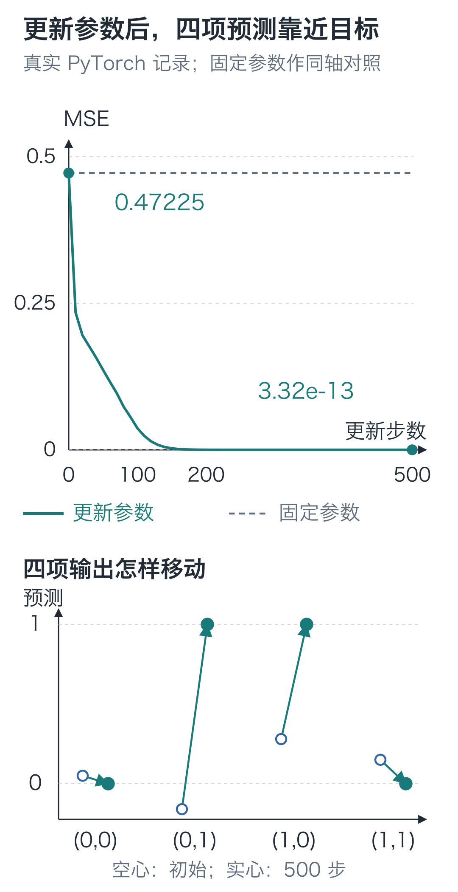
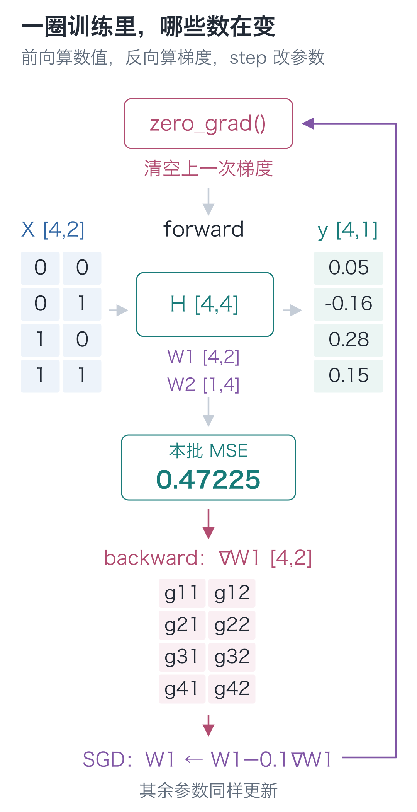
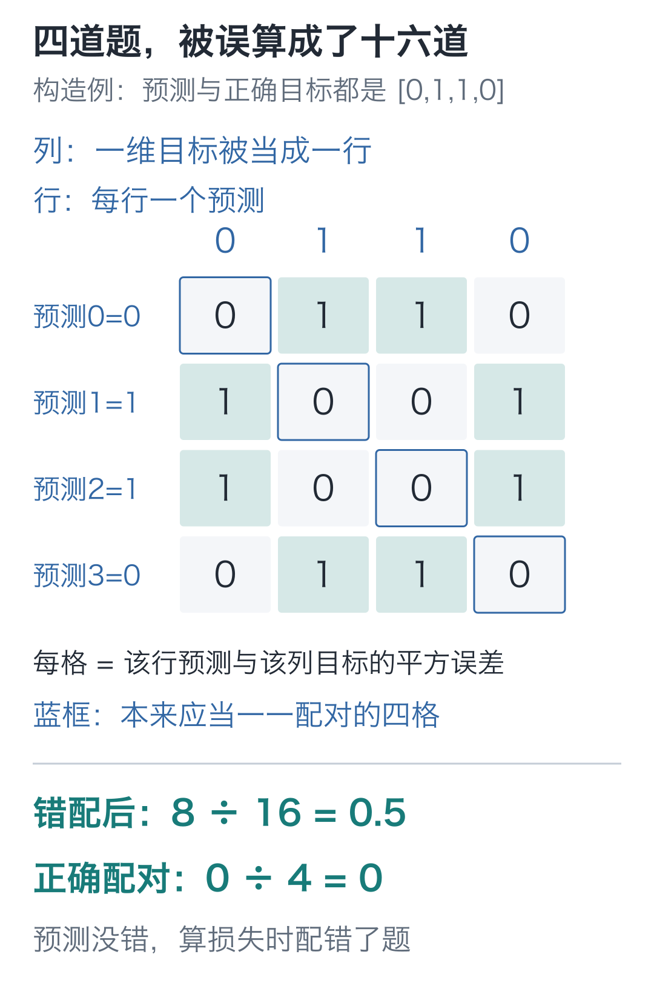

# 06｜训练循环：更新500次，四条预测会怎样？

手写小模型，看懂大模型 · 第 06 讲

按 `[0, 0]、[0, 1]、[1, 0]、[1, 1]` 的顺序给网络四份输入，它应该输出 `[0, 1, 1, 0]`，起初却给了 `[0.05, -0.16, 0.28, 0.15]`。

只看第二项：最初是 −0.16，更新 100 次后变成 0.7592，500 次后到了 0.9999994。其余三项也靠近了各自目标。输入和答案始终没换，程序反复改的是同一组参数。



上图记录实际训练的 MSE，横轴是更新次数；下图空心点是初始预测，实心点是 500 次更新后的位置。固定参数的虚线一直停在原损失上。

每次更新都要重新计算当前参数的梯度。网络大起来，逐项写反向容易漏路径，这次用 PyTorch 自动求导。先拿上一讲的手算结果核对，再训练这四条输入。

## 换了工具，同一个例子还算得对吗？

运行环境为 Python 3.12、`torch==2.9.1`，CPU、float32。[配套代码说明](https://github.com/DavidDingXu/hello-llm/blob/main/code/README.md)列出了 macOS 与 Windows 的安装命令。拿来核对的参数仍是：

```text
W1=[[1,0],[0,1]]，b1=[0,0]
W2=[[1,-1]]，b2=[0]
输入=[1,2]，目标=1
```

Python 列表负责存数，乘加由我们写循环。PyTorch 的 **Tensor，张量**，也按形状存数，并提供相应的运算。这里可以把它看作带有数值类型和形状的多维数组。

我们把一个样本横着放，因此输入 `x` 为 `[[1, 2]]`，形状 `[1, 2]`。前一个 1 是样本数，后一个 2 是每份样本的输入项数。

两层前向写成：

```text
hidden = ReLU(x @ W1.T + b1)
prediction = hidden @ W2.T + b2
```

`@` 做矩阵乘法，`.T` 交换参数矩阵的行列。用上面的初值核对，隐藏值应当仍为 `[[1, 2]]`，预测仍为 `[[-1]]`。

## 一轮训练，先认清五个动作

**清旧梯度 → 前向预测 → 算损失 → 反向算梯度 → 更新参数**

下面的 `forward` 对应已经算过的前向，`backward` 对应上一讲的反向，`SGD` 执行参数更新。代码还包含登记参数、打印数值等写法，先沿着这五个动作读。参数只在最后一步改变。

## 把刚才做过的运算记录下来

PyTorch 可以在执行运算时，记录结果由哪些输入、经过哪些操作得到。这些依赖连成一张**计算图**，反向时再沿依赖使用每种运算的局部规则。

当前样本的输入和目标固定，需要调整的是参数。Tensor 的 `requires_grad=True` 表示要追踪它参与的运算，以便计算对它的梯度。

把四组 Tensor 包成一个类。`nn.Module` 负责组织网络，`nn.Parameter` 登记参数并默认开启梯度追踪。代码里的 `B` 是样本数，`D` 是每份输入的项数，`H` 是隐藏单元个数。运行后可以先盯住 `W1` 第一行第二项的梯度：它应该还是上一讲追出来的 −8。

```python
import torch
from torch import nn


class TensorMLP(nn.Module):
    """两层网络：一行放一份输入，返回每份输入各自的一项预测。"""
    def __init__(self, params):
        super().__init__()
        # Parameter 登记可训练浮点数；各样本共用这些权重和偏置。
        self.W1 = nn.Parameter(torch.tensor(params["W1"], dtype=torch.float32))
        self.b1 = nn.Parameter(torch.tensor(params["b1"], dtype=torch.float32))
        self.W2 = nn.Parameter(torch.tensor(params["W2"], dtype=torch.float32))
        self.b2 = nn.Parameter(torch.tensor(params["b2"], dtype=torch.float32))

    def forward(self, x):
        # x 为 [B,D]，W1 为 [H,D]；转置后乘加得到 [B,H]，每行都加 b1。
        hidden = torch.relu(x @ self.W1.T + self.b1)
        # 输出层只做乘加，结果为 [B,1]，允许出现负预测。
        return hidden @ self.W2.T + self.b2
```

这个类只定义网络怎样计算，还没有进行训练。接着用上一讲的初值创建模型，再执行前面的五个训练动作。

`SGD` 是这里采用的优化器；不额外设置动量等选项时，它按已讲过的 `参数−学习率×梯度` 更新。`model.parameters()` 把模型登记的参数交给它。

```python
# 沿用手算例的初值，先核对自动求导，再进行后面的四样本实验。
params = {
    "W1": [[1., 0.], [0., 1.]], "b1": [0., 0.],
    "W2": [[1., -1.]], "b2": [0.],
}
model = TensorMLP(params)
# 输入与目标都按行放样本，目标保留 [B,1]，与预测逐项对齐。
x = torch.tensor([[1., 2.]])
target = torch.tensor([[1.]])
optimizer = torch.optim.SGD(model.parameters(), lr=0.01)

# 清除旧 .grad，防止本次反向的结果加到上次梯度上。
optimizer.zero_grad()
prediction = model(x)
# 对每份样本算平方误差再平均，得到一个可用于反向的标量损失。
loss = (prediction - target).square().mean()
# 只把梯度写入各参数的 .grad，此时参数值没有更新。
loss.backward()
print("预测、损失：", prediction.item(), loss.item())
for name, parameter in model.named_parameters():
    print(name, parameter.grad.tolist())

# SGD 在这一步才执行“参数 - 学习率 × 梯度”。
optimizer.step()
with torch.no_grad():
    # 用新参数重新检查结果；检查过程无需再建立求导记录。
    new_prediction = model(x)
    new_loss = (new_prediction - target).square().mean()
print("更新后：", new_prediction.item(), new_loss.item())
```

`loss.backward()` 从标量损失开始计算梯度，结果写入各个参数的 `.grad`。它没有执行参数更新；更新由后面的 `optimizer.step()` 执行。

| 检查项 | 第 05 讲手写结果 | 本段自动求导结果 |
| --- | --- | --- |
| 更新前预测 / 损失 | `−1 / 4` | `−1 / 4` |
| W1 梯度 | `[[-4, -8], [4, 8]]` | 相同 |
| b1 梯度 | `[-4, 4]` | 相同 |
| W2 梯度 | `[[-4, -8]]` | 相同 |
| b2 梯度 | `[-4]` | 相同 |
| 更新后预测 / 损失 | `−0.2896 / 1.66306816` | 约 `−0.2896002 / 1.6630688` |

float32 用有限位数存小数，最后几位会有舍入差异。手算、差分、自动求导核对的是同一个函数、同一组参数处的梯度；自动求导不需要逐个参数试着增加和减少。

<details class="optional" markdown="1">
<summary>代码旁注：类、求导开关与打印数值</summary>

`super().__init__()` 先初始化基类维护的模型信息；`self.W1` 等属性保存参数。调用 `model(x)` 时，`nn.Module` 会调用我们定义的 `forward`。

`with torch.no_grad():` 让缩进块里的检查计算不再被记录用于求导。此时只是读取更新后的结果，没有优化器更新；单独关闭求导并不会禁止所有手工改参数的动作。

`.item()` 取出只有一个数的 Tensor 中的 Python 数值，便于打印，不改变模型参数。

</details>

## 下一轮为什么先清梯度？

沿循环走完一圈，参数已经变了。下次预测会不同，损失对参数的变化率也可能不同，因此必须重新前向、重新求梯度。开头那 500 次更新，重复的是这套步骤。

开头的 `zero_grad()` 为什么必要？因为 PyTorch 默认把新算出的梯度**累加**到已有 `.grad` 上。普通的一批数据对应一次更新时，我们希望本次更新使用本批数据的梯度，所以先清空旧值。

接下来的 XOR 实验会把四个样本组成一批。它们都读取同一个 `W1`，贡献会合到 `W1.grad` 中。本批损失用了 `.mean()`，每条样本的贡献也要乘上 1/4，最终得到四条样本梯度的平均。这与“不清旧梯度，叠加多次反向结果”是两件事。

## 现在回到那四条错误预测

单样本核对通过后，再把开头四条 XOR 输入放成 `[4, 2]`，目标 `[0, 1, 1, 0]` 按样本逐行放成 `[4, 1]`。

目标也保留二维形状，是为了让每一行预测与同一行目标逐项相减。`.square().mean()` 先算四项平方误差，再除以 4，得到本批次 MSE。

这次新建 **2→4→1** 网络，隐藏层取四个单元。两个单元已经能表达 XOR，这里用四个做训练实验。



图中输入是 `[4,2]`，隐藏结果是 `[4,4]`：前一个4数的是样本，后一个4数的是每份样本的隐藏值。每次沿箭头走完一圈，使用新参数重算四份预测。

接着前面的类定义运行，重新创建模型与优化器。初值全部写在下面，学习率为 0.1，开头的四条初始预测就由它们算出：

```python
# 沿用上段的 TensorMLP 和 torch，重新建立 2→4→1 网络及优化器。
torch.set_num_threads(1)
xor_params = {
    "W1": [[.4, -.2], [-.3, .5], [.2, .3], [-.4, -.1]],
    "b1": [.1, .1, -.1, .2],
    "W2": [[.5, -.4, .3, .2]], "b2": [0.],
}
model = TensorMLP(xor_params)
# 四行输入与四行目标一一对应，共用同一组模型参数。
x = torch.tensor([[0., 0.], [0., 1.], [1., 0.], [1., 1.]])
target = torch.tensor([[0.], [1.], [1.], [0.]])
optimizer = torch.optim.SGD(model.parameters(), lr=0.1)
history = []

for step in range(501):
    # 每次用当前参数重新计算本批梯度，先清掉上一批留下的值。
    optimizer.zero_grad()
    prediction = model(x)
    # mean 除以四个样本数；反向时每条样本的梯度贡献也乘 1/4。
    loss = (prediction - target).square().mean()
    if step % 100 == 0:
        history.append((step, loss.item()))
    if step == 500:
        # 第 0 次尚未更新，第 500 次已更新 500 次；记录后不再多更新一次。
        break
    loss.backward()
    optimizer.step()

print("更新步数与损失：", history)
# detach 仅取出不追踪梯度的结果，展平后按样本顺序打印四项预测。
print("最终四项预测：", prediction.detach().flatten().tolist())
```

为什么循环到 500，却使用 `range(501)`？第 0 次记录尚未更新的初始损失；第 500 次记录完成 500 次更新后的结果，然后结束。记录次数与更新次数是两件事。

最后的 `.detach()` 取不再追踪梯度的结果，`.flatten()` 把 `[4, 1]` 展平为四项，`.tolist()` 转成便于查看的列表。它们用于展示，没有额外训练。

## 第 100 次到第 500 次，发生了什么

[XOR 原始记录](https://github.com/DavidDingXu/hello-llm/blob/main/code/artifacts/first_run/xor.json)使用上述固定初值、CPU float32 和 SGD 0.1，训练了 500 步。部分 MSE 如下：

| 已完成更新次数 | MSE |
| --- | --- |
| 0 | 0.47224998 |
| 100 | 0.03686844 |
| 200 | 0.00008998 |
| 500 | 约 3.32×10⁻¹³ |

若删去更新步骤，参数会停在初值，MSE 一直约为 0.47225，对应本文第一张图中的虚线。

四项最终输出分别为：

| 输入 | 目标 | 500 步后的预测 |
| --- | --- | --- |
| `[0, 0]` | 0 | 0.000000246 |
| `[0, 1]` | 1 | 0.999999404 |
| `[1, 0]` | 1 | 0.999999523 |
| `[1, 1]` | 0 | 0.000000827 |

四条输入现在都接近目标，说明这次拟合成功。它们全都参加过训练，还不能拿来证明网络会处理未见问题；这些直接乘加的输出也不是概率，初始的负数已经说明了这一点。

## 两道实验题

1. 假设四项预测已经全部等于目标 `[0,1,1,0]`。预测保持 `[4,1]`，却把目标写成一维 `[4]`，再计算平方误差的平均值。损失还会是 0 吗？
2. 同一个标量参数 `w=1`，对 `L=(2w−6)²` 连续进行两次前向和反向，中间不清梯度、不更新参数。两次打印的 `w.grad` 各是多少？

<details class="answer" markdown="1">
<summary>参考答案与核对代码</summary>

第一题的损失反而是 **0.5**。PyTorch相减时会自动扩展这两份数组：`[4,1]`的每个预测与`[4]`的全部四个目标相减，形成`[4,4]`，一共16项。这个自动扩展叫作**广播**；此处它把四道一一对应的题变成了全部交叉配对。



蓝框里的四格才是应当比较的题，平方误差全为0。错误代码却把整张表都平均了：`8/16=0.5`。先核对样本配对和损失数组的形状，再判断是否需要调整参数。

```python
# 构造四项完全正确的预测，与上面的训练实验分开；每行仍是一份样本。
perfect_prediction = torch.tensor([[0.], [1.], [1.], [0.]])
flat_target = torch.tensor([0., 1., 1., 0.])
# 故意保留一维目标：相减时交叉配对，得到16项平方误差。
wrong_errors = (perfect_prediction - flat_target).square()
# 还原为 [4,1] 后，才是每行预测与本行目标配对。
correct_errors = (perfect_prediction - flat_target[:, None]).square()
print(wrong_errors.shape, wrong_errors.mean().item())  # [4,4]，0.5
print(correct_errors.shape, correct_errors.mean().item())  # [4,1]，0.0
assert wrong_errors.shape == (4, 4) and wrong_errors.mean().item() == .5
assert correct_errors.shape == (4, 1) and correct_errors.mean().item() == 0.
```

上面 `flat_target[:, None]` 中的 `:` 保留全部四项，`None` 添加一根长度为 1 的轴，把 `[4]` 变成 `[4,1]`。目标数值没变，改变的是每个预测与哪个目标配对。

第二题，第一次是 **−16**，第二次是 **−32**，因为两个相同梯度累加了。可用这段独立小实验核对：

```python
# 沿用前面导入的 torch；本段只观察标量 w 的梯度，不做参数更新。
w = torch.tensor(1.0, requires_grad=True)
for _ in range(2):
    # 每次重新前向建立计算图，但特意不清空 w.grad，观察两次梯度相加。
    loss = (2 * w - 6).square()
    loss.backward()
    print(w.grad.item())  # -16.0，然后 -32.0
```

循环每次重新前向，建立本次运算图；没有对同一个已用完的 `loss` 重复调用反向。若此处希望第二次只保留本次梯度，可以在第二次前向前令 `w.grad=None`；模型训练中则由 `optimizer.zero_grad()` 统一处理。

</details>

进入文字模型前，先独立留下四项记录：一次前向的损失、反向后的某项梯度、更新前后的该项参数、更新后重新前向的损失。能指出“梯度出现”和“参数改变”分别发生在哪一行，并解释上面两道形状与累加题，再继续第07讲；若仍把反向等同于更新，先回第05讲沿一条路径复算。

这个网络收到的还是数字。若输入换成“小丁喜欢苹果。”，第一步该交给网络什么？

在 `code` 目录运行：

```bash
# 在配套代码目录运行本讲实验，核对正文中的结果。
python -m lessons.l06
```

这个入口会重新执行单步梯度核对和500次XOR训练，打印本次的初始、100步和最终结果，并保存到`artifacts/lessons/l06.json`。想先试100次，可运行`python -m lessons.l06 --steps 100`；原实验保存在`artifacts/first_run/xor.json`，可用来对照。

配套入口：[运行入口](https://github.com/DavidDingXu/hello-llm/blob/main/code/lessons/l06.py) · [Tensor 网络实现](https://github.com/DavidDingXu/hello-llm/blob/main/code/tiny_lm/tensor_mlp.py) · [完整运行记录](https://github.com/DavidDingXu/hello-llm/blob/main/code/EXPERIMENTS.md)

源码导航：[tensor_mlp.py · TensorMLP](https://github.com/DavidDingXu/hello-llm/blob/main/code/tiny_lm/tensor_mlp.py#L9)。

<!-- chapter-navigation:start -->

---

[← 手写反向传播](../05-backpropagation/README.md) · [课程目录](../../README.md#课程目录) · [文字与向量 →](../07-embeddings/README.md)

<!-- chapter-navigation:end -->
