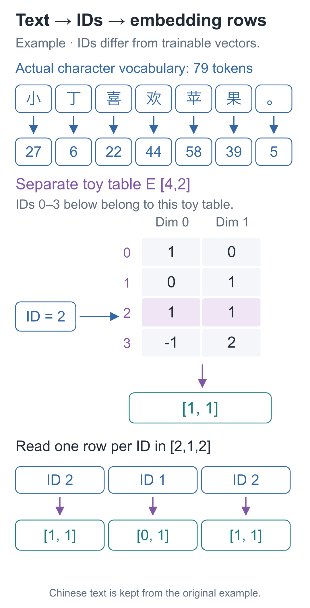
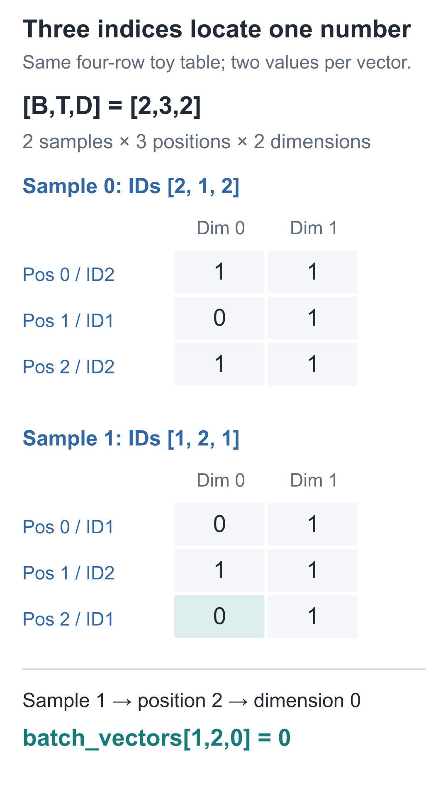
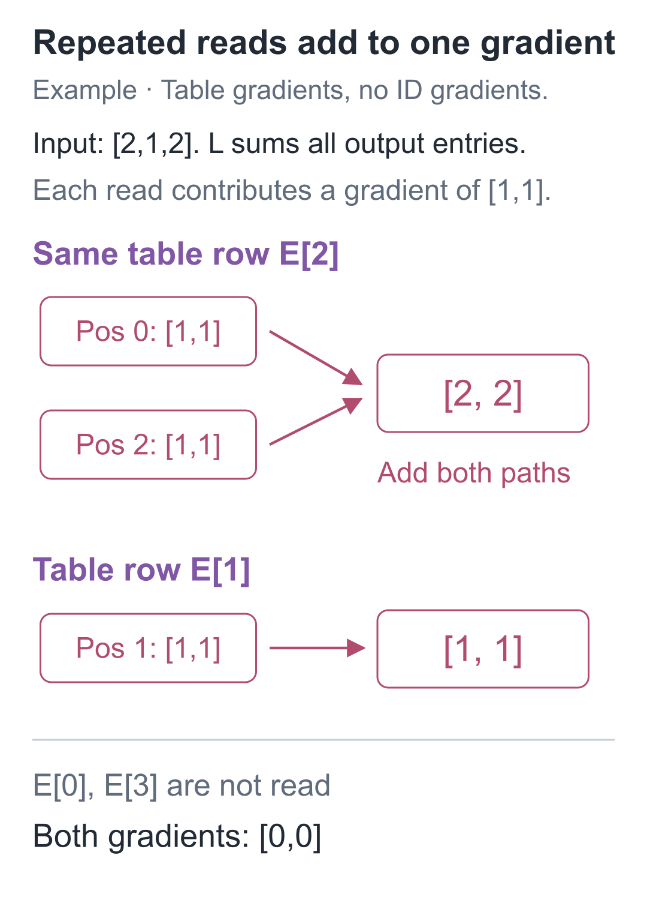

# 07 | Embedding: How Does Text Become a Network Input?

Build a Small Model, Understand Large Models · Lesson 07

In Python, `"小" * 2` produces “小小”. But the networks in the first six lessons need numerical multiply-and-add operations, followed by parameter adjustments based on prediction errors. Repeating a string does not connect to that calculation.

What if we assign each character a number? In the course vocabulary, “小” has ID 27, and “丁” has ID 6. Now `27×2=54` can be calculated, but ID 54 corresponds to “紫”. Multiplying “小” by 2 to get “紫” is clearly not the relationship between characters we want to establish.

An ID lets the program locate a character without telling it how to calculate with that character. Let us feed in “小丁喜欢苹果。” (“Xiaoding likes apples.”) and identify where we need fixed IDs and where we need adjustable numbers.

## First, make sure every character can be retrieved

Maintain a list of characters. A character's position in the list is its ID. This first step answers only “which character”; it does not interpret the size of an ID as meaning.

Our small model uses a character-level representation: each Chinese character or punctuation mark is one item. These basic items supplied to a model are called **tokens**. This series splits text by character; other schemes can combine several characters into one item, so a token need not be one Chinese character.

The fixed vocabulary has **79 entries**: 75 ordinary characters plus 4 special entries.

| ID | Entry | Role in this course |
| --- | --- | --- |
| 0 | `<pad>` | Pad samples to a common length |
| 1 | `<bos>` | Mark the beginning of a text |
| 2 | `<eos>` | Mark the end of a text |
| 3 | `<unk>` | Represent a character absent from the vocabulary |

Ordinary characters start at 4, sorted in a fixed Unicode order. Looking up “小丁喜欢苹果。” in the actual course vocabulary gives:

| Character | 小 | 丁 | 喜 | 欢 | 苹 | 果 | 。 |
| --- | --- | --- | --- | --- | --- | --- | --- |
| ID | 27 | 6 | 22 | 44 | 58 | 39 | 5 |

Converting text into a list of IDs is **encoding**; looking up the characters from that list is **decoding**. The component that performs these operations is the tokenizer.

The same “小” must always map to 27, or the saved parameters will read the wrong location. Run the following standard Python code from the companion code directory to encode and decode a sentence, checking that the original text returns:

```python
import json
from pathlib import Path

# 列表位置就是固定编号；读取课程词表，保证与保存的模型使用同一套地址。
tokens = json.loads(Path("data/vocab.json").read_text(
    encoding="utf-8"))["tokens"]
# 反向索引便于从字符查编号，编号本身不是要训练的浮点参数。
to_id = {token: i for i, token in enumerate(tokens)}

def encode(text):
    """逐字符编码成整数地址；查不到的字符使用 UNK 编号 3。"""
    return [to_id.get(char, 3) for char in text]

def decode(ids):
    """按编号取回普通字符，跳过 0—3 四个特殊项；不能恢复未知原字。"""
    return "".join(tokens[i] for i in ids if i >= 4)

text = "小丁喜欢苹果。"
ids = encode(text)
print(len(tokens), ids)
print(decode(ids))
assert len(tokens) == 79
# 本例字符都在词表中，所以编码、解码后应回到原句。
assert decode(ids) == text
```

`enumerate` supplies both list positions and contents. `get(char, 3)` uses the UNK ID when a character is missing. The decoder above skips special entries by default, so an exact round trip requires every original character to be in the vocabulary. Once an unknown character is encoded as UNK, the original character is lost and cannot be recovered by decoding.

For example, “龙” (“dragon”) is absent from the vocabulary, so it encodes as `[3]`. This represents an unknown item; the system has not inferred its meaning from its pronunciation or written shape.

## IDs round-trip correctly, but multiply-and-add is still disconnected

Printing the original sentence shows that the characters were located correctly. But if we next calculate `w×27+b`, changing the vocabulary to assign “小” ID 28 changes the output even though the text itself is unchanged. The calculation now depends on an arbitrary ordering.

We need “小” to have a representation that can be adjusted through prediction errors. The parameters should learn how to distinguish it from “丁”. The fact that the ID of “丁” is 21 less than that of “小” should not force their numerical representations to be 21 apart.

Keep the ID as an address and place a parameter row at each address: **the input ID only selects a row; the selected numbers take part in multiply-and-add.**

For a hand calculation, leave the real 79-entry vocabulary and use a separate four-entry demonstration vocabulary. Here, 0, 1, 2, and 3 are all ordinary demo entries; they do not carry the special meanings assigned above.

| Demo ID | Parameter column 0 | Parameter column 1 |
| --- | --- | --- |
| 0 | 1 | 0 |
| 1 | 0 | 1 |
| 2 | 1 | 1 |
| 3 | −1 | 2 |

ID 2 retrieves `[1, 1]`; ID 1 retrieves `[0, 1]`. Input `[2, 1, 2]` produces:

```text
[[1, 1],
 [0, 1],
 [1, 1]]
```

This trainable parameter table is an **embedding table**. Turning an ID into a vector is the embedding lookup. Each row currently contains 2 numbers, so the representation has width 2. Neither coordinate has a predetermined meaning such as “color” or “fruit.”



Trace one ID first: it points to just one row, without multiplying through the entire table. The selected rows are then placed in input order, preserving the order of positions.

Call the table `E` and the ID `i`. The lookup is written **output vector h=E[i]**. This is indexed retrieval, not `i×E`.

It also connects to our earlier matrix multiplication. Multiplying `[0, 0, 1, 0]` by this table keeps only row 2; all other rows are multiplied by 0, so the result is still `[1, 1]`. Actual code selects the row directly, avoiding multiply-and-add operations that must be zero.

Training changes the floating-point numbers in the table while the ID scheme stays fixed. The retrieved vector is a result of this forward pass.

## How do two sequences form a three-axis tensor?

Using the same small table, process two ID sequences, `[2,1,2]` and `[1,2,1]`, together. Each has 3 positions, and each position retrieves 2 numbers, so the output shape is **[2,3,2]**. The axes select sample, position, and vector coordinate, denoted `B`, `T`, and `D`.



To read `batch_vectors[1,2,0]`, first select the second sample, then its third position, then the vector's first coordinate, giving 0. **A “two-dimensional vector” means 2 numbers per position; a “three-axis tensor” here means that 3 indices are needed to locate one number.** These descriptions count different things.

In the [3D lookup lab](https://daviddingxu.github.io/hello-llm/chapters/07-embeddings/lab3d.en.html), select a value along these three axes and trace it back to its parameter-table row. Change an input ID at one position to compare which outputs change. The lab uses the four-entry demo table above; changing an ID selects a different row without updating any parameters.

Return now to the full model: each character is represented by 64 numbers, and the parameter table has shape **[79,64]**. The first axis selects a vocabulary entry; the second selects a feature coordinate. There are `79×64=5056` parameters.

A sentence with 7 characters has input shape `[7]` and becomes `[7,64]` after lookup. If we pass `B` sentences, each padded to `T` positions, the IDs have shape `[B,T]` and the result is `[B,T,64]`. The lookup retrieves 64 coordinates per input position without changing the number of samples or positions.

Adding BOS and EOS to this short sentence gives 9 positions and a lookup result of `[9, 64]`. One more input character retrieves one more row; changing each character to a 32-dimensional representation requires changing the parameter table's column count.

Immediately after lookup, the same character receives the same vector at different positions. The table has not read the preceding text and does not know which sentence contains this occurrence of “小”. Later, we need a separate computation to mix in context.

## If a character appears twice, will the wrong row be updated?

ID 2 appears twice in `[2, 1, 2]`, so two retrieved vectors come from the same row. During backpropagation, gradients return from both occurrences. Will only the last one survive?

Temporarily use “sum every output coordinate” as a demonstration loss. Each output coordinate then has gradient 1, making it easy to see where the two paths meet.

ID 2 is read twice, so both contributions return to row 2, giving `[2, 2]`. ID 1 is read once and receives `[1, 1]`. The other two rows are not read and receive `[0, 0]`.



The following standalone code checks row selection, gradient accumulation, and the update.

```python
import torch

# 独立的四项演示表：0—3 在这里都是普通地址，不沿用课程特殊项含义。
# 表内浮点数可求梯度，行号只是选行的整数。
table = torch.tensor([[1., 0.], [0., 1.],
                      [1., 1.], [-1., 2.]],
                     requires_grad=True)
indices = torch.tensor([2, 1, 2], dtype=torch.long)
# 按位置依次取行，得到 [3,2]；编号 2 的两次读取共享同一行参数。
vectors = table[indices]
# 用求和作演示损失，使每个输出坐标收到的梯度都为 1。
loss = vectors.sum()
# 两次读取的贡献加回第 2 行；这里只算梯度，还没有修改表内数值。
loss.backward()

print(vectors)
print(table.grad)
assert table.grad.tolist() == [[0., 0.], [1., 1.],
                               [2., 2.], [0., 0.]]

# 两条序列仍查同一张表；三根轴依次选择样本、位置、向量坐标。
batch_ids = torch.tensor([[2, 1, 2], [1, 2, 1]])
batch_vectors = table[batch_ids]
assert list(batch_vectors.shape) == [2, 3, 2]
assert batch_vectors[1, 2, 0].item() == 0.0

# 全部梯度算好后，再按学习率0.1更新；赋值过程不建立新的求导记录。
with torch.no_grad():
    table -= 0.1 * table.grad
print("更新后的第2行：", table[2])  # 约 [0.8, 0.8]
assert torch.allclose(table[2], torch.tensor([0.8, 0.8]))
```

`long` is the integer type used to store IDs. Integer indices themselves do not receive gradients; the floating-point table with `requires_grad=True` does. `table[indices]` retrieves several rows, and automatic differentiation still tracks where each came from.

The output confirms that row 2's gradient is `[2, 2]`. Both reads affect the same parameters, so their contributions add, exactly as in Lesson 05's branching-gradient rule. With learning rate 0.1, the row changes from `[1, 1]` to `[0.8, 0.8]`. The next time this ID appears, both occurrences retrieve the same updated row.

The sum loss here only makes the gradients easy to inspect. In Lesson 09, incorrect next-character predictions will drive changes to this table. PyTorch's `nn.Embedding(79, 64)` stores exactly this kind of trainable parameter table.

## Where does the current vocabulary come from?

This series declares eight people, fruits, colors, and a limited set of sentence patterns in advance, then fixes the allowed character set accordingly. Original records are split by whole templates before encoding: pretraining uses 256 training and 64 held-out examples; question answering uses 24 training and 8 held-out examples.

The vocabulary declares allowed characters; the training split updates parameters; the held-out split checks performance. Records, the vocabulary, and file checksums are in the [data directory](https://github.com/DavidDingXu/hello-llm/blob/main/code/data/manifest.json), with the full generation rules in the [data source](https://github.com/DavidDingXu/hello-llm/blob/main/code/tiny_lm/data.py).

To answer “which character might come next?”, the model still needs to turn a position vector into scores for all 79 vocabulary candidates.

## Three exercises with changed values

1. Swap demo IDs 1 and 2, and also swap rows 1 and 2 of the parameter table. After encoding and lookup, will the vectors for an original symbol sequence change? What if only the IDs change and the table stays the same?
2. Restart from this lesson's initial table and change the input to `[2, 2, 2]`. Keep the sum of all output coordinates as the loss. What is row 2's gradient? What does the row become after an update with learning rate 0.1?
3. Add one ID to each of the two sequences in the diagram, still using the same two-column table. What is the new output shape? Do the vectors also become four-dimensional?

<details class="answer" markdown="1">
<summary>Reference answers</summary>

For the first exercise, swapping both the ID scheme and the corresponding table rows leaves each symbol's retrieved vector unchanged. Changing only the scheme retrieves a different row and generally changes the result.

For the second, row 2 has gradient `[3,3]` and becomes `[0.7,0.7]` after the update. All other rows have gradient 0. Repeating an ID does not automatically create three separate parameter copies.

For the third, the output shape is `[2,4,2]`. The middle, position axis changes; each position still retrieves a vector of 2 numbers. The table's column count is unchanged.

</details>

From the companion code directory, run this using the course environment with PyTorch installed:

```bash
# 在配套代码目录运行本讲实验，核对正文中的结果。
python -m lessons.l07
```

Lesson entry point: [Entry point](https://github.com/DavidDingXu/hello-llm/blob/main/code/lessons/l07.py) · Complete component: [tokenizer.py](https://github.com/DavidDingXu/hello-llm/blob/main/code/tiny_lm/tokenizer.py) · [Environment setup](https://github.com/DavidDingXu/hello-llm/blob/main/code/README.md)

Source navigation: [tokenizer.py · CharTokenizer](https://github.com/DavidDingXu/hello-llm/blob/main/code/tiny_lm/tokenizer.py#L8) · [experiments.py · lesson07](https://github.com/DavidDingXu/hello-llm/blob/main/code/lessons/experiments.py#L113).

<!-- chapter-navigation:start -->

---

[← Making the Network Learn](../06-training-loop/README.en.md) · [Contents](../../README.en.md#course-contents) · [Scores and Probabilities →](../08-softmax/README.en.md)

<!-- chapter-navigation:end -->
