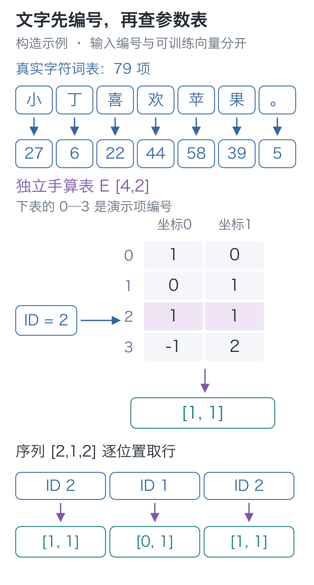
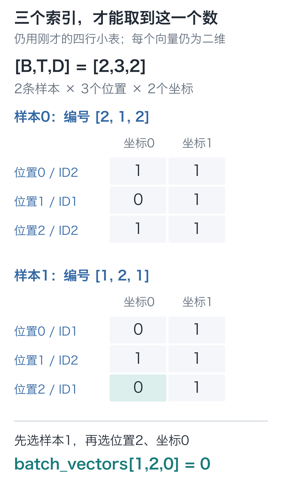
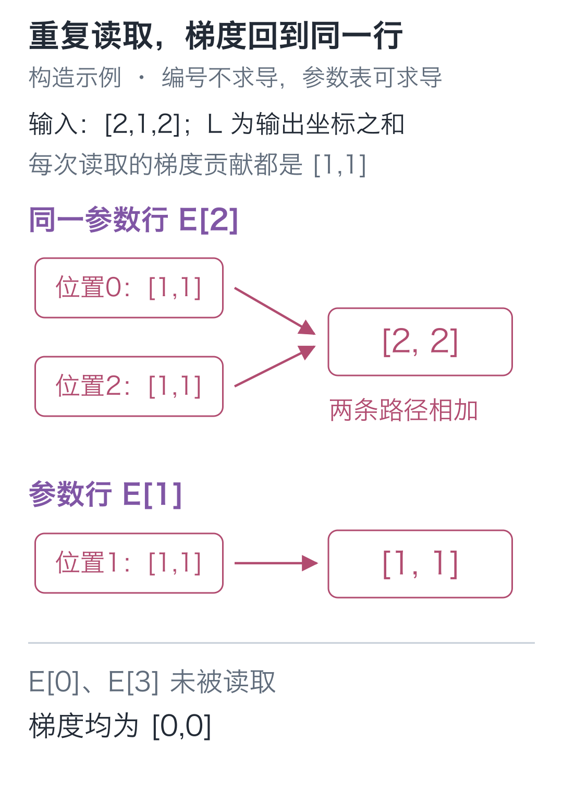

# 07｜Embedding：文字怎样变成网络的输入？

手写小模型，看懂大模型 · 第 07 讲

在 Python 里写 `"小" * 2`，会得到“小小”。但前六讲的网络需要做数值乘加，再根据预测错误改参数，字符串重复接不上这条计算。

给字编个号呢？课程词表里，“小”是 27，“丁”是 6。现在 `27×2=54` 能算了，然而编号 54 对应的字是“紫”。“小”乘 2 变成“紫”，显然不是我们想建立的文字关系。

编号让程序找得到一个字，却没有告诉它该怎样计算这个字。先把“小丁喜欢苹果。”送进去，看看哪里需要固定编号，哪里需要能调整的数。

## 先保证每个字都能找回来

维护一个字符列表，每个字符在列表中的位置，就是它的编号。这一步先只解决“哪个字符”，不拿编号大小解释含义。

我们的小模型采用字符级表示，一个汉字或标点各算一项。这些送进模型的基本项，统称 **token，词元**。本栏按字符切分，其他方案可以把多个字符合成一项，所以 token 不一定是一个汉字。

固定词表共有 **79 项**：75 个普通字符，再加 4 个特殊项。

| 编号 | 项目 | 在本课程中的作用 |
| --- | --- | --- |
| 0 | `<pad>` | 补齐样本长度 |
| 1 | `<bos>` | 标记一条文字开始 |
| 2 | `<eos>` | 标记一条文字结束 |
| 3 | `<unk>` | 接住词表里没有的字符 |

普通字符从 4 开始，按固定的 Unicode 顺序排列。用真实课程词表查“小丁喜欢苹果。”，得到：

| 字符 | 小 | 丁 | 喜 | 欢 | 苹 | 果 | 。 |
| --- | --- | --- | --- | --- | --- | --- | --- |
| 编号 | 27 | 6 | 22 | 44 | 58 | 39 | 5 |

把文字转换成编号列表，叫作**编码**；按列表反查字符，叫作**解码**。完成这两种动作的组件，就是 tokenizer。

同一个“小”每次都要查到 27，否则保存的参数就会读错位置。在配套代码目录运行下面的标准 Python，做一次编码、解码往返，检查是否仍能得到原句：

```python
import json
from pathlib import Path

# 列表位置就是固定编号；读取课程词表，保证与保存的模型使用同一套地址。
tokens = json.loads(Path("data/vocab.json").read_text(
    encoding="utf-8"))["tokens"]
# 反向索引便于从字符查编号，编号本身不是要训练的浮点参数。
to_id = {token: i for i, token in enumerate(tokens)}

def encode(text):
    """逐字符编码成整数地址；查不到的字符使用 UNK 编号 3。"""
    return [to_id.get(char, 3) for char in text]

def decode(ids):
    """按编号取回普通字符，跳过 0—3 四个特殊项；不能恢复未知原字。"""
    return "".join(tokens[i] for i in ids if i >= 4)

text = "小丁喜欢苹果。"
ids = encode(text)
print(len(tokens), ids)
print(decode(ids))
assert len(tokens) == 79
# 本例字符都在词表中，所以编码、解码后应回到原句。
assert decode(ids) == text
```

`enumerate` 同时给出列表位置和内容；`get(char, 3)` 表示查不到时使用 UNK 编号。上面的解码默认跳过特殊项，所以往返相同的前提是原文字符都在词表里。未知字符被编码成 UNK 后，原字符已经丢失，不能靠解码恢复。

例如输入“龙”，词表里没有它，编码就得到 `[3]`。这代表一个未知项，不是系统根据读音或字形猜出了它的含义。

## 编号能往返了，乘加还是没接上

程序打印出了原句，说明字符没有找错。但如果接着计算 `w×27+b`，换一份词表、把“小”改编为 28，文字没变，输出却变了。计算开始依赖人为排序。

我们需要让“小”拥有自己能从预测错误里调整的表示。它与“丁”应当怎样区分，由参数去学；“丁”的编号比“小”小 21，不该预先强迫它们在数值上相距 21。

把编号留作地址，为每个地址放一行参数就可以了：**输入编号只负责选行，选出的数再参加乘加。**

先离开 79 项真实词表，用一套独立的四项演示词表手算。这里 0、1、2、3 都是普通演示项，不沿用上面的特殊项含义。

| 演示编号 | 参数第 0 列 | 参数第 1 列 |
| --- | --- | --- |
| 0 | 1 | 0 |
| 1 | 0 | 1 |
| 2 | 1 | 1 |
| 3 | −1 | 2 |

输入编号 2，就取出 `[1, 1]`；输入编号 1，就取出 `[0, 1]`。输入 `[2, 1, 2]`，得到：

```text
[[1, 1],
 [0, 1],
 [1, 1]]
```

这张可训练参数表叫 **Embedding 表**，把编号变成向量的动作叫嵌入。此时每行有 2 个数，所以表示宽度为 2；这两个坐标没有预先规定的“颜色”“水果”等含义。



读图时先沿一个编号追踪：它只指向表的一行，没有把整个表都乘一遍。最后把各位置选出的行依次排好，位置顺序也保留了。

把表记作 `E`，编号记作 `i`，查表就写成 **输出向量 h=E[i]**。这是索引读取，不是 `i×E`。

这与前面的矩阵乘法也接得上。用 `[0, 0, 1, 0]` 乘这张表，相当于只留下第 2 行，其他行都乘 0，结果仍是 `[1, 1]`。实际代码直接选行，省去那些必然为零的乘加。

训练改变的是表里的浮点数，编号规则保持固定。选出的向量是这次前向的结果。

## 两条序列，怎样排成三轴张量

仍用这张小表，一次处理两条编号序列 `[2,1,2]`、`[1,2,1]`。每条都有3个位置，每个位置取出2个数，输出形状就是 **[2,3,2]**。三根轴依次选样本、位置、向量坐标，分别记作 `B、T、D`。



沿图取 `batch_vectors[1,2,0]`：先选第二条样本，再选它的第三个位置，最后选向量的第一个坐标，得到0。**“二维向量”说的是每个位置有2个数；这里的“三轴张量”说的是要用3个索引才能取到一个数。** 两种说法数的不是同一件事。

在[三维查表实验](https://daviddingxu.github.io/hello-llm/chapters/07-embeddings/lab3d.html)中，可以沿这三个轴选中一个数，查看它来自参数表的哪一行；也可以修改某个位置的输入编号，比较哪些输出随之改变。实验使用上面的四项演示表，修改编号只改变选行，不更新参数。

现在换回正式模型：每个字符表示成64个数，参数表形状为 **[79,64]**。前一轴选词表项，后一轴选特征坐标，共有 `79×64=5056` 个参数。

一句话有7个字符，输入形状是 `[7]`，查表后为 `[7,64]`。如果一次送入 `B` 条、每条补齐到 `T` 个位置，编号形状为 `[B,T]`，结果就是 `[B,T,64]`。查表给每个输入位置取出64个坐标，不改变样本数和位置数。

给这句短句加上 BOS、EOS，就有 9 个位置，查表后是 `[9, 64]`。多输入一个字，是多取一行；想把每个字改成 32 维表示，则要修改参数表的列数。

刚查完表时，同一个字符在不同位置得到相同向量。表尚未读取前文，也不知道这次“小”出现在什么句子里。后面需要专门的计算把上下文混进来。

## 一个字出现两次，会不会更新错行？

编号 2 在 `[2, 1, 2]` 里出现两次，读出的两个向量来自同一行。反向传播时，两处的梯度都回来，会不会只留下最后一次？

临时把“所有输出坐标相加”作为演示损失。这样每个输出坐标的梯度都是 1，最容易看清两条路径会在哪里碰面。

编号 2 被读取两次，所以两次贡献都回到第 2 行，得到 `[2, 2]`；编号 1 只读一次，得到 `[1, 1]`；另两行没被读取，得到 `[0, 0]`。



下面用代码核对选行、梯度累加和更新，可独立运行。

```python
import torch

# 独立的四项演示表：0—3 在这里都是普通地址，不沿用课程特殊项含义。
# 表内浮点数可求梯度，行号只是选行的整数。
table = torch.tensor([[1., 0.], [0., 1.],
                      [1., 1.], [-1., 2.]],
                     requires_grad=True)
indices = torch.tensor([2, 1, 2], dtype=torch.long)
# 按位置依次取行，得到 [3,2]；编号 2 的两次读取共享同一行参数。
vectors = table[indices]
# 用求和作演示损失，使每个输出坐标收到的梯度都为 1。
loss = vectors.sum()
# 两次读取的贡献加回第 2 行；这里只算梯度，还没有修改表内数值。
loss.backward()

print(vectors)
print(table.grad)
assert table.grad.tolist() == [[0., 0.], [1., 1.],
                               [2., 2.], [0., 0.]]

# 两条序列仍查同一张表；三根轴依次选择样本、位置、向量坐标。
batch_ids = torch.tensor([[2, 1, 2], [1, 2, 1]])
batch_vectors = table[batch_ids]
assert list(batch_vectors.shape) == [2, 3, 2]
assert batch_vectors[1, 2, 0].item() == 0.0

# 全部梯度算好后，再按学习率0.1更新；赋值过程不建立新的求导记录。
with torch.no_grad():
    table -= 0.1 * table.grad
print("更新后的第2行：", table[2])  # 约 [0.8, 0.8]
assert torch.allclose(table[2], torch.tensor([0.8, 0.8]))
```

`long` 是整数类型，负责存编号。整数索引本身不求梯度；可求梯度的是 `requires_grad=True` 的浮点表。`table[indices]` 读取多行，自动求导仍能追踪每行来自哪里。

输出里，第 2 行的梯度确实是 `[2, 2]`。两处读取都影响同一份参数，贡献相加，这正是第 05 讲的分支梯度规则。用学习率 0.1 更新后，它从 `[1, 1]` 变成 `[0.8, 0.8]`；下次遇到这个编号，两处都会取到更新后的同一行。

这里用求和损失只为看清梯度。到第 09 讲，我们会让“下一个字预测错了”来推动这张表改变。PyTorch 的 `nn.Embedding(79, 64)` 保存的就是这样一份可训练参数。

## 现在的词表从哪里来？

本栏预先声明八个人物、水果、颜色和有限句式，再据此固定合法字符集合。原始记录先按完整模板划分，之后才编码：预训练 256 条训练、64 条留出；问答 24 条训练、8 条留出。

词表声明合法字符，训练组负责更新参数，留出组用来检查效果。记录、词表及文件校验清单在[数据目录](https://github.com/DavidDingXu/hello-llm/blob/main/code/data/manifest.json)，完整生成规则在[数据源码](https://github.com/DavidDingXu/hello-llm/blob/main/code/tiny_lm/data.py)。

要让模型回答“接下来可能是哪一个字”，还需要把位置向量转换成词表里 79 个候选的分数。

## 三道改数题

1. 把演示编号 1、2 对调，同时交换参数表的第 1、2 行。原来的一段符号经过编码与查表后，向量会变吗？如果只改编号，不改表呢？
2. 从本讲的初始参数表重新运行，把输入改成 `[2, 2, 2]`，仍以输出所有坐标之和为损失。第 2 行的梯度是多少？用学习率 0.1 更新后，这一行变成什么？
3. 图中的两条序列各加一个编号，仍查同一张两列参数表。输出形状变成什么？每个向量也变成四维了吗？

<details class="answer" markdown="1">
<summary>参考答案</summary>

第一题，同时交换规则和对应表行，符号取得的向量不变；只改规则，会取到另一行，结果一般改变。

第二题，第2行梯度为 `[3,3]`，更新后为 `[0.7,0.7]`，其余行梯度为0。编号重复不会自动新增三份参数。

第三题，输出为 `[2,4,2]`。变的是中间的位置轴，每个位置取出的向量仍有2个数；参数表的列数没有改变。

</details>

进入配套代码目录，使用已安装 PyTorch 的课程环境运行：

```bash
# 在配套代码目录运行本讲实验，核对正文中的结果。
python -m lessons.l07
```

本讲入口：[运行入口](https://github.com/DavidDingXu/hello-llm/blob/main/code/lessons/l07.py) · 完整组件：[tokenizer.py](https://github.com/DavidDingXu/hello-llm/blob/main/code/tiny_lm/tokenizer.py) · [环境说明](https://github.com/DavidDingXu/hello-llm/blob/main/code/README.md)

源码导航：[tokenizer.py · CharTokenizer](https://github.com/DavidDingXu/hello-llm/blob/main/code/tiny_lm/tokenizer.py#L8) · [experiments.py · lesson07](https://github.com/DavidDingXu/hello-llm/blob/main/code/lessons/experiments.py#L113)。

<!-- chapter-navigation:start -->

---

[← 让网络学起来](../06-training-loop/README.md) · [课程目录](../../README.md#课程目录) · [分数与概率 →](../08-softmax/README.md)

<!-- chapter-navigation:end -->
