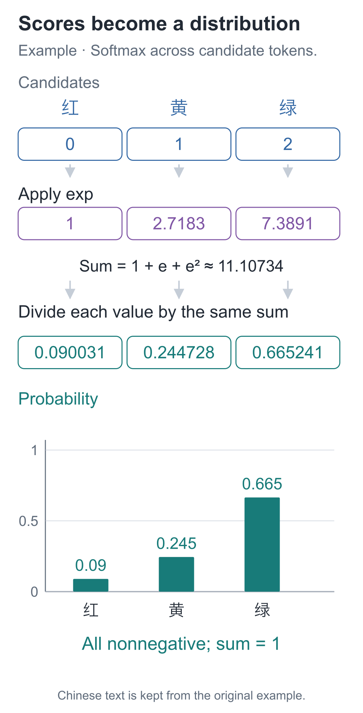
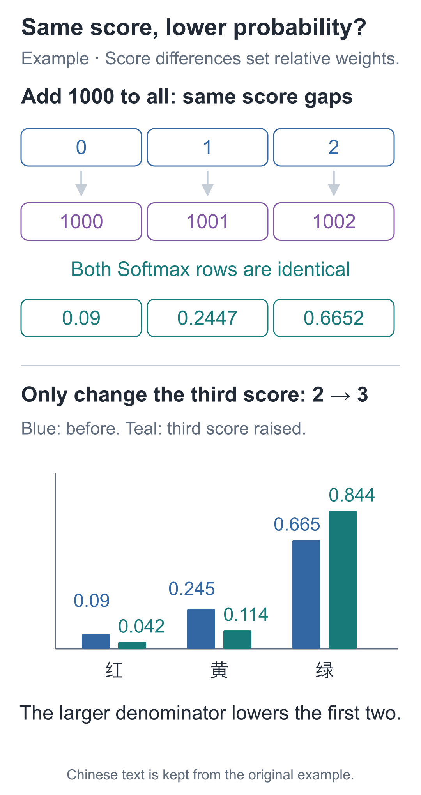

# 08 | Softmax: How Do Scores Become Next-Character Probabilities?

Build a Small Model, Understand Large Models · Lesson 08

For a hand calculation, narrow the possible next characters to “红, 黄, 绿” (“red, yellow, green”). With scores `[0, 1, 2]`, red's probability is about 0.090. Raise only green's score to 3, and red's score stays at 0 while its probability falls to about 0.042.

Why is red less likely to be selected even though its score did not decrease?

## First, calculate these three scores

The previous lesson turned characters into vectors. Now take the vector at one position and use Lesson 02's linear layer to calculate one number for each candidate.

For the hand calculation, use a two-dimensional position vector `h=[1, 2]` and three candidates. Their parameter rows are:

```text
候选红：[0, 0]
候选黄：[1, 0]
候选绿：[0, 1]
```

Multiply each row component by component with `h` and sum: red gets `0×1+0×2=0`, yellow gets `1×1+0×2=1`, and green gets `0×1+1×2=2`.

This is the **output projection**: its input is a position vector, its parameters are weights for each candidate, and its output is a set of candidate scores. These scores are often called **logits**. The current 0, 1, and 2 come from parameters chosen by hand, without training.

In the full model, the input has shape `[B, T, 64]`, the projection parameters have shape `[79, 64]`, and the output is **[B,T,79]**. Each entry on the last axis corresponds to one vocabulary candidate. With batched row vectors, the formula is **logits=h @ Wᵀ**. Transposing `Wᵀ` lets each position vector take a dot product with each row of the parameter table.

This model's output projection has no bias, and it does not apply ReLU after the scores. Scores can be positive or negative; the next step assigns probabilities based on candidates' relative scores. The input embedding table and output projection are two separately trainable parameter sets.

## Can we just divide scores by their sum?

Probabilities must be nonnegative, and probabilities of all mutually exclusive candidates must sum to 1. Scores have no such restrictions: they may be negative, and their sum may exceed 1.

Dividing directly by the sum of scores does not solve the general problem. For `[-1, 0, 1]`, the denominator is 0. A mixture of positive and negative scores may also produce negative “probabilities.”

First turn each score into a positive number, then divide each by their positive total. A common choice is the **exponential function**.

Write it as `exp(z)`, or `eᶻ`, where `e` is approximately 2.71828. For integers, `e²` means `e×e`; the exponential function also has a continuous definition for fractional values. For now, learn a few values and their purpose:

| Score z | exp(z), approximately |
| --- | --- |
| −1 | 0.36788 |
| 0 | 1 |
| 1 | 2.71828 |
| 2 | 7.38906 |

A higher score has a larger exponential value, and even negative scores become positive. This transformation also yields the probability ratios we will calculate below and connects to the logarithmic loss in the next lesson.

For `[0, 1, 2]`, we first obtain `[1, 2.71828, 7.38906]`, whose sum is approximately 11.10734. Divide each entry by this total:

```text
p红 = 1       / 11.10734 ≈ 0.09003057
p黄 = 2.71828 / 11.10734 ≈ 0.24472847
p绿 = 7.38906 / 11.10734 ≈ 0.66524096
```



Follow the third candidate's path: 7.38906 is its exponential value. Only after dividing by the total do we obtain its probability, 0.66524096.

The whole operation—“exponentiate each score, then divide by the sum of exponentials”—is called **Softmax**. If the `i`th score is `zᵢ`, its formula is:

**pᵢ=exp(zᵢ) / the sum of exp(z) over all candidates.**

The exponential transformation also connects score differences to probability ratios. Dividing two candidates' probabilities cancels the common denominator, giving **pᵢ/pⱼ=exp(zᵢ−zⱼ)**. Yellow's score is 1 above red's, so its probability is about 2.718 times red's. Green's score is 2 above red's, so its probability is about 7.389 times red's.

In the opening, only green's score changed from 2 to 3, raising its exponential value from about 7.38906 to 20.08554. Red's numerator stays at 1, but the denominator grows from about 11.10734 to 23.80382. Red's probability therefore falls from about 0.090 to 0.042.

**A candidate's share of probability depends on its relationship to the entire row of candidates.** Increasing its score by 1 multiplies its probability ratio against each other candidate by about 2.718. It does not simply multiply its own probability by 2.718, because the denominator changes too.

The denominator includes the entire vocabulary, not just the few entries ultimately displayed. When only the highest-probability candidates are shown, their bars may sum to less than 1; the remaining probability still belongs to other candidates.

Programs store floating-point approximations, so checking that the total is close to 1 is sufficient. Rounding for display may affect the last digit.

## What if all three scores increase by 1000?

Changing one score changed all three probabilities. Now try a different change: add 1000 to every score. Their gaps remain 1 and 1. A large probability change would make the model depend on an overall offset that did not change the relationships between candidates.

Exponentials satisfy `exp(a+b)=exp(a)×exp(b)`. Adding the same number to every score therefore multiplies every numerator and the denominator by the same factor, which cancels.

This also helps the computation. Directly calculating `exp(1002)` can exceed the floating-point range and produce infinity. Subtracting the maximum score first turns `[1000, 1001, 1002]` into `[-2, -1, 0]`. The largest exponential is now only 1, while the distribution remains equivalent.

Be sure to **subtract the same maximum value from the whole row**, rather than subtracting each number from itself. The code below checks that `[0, 1, 2]` and `[1000, 1001, 1002]` give the same result.

```python
import math

def softmax(scores):
    """把同一位置的全部候选分数，转换为总和为 1 的概率列表。"""
    if not scores:
        raise ValueError("至少需要一个候选分数")
    # 整行减同一个最大值，保留相对差距，同时避免指数过大。
    maximum = max(scores)
    positive = [math.exp(s - maximum) for s in scores]
    # 所有候选共用这个分母；此时 positive 还不是概率。
    total = sum(positive)
    return [value / total for value in positive]

p = softmax([0., 1., 2.])
# 共同平移分数后概率应相同，只有候选间的差距在这里起作用。
shifted = softmax([1000., 1001., 1002.])
print(p)
assert abs(sum(p) - 1.) < 1e-12
assert all(abs(a - b) < 1e-12 for a, b in zip(p, shifted))
```



The assertions check a common shift, while the bars retain the opening's single-score change. When the third score rises to 3, the full distribution becomes `[0.04201007, 0.11419520, 0.84379473]`. Both edits change scores, but only the one that changes relative gaps changes the distribution.

## From three candidates back to the character after “欢”

We can now assemble a minimal character predictor: take input IDs, retrieve vectors, and project them linearly into vocabulary scores. We call it **CharBaseline**, the character baseline model. A baseline keeps a simple approach as a reference for later improvements.

Expand the three candidates to the course vocabulary's 79 entries and place the projection after the lookup. Below, PyTorch initializes two random parameter sets. `manual_seed(42)` fixes the random seed so that initial values are reproducible in the same environment.

```python
import torch
from torch import nn

# 固定随机初值，只检查形状与概率；本段没有目标标签或参数更新。
torch.manual_seed(42)
# 两份独立参数：先按编号选出 64 维向量，再给 79 个候选各算一项分数。
embedding = nn.Embedding(79, 64)
projection = nn.Linear(64, 79, bias=False)

# 一条样本的“小丁喜欢”，编号形状为 [1,4]。
ids = torch.tensor([[27, 6, 22, 44]], dtype=torch.long)
hidden = embedding(ids)
logits = projection(hidden)
# 只沿最后的词表候选轴归一化，每个位置各有一份分布，不混合不同位置。
probabilities = torch.softmax(logits, dim=-1)

print(hidden.shape)         # [1, 4, 64]
print(logits.shape)         # [1, 4, 79]
print(probabilities.sum(dim=-1))
# 对每个位置分别求和，四行概率的和都应接近 1。
assert torch.allclose(probabilities.sum(dim=-1),
                      torch.ones(1, 4))
```

`nn.Linear(64, 79)` applies the same projection separately at every position. `dim=-1` normalizes along the final, candidate axis. It does not mix all four positions or all samples in a batch into one probability total.

Consider `logits[0, 3, 58]`: index 0 selects the sample, index 3 selects the input position containing “欢”, and index 58 selects candidate “苹”. This number answers “at this input position, what score is assigned to 苹 as the next character?” It does not mean that “苹” is already present in the input. In the example text, “欢” is the second character of “喜欢” (“likes”), and “苹” begins “苹果” (“apple”).

Input ID 44 selects the embedding row for “欢”; the output scores all 79 candidates at once. When calculating the probability of “苹”, every other candidate still affects it through the shared denominator, just as green affected red at the start.

The model first returns logits. Apply Softmax when displaying probabilities or sampling. For training loss in the next lesson, the tool expects raw scores and performs the related transformation internally.

This code performs no training, so its random output must not be interpreted as knowing what should follow “欢”.

The small model also has a testable limitation. Both “小丁喜欢” (“Xiaoding likes”) and “小周喜欢” (“Xiaozhou likes”) end in “欢”, so it gives them the same final row of scores: each position looks up only its own ID. In the next lesson, we will run training to see how far those scores can change.

## Once probabilities exist, must we choose the largest?

Return to the opening's three candidates, “红, 黄, 绿”. The third has the highest probability, about 0.665. A rule that always takes the largest value will select it; sampling according to the probabilities gives it the greatest chance, but can still select either of the others.

The same distribution can be paired with different selection rules, so the same parameters can generate different text. Lesson 18 will place this selection inside a character-by-character generation loop.

## Two exercises with changed scores

1. Change `[0, 1, 2]` to `[-5, -4, -3]`. Will the probabilities change? What if you multiply by 2 instead, giving `[0, 2, 4]`?
2. Raise only the first score from 0 to 1, keeping the second and third at 1 and 2. What are the new probabilities? Why does the third candidate's probability fall although its score stays the same?

<details class="answer" markdown="1">
<summary>Reference answers</summary>

Answers: For the first exercise, subtracting the same number preserves the distribution, which remains `[0.09003057, 0.24472847, 0.66524096]`. Multiplying by 2 widens the gaps and gives approximately `[0.01587624, 0.11731043, 0.86681333]`. For the second, the new probabilities are approximately `[0.21194156, 0.21194156, 0.57611688]`. The first candidate's exponential grows, increasing the shared denominator. The third candidate's numerator stays fixed, so its probability falls from approximately 0.665241 to 0.576117. Every Softmax output depends on the entire row of scores.

</details>

Run this from the companion code directory:

```bash
# 在配套代码目录运行本讲实验，核对正文中的结果。
python -m lessons.l08
```

Complete entry point: [Entry point](https://github.com/DavidDingXu/hello-llm/blob/main/code/lessons/l08.py) · [Environment setup](https://github.com/DavidDingXu/hello-llm/blob/main/code/README.md)

Source navigation: [baseline.py · CharBaseline](https://github.com/DavidDingXu/hello-llm/blob/main/code/tiny_lm/baseline.py#L8) · [experiments.py · lesson08](https://github.com/DavidDingXu/hello-llm/blob/main/code/lessons/experiments.py#L126).

<!-- chapter-navigation:start -->

---

[← Text and Vectors](../07-embeddings/README.en.md) · [Contents](../../README.en.md#course-contents) · [Text Training Problems →](../09-training-targets/README.en.md)

<!-- chapter-navigation:end -->
