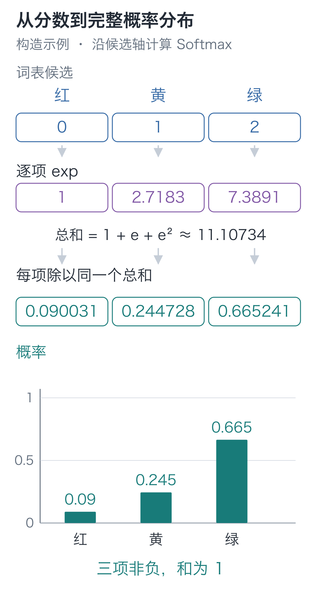
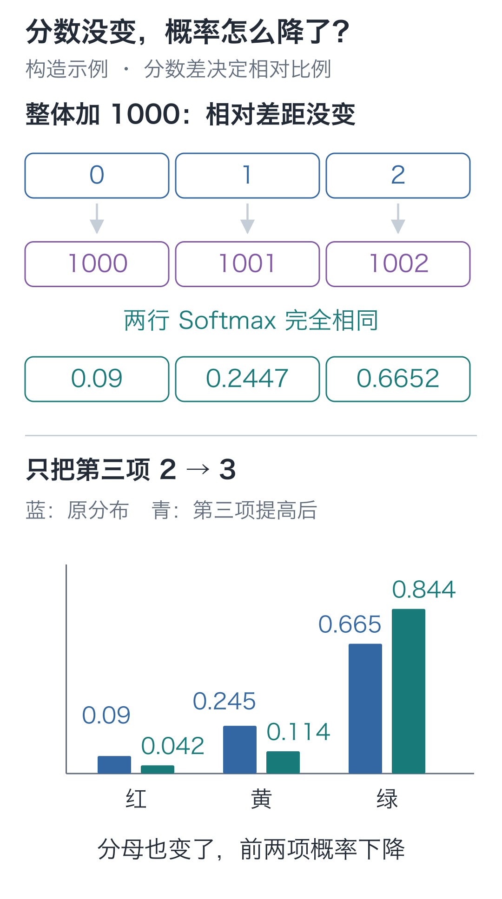

# 08｜Softmax：分数怎样变成下一字的概率？

手写小模型，看懂大模型 · 第 08 讲

先把可选的下一字缩成“红、黄、绿”三个，做一次手算。它们的分数为 `[0, 1, 2]` 时，红的概率约为 0.090；只把绿的分数改成 3，红的分数仍是 0，概率却降到了约 0.042。

红没被扣分，为什么更难被选中了？

## 先把这三个分数算出来

上一讲已经把字符变成向量。现在取一个位置的向量，用第 02 讲的线性层，给每个候选分别算一个数。

先用一个二维位置向量 `h=[1, 2]` 和三个候选做手算。三个候选的参数行分别是：

```text
候选红：[0, 0]
候选黄：[1, 0]
候选绿：[0, 1]
```

每行与 `h` 对应相乘再相加，得到红 `0×1+0×2=0`，黄 `1×1+0×2=1`，绿 `0×1+1×2=2`。

这一步叫**输出投影**：输入是一条位置向量，参数是每个候选对应的权重，输出是候选分数。分数常叫 **logits**。目前的 0、1、2 由我们手工指定参数得到，尚未训练。

正式模型输入形状是 `[B, T, 64]`，投影参数形状为 `[79, 64]`，输出就是 **[B,T,79]**。最后一轴的每一项，都对应词表中的一个候选。以批量行向量书写，公式为 **logits=h @ Wᵀ**；转置 `Wᵀ` 让每个位置向量依次与参数表的各行做点积。

本模型使用不带偏置的输出投影，也不在分数后接 ReLU。分数可以为正或为负，下一步根据各候选的相对分数分配概率。输入 Embedding 表与输出投影是两份各自可训练的参数。

## 分数有了，直接除以总和行不行？

概率应当非负，所有互斥候选的概率总和应当等于 1。分数没有这些限制，可能是负数，也可能总和大于 1。

直接除以分数总和，也不能解决一般情况。遇到 `[-1, 0, 1]`，分母就变成了 0；遇到混合正负值，还可能得到负的“概率”。

我们先把每个分数换成正数，再统一除以正数总和。一种常用选择是**指数函数**。

把它写成 `exp(z)`，也写成 `eᶻ`；`e` 约为 2.71828。对整数，`e²` 就是 `e×e`；对小数，指数函数也有连续的定义。这里先掌握几个值和用途：

| 分数 z | exp(z)，约数 |
| --- | --- |
| −1 | 0.36788 |
| 0 | 1 |
| 1 | 2.71828 |
| 2 | 7.38906 |

分数越大，指数值越大；负分数也会变成正数。用指数转换，还能得到后面要算的概率比，并与下一讲的对数损失接起来。

对 `[0, 1, 2]`，先得到 `[1, 2.71828, 7.38906]`，总和约为 11.10734。逐项除以这个总和：

```text
p红 = 1       / 11.10734 ≈ 0.09003057
p黄 = 2.71828 / 11.10734 ≈ 0.24472847
p绿 = 7.38906 / 11.10734 ≈ 0.66524096
```



沿第三条候选路径看，7.38906 是指数值，除以总和后得到的 0.66524096 才是概率。

“逐项取指数，再除以指数总和”这一整步，叫 **Softmax**。如果把第 `i` 个分数写成 `zᵢ`，它的公式是：

**pᵢ=exp(zᵢ) / 所有候选 exp(z) 的总和。**

用指数转换，还能把“分数差”与概率比联系起来。把两个候选的概率相除，共同分母约掉，得到 **pᵢ/pⱼ=exp(zᵢ−zⱼ)**。黄比红的分数高 1，概率就是红的约 2.718 倍；绿比红高 2，概率就是红的约 7.389 倍。

开头只把绿的分数从 2 改成 3，它的指数就从约 7.38906 增到 20.08554。红的分子仍是 1，分母却从约 11.10734 增到 23.80382，于是红的概率从约 0.090 降到了 0.042。

**一个候选分到多少概率，要看它与整行候选的关系。** 分数增加 1，能让它与其他项的概率比增大约 2.718 倍，但不是让它自身的概率直接乘 2.718，因为分母也变了。

分母包含整个词表，不只是最后展示出来的几项。只展示概率最大的几个候选时，几根柱子的和可能小于 1，剩余概率仍然属于其他候选。

程序保存的是浮点近似值，检查总和接近 1 即可；显示时的四舍五入可能影响末位。

## 那么，三个分数一起加 1000 呢？

刚才只改一项，三个概率都变了。现在试另一个方向：把三个分数都加上 1000。它们仍相差 1、1，若概率也大变，模型就会依赖一个没有改变候选关系的整体偏移。

指数有一个性质：`exp(a+b)=exp(a)×exp(b)`。所以给所有分数加相同数，相当于所有分子、分母都乘同一个数，最后会约掉。

这也给计算带来便利。直接求 `exp(1002)` 可能超过浮点数能保存的范围，得到无穷大。先减去最大分数，就把 `[1000, 1001, 1002]` 变成 `[-2, -1, 0]`：最大指数只有 1，又与原分布等价。

注意是**整行减去同一个最大值**，不是每个数减去自己。下面用代码核对：`[0, 1, 2]` 和 `[1000, 1001, 1002]` 会得到同一结果。

```python
import math

def softmax(scores):
    """把同一位置的全部候选分数，转换为总和为 1 的概率列表。"""
    if not scores:
        raise ValueError("至少需要一个候选分数")
    # 整行减同一个最大值，保留相对差距，同时避免指数过大。
    maximum = max(scores)
    positive = [math.exp(s - maximum) for s in scores]
    # 所有候选共用这个分母；此时 positive 还不是概率。
    total = sum(positive)
    return [value / total for value in positive]

p = softmax([0., 1., 2.])
# 共同平移分数后概率应相同，只有候选间的差距在这里起作用。
shifted = softmax([1000., 1001., 1002.])
print(p)
assert abs(sum(p) - 1.) < 1e-12
assert all(abs(a - b) < 1e-12 for a, b in zip(p, shifted))
```



代码中的断言检查共同平移，图中的柱子保留开头那次单项修改。第三项升到 3 后，完整概率为 `[0.04201007, 0.11419520, 0.84379473]`。两种改法都动了分数，却只有改变相对差距的那种动了分布。

## 从三个候选，回到“欢”后面接什么字

我们已经可以组成一个最小字符预测器：输入编号，查表得到向量，再线性投影成词表分数。它叫本栏的 **CharBaseline，字符基线模型**。基线的意思是先保留简单做法，作为后续改进的对照。

把刚才的三个候选扩为课程词表的 79 项，接在查表之后。下面让 PyTorch 初始化两份随机参数；`manual_seed(42)` 固定随机种子，使同一环境下的初值可以重现。

```python
import torch
from torch import nn

# 固定随机初值，只检查形状与概率；本段没有目标标签或参数更新。
torch.manual_seed(42)
# 两份独立参数：先按编号选出 64 维向量，再给 79 个候选各算一项分数。
embedding = nn.Embedding(79, 64)
projection = nn.Linear(64, 79, bias=False)

# 一条样本的“小丁喜欢”，编号形状为 [1,4]。
ids = torch.tensor([[27, 6, 22, 44]], dtype=torch.long)
hidden = embedding(ids)
logits = projection(hidden)
# 只沿最后的词表候选轴归一化，每个位置各有一份分布，不混合不同位置。
probabilities = torch.softmax(logits, dim=-1)

print(hidden.shape)         # [1, 4, 64]
print(logits.shape)         # [1, 4, 79]
print(probabilities.sum(dim=-1))
# 对每个位置分别求和，四行概率的和都应接近 1。
assert torch.allclose(probabilities.sum(dim=-1),
                      torch.ones(1, 4))
```

`nn.Linear(64, 79)` 对每个位置分别执行同样的投影；`dim=-1` 表示沿最后的候选轴归一化。它不会把四个位置或一批样本混成一个概率总和。

以 `logits[0, 3, 58]` 为例：第 0 项选样本，第 3 项选输入“欢”所在的位置，第 58 项选候选“苹”。这个数回答的是“在这个输入位置，给下一字为苹打多少分”，不表示输入已经出现了“苹”。

输入编号 44 让 Embedding 选“欢”的一行；输出则要同时给全部 79 项打分。判断“苹”的概率时，其他候选仍会通过共同分母影响它，正如开头的红受到了绿的影响。

模型计算先返回 logits。展示概率或抽样时再用 Softmax；下一讲计算训练损失时，工具需要接收原始分数，会在内部完成相关变换。

这段代码没有训练，所以不能把随机输出解读成模型已经知道“欢”后面该接什么。

这个小模型还有一个可检查的限制：“小丁喜欢”和“小周喜欢”都以“欢”结尾，它就会给出相同的最后一行分数，因为每个位置只查自己的编号。训练能改动这些分数到什么程度，下一讲会实际跑出来。

## 有了概率，就一定选最大的字吗？

回到开头“红、黄、绿”的三项例子，第三个候选概率最大，约为 0.665。若采用“总取最大值”的规则，会选它；若按概率抽样，它被选中的机会最多，但仍可能抽到另外两项。

同一分布可以配不同的选择规则，因而同一组参数也可能生成不同文本。第 18 讲会把选择接进逐字生成循环。

## 两道改数题

1. 把 `[0, 1, 2]` 改成 `[-5, -4, -3]`，概率会改变吗？如果把它乘 2，改成 `[0, 2, 4]` 呢？
2. 只把第一个分数从 0 改成 1，第二、第三项仍为 1、2。新的概率是多少？第三项分数没变，它的概率为什么下降？

<details class="answer" markdown="1">
<summary>参考答案</summary>

答案：第一题，减去同一个数不改变分布，仍为 `[0.09003057, 0.24472847, 0.66524096]`；乘 2 会扩大差距，约为 `[0.01587624, 0.11731043, 0.86681333]`。第二题，新概率约为 `[0.21194156, 0.21194156, 0.57611688]`。第一项指数增大，共用分母变大；第三项分子不变，概率就从约 0.665241 降到 0.576117。Softmax 的每个输出都依赖整行分数。

</details>

在配套代码目录运行：

```bash
# 在配套代码目录运行本讲实验，核对正文中的结果。
python -m lessons.l08
```

完整入口：[运行入口](https://github.com/DavidDingXu/hello-llm/blob/main/code/lessons/l08.py) · [环境说明](https://github.com/DavidDingXu/hello-llm/blob/main/code/README.md)

源码导航：[baseline.py · CharBaseline](https://github.com/DavidDingXu/hello-llm/blob/main/code/tiny_lm/baseline.py#L8) · [experiments.py · lesson08](https://github.com/DavidDingXu/hello-llm/blob/main/code/lessons/experiments.py#L126)。

<!-- chapter-navigation:start -->

---

[← 文字与向量](../07-embeddings/README.md) · [课程目录](../../README.md#课程目录) · [文本训练题 →](../09-training-targets/README.md)

<!-- chapter-navigation:end -->
