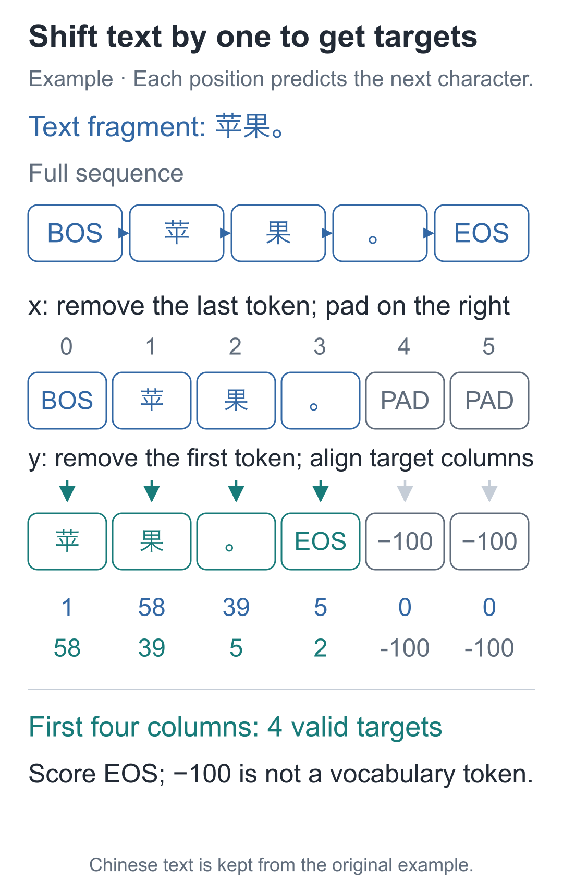
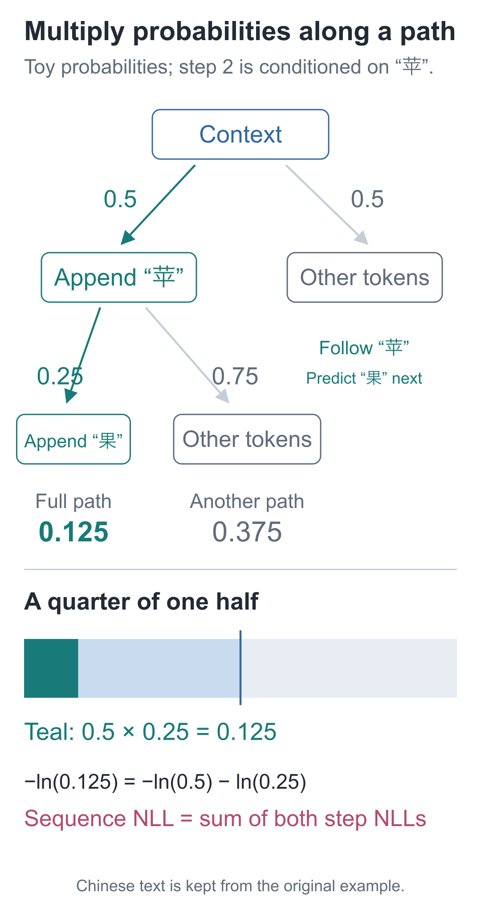
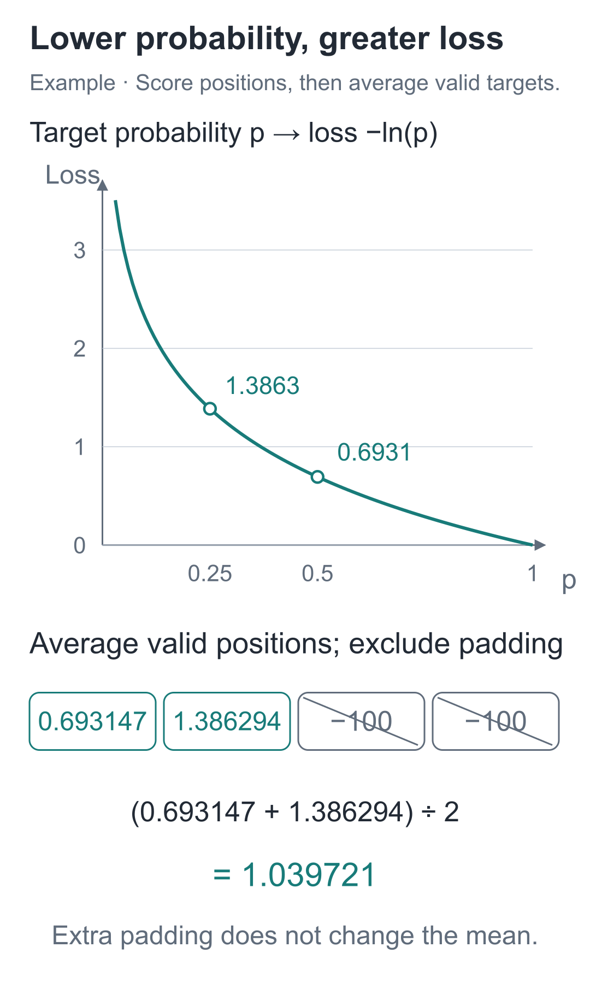

# 09 | Training Targets: How Does a Sentence Become a Learnable Task?

Build a Small Model, Understand Large Models · Lesson 09

The previous lesson exposed the character baseline's limitation: each position reads only its current character, so “小丁喜欢” (“Xiaoding likes”) and “小周喜欢” (“Xiaozhou likes”) produce the same final row of scores.

Is training such a model useful at all? After 1000 actual updates, training loss falls from about **4.479 to 0.934**, and loss on held-out sentence patterns falls from about **4.532 to 3.000**.

It still cannot distinguish the names, so which predictions improved? Let us turn a sentence into training problems and find out where the lower loss comes from.

## The original sentence already contains the answers

Use the short sentence “小丁喜欢苹果。” (“Xiaoding likes apples.”) to demonstrate how we construct the problems. Place BOS at the beginning and EOS at the end to obtain the full sequence:

```text
BOS 小 丁 喜 欢 苹 果 。 EOS
```

BOS lets the model predict the first character; EOS teaches it where a sentence ends. Now make two rows: remove the last item for the input and the first item for the target.

| Position t | Input x[t] at this position | Target y[t] at this position |
| --- | --- | --- |
| 0 | BOS | 小 |
| 1 | 小 | 丁 |
| 2 | 丁 | 喜 |
| 3 | 喜 | 欢 |
| 4 | 欢 | 苹 |
| 5 | 苹 | 果 |
| 6 | 果 | 。 |
| 7 | 。 | EOS |

The first row asks “predict 小 from the start,” and the last asks “predict the end after the full stop.” **The output at position t must be compared with y[t], not x[t].** Using the input unchanged as the target would teach the model to copy the current character.



The rightward shift in the arrows identifies the answer position. A later model that uses context also needs restrictions on which inputs it may read; Lesson 11 handles that separately. Shifted targets define the task, but do not automatically prevent the model from reading future answers.

The slices in the code correspond directly to these two rows:

```python
from tiny_lm.tokenizer import CharTokenizer

tokenizer = CharTokenizer.for_course()
# 1 是 BOS，2 是 EOS；先构造完整序列，再从同一序列错开一格。
full = [1] + tokenizer.encode("小丁喜欢苹果。") + [2]
# 输入不含最后的 EOS，目标不含开头的 BOS；x[t] 对应紧邻的下一项 y[t]。
x_list = full[:-1]
y_list = full[1:]
print(x_list)  # [1, 27, 6, 22, 44, 58, 39, 5]
print(y_list)  # [27, 6, 22, 44, 58, 39, 5, 2]
assert len(x_list) == len(y_list) == 8
```

The target ID tells the loss function which candidate is correct. It is not written directly into the parameters; parameters still change through loss calculation, backpropagation, and updates.

## How should a higher probability for the answer count as progress?

Suppose the correct answer to one problem is “苹”. One model assigns it probability 0.5, while another assigns only 0.25. Set aside how the remaining probability is distributed: we want the second model to receive a larger penalty.

We could record only “right or wrong,” but a correct answer's probability might rise from 0.1 to 0.4 without becoming the top candidate, leaving that score unchanged. Parameters have moved in a useful direction, and we want the score to recognize it.

This series uses **−ln(p)**, where `p` is the probability of the current correct answer and `ln` denotes the natural logarithm.

The previous lesson used exponentials to turn scores into positive numbers. A logarithm reverses that conversion: **if exp(a)=b, then ln(b)=a.** For example, `exp(0)=1`, so `ln(1)=0`; `exp(0.693147…)≈2`, so `ln(2)≈0.693147`.

When a probability is less than 1, its logarithm is negative. Adding a minus sign gives a nonnegative penalty:

| Correct-answer probability p | −ln(p), approximately |
| --- | --- |
| 1 | 0 |
| 0.5 | 0.693147, or ln2 |
| 0.25 | 1.386294, or ln4 |
| 0.1 | 2.302585 |

When the correct answer's probability falls from 0.5 to 0.25, loss rises from ln2 to ln4. As the probability approaches 0, the penalty grows. Here, 0 is a limiting case; the code does not directly take the logarithm of 0.

This is the **negative log loss** for one problem. With a single definite candidate as the target, it is also the cross-entropy loss used here. A sentence supplies several such problems.

Giving high probability only to a sentence's first character is not enough. We want the entire correct continuation to become more likely.

Consider the branching below: the first step assigns “苹” probability 0.5; **conditioned on having already appended “苹”**, the second step assigns “果” probability 0.25. The probability of the full path is `0.5×0.25=0.125`. The second probability already includes the first step's condition; we are not assuming that the two predictions are independent.



The teal area is one quarter of one half. We can increase the whole continuation's probability by increasing the probabilities of its correct successive steps. Logarithms satisfy `ln(a×b)=ln(a)+ln(b)`, so:

**−ln(0.125)=−ln(0.5)−ln(0.25).**

A product of continuation probabilities becomes a sum of losses, one per problem. With the minus sign, reducing total loss corresponds to increasing the probability of the full correct continuation. Once combined into a scalar, the loss can use the same backward calculations as in earlier lessons.

## A sentence's score must not improve merely by adding padding

One short sentence supplies 8 problems. For each, take the correct candidate's probability, calculate its negative logarithm, and average. With multiple samples, average over all valid positions together.

What if lengths differ? Pad the right side of inputs with PAD=0 to reach a common length. Pad the corresponding target positions with **−100**, telling the loss function to skip them.

−100 is not vocabulary entry −100, nor a character the model should predict. It is only the loss interface's marker for “do not score this position.” The last valid target is still EOS and must not be skipped.



For example, two valid problems with losses 0.693147 and 1.386294 have an average of approximately 1.039721. Adding ten pure-padding positions changes neither the numerator nor the valid-position denominator, so the result stays the same. Incorrectly dividing by total length would make “add more empty positions” look like model improvement.

We average over valid problems, so longer sentences supply more problems and contribute more. Averaging each sentence first, then averaging those means, would measure a different score and could not be compared directly.

In PyTorch, input scores have shape `[B, T, V]`, and targets have shape `[B, T]`. `B` and `T` still count samples and positions; `V` is vocabulary size, which is 79 in this course. Flattening the first two axes simply places all problems together. The last, candidate axis must remain intact.

```python
import torch
import torch.nn.functional as F

def token_loss(logits, targets):
    """[B,T,V] 原始分数与 [B,T] 下一项编号，返回有效位置的平均损失。"""
    if logits.ndim != 3 or targets.shape != logits.shape[:2]:
        raise ValueError("分数应为[B,T,V]，目标应为[B,T]")
    # -100 只标记“不计分”，不能把它当候选编号；全被忽略就没有均值可算。
    if not (targets != -100).any():
        raise ValueError("没有有效题目，无法计算平均损失")
    # 合并样本轴与位置轴，把每题排成一行，保留 V 个候选；标签按同序展平。
    # 接口内部计算对数概率，默认只对非 -100 目标求平均，无需先做 Softmax。
    return F.cross_entropy(
        logits.reshape(-1, logits.shape[-1]),
        targets.reshape(-1), ignore_index=-100)
```

`logits.shape[-1]` retrieves the final axis's size, `V`. `reshape(-1, V)` puts each of the `B×T` problems in one row; `-1` lets PyTorch infer the row count from the total number of elements. Targets are flattened in the same order, so each score row still matches its original answer.

`cross_entropy` takes **raw logits**, internally calculating log probabilities in a numerically stable way. Do not apply Softmax first: otherwise it treats the probabilities as another set of scores and computes a different loss.

Substituting Softmax into the negative logarithm also explains the interface: **loss=ln(the sum of all candidates' exponential values)−the correct candidate's score**. Direct exponentiation may overflow when the sum is large. The tool uses a stable transformation equivalent to subtracting the maximum first, avoiding the need to form a probability that has already underflowed to 0 before taking its logarithm.

Check an example that can be calculated exactly by hand. The three scores are `[0, ln2, ln3]`, whose exponentials are `[1, 2, 3]`; normalization gives `[1/6, 2/6, 3/6]`. If the target is the third candidate, with ID 2, the loss is `−ln(3/6)=ln2`:

```python
import math

# 沿用前段的 torch 与 token_loss：一条样本、一个位置、三个候选。
# 指数后为 [1,2,3]，第三个候选的概率是 3/6，所以目标编号取 2。
scores = torch.tensor([[[0., math.log(2.), math.log(3.)]]])
target = torch.tensor([[2]])
value = token_loss(scores, target)
print(value.item())  # 约0.693147
assert abs(value.item() - math.log(2.)) < 1e-6

# 沿位置轴多添一道填充题；-100 将它同时排除在损失之和与有效题数之外。
padded_scores = torch.cat([scores, torch.zeros(1, 1, 3)], dim=1)
padded_target = torch.tensor([[2, -100]])
assert torch.allclose(token_loss(padded_scores, padded_target), value)
```

This scoring also connects to the earlier backward calculations. Let PyTorch track these three scores, then inspect the gradients returned by the loss:

```python
# 接着上一段的 scores、target；此处直接查看损失对分数的梯度。
scores.requires_grad_()
# 重新计算损失再反向；只有一个有效目标，三个分数的梯度为 p 减正确项标记。
token_loss(scores, target).backward()
print(scores.grad)  # 约为 [[[0.166667, 0.333333, -0.5]]]
```

With just one valid problem, the combined Softmax and negative-log gradient is “probability minus the correct-answer indicator.” The first two entries are not the answer, so subtract 0 to get `1/6` and `2/6`. The third is the answer, so subtract 1 to get `3/6−1=−0.5`. Automatic differentiation checks this result in the code.

The first two gradients are positive, while the correct third entry's gradient is negative. If scores themselves could be updated independently, following Lesson 04's negative-gradient direction would lower incorrect scores and raise the correct one. In an actual model, these effects must flow through the computation graph to shared parameters. One update can affect many problems at once, so it still cannot guarantee that every individual loss decreases.

## What improved after 1000 updates?

Wrap the lookup and output projection in a class, and we can train them using the problems and loss above. `self` stores parameters that are reused on every forward pass:

```python
from torch import nn

class CharBaseline(nn.Module):
    """输入 [B,T] 字符编号，逐位置返回 [B,T,V] 分数，暂不读取前文。"""
    def __init__(self, vocab_size, width=16):
        super().__init__()
        # 每个编号选一行可训练向量；输出层另有一组参数，对全部候选打分。
        self.embedding = nn.Embedding(vocab_size, width)
        self.output = nn.Linear(width, vocab_size, bias=False)

    def forward(self, ids):
        # 各位置只查自己的行再做投影；返回原始分数，交叉熵会接着处理。
        return self.output(self.embedding(ids))
```

This small baseline has width 16, rather than the full model's later width of 64. Both models output `[B, T, 79]`; the shared interface lets them reuse the same labels and loss.

Below, only the training split is used for updates. The split was already made by whole templates before encoding; held-out examples do not enter the loop.

```python
from tiny_lm.data import build_records, make_pretrain_batch

# 沿用前段的 tokenizer、CharBaseline、token_loss；固定种子以重现参数初值。
torch.manual_seed(42)
torch.set_num_threads(1)
groups = build_records()
# 只拿训练组：x 是补齐后的字符编号，y 已错位，填充标签为 -100。
x, y = make_pretrain_batch(groups["pretrain_train"], tokenizer,
                           max_len=32)
model = CharBaseline(tokenizer.vocab_size, width=16)
optimizer = torch.optim.SGD(model.parameters(), lr=0.1)

print("更新前", token_loss(model(x), y).item())
for _ in range(1000):
    # 清掉上一轮梯度，每次用当前参数重新前向；样本与目标始终不变。
    optimizer.zero_grad()
    logits = model(x)
    loss = token_loss(logits, y)
    # 损失只平均有效标签，梯度传回 Embedding 与输出投影两份参数。
    loss.backward()
    # 反向只算梯度，这里才用 SGD 修改参数。
    optimizer.step()
print("更新后", token_loss(model(x), y).item())
```

The loop still follows Lesson 06's sequence: clear gradients, run forward, calculate loss, run backward, and update. What changes is the meaning of inputs, labels, and loss. The model now adjusts embedding and projection parameters based on errors in predicting the next character in text.

This SGD code actually produces training loss **4.479492→0.934471**. The companion entry point also scores the held-out split without updating parameters, recording held-out loss **4.531882→3.000230**. See the original [character-baseline experiment](https://github.com/DavidDingXu/hello-llm/blob/main/code/artifacts/lessons/l09.json).

Held-out loss did not decrease throughout the recorded run: after 500 updates it was approximately **2.887950**, but after 1000 it had risen to **3.000230**, while training loss continued to fall. Further fitting of the training problems did not keep improving these held-out problems. Training loss alone cannot establish effectiveness.

Now feed the two opening prefixes to the trained model and compare the probabilities at the last position:

```python
# 接着训练后的 model：两个前缀人名不同，最后一个字符都为“欢”。
prefixes = torch.tensor([
    [1] + tokenizer.encode("小丁喜欢"),
    [1] + tokenizer.encode("小周喜欢"),
])
with torch.no_grad():
    # 取各样本最后位置的整行分数，再沿词表候选轴转换成概率。
    last_probabilities = torch.softmax(model(prefixes)[:, -1], dim=-1)
# 逐候选比较两行分布，最大差值为 0 就说明分布完全相同。
difference = (last_probabilities[0] - last_probabilities[1]).abs().max()
print("两个人的最后一行概率差", difference.item())  # 0.0
assert difference.item() == 0.
```

The higher-probability candidates after “欢” now include 紫, 绿, 黄, and 红—purple, green, yellow, and red—at approximately 0.180, 0.163, 0.119, and 0.118. The model is learning which characters commonly follow “欢” in this dataset, which is enough to reduce loss on some problems.

But `forward` reveals why it still cannot distinguish the two people: each position runs only `embedding(ids)` followed by output projection. Both occurrences of “欢” have ID 44, so they get the same vector and scores. No computation path carries the preceding name to this position.

Thus, “红” after “小丁喜欢” and “黄” after “小周喜欢” collapse into the same input problem, which sees only “欢”. The model can adjust one mixed distribution but cannot answer separately by name. Improving these predictions requires connecting preceding text to the forward calculation. More training steps alone cannot create that missing connection.

## Two checking exercises

1. If targets change from `full[1:]` to `full[2:]`, while inputs change to `full[:-2]`, is the model still learning the next character?
2. Keep scores `[0, ln2, ln3]`, but make the second candidate the target. What is the loss? What happens if three more positions with target −100 are added?

<details class="answer" markdown="1">
<summary>Reference answers</summary>

Answers: For the first exercise, the task becomes predicting the character two positions ahead, skipping the immediately following item. BOS, for example, now targets “丁” rather than “小”. For the second, the second candidate's probability is `2/6=1/3`, so the loss is `ln3≈1.098612`. Pure padding does not participate in the valid-position average, so the loss stays unchanged.

</details>

Before moving to attention, switch to “小周拿着香蕉。” (“Xiaozhou is holding a banana.”) and independently list the inputs and targets from BOS to EOS. Check that the first item predicts “小”, the full stop predicts EOS, and adding PAD leaves the valid-problem count unchanged. Finally, return to “小丁喜欢” and “小周喜欢” and explain in your own words why the character baseline still cannot use the name to distinguish the same “欢”, even as training loss decreases. This stage is complete when all three checks make sense.

Run the snippets in order from the companion code directory, or execute directly:

```bash
# 在配套代码目录运行本讲实验，核对正文中的结果。
python -m lessons.l09
```

Complete entry point: [Entry point](https://github.com/DavidDingXu/hello-llm/blob/main/code/lessons/l09.py) · [Data implementation](https://github.com/DavidDingXu/hello-llm/blob/main/code/tiny_lm/data.py) · [Loss implementation](https://github.com/DavidDingXu/hello-llm/blob/main/code/tiny_lm/losses.py) · [Environment setup](https://github.com/DavidDingXu/hello-llm/blob/main/code/README.md)

Source navigation: [data.py · make_pretrain_batch](https://github.com/DavidDingXu/hello-llm/blob/main/code/tiny_lm/data.py#L69) · [losses.py · token_loss](https://github.com/DavidDingXu/hello-llm/blob/main/code/tiny_lm/losses.py#L9).

<!-- chapter-navigation:start -->

---

[← Scores and Probabilities](../08-softmax/README.en.md) · [Contents](../../README.en.md#course-contents) · [Single-Head Attention →](../10-attention/README.en.md)

<!-- chapter-navigation:end -->
