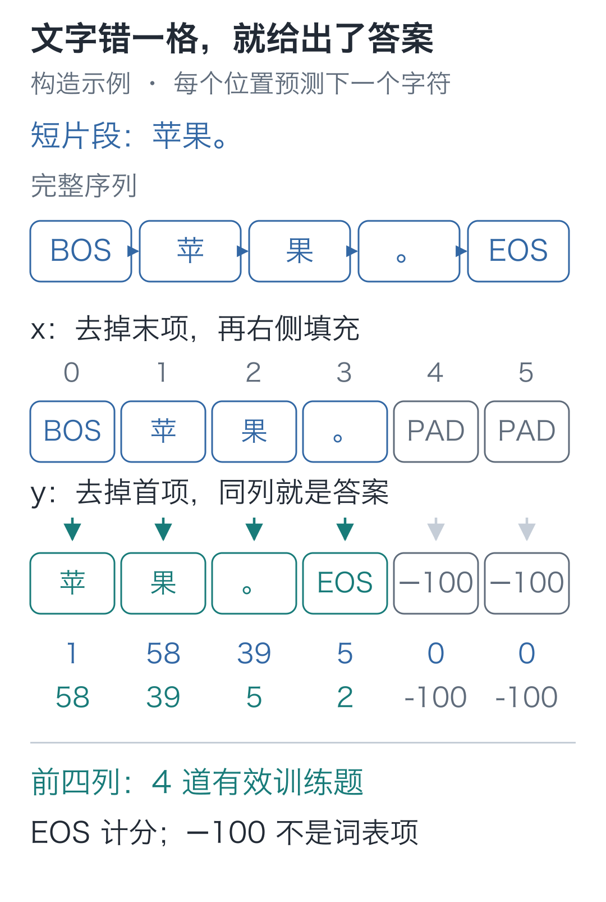
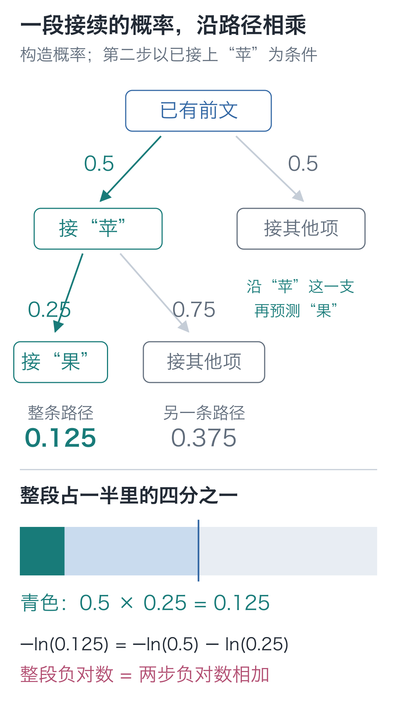
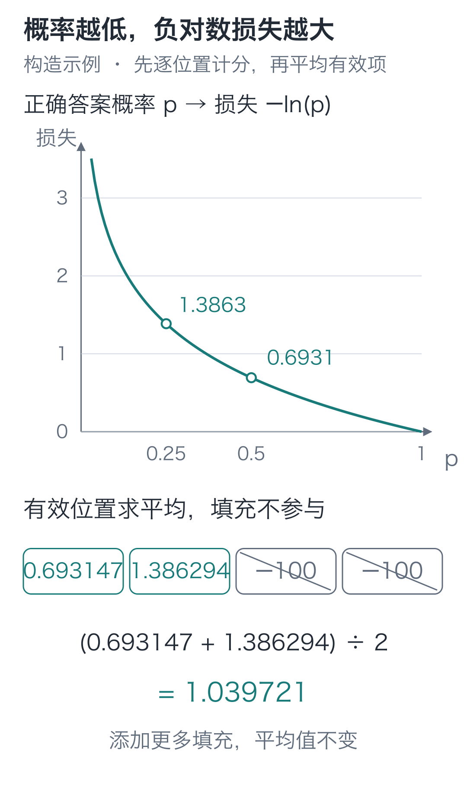

# 09｜训练目标：一句话怎样变成可学习的题？

手写小模型，看懂大模型 · 第 09 讲

上一讲已经看见字符基线的限制：每个位置只读当前字符，所以“小丁喜欢”和“小周喜欢”会得到相同的最后一行分数。

这样的模型，训练还有用吗？实际更新1000次，训练损失从约 **4.479 降到 0.934**，留出句式的损失也从约 **4.532 降到 3.000**。

它仍然分不清人名，哪些预测变好了？我们把原句拆成训练题，看看下降的损失来自哪里。

## 原句里已经放着训练答案

先用短句“小丁喜欢苹果。”演示出题。开头放 BOS，末尾放 EOS，得到完整序列：

```text
BOS 小 丁 喜 欢 苹 果 。 EOS
```

BOS 让模型可以预测第一个字符；EOS 让它学习一句话到哪里结束。现在复制两行：输入去掉最后一项，目标去掉第一项。

| 位置 t | 本位置输入 x[t] | 本位置目标 y[t] |
| --- | --- | --- |
| 0 | BOS | 小 |
| 1 | 小 | 丁 |
| 2 | 丁 | 喜 |
| 3 | 喜 | 欢 |
| 4 | 欢 | 苹 |
| 5 | 苹 | 果 |
| 6 | 果 | 。 |
| 7 | 。 | EOS |

第一行要求“从开始预测小”，最后一行要求“读到句号后预测结束”。**位置 t 的输出，要和 y[t] 比较，而不是和 x[t] 比较。** 如果把输入原样作为目标，模型就会学复制当前字符。



图中箭头向右错开的是“答案位置”。后面带上下文的模型还需要限制它能读取哪些输入，第 11 讲会单独处理。错位目标只定义任务，不会自动阻止模型偷读未来。

代码中的切片与这两行直接对应：

```python
from tiny_lm.tokenizer import CharTokenizer

tokenizer = CharTokenizer.for_course()
# 1 是 BOS，2 是 EOS；先构造完整序列，再从同一序列错开一格。
full = [1] + tokenizer.encode("小丁喜欢苹果。") + [2]
# 输入不含最后的 EOS，目标不含开头的 BOS；x[t] 对应紧邻的下一项 y[t]。
x_list = full[:-1]
y_list = full[1:]
print(x_list)  # [1, 27, 6, 22, 44, 58, 39, 5]
print(y_list)  # [27, 6, 22, 44, 58, 39, 5, 2]
assert len(x_list) == len(y_list) == 8
```

目标编号告诉损失函数哪个候选正确。它不会直接写进参数，参数还要通过损失、反向和更新来改变。

## 答案概率升了，怎样记成一次进步？

假设某一题的正确答案是“苹”。模型给它 0.5 的概率，另一个版本只给 0.25，其他候选怎样分都先放在一旁。我们希望后一个版本受到更大的惩罚。

可以只记“猜中或猜错”，但正确答案从 0.1 升到 0.4，只要还没排第一，评分就可能不动。参数已经朝有用的方向变化，我们希望评分能看见这次进步。

本栏采用 **−ln(p)**，其中 `p` 是当前正确答案的概率，`ln` 读作自然对数。

上一讲用指数把分数换成正数；对数做反方向的换算：**若 exp(a)=b，那么 ln(b)=a。** 例如 `exp(0)=1`，所以 `ln(1)=0`；`exp(0.693147…)≈2`，所以 `ln(2)≈0.693147`。

当概率小于 1，对数为负。前面加负号，就得到非负的惩罚：

| 正确答案概率 p | −ln(p)，约数 |
| --- | --- |
| 1 | 0 |
| 0.5 | 0.693147，也就是 ln2 |
| 0.25 | 1.386294，也就是 ln4 |
| 0.1 | 2.302585 |

正确答案的概率从 0.5 降到 0.25，损失由 ln2 增到 ln4。概率越来越接近 0，惩罚会越来越大。这里的 0 是极限情况，不在代码里直接对 0 求对数。

这就是一道题的**负对数损失**。目标为一个确定候选时，也就是这里使用的交叉熵损失。一句话会提供多道这样的题。

只给一句话的首字高概率，还不够。我们希望整段正确接续都更容易出现。

看下面的分流：第一步给“苹”0.5的概率；**以已经接上“苹”为前提**，第二步给“果”0.25的概率。走完这条路径的概率就是 `0.5×0.25=0.125`。第二个概率已经包含第一步的条件，不是在假设两次预测互不相关。



图中青色面积是一半里的四分之一。让整段概率变大，可以从逐步提高这些正确接续的概率入手。对数满足 `ln(a×b)=ln(a)+ln(b)`，所以：

**−ln(0.125)=−ln(0.5)−ln(0.25)。**

原本连乘的接续概率，变成了可以逐题相加的损失。取负号后，降低总损失就对应提高整段正确接续的概率。损失合成一个标量后，就能沿用前几讲的反向计算。

## 一整句的成绩，不能靠多填空位变好

一条短句提供了 8 道题，每题各自取正确候选的概率、计算负对数，再求平均。若一次放多条样本，就对其中所有有效位置一起平均。

长度不同怎么办？我们把输入右侧补 PAD=0，补到共同长度。目标在相应位置补 **−100**，告诉损失函数跳过这些位置。

−100 不是词表里的第 −100 项，也不是要求模型预测的字符。它只是损失接口约定的“此处不计分”标记。有效位置的最后一个目标仍然是 EOS，不能把它也跳过。



例如两道有效题的损失分别为 0.693147、1.386294，平均约为 1.039721。再添十个纯填充位置，分子和有效分母都不变，结果仍然相同。若错误地除以总长度，就会让“多填一些空位”伪装成模型变好了。

我们按有效题目平均，长句提供更多题目，贡献也更多。如果先求每句话的均值再平均，统计的就会变成另一种成绩，不能直接拿来比较。

在 PyTorch 里，输入分数为 `[B, T, V]`，目标为 `[B, T]`。`B、T` 仍分别表示样本数和位置数，`V` 是词表大小，本课程为 79。把前两轴展平，只是把所有题排到一起，最后的候选轴必须保留。

```python
import torch
import torch.nn.functional as F

def token_loss(logits, targets):
    """[B,T,V] 原始分数与 [B,T] 下一项编号，返回有效位置的平均损失。"""
    if logits.ndim != 3 or targets.shape != logits.shape[:2]:
        raise ValueError("分数应为[B,T,V]，目标应为[B,T]")
    # -100 只标记“不计分”，不能把它当候选编号；全被忽略就没有均值可算。
    if not (targets != -100).any():
        raise ValueError("没有有效题目，无法计算平均损失")
    # 合并样本轴与位置轴，把每题排成一行，保留 V 个候选；标签按同序展平。
    # 接口内部计算对数概率，默认只对非 -100 目标求平均，无需先做 Softmax。
    return F.cross_entropy(
        logits.reshape(-1, logits.shape[-1]),
        targets.reshape(-1), ignore_index=-100)
```

`logits.shape[-1]` 取最后一轴的大小 `V`；`reshape(-1, V)` 把 `B×T` 道题各排成一行，这里的 `-1` 让 PyTorch 根据元素总数自动算出行数。目标也按同样顺序展平，因此每行分数仍对应原来的那个答案。

`cross_entropy` 接收的是 **logits 原始分数**，内部会稳定地完成对数概率计算。不要先调用 Softmax 再传入，否则它会把概率当成另一组分数，计算的就不是上面的损失。

把 Softmax 代入负对数，还能看出这个接口为何成立：**损失=ln(所有候选指数值的总和)−正确候选的分数**。指数总和很大时，直接求指数可能溢出；工具会使用与“先减最大值”一致的稳定换算，避免先生成一个已经下溢到 0 的概率再取对数。

来核对一个正好能手算的例子。三个分数是 `[0, ln2, ln3]`，指数后为 `[1, 2, 3]`，归一化得到 `[1/6, 2/6, 3/6]`。目标为第三个候选，编号为 2，则损失为 `−ln(3/6)=ln2`：

```python
import math

# 沿用前段的 torch 与 token_loss：一条样本、一个位置、三个候选。
# 指数后为 [1,2,3]，第三个候选的概率是 3/6，所以目标编号取 2。
scores = torch.tensor([[[0., math.log(2.), math.log(3.)]]])
target = torch.tensor([[2]])
value = token_loss(scores, target)
print(value.item())  # 约0.693147
assert abs(value.item() - math.log(2.)) < 1e-6

# 沿位置轴多添一道填充题；-100 将它同时排除在损失之和与有效题数之外。
padded_scores = torch.cat([scores, torch.zeros(1, 1, 3)], dim=1)
padded_target = torch.tensor([[2, -100]])
assert torch.allclose(token_loss(padded_scores, padded_target), value)
```

评分也接得上前几讲的反向计算。先让PyTorch记录这三个分数，再直接查看损失传回的梯度：

```python
# 接着上一段的 scores、target；此处直接查看损失对分数的梯度。
scores.requires_grad_()
# 重新计算损失再反向；只有一个有效目标，三个分数的梯度为 p 减正确项标记。
token_loss(scores, target).backward()
print(scores.grad)  # 约为 [[[0.166667, 0.333333, -0.5]]]
```

这一次只有一道有效题，Softmax 与负对数组合后的梯度为“概率减正确项标记”：前两项不是答案，分别减 0，得到 `1/6、2/6`；第三项是答案，减 1，得到 `3/6−1=−0.5`。代码用自动求导核对了这个结果。

前两项梯度为正，正确的第三项为负。如果分数本身可以独立更新，按第04讲的负梯度方向，会压低错误项、抬高正确项。实际模型还要把这些影响沿计算图传回共享参数，一次更新可能同时影响许多题，因此仍不能保证每道题的损失都下降。

## 跑完1000次，它改善了什么？

把查表与输出投影封成类，就能用上面的题目和损失训练。参数由 `self` 保存，每次前向都复用它们：

```python
from torch import nn

class CharBaseline(nn.Module):
    """输入 [B,T] 字符编号，逐位置返回 [B,T,V] 分数，暂不读取前文。"""
    def __init__(self, vocab_size, width=16):
        super().__init__()
        # 每个编号选一行可训练向量；输出层另有一组参数，对全部候选打分。
        self.embedding = nn.Embedding(vocab_size, width)
        self.output = nn.Linear(width, vocab_size, bias=False)

    def forward(self, ids):
        # 各位置只查自己的行再做投影；返回原始分数，交叉熵会接着处理。
        return self.output(self.embedding(ids))
```

这里用宽度 16 的小基线，它与后面的 64 维完整模型不是同一规模。两种模型都输出 `[B, T, 79]`；共同的接口使同一套标签和损失可以复用。

下面只取训练组更新。分组在编码前已经按完整模板完成，留出组不进入循环。

```python
from tiny_lm.data import build_records, make_pretrain_batch

# 沿用前段的 tokenizer、CharBaseline、token_loss；固定种子以重现参数初值。
torch.manual_seed(42)
torch.set_num_threads(1)
groups = build_records()
# 只拿训练组：x 是补齐后的字符编号，y 已错位，填充标签为 -100。
x, y = make_pretrain_batch(groups["pretrain_train"], tokenizer,
                           max_len=32)
model = CharBaseline(tokenizer.vocab_size, width=16)
optimizer = torch.optim.SGD(model.parameters(), lr=0.1)

print("更新前", token_loss(model(x), y).item())
for _ in range(1000):
    # 清掉上一轮梯度，每次用当前参数重新前向；样本与目标始终不变。
    optimizer.zero_grad()
    logits = model(x)
    loss = token_loss(logits, y)
    # 损失只平均有效标签，梯度传回 Embedding 与输出投影两份参数。
    loss.backward()
    # 反向只算梯度，这里才用 SGD 修改参数。
    optimizer.step()
print("更新后", token_loss(model(x), y).item())
```

循环仍是第 06 讲的清梯度、前向、计算损失、反向、更新。现在变化的是输入、标签和损失的含义：模型根据文本里的下一字符错误，调整 Embedding 与投影参数。

这组 SGD 代码实际得到训练损失 **4.479492→0.934471**。配套入口还会对留出组只评分、不更新参数，记录的留出损失为 **4.531882→3.000230**。原始记录见[字符基线实验](https://github.com/DavidDingXu/hello-llm/blob/main/code/artifacts/lessons/l09.json)。

现有记录中的留出损失并非一直下降：第 500 次更新时约为 **2.887950**，到第 1000 次反而升到 **3.000230**，同期训练损失仍在下降。继续拟合训练题，没有让这批留出题继续改善；不能只看训练损失判断效果。

再把开头的两个前缀送进训练后的模型，比较最后位置的概率：

```python
# 接着训练后的 model：两个前缀人名不同，最后一个字符都为“欢”。
prefixes = torch.tensor([
    [1] + tokenizer.encode("小丁喜欢"),
    [1] + tokenizer.encode("小周喜欢"),
])
with torch.no_grad():
    # 取各样本最后位置的整行分数，再沿词表候选轴转换成概率。
    last_probabilities = torch.softmax(model(prefixes)[:, -1], dim=-1)
# 逐候选比较两行分布，最大差值为 0 就说明分布完全相同。
difference = (last_probabilities[0] - last_probabilities[1]).abs().max()
print("两个人的最后一行概率差", difference.item())  # 0.0
assert difference.item() == 0.
```

这次“欢”后面概率较高的项包括紫、绿、黄、红，约为 0.180、0.163、0.119、0.118。模型在学这批数据中哪些字符常接在“欢”后面，这足以降低一部分题的损失。

但查看 `forward`，就能找到它分不清两个人的原因：每个位置只做 `embedding(ids)`，再做输出投影。“欢”的编号都是 44，所以得到同一个向量、同一组分数；前面的人名没有任何一条计算路径通向这里。

于是，“小丁喜欢”后接“红”和“小周喜欢”后接“黄”，被压成了同一道只看“欢”的输入题。模型能调整一份混合分布，无法按人名分别给答案。要继续改善这类预测，需要把前文接进前向计算，单加训练次数补不出这条连接。

## 两道检查题

1. 若把目标从 `full[1:]` 改为 `full[2:]`，同时把输入改为 `full[:-2]`，模型学的还是下一个字符吗？
2. 分数仍为 `[0, ln2, ln3]`，把目标改成第二个候选，损失是多少？再添三个目标为 −100 的位置，损失会怎样？

<details class="answer" markdown="1">
<summary>参考答案</summary>

答案：第一题，改成了预测向后两格的字符，跳过紧邻的一项。例如 BOS 对应“丁”，不再对应“小”。第二题，第二项概率为 `2/6=1/3`，损失为 `ln3≈1.098612`；纯填充位置不参与有效平均，损失不变。

</details>

进入注意力前，换成“小周拿着香蕉。”，独立列出BOS到EOS的输入与目标。检查首项是否预测“小”、句号是否预测EOS，增加PAD后有效题数是否保持不变。最后回到“小丁喜欢”和“小周喜欢”两个前缀，用自己的话解释：即使训练损失下降，字符基线为什么仍无法按人名区分同一个“欢”？三项都能核对，才算完成这一阶段。

在配套代码目录按正文顺序运行，或直接执行：

```bash
# 在配套代码目录运行本讲实验，核对正文中的结果。
python -m lessons.l09
```

完整入口：[运行入口](https://github.com/DavidDingXu/hello-llm/blob/main/code/lessons/l09.py) · [数据实现](https://github.com/DavidDingXu/hello-llm/blob/main/code/tiny_lm/data.py) · [损失实现](https://github.com/DavidDingXu/hello-llm/blob/main/code/tiny_lm/losses.py) · [环境说明](https://github.com/DavidDingXu/hello-llm/blob/main/code/README.md)

源码导航：[data.py · make_pretrain_batch](https://github.com/DavidDingXu/hello-llm/blob/main/code/tiny_lm/data.py#L69) · [losses.py · token_loss](https://github.com/DavidDingXu/hello-llm/blob/main/code/tiny_lm/losses.py#L9)。

<!-- chapter-navigation:start -->

---

[← 分数与概率](../08-softmax/README.md) · [课程目录](../../README.md#课程目录) · [单头注意力 →](../10-attention/README.md)

<!-- chapter-navigation:end -->
