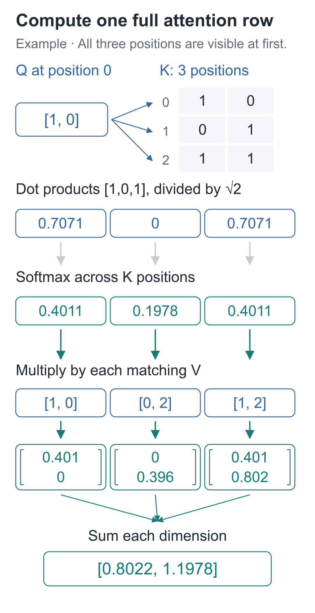
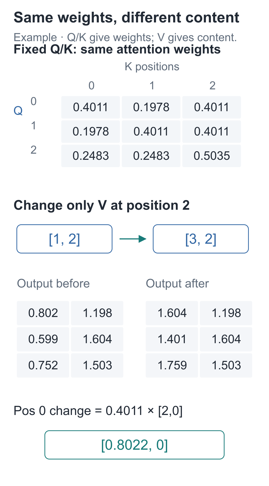
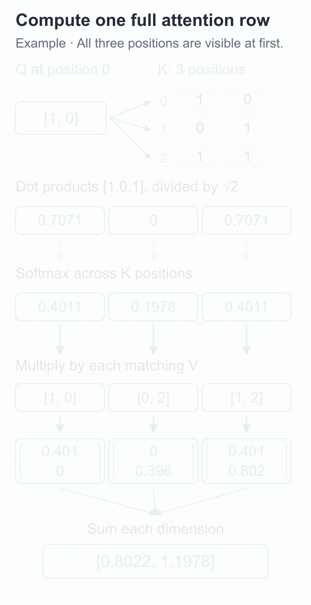

# 10 | Attention: How Does Predicting the Next Character Read Earlier Text?

Build a Small Model, Understand Large Models · Lesson 10

After “早上，小丁喜欢” (“In the morning, Xiaoding likes”), we want “红” (“red”); after “早上，小周喜欢” (“In the morning, Xiaozhou likes”), we want “黄” (“yellow”). The previous lesson's model mixes these cases because it predicts the next character using only the vector for the final “欢”.

The name is in the input array, but no computation path carries it to the last position. We will add that connection so that “丁” and “周” can affect the prediction after “欢”. Start with the most direct approach: combine vectors from different positions.

## Averaging lets preceding text contribute

Suppose three positions carry two-dimensional vectors `[1, 0]`, `[0, 2]`, and `[1, 2]`. Their direct average is `[2/3, 4/3]`.

Changing any row now changes the average, so information from other positions really is included. But whichever position initiates the read, it receives the same average. The combination cannot adapt to the current position's input.

We can also specify proportions `[0.5, 0.25, 0.25]` by hand and calculate a weighted combination:

```text
第0坐标：0.5×1 + 0.25×0 + 0.25×1 = 0.75
第1坐标：0.5×0 + 0.25×2 + 0.25×2 = 1
```

These proportions give another result, `[0.75, 1]`. If the proportions could also be calculated from the current input, we would not have to supply them sentence by sentence.

## Can the current input determine the proportions?

Let the current position produce one vector, and each readable position produce another. Take dot products between the first vector and each of the others to get a row of scores, then use Lesson 08's Softmax to turn them into proportions.

The vector initiating the read is **Q, the query vector**. The vectors paired with it for scoring are **K, the key vectors**. The content vectors combined according to those proportions are **V, the value vectors**.

All three groups come from input `X` through separate linear projections:

**Q=X @ Wqᵀ, K=X @ Wkᵀ, V=X @ Wvᵀ.**

`X` is the current input, `Wq/Wk/Wv` are trainable parameters, and `Q/K/V` are intermediate projection results. Training changes the parameters; with fixed parameters, changing the input also changes Q/K/V.

The three projections separate two actions: Q/K determine matching proportions, while V determines the content being combined. Training can adjust “how to choose proportions” and “which numbers to pass on” separately, without tying both jobs to the same coordinates.

A dot product does not inherently recognize a relationship between “丁” and “苹果” (“apple”). It only multiplies corresponding coordinates and adds them; its value is also affected by vector direction and length. Later, next-character prediction errors backpropagate to `Wq/Wk/Wv`, potentially giving useful preceding text appropriate reading proportions. Training does not supply a separate answer key saying “this head should look here.”

Use a constructed example with three positions and two dimensions per position to expose every internal value:

```text
Q = K = [[1, 0],      V = [[1, 0],
         [0, 1],           [0, 2],
         [1, 1]]           [1, 2]]
```

All three have shape `[3, 2]`: the first axis is position, and the second is feature. They can be obtained from `X=Q`, `Wq=Wk=the identity matrix`, and `Wv=[[1, 0], [0, 2]]`. The identity matrix preserves the original coordinates; the third parameter matrix multiplies the second coordinate by 2.

These numbers do not represent the actual meanings of three Chinese words. For now, every position may read all three positions.

## Calculate just the first row to find the proportions

Choose position 0, whose query is `q₀=[1, 0]`. Take its dot product with each of the three K rows:

```text
q₀·k₀ = 1×1 + 0×0 = 1
q₀·k₁ = 1×0 + 0×1 = 0
q₀·k₂ = 1×1 + 0×1 = 1
```

These numbers are this example's matching scores. Negative scores are allowed and need not be changed to 0 first.

Displayed values below are rounded to four decimal places; the code uses full precision. Hand calculations using the rounded numbers may differ slightly in the last digit.

Next, divide each score by `√2`, giving approximately `[0.7071, 0, 0.7071]`. The square root of 2 is the positive number whose square is 2, approximately 1.4142. Here, 2 comes from the query vector's dimension.

Why scale? Dot products sum more terms as dimension increases, and their score variation typically grows. When coordinate scales are similar and contributions are not strongly correlated, dividing by the square root of the dimension moderates that growth, helping prevent Softmax from concentrating too early on very few entries. The actual proportions still depend on this pass's Q and K values.

Apply Softmax to this row:

**a₀=[0.4011, 0.1978, 0.4011].**

Specifically, the three exponential values are approximately `[2.0281, 1, 2.0281]`, with shared denominator 5.0562. The first entry, `2.0281/5.0562`, gives approximately 0.4011. Every proportion depends on all three scores in the row.

All entries are nonnegative and sum to approximately 1. The first and third proportions match because their scores in this row match.



The three horizontal candidates in the figure are **readable positions**. In Lesson 08, Softmax normalized over vocabulary candidates; here it normalizes over K's position axis. The algorithm is the same, but the candidates are different objects.

## Use this row of proportions to combine V coordinate by coordinate

The first output coordinate is:

**0.4011×1 + 0.1978×0 + 0.4011×1 ≈ 0.8022.**

The second output coordinate is:

**0.4011×0 + 0.1978×2 + 0.4011×2 ≈ 1.1978.**

Position 0 therefore receives a new vector, `[0.8022, 1.1978]`. It now depends on V at positions 1 and 2. Unlike the baseline that reads only its own position, this creates a computation path across positions. The result is still a position representation; it needs the later network's vocabulary projection before it can score the next character.

V has two columns here, so the combined result has two coordinates. Even if the number of readable positions grows from three to ten, the output width remains 2 as long as V still has two columns. Position count determines how many pieces of content can be read; feature width determines how many coordinates each piece contains. Attention does not simply concatenate these axes into six or twenty dimensions.

These three proportions are assigned to input positions. They are not generation probabilities for three characters.

The proportions are often called **attention weights**. The word “weights” can be confusing: `Wq/Wk/Wv` are parameters stored and updated by the model, while `a₀` contains coefficients calculated temporarily during this forward pass. The latter are not kept by the optimizer as an independent, persistent parameter table.

During backpropagation, gradients pass through Softmax, dot products, and projections to the three parameter groups. The next forward pass recomputes reading proportions using the updated parameters.

Read the proportions together with V. If one V row contains only 0s, even a large proportion gives no direct numerical contribution from that row in the current pass. Positive and negative contributions can also cancel in individual coordinates.

## Extend one row to every position

Positions 1 and 2 have their own Q vectors and obtain their own proportion rows. Stack all rows:

```text
A ≈ [[0.4011, 0.1978, 0.4011],
     [0.1978, 0.4011, 0.4011],
     [0.2483, 0.2483, 0.5035]]
```

Each row has its own denominator; the nine entries of the whole matrix are not normalized to sum to 1. `A` has shape `[3, 3]`: rows select the querying position, and columns select the position being read.

Compressing the steps gives:

**scores=Q @ Kᵀ / √d; A=Softmax(scores); output=A @ V.**

`Kᵀ` swaps rows and columns so that each row of Q is paired with every row of K. `[3, 3] @ [3, 2]` gives `[3, 2]`: the output still has three positions with two dimensions each.

A single Q row can be viewed as `[1, 2]`; pairing it with the same K gives scores of shape `[1, 3]`. Sending all three Q rows together expands this to `[3, 3]`. More query rows mean more independently calculated sets of proportions, not a different parameter set for the original row.

The following core code retains parameters, scores, proportions, and outputs for comparison with every hand-calculated value:

```python
import math
import torch

# 三个位置各有两个坐标；这是构造数值，不预先指定中文语义。
x = torch.tensor([[1., 0.], [0., 1.], [1., 1.]])
# 三组可训练投影参数：Q/K 在本例保留坐标，V 把第二坐标乘 2。
wq = torch.eye(2, requires_grad=True)
wk = torch.eye(2, requires_grad=True)
wv = torch.tensor([[1., 0.], [0., 2.]], requires_grad=True)
q, k, v = x @ wq.T, x @ wk.T, x @ wv.T

def attention(q, k, v):
    """每行 Q 查询各行 K，再汇总 V；返回输出、匹配分数与读取比例。"""
    # 行选查询位置，列选被读位置；除以查询宽度的平方根来缓和分数尺度。
    scores = q @ k.transpose(-2, -1) / math.sqrt(q.shape[-1])
    # 每行在被读位置之间分配比例；这里尚未加掩码，允许读取全部位置。
    weights = torch.softmax(scores, dim=-1)
    # [3,3] 比例乘 [3,2] 内容，得到 [3,2]；比例是本次算出的量，不是参数。
    return weights @ v, scores, weights

output, scores, weights = attention(q, k, v)
# 单独重算第 0 个查询，与矩阵版第一行核对，使用同一份 K/V。
first_scores = (q[0] @ k.T) / math.sqrt(2)
first_weights = torch.softmax(first_scores, dim=-1)
first_output = first_weights @ v

print(scores)
print(weights)
print(output)
assert torch.allclose(first_output, output[0])
# 三个查询各自一行，分别沿被读位置求和，不能把九项一起归一化。
assert torch.allclose(weights.sum(dim=-1), torch.ones(3))
```

The matrix version's first row matches the independently calculated first row. The full output is approximately:

```text
[[0.8022, 1.1978],
 [0.5989, 1.6044],
 [0.7517, 1.5035]]
```

<details class="optional" markdown="1">
<summary>One step further: can Q and K share a projection table?</summary>

A model can be built that way, but it restricts the matching scores. If both sides use the same table, Q and K are identical at a given position. Taking the dot product between positions 0 and 1 in the opposite order merely reorders the products, so both directions have equal dot-product scores.

If we want to allow “position 0 scores position 1 highly, but the reverse direction scores low,” independent projection tables can express that difference. Construct an example with two input rows, `[[1,0],[0,1]]`, and inspect the dot products before scaling or normalization:

```python
# 这是单独的构造实验；两行输入、每行两个坐标，不代表具体词义。
pair_x = torch.tensor([[1., 0.], [0., 1.]])
pair_q = pair_x @ torch.eye(2).T  # 查询投影暂取单位矩阵。
# 共用投影时，K与Q相同，两个方向的点积都是0。
shared_scores = pair_q @ pair_q.T
# 换一张键投影表，得到 K=[[0,0],[2,0]]，保持Q不变。
key_projection = torch.tensor([[0., 2.], [0., 0.]])
pair_k = pair_x @ key_projection.T
separate_scores = pair_q @ pair_k.T
print(shared_scores)    # [[1,0],[0,1]]
print(separate_scores)  # [[0,2],[0,0]]
assert shared_scores[0, 1].item() == shared_scores[1, 0].item() == 0.
assert separate_scores[0, 1].item() == 2. and separate_scores[1, 0].item() == 0.
```

With separate projections, the two directions can score 2 and 0. Our model uses independent Q/K projections to preserve this freedom. This does not require training to produce any particular relationship; it explains which relationships the architecture permits.

This comparison concerns dot products. Softmax still divides by each row's own total, so even equal dot-product scores in opposite directions need not produce equal final reading proportions.

</details>

## Does changing another position now affect the current one?

Hold Q and K fixed, and change the third V row from `[1, 2]` to `[3, 2]`. Neither the scores nor Softmax uses V, so the attention proportions stay unchanged. During the weighted sum, however, coordinate 0 of the third row has increased by 2, changing the output.



Coordinate 0 of position 0 increases by `2×0.4011≈0.8022`, while coordinate 1 stays unchanged. Continue with this code to check:

```python
# 沿用上段的 Q/K 与 attention；复制 V 的数值，本次只做固定比例的干预。
changed_v = v.detach().clone()
# 只改第三行的第 0 坐标，不重新生成 Q/K，因此匹配分数与比例应保持不变。
changed_v[2, 0] = 3.
changed_output, _, changed_weights = attention(q, k, changed_v)
assert torch.allclose(changed_weights, weights)
print(changed_output - output)
```

The assertion shows unchanged proportions, but the combined result changes: content at position 2 can now affect position 0.

This experiment deliberately holds Q/K fixed and changes only V to separate the two responsibilities. Changing the actual input usually changes all three projections together, and the reading proportions can change too.



Pause the [interactive demo](https://daviddingxu.github.io/hello-llm/chapters/10-attention/walkthrough.en.html) at the dot-product, Softmax, or aggregation stage and check it against the static calculations above.

Position 0 can now read position 2, where later inputs might contain the very answer it is supposed to predict. In the next lesson, we will define each position's permitted reading range to block this shortcut.

## Two exercises with changed numbers

1. Hold Q and K fixed, changing only the third V row to `[3, 2]`. How much does coordinate 0 at position 1 increase? Do the attention weights change?
2. Change `q₀` to `[0, 0]` while keeping all three K and V rows unchanged. What are the first row's proportions and output?

<details class="answer" markdown="1">
<summary>Reference answers</summary>

Answers: For the first exercise, the increase is `2×0.4011≈0.8022`, and the weights stay unchanged. For the second, all three dot products are 0, so Softmax gives `[1/3, 1/3, 1/3]`. The output returns to the average, `[2/3, 4/3]`.

</details>

Run this from the companion code directory:

```bash
# 在配套代码目录运行本讲实验，核对正文中的结果。
python -m lessons.l10
```

Complete entry point: [Entry point](https://github.com/DavidDingXu/hello-llm/blob/main/code/lessons/l10.py) · [Attention component](https://github.com/DavidDingXu/hello-llm/blob/main/code/tiny_lm/attention.py) · [Environment setup](https://github.com/DavidDingXu/hello-llm/blob/main/code/README.md)

Source navigation: [attention.py · attention_2d](https://github.com/DavidDingXu/hello-llm/blob/main/code/tiny_lm/attention.py#L30).

<!-- chapter-navigation:start -->

---

[← Text Training Problems](../09-training-targets/README.en.md) · [Contents](../../README.en.md#course-contents) · [Causal masks →](../11-causal-mask/README.en.md)

<!-- chapter-navigation:end -->
