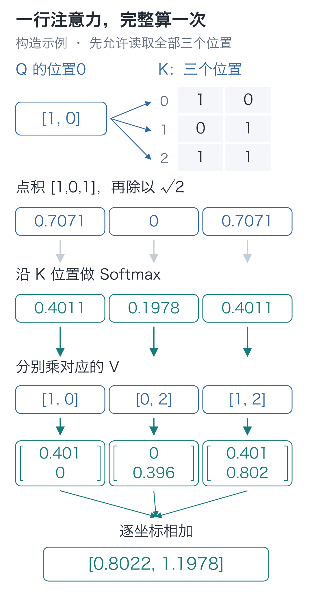
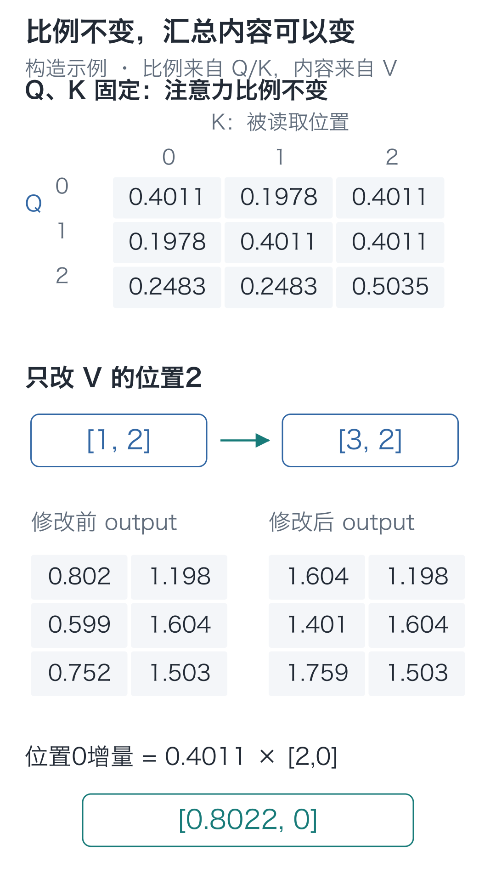
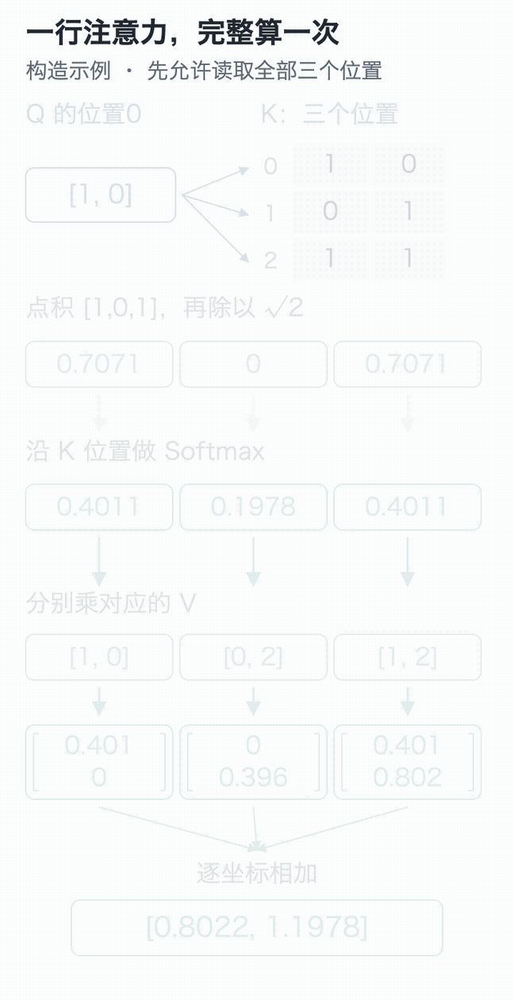

# 10｜注意力：预测下一字，怎样读到前文？

手写小模型，看懂大模型 · 第 10 讲

读到“早上，小丁喜欢”，我们希望接“红”；换成“早上，小周喜欢”，应接“黄”。上一讲的模型却把它们混在一起，因为它预测下一字时只使用最后那个“欢”的向量。

人名虽然也在输入数组里，却没有传到最后位置的计算路径。现在补上这条连接，让“丁”和“周”能影响“欢”后面的预测。先试最直接的办法：把各位置的向量合起来。

## 平均一下，前文就能进来了

假设三个位置分别带来二维向量 `[1, 0]`、`[0, 2]`、`[1, 2]`。直接平均，可以得到 `[2/3, 4/3]`。

现在改动任意一行，平均值都会变。其他位置的信息确实进来了。但无论哪个位置发起读取，拿到的总是同一个平均值，不能根据当前位置的输入换一种组合。

如果手工规定比例 `[0.5, 0.25, 0.25]`，也能算出一个汇总：

```text
第0坐标：0.5×1 + 0.25×0 + 0.25×1 = 0.75
第1坐标：0.5×0 + 0.25×2 + 0.25×2 = 1
```

这组比例给出了另一个结果 `[0.75, 1]`。如果比例也能根据当前输入算出来，就不必由我们逐句填写。

## 比例能不能由当前输入自己算？

当前位置先产生一条向量，其他可读位置也各自产生一条向量。把前者与后者分别做点积，就能得到一行分数，再用第08讲的 Softmax 变成比例。

发起读取的向量叫 **Q，查询向量**；与它配对打分的向量叫 **K，键向量**；按比例汇总的内容向量叫 **V，值向量**。

三组向量都从输入 `X` 经过各自的线性投影得到：

**Q=X @ Wqᵀ，K=X @ Wkᵀ，V=X @ Wvᵀ。**

`X` 是这次的输入，`Wq/Wk/Wv` 是可训练参数，`Q/K/V` 是投影后的中间结果。训练改变参数；参数固定时，换输入也会改变 Q/K/V。

三组投影把两个动作分开了：Q/K 决定匹配比例，V 决定汇总的内容。训练可以分别调整“如何决定比例”和“传递哪些数”，不用把两者绑定在同一组坐标上。

点积并不会天生识别“丁”和“苹果”的关系。它只是把对应坐标相乘再相加，数值还会受向量方向和长度影响。后面用下一字的预测错误反向更新 `Wq/Wk/Wv`，才可能让有助于预测的前文得到合适的读取比例；训练中没有另给一张“这一头应该看谁”的标准答案。

用三个位置、每个位置二维的构造例子，把内部数值全部展开：

```text
Q = K = [[1, 0],      V = [[1, 0],
         [0, 1],           [0, 2],
         [1, 1]]           [1, 2]]
```

三者形状均为 `[3, 2]`，前一轴是位置，后一轴是特征。它们可以由 `X=Q`、`Wq=Wk=单位矩阵`、`Wv=[[1, 0], [0, 2]]` 得到。单位矩阵的作用是保留原坐标；第三组参数把第二坐标乘 2。

这些数不代表三个中文词的真实语义。这里暂时允许每个位置读取全部三个位置。

## 只算第一行，看看比例从哪里来

选位置 0，它的查询向量是 `q₀=[1, 0]`。分别与三条 K 做点积：

```text
q₀·k₀ = 1×1 + 0×0 = 1
q₀·k₁ = 1×0 + 0×1 = 0
q₀·k₂ = 1×1 + 0×1 = 1
```

这三个数表示本例采用的匹配得分。负得分也是允许的，不必先改成 0。

下面的展示值保留四位小数，代码用完整精度计算；手算若使用已四舍五入的数，最后一位可能略有差别。

接着，每个数都除以 `√2`，得到约 `[0.7071, 0, 0.7071]`。根号 2 是“平方后等于 2 的正数”，约为 1.4142；这里的 2 来自查询向量的维度。

为什么缩放？点积累加的项越多，分数波动通常也会增大。在坐标尺度相近、贡献没有强相关等条件下，除以维度的平方根可以缓和这种增长，避免 Softmax 过早集中到极少数项。具体比例仍由本次 Q、K 的数值决定。

现在对这一行做 Softmax，得到：

**a₀=[0.4011，0.1978，0.4011]。**

具体地说，三个指数值约为 `[2.0281, 1, 2.0281]`，分母是它们的和 5.0562。第一项 `2.0281/5.0562`，正好得到约 0.4011。每个比例都由这一行的三个得分共同决定。

三项都非负，总和约为 1。第一项和第三项比例相同，因为它们在这一行的得分相同。



图中横向的三个候选是**可读取的位置**。第08讲的 Softmax 沿词表候选归一化，这里的 Softmax 沿 K 的位置轴归一化；算法相同，候选对象已经换了。

## 用这行比例，逐坐标汇总 V

第一个输出坐标为：

**0.4011×1 + 0.1978×0 + 0.4011×1 ≈ 0.8022。**

第二个输出坐标为：

**0.4011×0 + 0.1978×2 + 0.4011×2 ≈ 1.1978。**

所以位置 0 得到新向量 `[0.8022, 1.1978]`。它已经与位置 1、2 的 V 有关。与开头只看自己的基线相比，跨位置的计算路径出现了；这个结果仍是位置表示，还要接到后续网络的词表投影，才能给下一字打分。

在这个例子里，V 有两列，所以汇总也有两个坐标。即使可读取的位置从三个增加到十个，只要 V 仍为两列，输出宽度就仍然是 2。位置数决定有多少份内容可读，特征宽度决定每份内容包含多少坐标；注意力不会把这两个轴直接拼成六维或二十维。

这里的三项比例分给的是输入位置，不能当作三个字符的生成概率。

这组比例常被叫作**注意力权重**。这里“权重”一词容易混淆：`Wq/Wk/Wv` 是模型保存并更新的参数；`a₀` 是本次前向临时算出的系数。后者不会作为一份独立参数表被优化器长期保存。

反向时，梯度经过 Softmax、点积和投影，传到三组参数。下一次前向再用更新后的参数重算读取比例。

比例要和 V 一起看。某行 V 若全为 0，即使比例很高，当前也没有它的直接数值贡献；不同坐标还可能正负抵消。

## 从一行，推广到所有位置

位置 1、2 各有自己的 Q，也分别得到一行比例。把全部行排起来：

```text
A ≈ [[0.4011, 0.1978, 0.4011],
     [0.1978, 0.4011, 0.4011],
     [0.2483, 0.2483, 0.5035]]
```

每一行有自己的分母，不是让整张矩阵的九项加起来等于 1。`A` 的形状是 `[3, 3]`：行选发起查询的位置，列选被读取的位置。

把刚才的步骤压缩起来，就是：

**scores=Q @ Kᵀ / √d；A=Softmax(scores)；output=A @ V。**

`Kᵀ` 交换行列，让 Q 的每一行与 K 的每一行配对。`[3, 3] @ [3, 2]` 得到 `[3, 2]`，输出仍有三个位置，每个位置两维。

单独读取一行 Q 时，形状可以看成 `[1, 2]`，配同一份 K 就得到 `[1, 3]` 的分数。把三行 Q 一起送入，才扩成 `[3, 3]`。增加查询行数，只是多算几组独立的比例，并不是让原来的一行改用另一套参数。

下面的核心代码同时保留参数、分数、比例和输出，能与手算逐项核对：

```python
import math
import torch

# 三个位置各有两个坐标；这是构造数值，不预先指定中文语义。
x = torch.tensor([[1., 0.], [0., 1.], [1., 1.]])
# 三组可训练投影参数：Q/K 在本例保留坐标，V 把第二坐标乘 2。
wq = torch.eye(2, requires_grad=True)
wk = torch.eye(2, requires_grad=True)
wv = torch.tensor([[1., 0.], [0., 2.]], requires_grad=True)
q, k, v = x @ wq.T, x @ wk.T, x @ wv.T

def attention(q, k, v):
    """每行 Q 查询各行 K，再汇总 V；返回输出、匹配分数与读取比例。"""
    # 行选查询位置，列选被读位置；除以查询宽度的平方根来缓和分数尺度。
    scores = q @ k.transpose(-2, -1) / math.sqrt(q.shape[-1])
    # 每行在被读位置之间分配比例；这里尚未加掩码，允许读取全部位置。
    weights = torch.softmax(scores, dim=-1)
    # [3,3] 比例乘 [3,2] 内容，得到 [3,2]；比例是本次算出的量，不是参数。
    return weights @ v, scores, weights

output, scores, weights = attention(q, k, v)
# 单独重算第 0 个查询，与矩阵版第一行核对，使用同一份 K/V。
first_scores = (q[0] @ k.T) / math.sqrt(2)
first_weights = torch.softmax(first_scores, dim=-1)
first_output = first_weights @ v

print(scores)
print(weights)
print(output)
assert torch.allclose(first_output, output[0])
# 三个查询各自一行，分别沿被读位置求和，不能把九项一起归一化。
assert torch.allclose(weights.sum(dim=-1), torch.ones(3))
```

矩阵版的第一行，与单独算第一行得到同样结果。完整输出约为：

```text
[[0.8022, 1.1978],
 [0.5989, 1.6044],
 [0.7517, 1.5035]]
```

<details class="optional" markdown="1">
<summary>再追问一步：Q、K能不能共用一张投影表？</summary>

可以这样构造模型，但会限制匹配分数。如果两边用同一张表，同一个位置得到的Q与K就相同。位置0与位置1做点积，交换先后只是把乘积换个顺序，因此两个方向的点积相等。

若希望允许“位置0对位置1的匹配分数高，反方向低”，独立的两张投影表就能表达这种差别。先用两行输入`[[1,0],[0,1]]`构造一个例子，直接看尚未缩放和归一化的点积：

```python
# 这是单独的构造实验；两行输入、每行两个坐标，不代表具体词义。
pair_x = torch.tensor([[1., 0.], [0., 1.]])
pair_q = pair_x @ torch.eye(2).T  # 查询投影暂取单位矩阵。
# 共用投影时，K与Q相同，两个方向的点积都是0。
shared_scores = pair_q @ pair_q.T
# 换一张键投影表，得到 K=[[0,0],[2,0]]，保持Q不变。
key_projection = torch.tensor([[0., 2.], [0., 0.]])
pair_k = pair_x @ key_projection.T
separate_scores = pair_q @ pair_k.T
print(shared_scores)    # [[1,0],[0,1]]
print(separate_scores)  # [[0,2],[0,0]]
assert shared_scores[0, 1].item() == shared_scores[1, 0].item() == 0.
assert separate_scores[0, 1].item() == 2. and separate_scores[1, 0].item() == 0.
```

分开以后，两个方向可以得到2和0。本模型选择独立的Q/K投影，保留这种自由。这不是规定训练后必须出现某种关系，而是说明结构允许哪些关系。

这里比较的是点积。Softmax还要除以各自行的总和，即使点积分数相同，两个方向最后的读取比例也不一定相同。

</details>

## 现在改动别的位置，当前位置会变吗？

固定 Q、K，把第三行 V 从 `[1, 2]` 改成 `[3, 2]`。分数与 Softmax 都没有用到 V，所以注意力比例不变；汇总时第三行的第 0 坐标多了 2，输出会随之改变。



位置 0 的第 0 坐标增加 `2×0.4011≈0.8022`，第 1 坐标不变。代码可以接着核对：

```python
# 沿用上段的 Q/K 与 attention；复制 V 的数值，本次只做固定比例的干预。
changed_v = v.detach().clone()
# 只改第三行的第 0 坐标，不重新生成 Q/K，因此匹配分数与比例应保持不变。
changed_v[2, 0] = 3.
changed_output, _, changed_weights = attention(q, k, changed_v)
assert torch.allclose(changed_weights, weights)
print(changed_output - output)
```

断言显示比例不变，汇总结果却变了：位置 2 的内容已经能影响位置 0。

这个小实验特意固定 Q/K，只改 V，用来拆开两步的职责。实际修改输入时，三组投影结果通常会一起变化，读取比例也会跟着改变。



可以在[交互演示](https://daviddingxu.github.io/hello-llm/chapters/10-attention/walkthrough.html)里停在点积、Softmax 或汇总阶段，与上面的静态算式逐项核对。

位置 0 现在也能读取位置 2，而后面的输入里可能就放着它要预测的答案。下一讲要给每个位置划定读取范围，堵住这条捷径。

## 两道改数题

1. 固定 Q、K，只把第三行 V 改为 `[3, 2]`。位置 1 的第 0 坐标增加多少？注意力权重会改变吗？
2. 把 `q₀` 改成 `[0, 0]`，三行 K、V 保持原样。第一行比例和输出是什么？

<details class="answer" markdown="1">
<summary>参考答案</summary>

答案：第一题，增加 `2×0.4011≈0.8022`，权重不变。第二题，三个点积都是 0，Softmax 得到 `[1/3, 1/3, 1/3]`，输出回到平均值 `[2/3, 4/3]`。

</details>

在配套代码目录运行：

```bash
# 在配套代码目录运行本讲实验，核对正文中的结果。
python -m lessons.l10
```

完整入口：[运行入口](https://github.com/DavidDingXu/hello-llm/blob/main/code/lessons/l10.py) · [注意力组件](https://github.com/DavidDingXu/hello-llm/blob/main/code/tiny_lm/attention.py) · [环境说明](https://github.com/DavidDingXu/hello-llm/blob/main/code/README.md)

源码导航：[attention.py · attention_2d](https://github.com/DavidDingXu/hello-llm/blob/main/code/tiny_lm/attention.py#L30)。

<!-- chapter-navigation:start -->

---

[← 文本训练题](../09-training-targets/README.md) · [课程目录](../../README.md#课程目录) · [因果掩码 →](../11-causal-mask/README.md)

<!-- chapter-navigation:end -->
