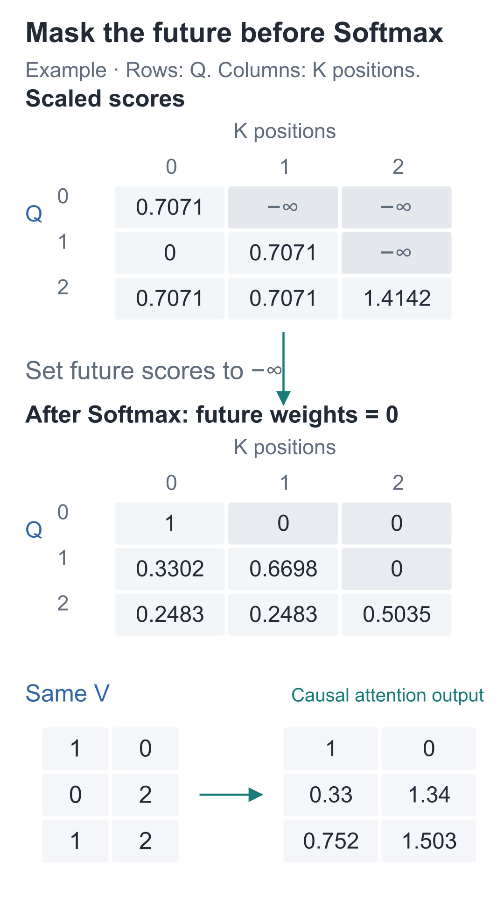
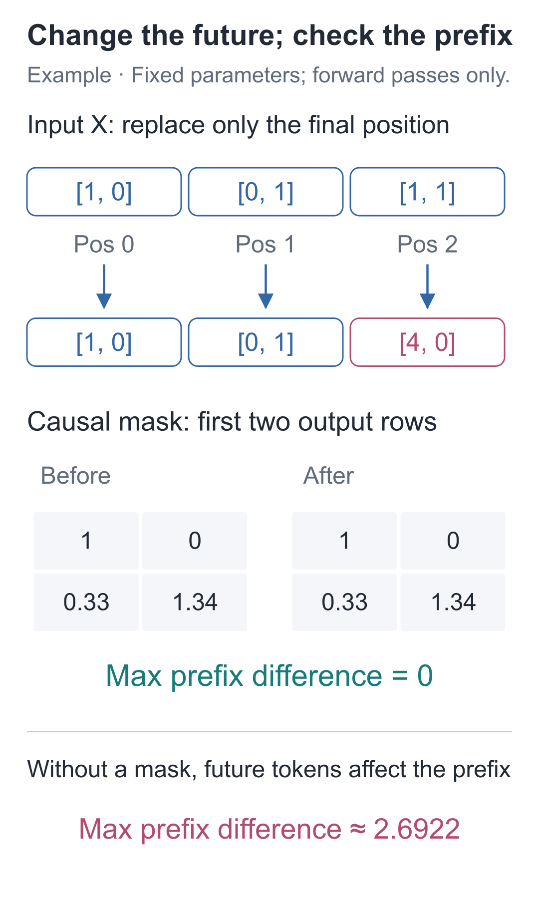
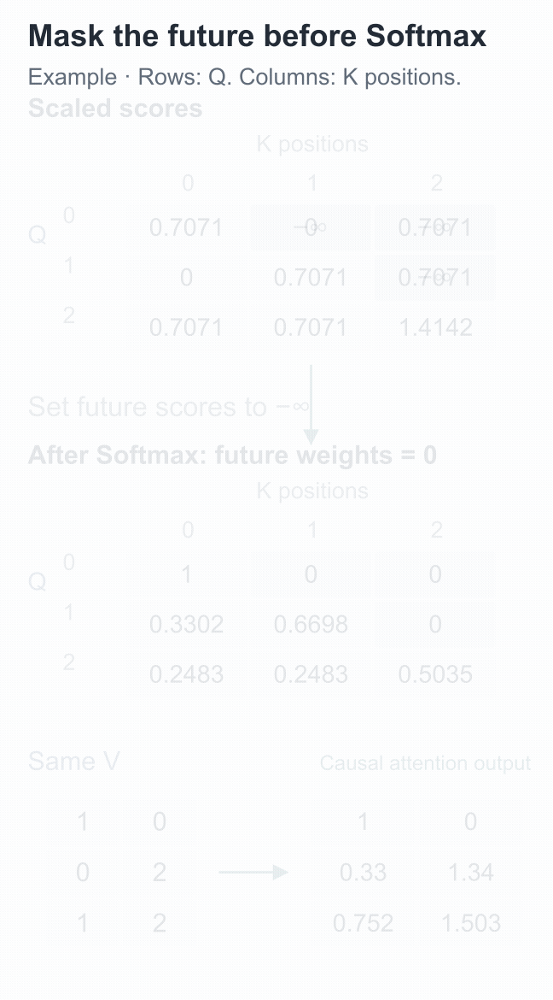

# 11 | Causal Masks: Why Is Parallel Training Not Peeking at the Answer?

Build a Small Model, Understand Large Models · Lesson 11

During training, predicting “苹” after “欢” offers a dangerous shortcut: the next input slot already contains “苹”. If the attention mechanism from the previous lesson reads that slot, a correct prediction may simply mean it has read the answer directly. These are characters in our actual Chinese training data: “欢” completes “喜欢” (“likes”), and “苹” begins “苹果” (“apple”).

During generation, the following “苹” has not appeared yet, so this shortcut is unavailable. Even a very low training loss would not establish that the model can predict from the preceding text.

## Find the Slot That Could Leak the Answer

Lay out the input and target:

```text
输入：BOS 小 丁 喜 欢 苹 果 。
目标：小  丁 喜 欢 苹 果 。 EOS
```

The two rows above are the input and target, respectively. Input position 4 contains “欢”, and its target is “苹”. Reading from BOS through “欢” lets the model predict from the available prefix. Reading “苹” at input position 5 would bring the answer into the computation.

Shifting the targets by one slot has not closed this route. It tells the loss function **what to predict**, but does not restrict **what the forward pass may use to predict it**. Each position needs a permitted reading range: position t may read only positions 0 through t.

We allow the current position to remain visible: the “欢” at position 4 is already known when predicting the next character. The first BOS can also read itself, ensuring that the first row has at least one entry to normalize over.

## Cross Out the Connections That Should Not Exist

Reuse the three-position values from the previous lesson:

```text
Q = K = [[1, 0],      V = [[1, 0],
         [0, 1],           [0, 2],
         [1, 1]]           [1, 2]]
```

As before, displayed values are rounded to four decimal places; the computation uses full precision.

Position 0 may now read only 0; position 1 may read 0 and 1; position 2 may read 0, 1, and 2. Rows represent query positions, and columns represent positions being read. Mark allowed connections with 1 and forbidden connections with 0:

```text
[[1, 0, 0],
 [1, 1, 0],
 [1, 1, 1]]
```

This rule table is a **causal mask**. It is generated from position relationships and is not trained. The diagonal and the region below it are visible; the upper-right region containing future positions is hidden.



The gray cells indicate forbidden reads. This differs from −100 in the targets: −100 only determines whether a position contributes a direct loss. Here, we must block an input information path.

## Would Setting Future Scores to 0 Block Them?

Start with position 1. Its unmasked scores are `[0, 0.7071, 0.7071]`. The third entry refers to the future and must receive probability 0.

The obvious first attempt is to set that third score to 0. But run Softmax again: `exp(0)=1`, so this position still receives a share. A score of zero is an ordinary score; it does not mean “reading forbidden.”

For the share to vanish completely, its exponential must be 0. As a score approaches negative infinity, its exponential approaches 0.

The code represents negative infinity with `float("-inf")`. Exponentiating it gives 0; dividing that by the sum of the valid terms still gives 0. Position 1's scores therefore become:

```text
[0, 0.7071, -∞]
```

Its probabilities become **[0.3302,0.6698,0]**. The third entry disappears, and the first two are renormalized so that their sum remains 1.

Now try “zero the future after Softmax.” That leaves `[0.1978, 0.4011, 0]`, whose sum is only about 0.5989. The future entry is zero, but the first two entries still use the old denominator, shrinking the aggregate vector unnecessarily. Masking before Softmax lets the visible positions receive the full share again.

Setting only the future V to all 0 is also insufficient: the future K can still affect the result through the Softmax denominator.

The first row has only position 0 left, so its weights are `[1, 0, 0]`. The last row has no future positions and retains the previous lesson's result. The complete weight table is:

```text
[[1.0000, 0.0000, 0.0000],
 [0.3302, 0.6698, 0.0000],
 [0.2483, 0.2483, 0.5035]]
```

The corresponding output is approximately:

```text
[[1.0000, 0.0000],
 [0.3302, 1.3395],
 [0.7517, 1.5035]]
```

Position 1's output comes from `0.3302×[1, 0]+0.6698×[0, 2]`, with no contribution from the third row of V. The weight table lets us trace the source of every result.

## Put the Restriction into the Core Code

```python
import math
import torch

def attention(q, k, v, causal=True):
    """Aggregate V at visible positions; inputs are [T,2], and outputs are [T,2] and [T,T]."""
    # Rows are query positions and columns are K positions; scale dot products by the query width's square root.
    scores = q @ k.transpose(-2, -1) / math.sqrt(q.shape[-1])
    if causal:
        # True means visible: the lower triangle includes current and past positions, excluding the future.
        visible = torch.ones(scores.shape[-2:], dtype=torch.bool,
                             device=scores.device).tril()
        # ~visible selects future entries; set them to -inf before Softmax so their exponentials become 0.
        scores = scores.masked_fill(~visible, float("-inf"))
    # The last axis contains K positions; each query row distributes attention weights that sum to 1.
    weights = torch.softmax(scores, dim=-1)
    return weights @ v, weights

q = torch.tensor([[1., 0.], [0., 1.], [1., 1.]])
k = q.clone()
v = torch.tensor([[1., 0.], [0., 2.], [1., 2.]])
output, weights = attention(q, k, v, causal=True)
print(weights)
print(output)
# Check that future positions receive zero attention weight, rather than merely zeroing their V vectors.
assert weights[0, 1:].eq(0).all()
assert weights[1, 2].item() == 0.
assert torch.allclose(weights.sum(dim=-1), torch.ones(3))
```

`tril()` keeps the lower triangle. Boolean `True` means visible; `~visible` flips the Boolean values to select forbidden positions. `masked_fill` returns a new set of scores with negative infinity in those positions. The code comments and docstrings are preserved in Chinese so that these runnable examples remain identical to the original lesson.

Do not mask an entire row: when every score is negative infinity, there is no valid normalization denominator. Keeping the diagonal ensures that every row can at least read itself.

## Change the Future and Check for Leakage

Test the mask by modifying the input. Keep the same projections: `Q=K=X`, and V multiplies the second coordinate by 2. Change the final input position from `[1, 1]` to `[4, 0]`. Its Q, K, and V all change, but positions 0 and 1 are not allowed to read it, so their outputs should stay the same.

```python
def run(x, causal):
    """Fix Q=K=X and double only V's second coordinate to compare visibility ranges."""
    values = x @ torch.tensor([[1., 0.], [0., 2.]]).T
    return attention(x, x, values, causal=causal)[0]

x = torch.tensor([[1., 0.], [0., 1.], [1., 1.]])
changed_x = x.clone()
# Replace only position 2; inputs at positions 0 and 1 and all parameters stay unchanged.
changed_x[2] = torch.tensor([4., 0.])

before = run(x, causal=True)
after = run(changed_x, causal=True)
assert torch.allclose(before[:2], after[:2])
print("Causal-prefix difference:", (before[:2] - after[:2]).abs().max().item())

# Control: without the causal constraint, position 2 can affect the first two rows.
open_before = run(x, causal=False)
open_after = run(changed_x, causal=False)
assert not torch.allclose(open_before[:2], open_after[:2])
```



There is no backward pass or parameter update during this comparison. Otherwise, parameter changes could alter the entire prefix even when the future is masked. In the complete model, we must also replace a future token with another ID and check that the earlier **logits** agree, confirming that later components do not reintroduce a path from the future.

The first two rows differ by 0 in the causal version; they change in the unmasked version. The final row we replaced is allowed to read itself, so its result may change. The printed Chinese label means “causal prefix difference.”

A multilayer network must obey the same constraint. At layer one, position t reads only inputs at or before t. If layer two also reads only first-layer results at or before t, those results still contain only prefix information. Continuing this argument through the layers establishes that future information cannot take a detour through an intermediate position. Masking the future only at the final layer cannot remove information mixed in earlier.

Right padding follows the same rule. PAD appears after all valid positions, so earlier valid queries cannot read it. PAD rows still produce outputs, but their labels are −100 and do not contribute to the loss. Protecting the prefix does not depend on their vectors happening to be all zeros.

## If Each Position Has Its Own Prefix, Why Can They Run Together?

Discussing position 0 before position 1 is an order of explanation, not a dependency that forces the program to wait row by row.

During training, all inputs are already given, so all Q, K, and V vectors can be computed first. Each row applies its own visibility range to the same known input. Position 1 need not wait for position 0 to generate a new character, and position 2 need not wait for position 1's prediction.

Blocking the future therefore does not force character-by-character training. A matrix multiplication computes every score, the upper-right region is masked, and each row is normalized to obtain all the predictions together. Whether the model peeks at the answer depends on the permitted connections, not on which row the program computes first.



In the [interactive demo](https://daviddingxu.github.io/hello-llm/chapters/11-causal-mask/walkthrough.en.html), inspect the scores and Softmax results before and after masking. All rows in the full matrix are computed in the same forward pass.

Generation is different: the next character has not yet been chosen, so its input vector does not exist. The model produces a row of scores, selects a character, appends it to the input, and then computes the next step. **Known training inputs can be processed in parallel; new inputs during generation must still be obtained step by step.** The causal constraint gives prediction the same meaning in both processes.

During training, the prefix comes from the original sentence. During generation, it includes characters the model itself selected. If one character is wrong, the input to the next step changes as well.

## Two Check Questions

1. Set position 0's future scores to 0 instead of negative infinity. Its three scores become `[0.7071, 0, 0]`. Will the final two weights be 0?
2. If the input at position 1 changes, should position 0's output change? What about position 2? What happens if only the target label at position 1 changes?

<details class="answer" markdown="1">
<summary>Reference answers</summary>

For question one, no. The weights are approximately `[0.5035, 0.2483, 0.2483]`, so the future remains visible. For question two, in a causal computation with fixed parameters, position 0 should remain unchanged. Position 2 may read position 1 and may therefore change. If only the target label changes, with inputs and parameters held fixed, all forward outputs remain the same. What changes is the loss and the gradients that may subsequently be computed.

</details>

Run this from the companion code directory:

```bash
# Run this lesson from the companion code directory to check the chapter's results.
python -m lessons.l11
```

Complete entry points: [Lesson runner](https://github.com/DavidDingXu/hello-llm/blob/main/code/lessons/l11.py) · [Attention component](https://github.com/DavidDingXu/hello-llm/blob/main/code/tiny_lm/attention.py) · [Environment setup](https://github.com/DavidDingXu/hello-llm/blob/main/code/README.md)

Source navigation: [attention.py · attention_2d](https://github.com/DavidDingXu/hello-llm/blob/main/code/tiny_lm/attention.py#L30).

<!-- chapter-navigation:start -->

---

[← Single-Head Attention](../10-attention/README.en.md) · [Contents](../../README.en.md#course-contents) · [Multi-head attention →](../12-multi-head-attention/README.en.md)

<!-- chapter-navigation:end -->
