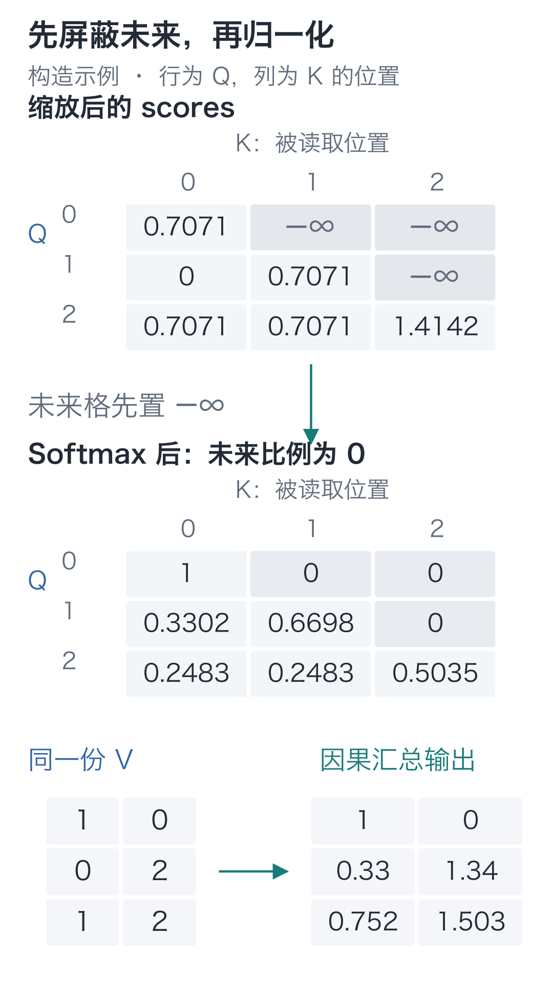
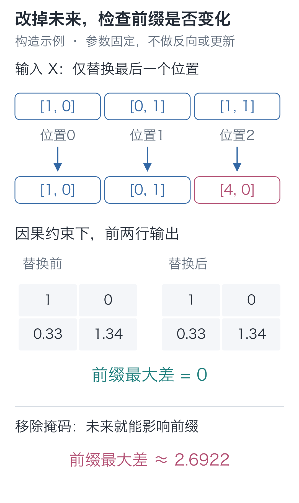
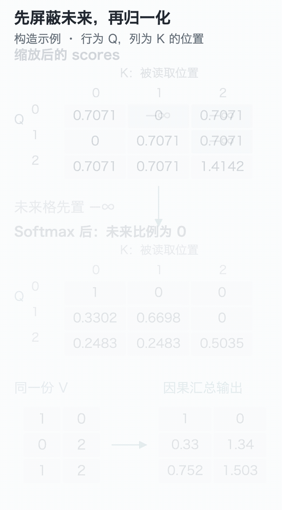

# 11｜因果掩码：并行训练为什么不算偷看答案？

手写小模型，看懂大模型 · 第 11 讲

训练时，预测“欢”后面的“苹”有一条危险的捷径：输入的下一格，本来就放着“苹”。如果上一讲的注意力读到了这一格，即使答对，也可能只是直接读到了答案。

生成时，后面的“苹”还没出现，这条捷径就用不了了。训练损失再低，也不能说明模型能根据已有前文预测。

## 把可能泄露答案的那一格找出来

展开输入与目标：

```text
输入：BOS 小 丁 喜 欢 苹 果 。
目标：小  丁 喜 欢 苹 果 。 EOS
```

输入位置 4 是“欢”，它的目标是“苹”。允许读取 BOS 到“欢”，就能根据已有前文预测；若允许读取输入位置 5 的“苹”，答案就已经进入计算。

原来，把目标错开一格并没有堵住这条路：它只告诉损失函数“预测谁”，没有限制前向“根据谁预测”。我们需要给每个位置划定读取范围：位置 t 只能读位置 0 到 t。

我们选择当前位置也可见：位置 4 的“欢”本来就是预测下一字时已经知道的输入。第一个 BOS 也能读取自己，这能保证第一行至少有一项参与归一化。

## 先把不该存在的连接划掉

沿用上一讲三个位置的数值：

```text
Q = K = [[1, 0],      V = [[1, 0],
         [0, 1],           [0, 2],
         [1, 1]]           [1, 2]]
```

下文继续把展示值保留四位小数，实际计算使用完整精度。

现在位置 0 只读 0；位置 1 读 0、1；位置 2 读 0、1、2。行表示查询位置，列表示被读取位置，用 1 标允许、0 标禁止：

```text
[[1, 0, 0],
 [1, 1, 0],
 [1, 1, 1]]
```

这张规则表叫**因果掩码**，由位置关系生成，不参与训练。对角线与下方可见，未来所在的右上区域不可见。



图中的灰格表示禁止读取。它与目标里的 −100 不同：−100 只决定某位置是否计算直接损失；这里要阻断一条输入信息路径。

## 把未来得分改成 0，能不能堵住？

先看位置 1。未屏蔽的得分是 `[0, 0.7071, 0.7071]`，第三项对应未来，必须让它的概率为 0。

最容易想到的是把第三项改成 0。可重新走一遍 Softmax：`exp(0)=1`，这个位置仍会分到比例。分数为零，只是一次普通打分，并没有表达“禁止读取”。

要让它完全没有份额，需要让指数为 0。分数趋向负无穷时，指数正好趋向 0。

代码用 `float("-inf")` 表示负无穷。它参与这一行的指数后得到 0，再除以有效项的总和，仍然为 0。于是位置 1 的分数变成：

```text
[0, 0.7071, -∞]
```

其概率变成 **[0.3302,0.6698,0]**。第三项消失，前两项重新归一化，和仍为 1。

再试“Softmax 后把未来清零”，会留下 `[0.1978, 0.4011, 0]`，和只有约 0.5989。未来虽然归零了，前两项仍按旧分母计算，汇总向量被额外缩小。直接在 Softmax 前屏蔽，就能让可见位置重新分完整份额。

仅把未来 V 变成全 0 也不够：未来 K 仍能通过 Softmax 的分母影响结果。

第一行只剩位置 0，权重为 `[1, 0, 0]`；最后一行没有未来，保持上一讲的结果。完整权重为：

```text
[[1.0000, 0.0000, 0.0000],
 [0.3302, 0.6698, 0.0000],
 [0.2483, 0.2483, 0.5035]]
```

对应输出约为：

```text
[[1.0000, 0.0000],
 [0.3302, 1.3395],
 [0.7517, 1.5035]]
```

位置 1 的输出来自 `0.3302×[1, 0]+0.6698×[0, 2]`，没有第三行 V 的贡献。每个结果都能沿权重表找到来源。

## 把限制写进核心代码

```python
import math
import torch

def attention(q, k, v, causal=True):
    """汇总可见位置的 V；本例输入均为 [T,2]，返回 [T,2] 与 [T,T]。"""
    # 行是发起查询的位置，列是被读取的 K 位置；按查询向量宽度缩放点积。
    scores = q @ k.transpose(-2, -1) / math.sqrt(q.shape[-1])
    if causal:
        # True 表示允许读取：下三角包含当前位置和过去，排除未来。
        visible = torch.ones(scores.shape[-2:], dtype=torch.bool,
                             device=scores.device).tril()
        # ~visible 选中未来格；必须在 Softmax 前置为 -inf，使其指数为 0。
        scores = scores.masked_fill(~visible, float("-inf"))
    # 最后一轴是 K 位置，每个查询行独立分配总和为 1 的比例。
    weights = torch.softmax(scores, dim=-1)
    return weights @ v, weights

q = torch.tensor([[1., 0.], [0., 1.], [1., 1.]])
k = q.clone()
v = torch.tensor([[1., 0.], [0., 2.], [1., 2.]])
output, weights = attention(q, k, v, causal=True)
print(weights)
print(output)
# 核对未来位置的比例为零，而不是只把它们的 V 向量清零。
assert weights[0, 1:].eq(0).all()
assert weights[1, 2].item() == 0.
assert torch.allclose(weights.sum(dim=-1), torch.ones(3))
```

`tril()` 留下下三角；布尔值 `True` 表示可见；`~visible` 把真假反过来，指向禁止位置。`masked_fill` 返回在这些位置填入负无穷的新分数。

不能把整行都屏蔽，因为全是负无穷时，没有有效的归一化分母。这里保留对角线，所以每行至少能读自己。

## 现在把未来换掉，检查它是否还在漏

用修改输入的办法检查屏蔽是否有效。继续用同一组投影：`Q=K=X`，V 把第二坐标乘 2。把最后一个输入位置从 `[1, 1]` 改成 `[4, 0]`，它产生的 Q、K、V 都会变化；位置 0、1 不允许读取它，输出应当保持不变。

```python
def run(x, causal):
    """固定投影 Q=K=X，只将 V 的第二坐标乘 2，便于比较可见范围。"""
    values = x @ torch.tensor([[1., 0.], [0., 2.]]).T
    return attention(x, x, values, causal=causal)[0]

x = torch.tensor([[1., 0.], [0., 1.], [1., 1.]])
changed_x = x.clone()
# 只替换位置 2；位置 0、1 的输入和计算参数均保持原样。
changed_x[2] = torch.tensor([4., 0.])

before = run(x, causal=True)
after = run(changed_x, causal=True)
assert torch.allclose(before[:2], after[:2])
print("因果前缀差值", (before[:2] - after[:2]).abs().max().item())

# 对照：取消因果限制后，位置 2 可以影响前两行。
open_before = run(x, causal=False)
open_after = run(changed_x, causal=False)
assert not torch.allclose(open_before[:2], open_after[:2])
```



比较期间没有反向或更新。否则即便未来被屏蔽，参数变化也可能改变整个前缀。在完整模型中，还要把未来 token 换成另一个编号，检查此前位置的 **logits** 是否一致，确认后续组件没有重新引入未来路径。

因果版本的前两行差值为 0，无掩码版本则发生变化。被换掉的最后一行允许读取自己，它的结果可以变。

多层网络也要遵守这条约束。第一层位置 t 只读取不晚于 t 的输入；第二层若也只读取不晚于 t 的第一层结果，这些结果就仍然只含前缀信息。沿层数继续检查，就能确认未来没有通过某个中间位置绕回来。只在最后一层遮住未来，无法清除之前已经混入的信息。

右侧填充也遵守同一规则：PAD 在所有有效位置之后，所以前面的有效查询读不到它；PAD 自己所在的行仍会输出，但标签为 −100，不参与损失。它不需要靠“向量恰好为全零”来保护前文。

## 既然各看各的前缀，为什么还能一起算？

“先讲位置 0，再讲位置 1”是展开计算的顺序，不是程序必须逐行等待的依赖。

训练时所有输入已经给定，Q、K、V 都能先算出来。每一行使用自己的可见范围，对同一个已知输入做计算：位置 1 不需要等位置 0 生成一个新字符，位置 2 也不需要等位置 1 的预测结果。

因此，封住未来并没有迫使我们逐字训练。一次矩阵乘法算出全部得分，屏蔽右上区域，再各行归一化，就能同时得到这些题的结果。决定有没有偷看的是允许连接的范围，不是程序先算哪一行。



可以在[交互演示](https://daviddingxu.github.io/hello-llm/chapters/11-causal-mask/walkthrough.html)中分别查看屏蔽前后的分数与 Softmax 结果。完整矩阵中的各行，在同次前向中一起计算。

生成时情况不同：下一个字符尚未决定，它的输入向量也不存在。模型先输出一行分数，选择一个字符，追加到输入，再计算下一步。**训练的已知输入可以并行，生成的新输入仍需逐步获得。** 因果约束在这两种过程中保持同样的预测含义。

训练时，前缀来自原句；生成时，前缀会包含模型自己选出的字。如果选错一个字，下一步面对的输入也随之改变。

## 两道检查题

1. 把位置 0 的未来分数改成 0，而不是负无穷。它的三个分数变成 `[0.7071, 0, 0]`，后两项权重会是 0 吗？
2. 修改位置 1 的输入时，位置 0 的输出应否改变？位置 2 呢？如果只把位置 1 的目标标签改掉，又会怎样？

<details class="answer" markdown="1">
<summary>参考答案</summary>

答案：第一题，不会。权重约为 `[0.5035, 0.2483, 0.2483]`，未来仍然可见。第二题，在参数固定的因果计算中，位置 0 不应改变；位置 2 允许读取位置 1，所以可能改变。只改目标标签，不改输入且不更新参数，前向输出都不变，变化的是损失与随后可能得到的梯度。

</details>

在配套代码目录运行：

```bash
# 在配套代码目录运行本讲实验，核对正文中的结果。
python -m lessons.l11
```

完整入口：[运行入口](https://github.com/DavidDingXu/hello-llm/blob/main/code/lessons/l11.py) · [注意力组件](https://github.com/DavidDingXu/hello-llm/blob/main/code/tiny_lm/attention.py) · [环境说明](https://github.com/DavidDingXu/hello-llm/blob/main/code/README.md)

源码导航：[attention.py · attention_2d](https://github.com/DavidDingXu/hello-llm/blob/main/code/tiny_lm/attention.py#L30)。

<!-- chapter-navigation:start -->

---

[← 单头注意力](../10-attention/README.md) · [课程目录](../../README.md#课程目录) · [多头注意力 →](../12-multi-head-attention/README.md)

<!-- chapter-navigation:end -->
