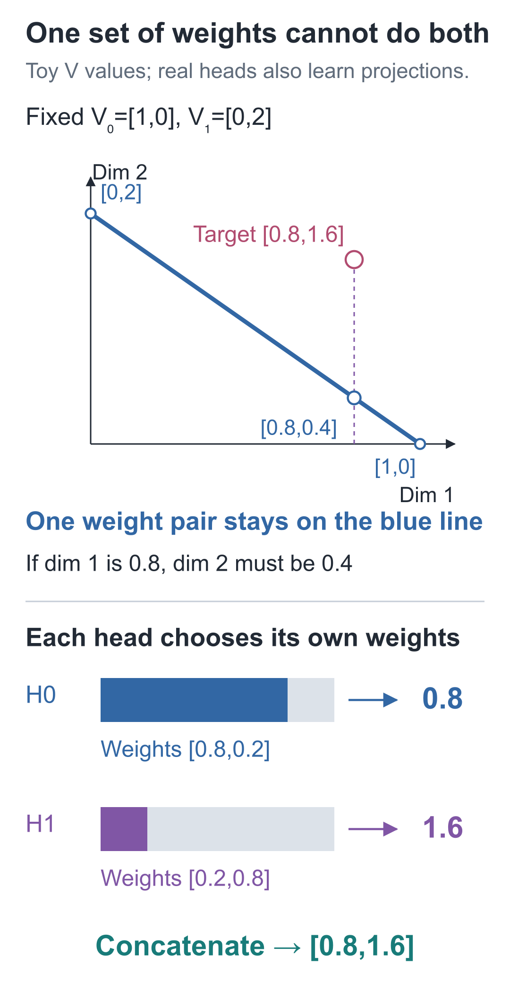
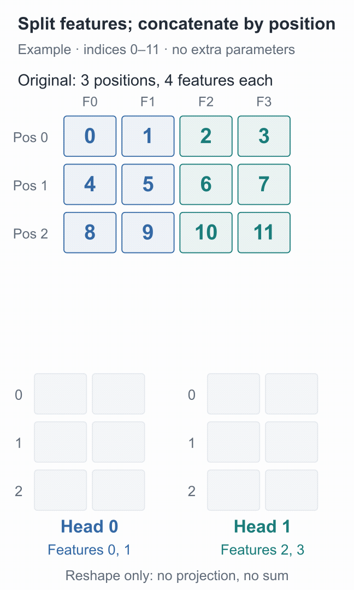
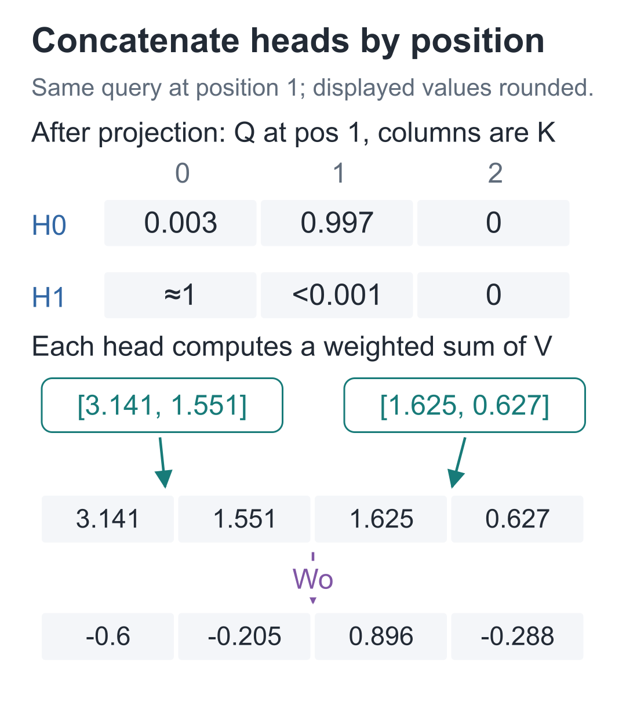

# 12 | Multi-Head Attention: Where Does Each Head Read?

Build a Small Model, Understand Large Models · Lesson 12

When reading “小丁拿着红色的苹果。” (“Xiaoding is holding a red apple”), finding “who is holding it” and “what color it is” calls for reading different positions. A sentence can be read in different ways. Can the model preserve several of them at once?

In the previous lesson, each query produced one row of weights shared by every output coordinate. **Multi-head attention** lets several groups of representations compute their own reading weights and then combines the results. The sentence example only motivates the need; we must inspect trained behavior to determine what each head actually learns to do.

## Where Does a Single Set of Weights Reach Its Limit?

Fix two content vectors V: `[1, 0]` and `[0, 2]`. Suppose we want the aggregate's first coordinate to be 0.8 and its second to be 1.6. First try to achieve this with one row of weights.

Write the weights as `[a, 1−a]`. The output is `[a, 2(1−a)]`. The first coordinate requires `a=0.8`, while the second requires `a=0.2`. Both cannot hold at once.

Attention weights are nonnegative and sum to 1, so `a` can vary only from 0 to 1. Across all valid values of `a`, the output can move only along the blue line below; it cannot reach the target point outside that line.



Now give each coordinate group its own weights. Head 0 aggregates the first group using `[0.8,0.2]`, producing `0.8×1+0.2×0=0.8`. Head 1 aggregates the second group using `[0.2,0.8]`, producing `0.2×0+0.8×2=1.6`. Concatenating them gives exactly `[0.8,1.6]`. We specified these weights ourselves; they have not been trained.

This comparison holds V fixed. A real model also learns projections for each head, and changing the projections changes what a single head can reach. The point here is that the architecture can retain several reading patterns at the same time. Next, we will arrange the heads in an array and let each perform its computation.

## How Should an Array Hold Two Sets of Weights?

Shrink the shape until we can draw every entry: 1 sample, 3 positions, and 4 features per position. Fill the array with labels 0 through 11 to track coordinates:

```text
X[0] = [[0,  1,  2,  3],
        [4,  5,  6,  7],
        [8,  9, 10, 11]]
```

The shape is `[B, T, D]=[1, 3, 4]`. These numbers only track cells. They are not character IDs or learned semantic features.

Split the features into 2 heads, each of width `d=D/H=4/2=2`. The first two entries at each position go to head 0; the last two go to head 1:

```text
头0：[[0, 1],       头1：[[ 2,  3],
      [4, 5],             [ 6,  7],
      [8, 9]]             [10, 11]]
```

The Chinese labels above mean “head 0” and “head 1.” Notice that each head still has all three positions. We split the feature axis, not the positions into “head 0 sees the first two characters, head 1 sees the last two.”



Blue cells are the first two entries at each position; teal cells are the last two. Follow 4 and 5 first: they move together to position 1 in head 0. Entries 6 and 7 move to the same position in head 1. This is only splitting and merging, with no projection or summation. To pause and inspect it, see the [static splitting diagram](images/en/04-只看格子怎样拆.png).

After splitting, the axes are **[B,H,T,d]=[1,2,3,2]**. Selecting one head along the head axis gives three positions with two coordinates each, ready for the attention calculation from the previous two lessons.

Open the [3D tensor lab](https://daviddingxu.github.io/hello-llm/chapters/12-multi-head-attention/lab3d.en.html) to follow the number 4 through splitting the feature axis, swapping head and position axes, and merging. Select any number to inspect its index at each step. This lab only rearranges the 12 values; it does not compute projections or attention.

The rearrangement itself adds no parameters and changes no values. The code needs two steps: split the last axis into “head” and “coordinate within a head,” then move the head axis before the position axis.

```python
import torch

def split_heads(x, heads):
    """把 [B,T,D] 的特征分为 H 组，返回 [B,H,T,d]，其中 d=D/H。"""
    batch, positions, width = x.shape
    if heads <= 0 or width % heads != 0:
        raise ValueError("表示宽度必须能被头数整除")
    # 先得到 [B,T,H,d]，再交换位置轴与头轴；每个头仍保留全部位置。
    return x.reshape(batch, positions, heads,
                     width // heads).transpose(1, 2)

def merge_heads(x):
    """逆转分头重排，将同一位置的各头结果拼成 [B,T,H*d]。"""
    batch, heads, positions, width = x.shape
    # contiguous 仅整理交换轴后的内存布局，不改变坐标对应的数值。
    return x.transpose(1, 2).contiguous().reshape(
        batch, positions, heads * width)

# 0—11 用来追踪坐标，不是字符编号；一个样本、三个位置、四维表示。
x = torch.arange(12, dtype=torch.float32).reshape(1, 3, 4)
heads = split_heads(x, 2)
print(heads)
assert heads.shape == (1, 2, 3, 2)
# 除了形状与往返，还要核对具体位置，防止两次错误重排恰好互相抵消。
assert heads[0, 0, 1].tolist() == [4., 5.]
assert heads[0, 1, 1].tolist() == [6., 7.]
assert torch.equal(merge_heads(heads), x)
```

`reshape` first produces `[B, T, H, d]`, and `transpose(1, 2)` swaps the position and head axes. Merging reverses the process. `contiguous()` organizes the transposed data into a contiguous layout suitable for the subsequent reshape; it does not alter the numerical relationships represented by the array.

Checking only that splitting and merging recover the original is insufficient. Opposite mistakes in the two functions could cancel out, so we also check that position 1 in head 0 really receives `[4, 5]`.

## Splitting into Two Pieces Does Not Automatically Create Two Reading Patterns

So far we have only moved cells; we have not decided how each head reads. To address the two needs at the start, each head must use its own parameters to produce representations. Apply three trainable projections to X to obtain Q, K, and V with shape `[B, T, D]`, then split each into `[B, H, T, d]`.

Although the code represents each projection with one large matrix, different heads receive different parameter rows from that matrix. A Q coordinate in one head can combine all D original input coordinates; it is not permanently restricted to the first two original input entries.

Each head thus has its own `Q_h/K_h/V_h`, computes its own `[T, T]` score table, applies the same causal constraint, and then normalizes and aggregates.

**Head h output = Softmax(Q_h @ K_hᵀ / √d + causal mask) @ V_h.**

With two heads, the combined score table is `[1, 2, 3, 3]`. Its last two axes are query position and position being read; Softmax operates along the final, read-position axis. One head's aggregate has shape `[1, 3, 2]`. Combining all heads' aggregates gives `[1, 2, 3, 2]`, whose final two axes are position and feature within a head.

Scaling by the full width 4 would use the wrong dimension. Each head's dot product actually contains 2 terms, so this example divides by `√2`. The full model uses `D=64, H=2, d=32` and divides by `√32`.

## How Do the Two Heads Pass Their Results On?

Suppose the two head outputs at one position are `[a, b]` and `[c, d]`. Concatenation yields `[a, b, c, d]`. It does not add them into `[a+c, b+d]`, and it does not concatenate position 0 with position 1.

Concatenation simply collects each head's result into one position vector. A set of **Wo output projection parameters** then allows each subsequent coordinate to combine results from different heads.

This is the output projection inside attention, mixing head outputs back into a `D`-dimensional position representation. The vocabulary projection from Lesson 08 comes later and turns that representation into 79 candidate scores. We have not yet chosen the next character.

For example, a projection row `[1, 0, 1, 0]` computes `a+c` from the concatenated vector. This mixing across heads is trainable; concatenation itself has no trainable parameters.

After projection, the head results return to `[B, T, D]`, ready for the rest of the network.

## Where Will the Two Heads Read?

Try a fixed set of random parameters first. Position 1 can read only position 0 and itself. How will the two heads divide their weights? This run gives:

- Head 0: approximately `[0.002978, 0.997022, 0]`, almost entirely on position 1.
- Head 1: approximately `[0.999998, 0.000002, 0]`, almost entirely on position 0.

With the same input and the same query position, the two heads already use different reading weights. Each produces a two-dimensional result, and the results are merged by position into four dimensions.



The code below recomputes the aggregates and checks that computing all heads at once agrees with looping over them individually. It prints only the result shape; inspect `projected_weights` in the complete lesson runner to verify the two weight rows above. Position rotation is not included yet. The next lesson will add it after splitting Q and K into heads.

```python
import math
from torch import nn

def attend(q, k, v):
    """对 [...,T,d] 做因果注意力；样本、头等前导轴各自独立计算。"""
    # Q/K 分头后为 [B,H,T,d]，得分为 [B,H,T,T]；缩放用 d 而非总宽度。
    scores = q @ k.transpose(-2, -1) / math.sqrt(q.shape[-1])
    length = q.shape[-2]
    # True 是可读位置；这张 [T,T] 掩码会广播到所有样本和头。
    visible = torch.ones(length, length, dtype=torch.bool,
                         device=q.device).tril()
    # 沿最后的 K 位置轴归一化；未来先置 -inf，才会分到零比例。
    weights = torch.softmax(
        scores.masked_fill(~visible, float("-inf")), dim=-1)
    return weights @ v

torch.manual_seed(42)
# 四个 Linear 保存各自的参数，前三个生成 Q/K/V，最后一个混合各头结果。
q_proj = nn.Linear(4, 4, bias=False)
k_proj = nn.Linear(4, 4, bias=False)
v_proj = nn.Linear(4, 4, bias=False)
out_proj = nn.Linear(4, 4, bias=False)

# 投影 [1,3,4] 后再分头，每个 Q/K/V 均为 [1,2,3,2]。
q = split_heads(q_proj(x), 2)
k = split_heads(k_proj(x), 2)
v = split_heads(v_proj(x), 2)
context = attend(q, k, v)
# 先按位置拼回四维，再经输出投影；不是把两个头逐项相加。
output = out_proj(merge_heads(context))

# 参考路径每次取一个头，输入形状变成 [B,T,d]。
reference_heads = []
for head in range(2):
    reference_heads.append(attend(q[:, head], k[:, head],
                                  v[:, head]))
# stack 在轴 1 恢复头轴，与一次批量计算的 [B,H,T,d] 对齐。
reference = torch.stack(reference_heads, dim=1)
assert torch.allclose(context, reference)
assert output.shape == x.shape
print(context.shape, output.shape)
```

Run this after the preceding snippet. Matrix multiplication operates on the last two axes; the leading sample and head axes are processed independently. The same lower-triangular mask is applied to every sample and head.

`stack(..., dim=1)` collects the individual results along the head axis. The assertion verifies that separate calls per head produce the same aggregates as one batched calculation.

The full model uses 64 dimensions and 2 heads, with 32 dimensions per head, and splits and merges in the same way. Read shapes by the meaning of their axes: the final axis of an aggregate contains features, while the final axis of attention scores contains positions being read. Equal axis lengths do not make the axes interchangeable.

Return to the two checks in the code:

| Check | Result in this run |
| --- | --- |
| Individual heads versus one batched aggregation | Equal; maximum difference 0 |
| Head outputs merged by position | Shape `[1,3,4]` |

For entry-by-entry inspection, see the [complete numerical comparison](images/en/02-验证.png).

Q/K/V come from projections with fixed random parameters, intended to verify organization and computation. These outputs do not justify labeling one head a “syntax head” and the other a “common-sense head.” A head's role depends on the trained model's overall behavior, and one head may represent several relationships.

During backpropagation, the output projection sends gradients to the concatenated vector, and concatenation routes gradients from the corresponding coordinates to each head. Splitting and merging have no parameters but still belong to the computation graph. They preserve coordinate correspondence rather than making gradients disappear. Training updates the three input projection matrices and the one output projection matrix.

In the [interactive demo](https://daviddingxu.github.io/hello-llm/chapters/12-multi-head-attention/walkthrough.en.html), select a cell and use its sample, position, and feature indices to track where it goes during splitting and merging.

## Do More Heads Always Mean More Parameters?

In this series' implementation, total width D is fixed and divided equally among heads. The Q/K/V and output projections are all `[D, D]`, with no bias, for a total of `4D²` parameters. Changing from 2 heads to 4 mainly changes the width and grouping of each head; it does not change the total parameter count of these four matrices.

The organization of the computation does change. Each head still has a score table containing `T×T` entries, so more heads mean storing more such tables, while each head has fewer coordinates to use. More heads do not automatically improve results; width, data, and training must also be considered.

The total width must be divisible by the number of heads. For example, dividing 5 dimensions into 2 equal-width heads has no integer solution. This implementation raises an error instead of silently discarding the last coordinate.

The causal mask already specifies where reading is forbidden, but the dot product does not yet explicitly include a position difference. The next lesson adds it through rotations of Q/K.

## Two Check Questions

1. Keep the values 0 through 11 in `X`, but use only 1 head. What is its shape? Which numbers are at position 1 in head 0? For the full configuration of 64 dimensions and 2 heads, what are the width per head and the total number of parameters in the four projections?
2. Use two positions, `X[0]=[[0,1,2,3],[4,5,6,7]]`, still split into 2 heads. If `transpose(1, 2)` is omitted, the shape remains `[1,2,2,2]`. Does that prove the split is correct? Write the two values at “head 0, position 1” for both the correct and incorrect results.

<details class="answer" markdown="1">
<summary>Reference answers</summary>

For question one, the shape is `[1, 1, 3, 4]`, and position 1 contains `[4, 5, 6, 7]`. In the full model, each head has width 32, and the four projections contain `4×64×64=16384` parameters in total.

For question two, no. In the correct result, head 0 receives `[0,1]` and `[4,5]` at its two positions. Without swapping the axes, it receives `[0,1]` and `[2,3]`, mistaking another feature group from position 0 for position 1. The two axes happen to have equal lengths, so a shape check cannot detect the mistake.

```python
# 沿用前面的 split_heads；这次让位置数与头数都为2，避免只靠形状判定。
short_x = torch.arange(8, dtype=torch.float32).reshape(1, 2, 4)
correct = split_heads(short_x, 2)
# 故意漏掉 transpose：轴的长度没变，头与位置的含义却被混淆了。
wrong = short_x.reshape(1, 2, 2, 2)
assert correct.shape == wrong.shape == (1, 2, 2, 2)
print("头0、位置1：", correct[0, 0, 1], wrong[0, 0, 1])
assert correct[0, 0, 1].tolist() == [4., 5.]
assert wrong[0, 0, 1].tolist() == [2., 3.]
```

If you get these axes reversed, label the two length-2 axes “position” and “head,” then swap them in the order used by `split_heads`. Shape numbers tell you how many cells there are; axis meanings tell you what belongs in them.

</details>

Run this from the companion code directory:

```bash
# 在配套代码目录运行本讲实验，核对正文中的结果。
python -m lessons.l12
```

Complete entry points: [Lesson runner](https://github.com/DavidDingXu/hello-llm/blob/main/code/lessons/l12.py) · [Multi-head component](https://github.com/DavidDingXu/hello-llm/blob/main/code/tiny_lm/attention.py) · [Environment setup](https://github.com/DavidDingXu/hello-llm/blob/main/code/README.md)

Source navigation: [attention.py · split_heads](https://github.com/DavidDingXu/hello-llm/blob/main/code/tiny_lm/attention.py#L15) · [attention.py · CausalSelfAttention](https://github.com/DavidDingXu/hello-llm/blob/main/code/tiny_lm/attention.py#L49).

<!-- chapter-navigation:start -->

---

[← Causal masks](../11-causal-mask/README.en.md) · [Contents](../../README.en.md#course-contents) · [Rotary position embeddings →](../13-rope/README.en.md)

<!-- chapter-navigation:end -->
