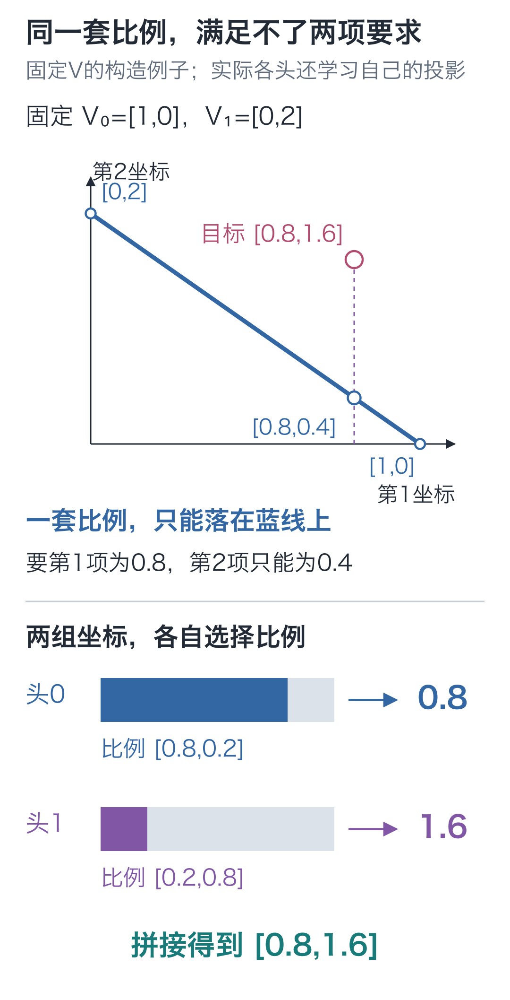
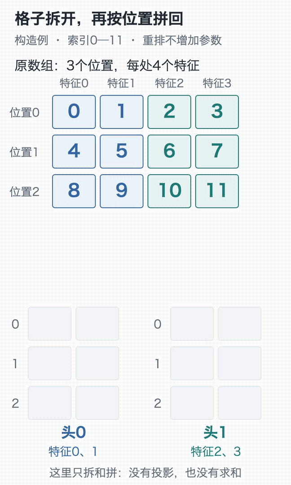
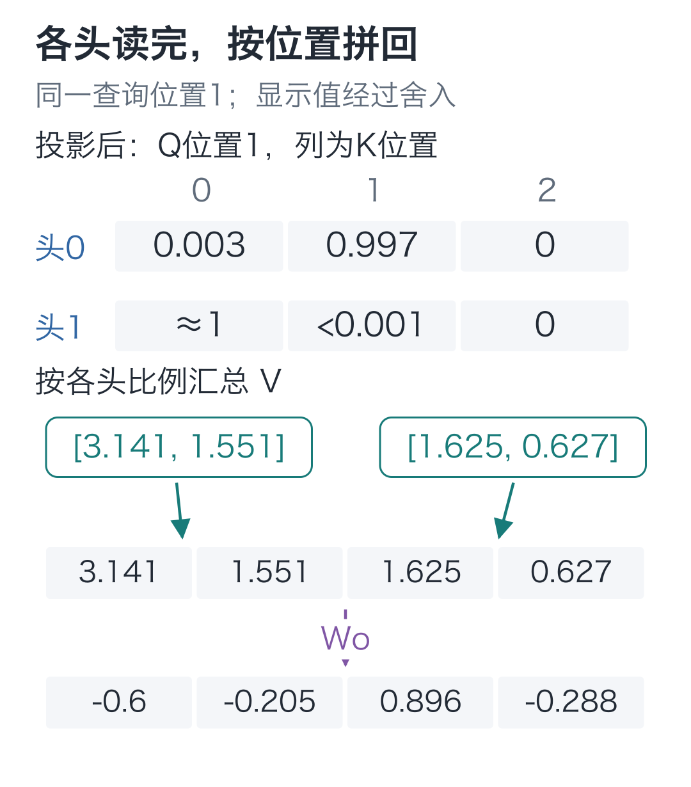

# 12｜多头注意力：各个头分别读向哪里？

手写小模型，看懂大模型 · 第 12 讲

读“小丁拿着红色的苹果。”，若分别找“谁拿着”“什么颜色”，该读的位置就不一样。一句话可以有不同的读法，模型能不能同时保留几种？

上一讲每个查询只算一行比例，所有输出坐标共用它。**多头注意力**让多组表示分别计算读取比例，再把结果组合起来。这里的读句子例子只用来说明需求，各个头实际学到的用途要由训练结果来检查。

## 一套读取比例，会卡在哪里？

固定两行内容向量 V：`[1, 0]`、`[0, 2]`。现在希望汇总后第一项为 0.8、第二项为 1.6。先试着用一行比例完成它。

把比例写成 `[a, 1−a]`，输出就是 `[a, 2(1−a)]`。第一项要求 `a=0.8`，第二项却要求 `a=0.2`，没法同时满足。

注意力比例非负、总和为1，所以 `a` 只能在0到1之间变化。换遍所有合法的 `a`，输出也只能沿下图的蓝线移动，碰不到线外的目标点。



如果两组坐标各用一套比例：头0按 `[0.8,0.2]` 汇总第一组，得到 `0.8×1+0.2×0=0.8`；头1按 `[0.2,0.8]` 汇总第二组，得到 `0.2×0+0.8×2=1.6`。拼起来正好是目标 `[0.8,1.6]`。这两行比例由我们指定，尚未训练。

这个比较固定了 V；实际模型还会为各头学习投影，改变投影也会改变单头的可达范围。这里要看清的是：结构可以同时保留多套读取方式。接下来先把这些头放进数组，再让它们各自计算。

## 两套比例，数组该怎样摆？

把形状缩到能完整画出来：1 个样本、3 个位置、每位置 4 个特征。用 0 到 11 当坐标标签，填入数组：

```text
X[0] = [[0,  1,  2,  3],
        [4,  5,  6,  7],
        [8,  9, 10, 11]]
```

形状是 `[B, T, D]=[1, 3, 4]`。这些编号只用来追踪格子，暂不代表字符编号，也不是训练得到的语义特征。

分成 2 个头，每头宽度 `d=D/H=4/2=2`。每个位置的前两项给头 0，后两项给头 1：

```text
头0：[[0, 1],       头1：[[ 2,  3],
      [4, 5],             [ 6,  7],
      [8, 9]]             [10, 11]]
```

注意每个头仍然拥有全部三个位置。我们拆的是特征轴，不能把三个位置拆成“头 0 看前两字，头 1 看后两字”。



蓝格是每个位置的前两项，青格是后两项。先跟住4和5：它们一起移到头0的位置1；6和7则进入头1的同一位置。这里只拆分与拼回，没有投影或求和。要停下来核对，可看[静态拆分图](images/04-只看格子怎样拆.png)。

分头后的轴顺序为 **[B,H,T,d]=[1,2,3,2]**。沿头轴取出一个头，得到三个位置、每个位置两维，正好可以使用前两讲的注意力计算。

也可以打开[三维张量实验](https://daviddingxu.github.io/hello-llm/chapters/12-multi-head-attention/lab3d.html)，跟住数字4，逐步查看拆分特征轴、交换头与位置轴、再合头的过程。点选数字可核对每一步的索引；实验只重排这12个数，不执行投影或注意力计算。

这个重排本身没有增加参数，也没有改动数值。代码要分两步：先把最后一轴分成“头、头内坐标”，再把头轴移到位置轴前面。

```python
import torch

def split_heads(x, heads):
    """把 [B,T,D] 的特征分为 H 组，返回 [B,H,T,d]，其中 d=D/H。"""
    batch, positions, width = x.shape
    if heads <= 0 or width % heads != 0:
        raise ValueError("表示宽度必须能被头数整除")
    # 先得到 [B,T,H,d]，再交换位置轴与头轴；每个头仍保留全部位置。
    return x.reshape(batch, positions, heads,
                     width // heads).transpose(1, 2)

def merge_heads(x):
    """逆转分头重排，将同一位置的各头结果拼成 [B,T,H*d]。"""
    batch, heads, positions, width = x.shape
    # contiguous 仅整理交换轴后的内存布局，不改变坐标对应的数值。
    return x.transpose(1, 2).contiguous().reshape(
        batch, positions, heads * width)

# 0—11 用来追踪坐标，不是字符编号；一个样本、三个位置、四维表示。
x = torch.arange(12, dtype=torch.float32).reshape(1, 3, 4)
heads = split_heads(x, 2)
print(heads)
assert heads.shape == (1, 2, 3, 2)
# 除了形状与往返，还要核对具体位置，防止两次错误重排恰好互相抵消。
assert heads[0, 0, 1].tolist() == [4., 5.]
assert heads[0, 1, 1].tolist() == [6., 7.]
assert torch.equal(merge_heads(heads), x)
```

`reshape` 先得到 `[B, T, H, d]`，`transpose(1, 2)` 交换位置轴和头轴。拼回时做反向动作。`contiguous()` 把交换轴后的数据整理成适合后续重排的连续布局；这里的整理不改变数组表达的数值关系。

只验证“拆了还能拼回”还不够。两段代码如果恰好犯了相反的错，也可能通过往返；所以还检查头 0 的位置 1 是否真拿到 `[4, 5]`。

## 拆出两块，还不会自动产生两套读法

刚才只是移动格子，还没决定各头如何读取。要回应开头那两种需求，必须先用各自的参数产生表示：对 X 执行三组可训练投影，得到 `[B, T, D]` 的 Q、K、V，再分别拆成 `[B, H, T, d]`。

虽然代码把每组投影写成一个大矩阵，矩阵里分给不同头的参数行是不同的。某一头的 Q 坐标，可以是原始 D 个输入坐标的组合；它不必永远只读原始输入的前两项。

这样，每个头都有自己的 `Q_h/K_h/V_h`，各算一张 `[T, T]` 的分数表，加同样的因果约束，再归一化、汇总。

**头 h 的输出=Softmax(Q_h @ K_hᵀ / √d + 因果屏蔽) @ V_h。**

本例有两个头，分数表合起来为 `[1, 2, 3, 3]`，最后两轴分别是查询位置、被读取位置，Softmax 沿最后的被读取位置轴计算。单头汇总结果为 `[1, 3, 2]`，所有头的汇总结果合起来为 `[1, 2, 3, 2]`，最后两轴是位置与头内特征。

如果把完整宽度 4 拿去缩放，就用错了维度。每个头实际点积只有 2 项，因此本例除以 `√2`；正式模型 `D=64, H=2, d=32`，除以 `√32`。

## 两个头分别读完，结果怎样交给后面？

假设某位置两个头的结果分别是 `[a, b]`、`[c, d]`，拼接得到 `[a, b, c, d]`。它不是相加成 `[a+c, b+d]`，也不是把位置 0 与位置 1 拼在一起。

拼接只是把各头的结果收进同一个位置向量。接着再用一组 **Wo 输出投影参数**，让后续每个坐标能够组合不同头的结果。

这是注意力内部的输出投影，把各头结果混合回 `D` 维位置表示。第08讲的词表投影还在后面，负责把位置表示变成79个候选分数；这里尚未决定下一字。

例如输出投影的一行参数为 `[1, 0, 1, 0]`，就会从刚才的向量算出 `a+c`。这个跨头混合是可训练的，拼接动作本身则没有可训练参数。

各头的结果经投影后回到 `[B, T, D]`，便于接到后续网络。

## 两个头会读到哪里

先用一组固定随机参数试算。位置1只能读位置0和自己，两个头会把比例分给谁？这次得到：

- 头0约为 `[0.002978, 0.997022, 0]`，几乎都给位置1。
- 头1约为 `[0.999998, 0.000002, 0]`，几乎都给位置0。

同一份输入、同一个查询位置，两个头已经采用了不同的读取比例。它们得到各自的二维结果，再按位置拼回四维。



下面用代码复算各头的汇总结果，并检查一次算全部头，是否与逐头循环相同。代码只打印结果形状；上面两行读取比例可在本讲完整入口输出的 `projected_weights` 中核对。位置旋转还没有加入，下一讲会把它接在 Q、K 分头之后。

```python
import math
from torch import nn

def attend(q, k, v):
    """对 [...,T,d] 做因果注意力；样本、头等前导轴各自独立计算。"""
    # Q/K 分头后为 [B,H,T,d]，得分为 [B,H,T,T]；缩放用 d 而非总宽度。
    scores = q @ k.transpose(-2, -1) / math.sqrt(q.shape[-1])
    length = q.shape[-2]
    # True 是可读位置；这张 [T,T] 掩码会广播到所有样本和头。
    visible = torch.ones(length, length, dtype=torch.bool,
                         device=q.device).tril()
    # 沿最后的 K 位置轴归一化；未来先置 -inf，才会分到零比例。
    weights = torch.softmax(
        scores.masked_fill(~visible, float("-inf")), dim=-1)
    return weights @ v

torch.manual_seed(42)
# 四个 Linear 保存各自的参数，前三个生成 Q/K/V，最后一个混合各头结果。
q_proj = nn.Linear(4, 4, bias=False)
k_proj = nn.Linear(4, 4, bias=False)
v_proj = nn.Linear(4, 4, bias=False)
out_proj = nn.Linear(4, 4, bias=False)

# 投影 [1,3,4] 后再分头，每个 Q/K/V 均为 [1,2,3,2]。
q = split_heads(q_proj(x), 2)
k = split_heads(k_proj(x), 2)
v = split_heads(v_proj(x), 2)
context = attend(q, k, v)
# 先按位置拼回四维，再经输出投影；不是把两个头逐项相加。
output = out_proj(merge_heads(context))

# 参考路径每次取一个头，输入形状变成 [B,T,d]。
reference_heads = []
for head in range(2):
    reference_heads.append(attend(q[:, head], k[:, head],
                                  v[:, head]))
# stack 在轴 1 恢复头轴，与一次批量计算的 [B,H,T,d] 对齐。
reference = torch.stack(reference_heads, dim=1)
assert torch.allclose(context, reference)
assert output.shape == x.shape
print(context.shape, output.shape)
```

这段接在前一段之后运行。矩阵乘法只使用最后两个轴，前面的样本轴与头轴各自独立计算；同一张下三角掩码会应用到每个样本、每个头。

`stack(..., dim=1)` 把逐头结果收回头轴。断言核对的是：逐头调用与一次批量计算得到相同的汇总结果。

正式模型使用64维、2个头，每头32维，仍按相同方式拆开和拼回。读形状时要看轴的含义：汇总结果最后一轴是特征，注意力分数最后一轴则是被读取的位置，不能因为数字碰巧相同就混用。

回到代码里的两条检查：

| 检查项 | 本次结果 |
| --- | --- |
| 逐头计算与一次批量汇总 | 相同，最大差值为0 |
| 各头结果按位置拼回 | 形状为 `[1,3,4]` |

需要逐格核对，可看[完整数值对照](images/02-验证.png)。

Q/K/V 由固定随机参数投影得到，目的是验证组织和计算。不能从这次输出给两个头分别贴上“语法头”“常识头”的标签。头的用途取决于训练后的整体行为，同一头也可能承担多种关系。

反向传播时，输出投影把梯度传回拼接向量，拼接再把对应坐标的梯度送回各头。分头、合头虽然没有参数，仍然位于计算图里；它们负责保持坐标对应，不会让梯度在这里消失。更新的是三组输入投影与一组输出投影的参数。

在[交互演示](https://daviddingxu.github.io/hello-llm/chapters/12-multi-head-attention/walkthrough.html)里选定一个格子，沿着它的样本、位置、特征索引，追踪拆分和拼回后的去向。

## 头越多，参数一定越多吗？

在本栏这种总宽度 D 固定、各头宽度均分的实现中，Q/K/V 与输出投影都是 `[D, D]`，无偏置，合计 `4D²` 个参数。把 2 个头改成 4 个头，主要改变每头宽度与分组方式，这四张矩阵的总参数量不变。

但计算组织会改变：每头分数表仍有 `T×T` 项，头数增加时要保存更多这样的表；每头能使用的坐标则减少。更多头不自动等于更好的效果，需要和宽度、数据与训练一起看。

总宽度也要能整除头数。比如 5 维分成 2 个等宽头就没有整数解，当前实现会直接报错，不会悄悄丢掉最后一个坐标。

因果掩码已经规定禁止读取的范围，但点积里还没有显式的位置差。下一讲把它放进 Q/K 的旋转。

## 两道检查题

1. 保持 `X` 的 0 到 11 不变，只分成 1 个头。形状是什么？头 0 的位置 1 包含哪些数？回到正式配置 64 维、2 个头，每头宽度和四个投影的参数总数各是多少？
2. 换成两个位置：`X[0]=[[0,1,2,3],[4,5,6,7]]`，仍分成 2 个头。省掉 `transpose(1, 2)` 后，形状仍是 `[1,2,2,2]`，能否据此认为拆头正确？分别写出正确与错误结果中“头 0、位置 1”的两个数。

<details class="answer" markdown="1">
<summary>参考答案</summary>

答案：第一题，形状为 `[1, 1, 3, 4]`，位置 1 为 `[4, 5, 6, 7]`。正式每头宽度 32，四个投影共 `4×64×64=16384` 个参数。

第二题不能。正确结果中，头 0 在两个位置分别拿到 `[0,1]`、`[4,5]`；漏掉交换轴后却是 `[0,1]`、`[2,3]`，把位置 0 的另一组特征当成了位置 1。两根轴的长度碰巧相同，形状检查发现不了这个错误。

```python
# 沿用前面的 split_heads；这次让位置数与头数都为2，避免只靠形状判定。
short_x = torch.arange(8, dtype=torch.float32).reshape(1, 2, 4)
correct = split_heads(short_x, 2)
# 故意漏掉 transpose：轴的长度没变，头与位置的含义却被混淆了。
wrong = short_x.reshape(1, 2, 2, 2)
assert correct.shape == wrong.shape == (1, 2, 2, 2)
print("头0、位置1：", correct[0, 0, 1], wrong[0, 0, 1])
assert correct[0, 0, 1].tolist() == [4., 5.]
assert wrong[0, 0, 1].tolist() == [2., 3.]
```

若在这里弄反，先在两根长度为 2 的轴旁写出“位置、头”，再按 `split_heads` 的顺序交换。形状中的数字告诉你有几格，轴的含义才告诉你格子里该放谁。

</details>

在配套代码目录运行：

```bash
# 在配套代码目录运行本讲实验，核对正文中的结果。
python -m lessons.l12
```

完整入口：[运行入口](https://github.com/DavidDingXu/hello-llm/blob/main/code/lessons/l12.py) · [多头组件](https://github.com/DavidDingXu/hello-llm/blob/main/code/tiny_lm/attention.py) · [环境说明](https://github.com/DavidDingXu/hello-llm/blob/main/code/README.md)

源码导航：[attention.py · split_heads](https://github.com/DavidDingXu/hello-llm/blob/main/code/tiny_lm/attention.py#L15) · [attention.py · CausalSelfAttention](https://github.com/DavidDingXu/hello-llm/blob/main/code/tiny_lm/attention.py#L49)。

<!-- chapter-navigation:start -->

---

[← 因果掩码](../11-causal-mask/README.md) · [课程目录](../../README.md#课程目录) · [旋转位置 →](../13-rope/README.md)

<!-- chapter-navigation:end -->
