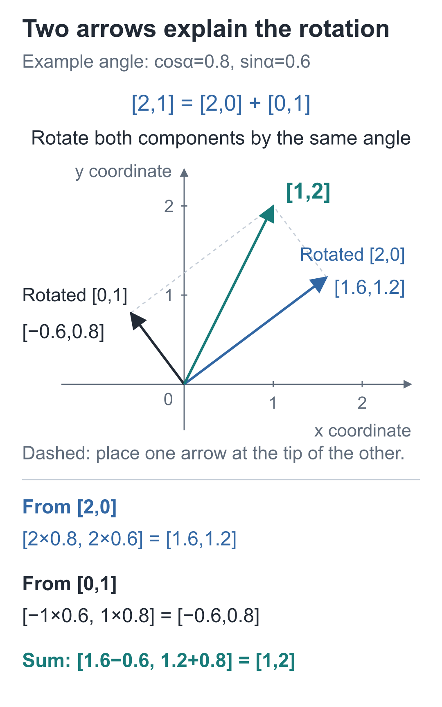
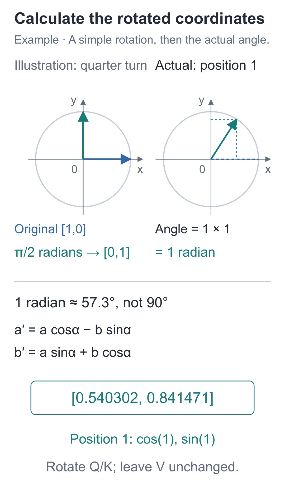
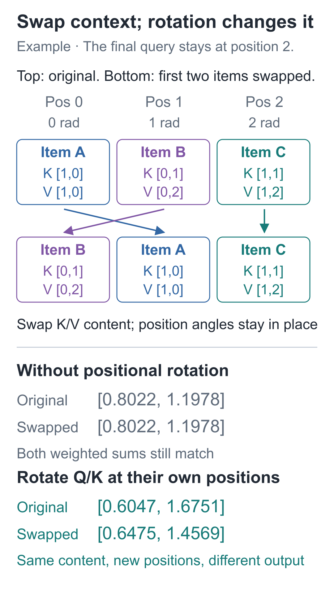
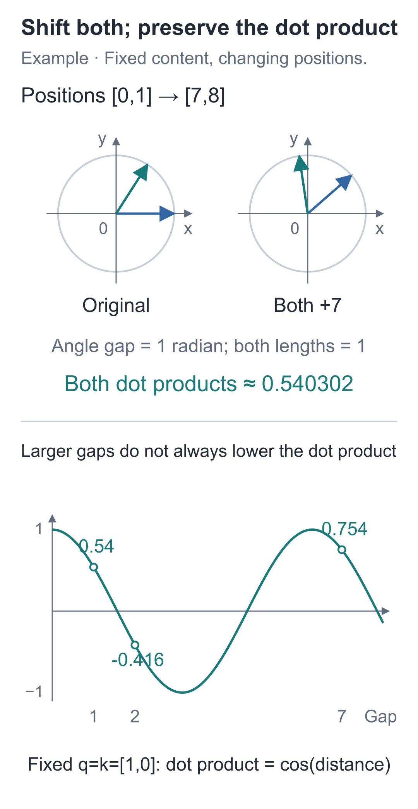
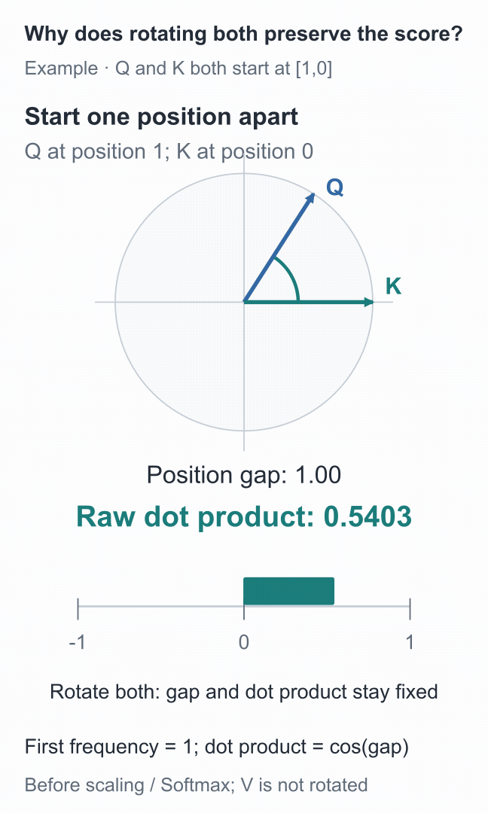

# 13 | RoPE: How Does the Model Know the Order?

Build a Small Model, Understand Large Models · Lesson 13

“小丁喜欢苹果。” (“Xiaoding likes apples”) and “苹果喜欢小丁。” (“Apples like Xiaoding”) use the same characters, but changing the order changes the meaning. We want the model's computation to use this difference in order.

With the attention mechanism we have built so far, swapping two earlier pieces of content together with their K and V vectors may leave every coordinate of the final query's aggregate unchanged. Why can moving the content appear to make no difference?

The query stays fixed, so each piece of content retains its matching score with the query. When K and V move together, the weights follow their original content. In the final sum, we have merely **changed the order of the same products**, so the total is unchanged.

<details class="optional" markdown="1">
<summary>Expand a three-position example to see which terms swap</summary>

Fix **one query at the final position**, with Q equal to `[1, 0]`. The three visible K rows are `[1, 0]`, `[0, 1]`, and `[1, 1]`, with corresponding V rows `[1, 0]`, `[0, 2]`, and `[1, 2]`. All three rows are allowed by the causal mask.

Swap the first two K rows together with their corresponding V rows. Using the same scaling and Softmax as before gives:

```text
原来：0.4011×[1,0] + 0.1978×[0,2] + 0.4011×[1,2]
换序：0.1978×[0,2] + 0.4011×[1,0] + 0.4011×[1,2]
```

The weights move with K, so only the order of the products in the final sum changes. At full precision, both outputs are `[0.80222419, 1.19777581]`. The preserved Chinese labels in this calculation distinguish the original order from the swapped order.

</details>

We fixed the query and visible range and inspected only one aggregation. This does not establish that an entire causal network is insensitive to order. The difference we want to add is specific: whether the same content appears one slot or two slots earlier should be able to affect its matching score.

Our model uses **RoPE, rotary position embeddings**: rotate Q and K by different angles at different positions, then take their dot product. We will first see how rotation changes coordinates, then recompute the ordering example.

## What Happens to the Coordinates After a Quarter Turn?

Draw a two-dimensional vector as an arrow from the origin. `[1, 0]` points right along the horizontal axis; a counterclockwise quarter turn gives `[0, 1]`. The same quarter turn takes `[3, 4]` to `[-4, 3]`.

A quarter turn is 90 degrees, a convenient starting angle for visualization. Real calculations may rotate by any angle, using **cos, cosine**, and **sin, sine**.

On a circle of radius 1, rotate an arrow through angle α from the positive horizontal axis. Its endpoint's horizontal coordinate is `cos(α)`, and its vertical coordinate is `sin(α)`. Thus the endpoint is `[1, 0]` at 0 degrees and `[0, 1]` at 90 degrees.

For any vector `[a, b]`, the coordinates after counterclockwise rotation are:

**a′=a×cos(α)−b×sin(α)**

**b′=a×sin(α)+b×cos(α)**

Think of rotating two component arrows together. The horizontal component contributes `[a cos(α), a sin(α)]`; the vertical component contributes `[-b sin(α), b cos(α)]`. Adding corresponding coordinates gives the two formulas above.

Between 0 and 90 degrees, the originally upward component rotates toward the upper left. Its horizontal contribution is negative, which explains the minus sign in the first formula.

Try `[2,1]` with an angle whose cosine is 0.8 and sine is 0.6, about 36.87 degrees. Rotate the horizontal component 2 and vertical component 1 separately, then add them:



The solid arrows share the same origin. A dashed arrow places one component at the tip of the other; the teal arrow is their sum. Check the new horizontal coordinate, `1.6−0.6=1`, then the new vertical coordinate, `1.2+0.8=2`.

The circle also explains why length is preserved: its unit-circle coordinates satisfy `cos²(α)+sin²(α)=1`. Square and add the two rotated coordinates. The positive and negative cross terms cancel, leaving `a²+b²`. For example, both `[3, 4]` and `[-4, 3]` have squared-coordinate sum 25 and length 5.

## Does Substituting Position 1 Give [0,1]?

Python's `sin` and `cos` take **radians**, not degree values directly. A radian measure is arc length divided by radius. A full turn is `2π` radians, half a turn is `π`, and a quarter turn is `π/2≈1.5708`.

The 1 in `cos(1)` or `sin(1)` means one radian, about 57.3 degrees. We therefore cannot use the quarter-turn result directly for position 1.

For the first coordinate pair in this model, the rotation angle is:

**α=position×frequency, with frequency=1 for the first pair.**

Positions are numbered from 0: position 0 rotates by 0 radians, position 1 by 1 radian, and position 2 by 2 radians. At position 1, `[1, 0]` therefore becomes:

**[cos(1),sin(1)]≈[0.54030231,0.84147098].**

Here, position is the position index. Frequency specifies how many additional radians to rotate for each step to the right and comes from a fixed formula. Neither is a trainable parameter. Q and K come from the trainable projections in the previous lesson; this forward pass first computes their content vectors, then applies position rotations.



## The Same Content at Different Position Offsets

For now, compare only the rotated dot products, before applying the causal mask. Actual attention aggregation still masks future positions. Set both content vectors to `[1, 0]`. If Q is at position 0 and K at position 1, they rotate by 0 and 1 radians respectively, giving:

**[1,0]·[cos(1),sin(1)]=cos(1)≈0.54030231.**

If both positions are 0, the dot product is 1. Move only K one position later, and it becomes about 0.54030231. The content vectors have not changed; the position difference has changed the matching score.

Now move both vectors 3 positions later. Q rotates by 3 radians and K by 4 radians. Their angle still differs by 1 radian, so the dot product remains about 0.54030231.

A common rotation also preserves the angle and lengths of arrows with different content. Writing a rotation as `R(α)`, the relationship for positions m and n can be expressed as:

**Rotated dot product = the dot product of R(mω)q and R(nω)k.**

Rotate both arrows back by `mω`. The dot product stays unchanged, making it equivalent to **the dot product of q and R((n−m)ω)k**. It depends on content q and k and the position difference n−m, rather than separately on their absolute starting positions.

## Two Coordinates Can Rotate. What About 32?

Each head in the full model has 32 dimensions. We pair adjacent coordinates: 0 and 1, then 2 and 3, through 30 and 31, giving 16 pairs.

If every pair rotated at the same rate, position changes would provide only one rotational rhythm. Our model makes some pairs rotate quickly and others slowly. As distance changes, some coordinate pairs change rapidly and others gradually, letting the matching score use several scales of variation.

For head width d and coordinate-pair index i, starting at i=0, the frequency is:

**ωᵢ=theta^(−2i/d), with angle αᵢ=position×ωᵢ.**

This model fixes `theta` at 10000. A negative exponent means taking a reciprocal; for example, `10000^(−1/2)=1/100=0.01`.

Use d=4 for the smallest example with multiple frequencies. Pair 0 has frequency 1; pair 1 has frequency 0.01. At position 1, they rotate by 1 radian and 0.01 radians respectively.

Move the same four-dimensional example to position 10: the pairs rotate by 10 radians and 0.1 radians, making the speed difference visible. The full model computes all 16 pairs with the same formula. Heads can reuse the frequency table, which requires no training. `theta` affects each pair's rotation rate through its frequency; position times frequency gives the angle.

The [3D rotation lab](https://daviddingxu.github.io/hello-llm/chapters/13-rope/lab3d.en.html) places each coordinate pair on its own plane so their different rates can be compared. Save a result, then shift both Q and K positions together or move only K to compare the rotated coordinates and dot product. The spacing between planes is only for viewing; it adds no feature dimensions.

RoPE is applied after Q and K are split into heads, retaining shape `[B, H, T, d]`. **V stays unchanged**, because we put positional information into the matching path that determines the reading weights. We then compute scores, apply the causal mask, run Softmax, and aggregate V as usual.

Nor do we append a position index as a new coordinate. The 32 dimensions remain 32 dimensions; adjacent pairs are simply transformed together. Each pair needs two coordinates, which is why the code requires an even head width. Our width of 32 satisfies that condition.

## Write the Rotation Formula Directly in Code

```python
import torch

def apply_rope(q, k, positions, theta=10000.):
    """Rotate [B,H,T,d] Q/K by position and return the same shapes; V is not passed to this function."""
    width = q.shape[-1]
    if (q.shape != k.shape or width % 2 != 0
            or positions.ndim != 1 or len(positions) != q.shape[-2]):
        raise ValueError("Q/K同形、头宽度为偶数，位置数等于序列长度")

    # Assign a fixed frequency to each adjacent coordinate pair: d/2 values, none trainable.
    frequency = theta ** (-torch.arange(
        0, width, 2, device=q.device, dtype=q.dtype) / width)
    # [T,1] positions times [1,d/2] frequencies give the angle in radians for every position and coordinate pair.
    angles = positions.to(device=q.device, dtype=q.dtype)[:, None] * frequency[None, :]
    cosine, sine = angles.cos(), angles.sin()

    def rotate(x):
        """Pair (0,1), (2,3), and so on, preserving the original adjacent-coordinate order."""
        # Both slices are [B,H,T,d/2], selecting the first and second coordinates of each pair.
        a, b = x[..., 0::2], x[..., 1::2]
        # The [T,d/2] sines and cosines broadcast over the sample and head axes.
        rotated = torch.stack((a * cosine - b * sine,
                               a * sine + b * cosine), dim=-1)
        # stack gives [...,d/2,2]; merge the final two axes to restore [...,d].
        return rotated.flatten(-2)

    return rotate(q), rotate(k)

# One sample, one head, three positions, and two dimensions per position; content is identical, only position changes.
q = torch.tensor([[[[1., 0.], [1., 0.], [1., 0.]]]])
k = q.clone()
positions = torch.arange(3)
rotated_q, rotated_k = apply_rope(q, k, positions)
# At position 1, the first pair's frequency is 1, so it rotates by 1 radian, not a quarter turn.
print(rotated_q[0, 0, 1])  # Approximately [0.54030231, 0.84147098]
print(rotated_q @ rotated_k.transpose(-2, -1))
```

`0::2` selects entries 0, 2, 4, and so on; `1::2` selects entries 1, 3, 5, and so on. These provide the two members of each adjacent coordinate pair. `stack` places the two new coordinates together, and `flatten(-2)` restores the full feature axis.

`positions[:, None]` makes positions a column, while `frequency[None, :]` makes frequencies a row. Their product gives a `[T, d/2]` angle table. Broadcasting applies the same positions and frequencies to every sample and head.

The example produces a dot-product table with 1 on the main diagonal, approximately 0.54030231 for neighboring positions, and approximately −0.41614684 for positions two steps apart. These are still raw dot products, before scaling or Softmax.

## Return to the Ordering Example: Is the Result Still the Same?

Use the same three K/V pairs from the opening. The final query's content remains `[1,0]`, at position 2. Swap only the first two K vectors and their corresponding V vectors; leave positions 0, 1, and 2 and their angles fixed.

Without position rotation, content and its weight move together, and the aggregate remains `[0.8022,1.1978]`. With RoPE, content moved to a different slot must be rotated using that slot's angle. The relative Q/K angles change, so the weights are no longer merely the original two entries exchanged.



Recompute the scaling, Softmax, and aggregation. The original order gives approximately `[0.6047,1.6751]`; the swapped order gives approximately `[0.6475,1.4569]`. The distinction previously erased by summation now affects the output.

The following snippet recomputes only the final query, for which all three keys are visible. Reuse `q`, `positions`, and `apply_rope` from the previous snippet:

```python
def read_last(keys, values):
    """Fix the query at position 2; place K/V in their current order, rotate, compute attention weights, and aggregate."""
    # Add sample and head axes to turn K from [3,2] into [1,1,3,2].
    rq, rk = apply_rope(q, keys[None, None], positions)
    # Take only the last Q row; divide all three scores by the square root of head width 2.
    scores = (rq[0, 0, -1] @ rk[0, 0].T) / (2 ** 0.5)
    return scores.softmax(-1) @ values

keys = torch.tensor([[1., 0.], [0., 1.], [1., 1.]])
values = torch.tensor([[1., 0.], [0., 2.], [1., 2.]])
# Swap K and its corresponding V together; keep the query content and positions=[0,1,2] unchanged.
order = torch.tensor([1, 0, 2])
original = read_last(keys, values)
swapped = read_last(keys[order], values[order])
print(original, swapped)  # Approximately [0.6047,1.6751] and [0.6475,1.4569]
assert not torch.allclose(original, swapped)
```

In this example, position differences change the aggregate. If the swapped content is identical, or contributions cancel, the output may still be the same.

## Is Position Having an Effect, or Was the Vector Accidentally Enlarged?

Check two rotation properties in code: vector lengths are preserved, and rotating two vectors by the same angle preserves their dot product. Incorrect coordinate rearrangement or scaling can violate these properties.



Continue with:

```python
# Keep content fixed and add 7 to every position to check whether relative position relationships are preserved.
shift_q, shift_k = apply_rope(q, k, positions + 7)
# The final two axes form a [T,T] dot-product table; scaling and Softmax have not been applied yet.
dots = rotated_q @ rotated_k.transpose(-2, -1)
shift_dots = shift_q @ shift_k.transpose(-2, -1)

# Measure length over the feature axis; rotation should preserve it, and shifting all positions equally should preserve dot products.
assert torch.allclose(q.norm(dim=-1), rotated_q.norm(dim=-1))
assert torch.allclose(dots, shift_dots, atol=1e-6)
```

`norm(dim=-1)` computes length along the feature axis: square the coordinates, sum them, and take the square root. Floating-point trigonometric functions introduce rounding error, so compare with a small tolerance rather than requiring identical bits.

The contents of q and k remain fixed throughout these checks. If we remove part of the prefix and recompute the entire network, the content vectors may change too, so this conclusion cannot be applied directly.



In the animation, Q starts at position 1 and K at position 0. Moving both 3 positions later leaves the teal dot-product bar unchanged. Moving only K from position 3 to position 2 changes the position difference to 2, sending the bar to the left of 0. Both arrows retain their lengths; only their relative angle changes.

To check the two coordinates for 1 radian individually, open the [interactive demo](https://daviddingxu.github.io/hello-llm/chapters/13-rope/walkthrough.en.html) and pause at position 1.

## Does a Greater Distance Always Mean a Lower Score?

Keep changing only the distance, and another result appears. For these identical content vectors `[1, 0]`, the dot product is approximately −0.416 at distance 2, but approximately 0.754 at distance 7. The score rises again despite the greater distance, following the oscillation of `cos(distance)` shown above.

We have therefore added position differences, not a hard rule that “farther away means less important.” The full model also combines dot products from several frequencies and applies Softmax over positions. Its reading pattern depends on the row of scores computed jointly from position and content.

## Two Number-Changing Exercises

1. Let Q and K both contain `[1, 0]`, at positions 2 and 3, with first-pair frequency 1. What is their dot product? What if both move to positions 9 and 10?
2. Change the head width to 4 and use vector `[1, 0, 1, 0]` at position 1, with theta equal to 10000. How many radians does each pair rotate? What is the length after rotation?

<details class="answer" markdown="1">
<summary>Reference answers</summary>

For question one, both position differences are 1, so both dot products are `cos(1)≈0.54030231`. For question two, the angles are 1 and 0.01 radians, giving approximately `[0.54030231, 0.84147098, 0.99995000, 0.00999983]`. The length remains `√2`. Rotating the second pair by 1 radian as well would omit the frequency difference.

</details>

Run this from the companion code directory:

```bash
# Run this lesson from the companion code directory to check the chapter's results.
python -m lessons.l13
```

Complete entry points: [Lesson runner](https://github.com/DavidDingXu/hello-llm/blob/main/code/lessons/l13.py) · [RoPE implementation](https://github.com/DavidDingXu/hello-llm/blob/main/code/tiny_lm/rope.py) · [Environment setup](https://github.com/DavidDingXu/hello-llm/blob/main/code/README.md)

Source navigation: [rope.py · apply_rope](https://github.com/DavidDingXu/hello-llm/blob/main/code/tiny_lm/rope.py#L9).

<!-- chapter-navigation:start -->

---

[← Multi-head attention](../12-multi-head-attention/README.en.md) · [Contents](../../README.en.md#course-contents) · [Positionwise feed-forward networks →](../14-swiglu/README.en.md)

<!-- chapter-navigation:end -->
