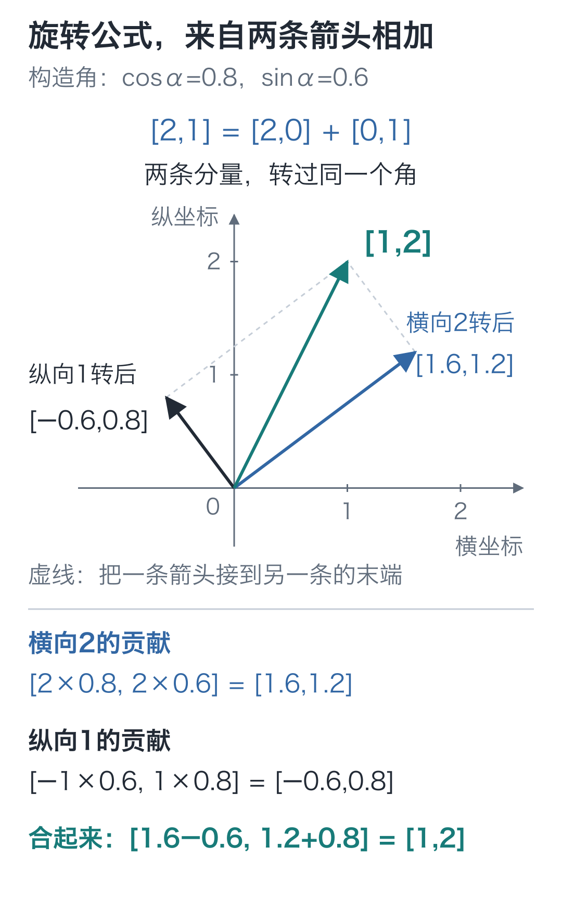
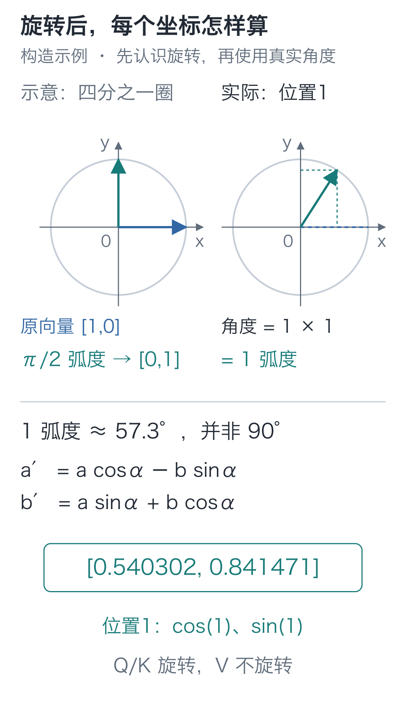
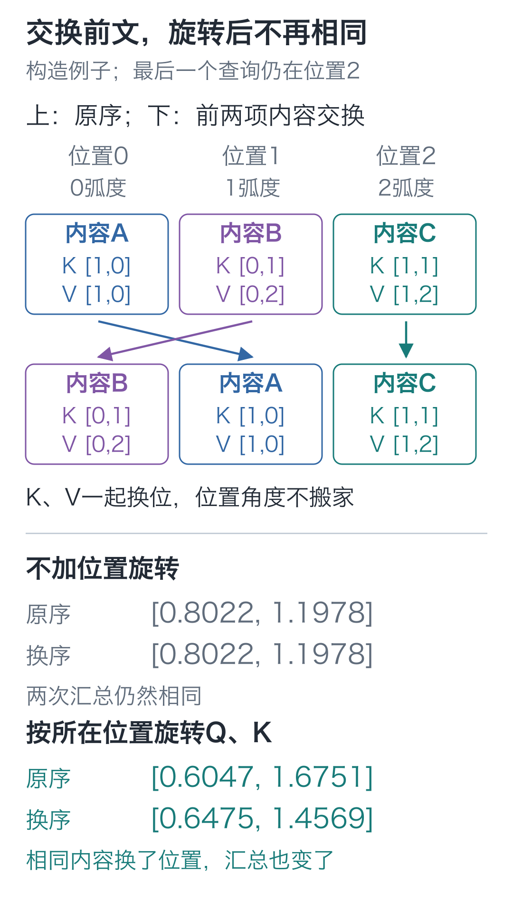
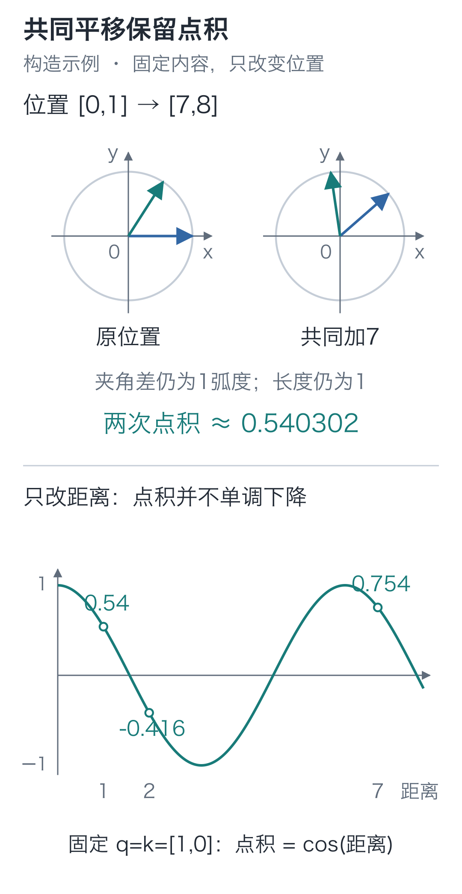
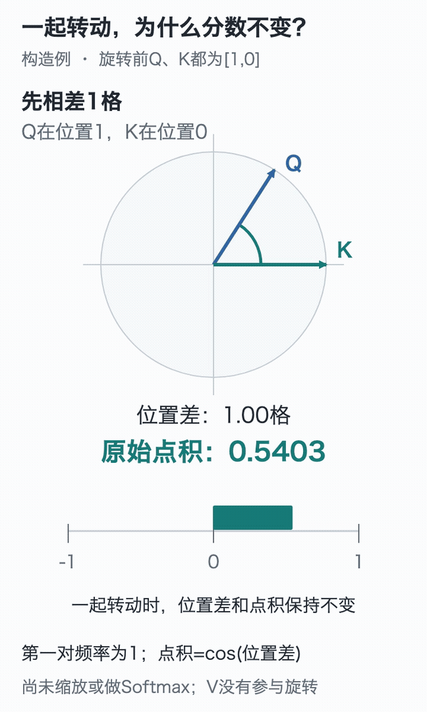

# 13｜RoPE：模型怎样知道先后顺序？

手写小模型，看懂大模型 · 第 13 讲

“小丁喜欢苹果。”与“苹果喜欢小丁。”用到相同的字，顺序一换，意思就变了。我们希望模型的计算能用上这种顺序差别。

沿用前面的注意力，把两处历史内容连同各自的 K、V 交换，最后一次查询的汇总却可能一项也不变。为什么换了位置，计算看起来和没换一样？

查询不变，每份内容与查询的匹配分数就没变；连同 K、V 换位后，比例也跟着原来的内容走。最后只是**把同几项乘积换个顺序相加**，总和当然相同。

<details class="optional" markdown="1">
<summary>展开三个位置的小算例，看哪两项交换了</summary>

固定**最后一个位置的一次查询** Q 为 `[1, 0]`。可见前缀中的三行 K 为 `[1, 0]`、`[0, 1]`、`[1, 1]`，对应 V 为 `[1, 0]`、`[0, 2]`、`[1, 2]`。三行都在因果掩码允许的范围内。

把前两行 K 连同各自的 V 交换，使用前面同样的缩放与 Softmax，得到：

```text
原来：0.4011×[1,0] + 0.1978×[0,2] + 0.4011×[1,2]
换序：0.1978×[0,2] + 0.4011×[1,0] + 0.4011×[1,2]
```

比例跟着 K 换了位，最后相加的乘积只换了顺序。使用原精度计算，两次输出都是 `[0.80222419, 1.19777581]`。

</details>

这里固定了查询与可见范围，只检查一次汇总，不能据此说整个因果网络对顺序都没有反应。我们要补进去的差别很具体：同一份内容位于前一格，还是前两格，应当能参与匹配分数的计算。

本模型采用 **RoPE，旋转位置编码**：让不同位置的 Q、K 转过不同角度，再做点积。先看转动怎样改变坐标，随后把刚才的换序题重新算一遍。

## 先转四分之一圈，坐标发生了什么？

先把二维向量画成一根从原点出发的箭头。`[1, 0]` 沿横轴向右，逆时针转四分之一圈，变成 `[0, 1]`；`[3, 4]` 同样转四分之一圈，变成 `[-4, 3]`。

四分之一圈对应 90 度，只是方便观察的入门角度。真实计算可以旋转任意角度，需要两个函数 **cos，余弦**与 **sin，正弦**。

在半径为 1 的圆上，从横轴正方向转过角度 α，箭头末端的横坐标就是 `cos(α)`，纵坐标就是 `sin(α)`。因此 0 度时为 `[1, 0]`，90 度时为 `[0, 1]`。

对于任意向量 `[a, b]`，逆时针旋转后的两个坐标是：

**a′=a×cos(α)−b×sin(α)**

**b′=a×sin(α)+b×cos(α)**

可以把它理解成两条基础箭头一起转：横向分量转后贡献 `[a cos(α), a sin(α)]`，纵向分量转后贡献 `[-b sin(α), b cos(α)]`，逐项相加，就得到上面两式。

在0到90度之间，原来向上的分量转向左上方，给横坐标的贡献为负，这就对应第一式的减号。

拿`[2,1]`试一次，选一个余弦为0.8、正弦为0.6的角，约36.87度。先分别旋转横向2、纵向1，再把结果相加：



图中实线都从同一个原点出发；虚线把其中一条箭头接到另一条的末端，青色箭头就是两者之和。先核对新横坐标`1.6−0.6=1`，再核对新纵坐标`1.2+0.8=2`。

长度为什么没变，也能在圆上看出来：单位圆上的两个坐标满足 `cos²(α)+sin²(α)=1`。把旋转后的两项平方相加，交叉的乘积一正一负抵消，剩下 `a²+b²`。例如 `[3, 4]` 与 `[-4, 3]` 的平方和都是 25，长度都为 5。

## 把位置 1 代进去，会得到 [0,1] 吗？

Python 的 `sin`、`cos` 使用**弧度**，不是直接把角度数传进去。弧度等于圆弧长度除以半径；一整圈为 `2π` 弧度，半圈为 `π`，四分之一圈为 `π/2≈1.5708`。

`cos(1)`、`sin(1)` 里的 1 是一弧度，约为 57.3 度。因此，位置 1 的计算不能直接套用刚才四分之一圈的结果。

本模型第一对坐标的旋转角度为：

**α=position×frequency，第一对的 frequency=1。**

位置从 0 开始编号：位置 0 转 0 弧度，位置 1 转 1 弧度，位置 2 转 2 弧度。于是 `[1, 0]` 在位置 1 得到：

**[cos(1),sin(1)]≈[0.54030231,0.84147098]。**

这里的 position 是位置编号，frequency 表示每向后移动一格要多转多少弧度，由固定公式算出，二者都不是需要训练的参数。Q、K 则来自上一讲的可训练投影；它们在本次前向中先算出内容向量，再接受位置旋转。



## 同样的内容，不同的位置差

这一段先单独比较旋转后的点积，尚未应用因果掩码；实际汇总时仍会屏蔽未来位置。先让两个内容向量都为 `[1, 0]`。若 Q 位于位置 0、K 位于位置 1，分别转过 0 和 1 弧度，点积为：

**[1,0]·[cos(1),sin(1)]=cos(1)≈0.54030231。**

如果两个位置都为 0，点积是 1；只让 K 向后移一格，就变成约 0.54030231。内容向量没换，位置差改变了匹配分数。

把它们一起往后移 3 格，Q 转 3 弧度、K 转 4 弧度。两根箭头的夹角仍差 1 弧度，点积仍约为 0.54030231。

对不同内容的两根箭头，共同旋转也保留夹角和长度。因此，若把旋转写成 `R(α)`，两个位置 m、n 的关系可以压缩为：

**旋转后点积 = R(mω)q 与 R(nω)k 的点积。**

两根箭头共同转回 `mω`，点积不变，就等价于 **q 与 R((n−m)ω)k 的点积**。它由内容 q、k 和位置差 n−m 决定，而不是分别依赖两者的绝对起点。

## 两个坐标能转，32 个坐标怎样办？

正式模型每个头有32维。我们采用相邻配对：第0、1项一组，第2、3项一组，直到第30、31项，共16对。

如果每对都转得一样快，位置变化就只有同一种转动节奏。本模型让各对转得有快有慢：距离变化时，有的坐标对变化很快，有的变化较慢，匹配分数就能同时使用这些不同的变化尺度。

设头宽度为 d，第 i 对从 i=0 开始编号，频率为：

**ωᵢ=theta^(−2i/d)，角度 αᵢ=position×ωᵢ。**

`theta` 在本模型固定为 10000。指数是负数时表示取倒数，例如 `10000^(−1/2)=1/100=0.01`。

用 d=4 看最小的多频率例子：第 0 对频率是 1，第 1 对是 0.01。位置 1 时，它们分别转 1 弧度与 0.01 弧度。

同一个四维例子移到位置10，两对分别转10弧度与0.1弧度，就能看出快慢差别。正式的16对也按这条公式算，频率表可由各个头复用，不需要训练。`theta` 通过频率影响各对的转动速度，位置乘频率才是角度。

在[三维旋转实验](https://daviddingxu.github.io/hello-llm/chapters/13-rope/lab3d.html)中，两对坐标各占一个平面，可以同时观察快慢差别。锁定一次结果，再共同移动 Q、K 的位置或只移动 K，比较旋转后的坐标和点积；平面之间的间距只是便于观察，不是新增的特征维度。

RoPE 在 Q、K 分头之后执行，形状保持 `[B, H, T, d]`。**V 保持原样**，因为这里把位置信息放进“怎样决定读取比例”的匹配路径；随后照常算分数、加因果掩码、Softmax、汇总 V。

它也没有把位置编号追加成一个新坐标。32 维仍然是 32 维，只是相邻两项按公式一起变换。每对需要两个坐标，这就是代码要求头宽度为偶数的原因；本模型每头 32 维，满足这个条件。

## 把旋转公式原样写成代码

```python
import torch

def apply_rope(q, k, positions, theta=10000.):
    """按位置旋转 [B,H,T,d] 的 Q/K，返回同形结果；V 不进入此函数。"""
    width = q.shape[-1]
    if (q.shape != k.shape or width % 2 != 0
            or positions.ndim != 1 or len(positions) != q.shape[-2]):
        raise ValueError("Q/K同形、头宽度为偶数，位置数等于序列长度")

    # 每个相邻坐标对配一个固定频率，共 d/2 项，不是可训练参数。
    frequency = theta ** (-torch.arange(
        0, width, 2, device=q.device, dtype=q.dtype) / width)
    # [T,1] 的位置乘 [1,d/2] 的频率，得到每个位置、每对坐标的弧度。
    angles = positions.to(device=q.device, dtype=q.dtype)[:, None] * frequency[None, :]
    cosine, sine = angles.cos(), angles.sin()

    def rotate(x):
        """对 (0,1)、(2,3)…配对，保持原来的相邻坐标顺序。"""
        # 两个切片均为 [B,H,T,d/2]，分别取每对的第一项和第二项。
        a, b = x[..., 0::2], x[..., 1::2]
        # [T,d/2] 的正余弦自动广播到样本轴和头轴。
        rotated = torch.stack((a * cosine - b * sine,
                               a * sine + b * cosine), dim=-1)
        # stack 得到 [...,d/2,2]，合并最后两轴还原成 [...,d]。
        return rotated.flatten(-2)

    return rotate(q), rotate(k)

# 一个样本、一个头、三个位置、每位置两维；三处内容相同，只改变位置。
q = torch.tensor([[[[1., 0.], [1., 0.], [1., 0.]]]])
k = q.clone()
positions = torch.arange(3)
rotated_q, rotated_k = apply_rope(q, k, positions)
# 位置 1 的第一对频率为 1，所以转 1 弧度，不是四分之一圈。
print(rotated_q[0, 0, 1])  # 约[0.54030231, 0.84147098]
print(rotated_q @ rotated_k.transpose(-2, -1))
```

`0::2` 取第 0、2、4 等项，`1::2` 取第 1、3、5 等项，让相邻坐标对分别进入公式。`stack` 把每对的新坐标放在一起，`flatten(-2)` 再还原为完整特征轴。

`positions[:, None]` 把位置排成一列，`frequency[None, :]` 把频率排成一行，相乘得到 `[T, d/2]` 的角度表。同一套位置与频率作用于每个样本、每个头，数组广播完成这件事。

上面的示例得到一张点积表，主对角线都是 1，相邻位置约为 0.54030231，隔两格约为 −0.41614684。这里展示的还是点积分数，尚未缩放或做 Softmax。

## 回到开头的换序题，这次还一样吗？

仍用开头三组 K、V，最后一个查询的内容仍为 `[1,0]`，位于位置2。只交换前两组 K 及各自的 V，位置0、1、2和对应角度都不换。

没有位置旋转时，内容和它的比例一起换位，汇总仍为 `[0.8022,1.1978]`。加上 RoPE 后，内容搬到了另一格，就要按那一格的角度重新旋转；Q与K的相对转角改变了，比例不再只是原来的两项交换。



重新执行缩放、Softmax和汇总，原序得到约 `[0.6047,1.6751]`，换序得到约 `[0.6475,1.4569]`。开头那次被求和抹掉的区别，这次已经影响了输出。

下面只复算最后一个查询，三个键都在它的可见范围内。沿用前段的 `q`、`positions` 和 `apply_rope`：

```python
def read_last(keys, values):
    """固定位置2的查询；K/V按当前顺序放置，再旋转、算比例、汇总。"""
    # 增加样本与头两根轴，把 [3,2] 的 K 放成 [1,1,3,2]。
    rq, rk = apply_rope(q, keys[None, None], positions)
    # 只取最后一行 Q；三项得分都除以头宽度2的平方根。
    scores = (rq[0, 0, -1] @ rk[0, 0].T) / (2 ** 0.5)
    return scores.softmax(-1) @ values

keys = torch.tensor([[1., 0.], [0., 1.], [1., 1.]])
values = torch.tensor([[1., 0.], [0., 2.], [1., 2.]])
# K和对应V一起换位；查询内容与 positions=[0,1,2] 保持原样。
order = torch.tensor([1, 0, 2])
original = read_last(keys, values)
swapped = read_last(keys[order], values[order])
print(original, swapped)  # 约 [0.6047,1.6751]、[0.6475,1.4569]
assert not torch.allclose(original, swapped)
```

在本例中，位置差改变了汇总；若交换的内容相同，或各项贡献抵消，输出仍可能相同。

## 是位置在起作用，还是向量被意外放大了？

用代码检查旋转的两个性质：向量长度不变；两条向量一起转相同角度，点积不变。坐标重排或缩放写错，可能破坏这两个性质。



接着执行：

```python
# 内容保持不变，所有位置同时加 7，检查相对位置关系是否保留。
shift_q, shift_k = apply_rope(q, k, positions + 7)
# 最后两轴得到 [T,T] 点积表，这里尚未缩放或做 Softmax。
dots = rotated_q @ rotated_k.transpose(-2, -1)
shift_dots = shift_q @ shift_k.transpose(-2, -1)

# 沿特征轴量长度；旋转不应拉长向量，共同平移也不应改变对应点积。
assert torch.allclose(q.norm(dim=-1), rotated_q.norm(dim=-1))
assert torch.allclose(dots, shift_dots, atol=1e-6)
```

`norm(dim=-1)` 沿特征轴算长度，也就是各坐标平方求和后开根号。浮点三角函数会有舍入误差，所以用小容差比较，不要求二进制位完全相同。

检查期间 q、k 的内容保持固定。若删掉一段前文再重算整个网络，内容向量也可能改变，不能直接套用这里的结论。



动图中，Q在位置1、K在位置0，两者一起后移3格，青色的点积条保持原长。只把K从位置3改到2，位置差变为2，点积条才转到0的左侧。两根箭头一直保持原长度，改变的是相对转角。

要逐项核对1弧度的两个坐标，可以打开[交互演示](https://daviddingxu.github.io/hello-llm/chapters/13-rope/walkthrough.html)，停在位置1查看。

## 隔得更远，分数就一定更低吗？

继续只改距离，会看到另一个结果：相同内容 `[1, 0]` 的这对向量，在距离 2 时点积约为 −0.416，距离 7 时又约为 0.754。隔得更远，分数反而回升了，正是上图 `cos(距离)` 的起伏。

所以这次补进来的是位置差，而不是“越远越不重要”的硬规则。正式模型还会合并多个频率的点积，再沿位置做 Softmax。它怎样读取，取决于位置和内容共同算出的那一行分数。

## 两道改数题

1. 内容 Q、K 都取 `[1, 0]`，分别位于位置 2、3，第一对频率为 1。点积是多少？一起改到位置 9、10 呢？
2. 将头宽度改成 4，向量取 `[1, 0, 1, 0]`，位置为 1、theta 为 10000。两对分别转多少弧度？旋转后长度是多少？

<details class="answer" markdown="1">
<summary>参考答案</summary>

答案：第一题，两种情况位置差都是 1，点积均为 `cos(1)≈0.54030231`。第二题，角度分别为 1 和 0.01 弧度，结果约为 `[0.54030231, 0.84147098, 0.99995000, 0.00999983]`；长度仍为 `√2`。把第二对也旋转 1 弧度，就漏掉了频率差异。

</details>

在配套代码目录运行：

```bash
# 在配套代码目录运行本讲实验，核对正文中的结果。
python -m lessons.l13
```

完整入口：[运行入口](https://github.com/DavidDingXu/hello-llm/blob/main/code/lessons/l13.py) · [RoPE 实现](https://github.com/DavidDingXu/hello-llm/blob/main/code/tiny_lm/rope.py) · [环境说明](https://github.com/DavidDingXu/hello-llm/blob/main/code/README.md)

源码导航：[rope.py · apply_rope](https://github.com/DavidDingXu/hello-llm/blob/main/code/tiny_lm/rope.py#L9)。

<!-- chapter-navigation:start -->

---

[← 多头注意力](../12-multi-head-attention/README.md) · [课程目录](../../README.md#课程目录) · [逐位置前馈 →](../14-swiglu/README.md)

<!-- chapter-navigation:end -->
