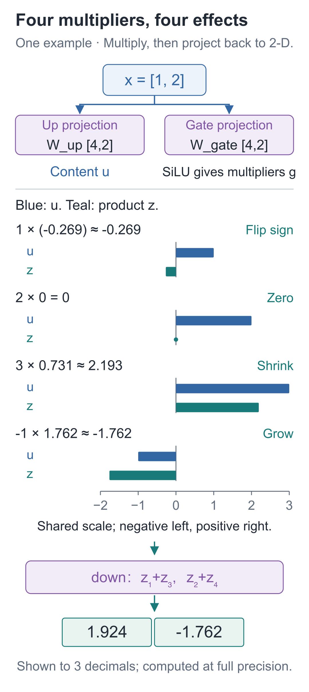
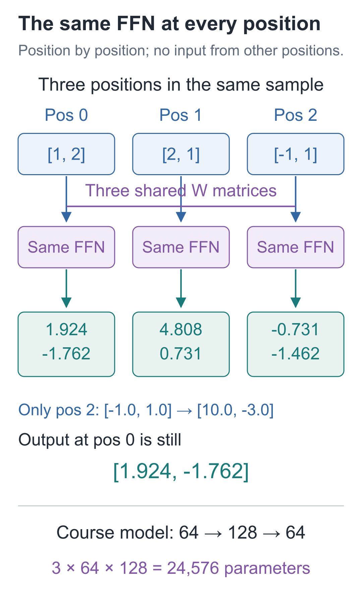

# 14 | SwiGLU: What Happens After Reading the Prefix?

Build a Small Model, Understand Large Models · Lesson 14

Attention lets the position containing “欢” read the person's name earlier in the sentence. Here “欢” is the second character of “喜欢” (“likes”) in our Chinese data. Once the information is gathered, we still need to compute with combinations of those values.

Consider the familiar programming operator `and`: the overall condition is true only when both conditions are true. Represent true as 1 and false as 0. We want `[0,0]`, `[0,1]`, and `[1,0]` to output 0, and only `[1,1]` to output 1.

Can a fixed weighted sum directly meet all four numerical targets? The first three force the bias and both weights to 0, making the fourth output of 1 impossible. Multiplying the two inputs, however, meets all four targets.

**How can several values act together after information has arrived?** This is what the feed-forward network, commonly abbreviated FFN, addresses here. Our implementation has two branches: one produces intermediate values, and the other produces multipliers from the input. We will calculate both branches by hand for `[1,2]`, then return to how this multiplication can express `and`.

## Why Is Computing More Values Not Enough?

Starting from `x=[1, 2]`, calculate four coordinate combinations. We specify the parameters ourselves to make each term easy to check. This branch is called `up`, because it expands the width:

| Output coordinate | Parameter row | Weighted-sum result |
| --- | --- | --- |
| u₁ | [1,0] | 1×1+2×0=1 |
| u₂ | [0,1] | 1×0+2×1=2 |
| u₃ | [1,1] | 1×1+2×1=3 |
| u₄ | [1,−1] | 1×1+2×(−1)=−1 |

This gives `u=[1, 2, 3, −1]`. Each entry uses the weighted sums introduced in Lesson 2; there is no bias here.

If we immediately used another set of fixed parameters to project four entries back to two, the two weighted-sum operations could still be combined. Lesson 3 added ReLU to break this limitation, forming one possible feed-forward network. Here we take another approach: **compute the multipliers from the current input**, instead of using the same intermediate multipliers for every input.

## A Second Branch Computes a Multiplier for Each Entry

This new branch is called `gate`. Specify another set of parameters so that its weighted sums produce:

`a=[−1, 0, 1, 2]`

Apply the same function to each entry of `a`. First calculate:

**sigmoid(a)=1/(1+exp(−a))**

`exp` is the exponential operation introduced in Lesson 8. This function maps real numbers into the interval between 0 and 1. Multiply the result by the original number to obtain this lesson's activation:

**SiLU(a)=a×sigmoid(a)**

For `a=2`, sigmoid first produces about 0.880797. Multiplying by 2 gives approximately 1.761594. For all four entries:

| a | sigmoid(a), approximately | g=SiLU(a), approximately |
| --- | --- | --- |
| −1 | 0.268941 | −0.268941 |
| 0 | 0.5 | 0 |
| 1 | 0.731059 | 0.731059 |
| 2 | 0.880797 | 1.761594 |

Collect these four results into vector `g`, then multiply entries with the same index:

**z=u⊙g≈[−0.268941,0,2.193176,−1.761594]**

The symbol `⊙` means elementwise multiplication: first entry times first entry, second entry times second entry. It neither sums the four entries nor searches other positions for another character.



All four rows use the same scale. Blue bars show `u` before multiplication; teal bars show `z` afterward. In the first row, the result crosses to the left of 0. The second collapses to zero, the third gets shorter, and the fourth extends farther in the negative direction.

“Gating” here has more than an on/off state: **multipliers can be negative or greater than 1, and they do not need to sum to 1.** They are not probabilities of selecting a position.

Finally, `down` projects four entries back to two. The first output takes `z₁+z₃`, and the second takes `z₂+z₄`:

**y≈[1.924234,−1.761594]**

The input and output both contain two entries, temporarily expanding to four in between. Later components can therefore continue using vectors of the same width.

Changing only the input recomputes both `u` and `g`. The elementwise multipliers change with the input, so the full function can no longer be collapsed into one fixed weighted sum.

The three matrices are named `W_up`, `W_gate`, and `W_down`. Each row stores the parameters for one output coordinate. Following the code's convention of one sample per row:

**u=xW_upᵀ**

**g=SiLU(xW_gateᵀ)**

**FFN(x)=(u⊙g)W_downᵀ**

The superscript `ᵀ` denotes a transpose, aligning input coordinates with parameter rows for multiplication. In this example, the two expansion matrices are `[4, 2]` and the reduction matrix is `[2, 4]`.

This structure, which multiplies two projection branches and applies SiLU to one of them, is called **SwiGLU**. The [original paper](https://arxiv.org/abs/2002.05202) discusses these feed-forward variants; the SiLU definition can be checked against the [PyTorch interface](https://docs.pytorch.org/docs/2.9/generated/torch.nn.SiLU.html).

Both a ReLU feed-forward network and SwiGLU add nonlinear processing. This lesson does not compare their training results, so it does not establish that either is better.

## Can It Produce 1 This Time?

Focus on just one intermediate coordinate and one output coordinate. Let `up` take the first input as `u`, and let `gate` take the second as `a`. Use their product `u×SiLU(a)` for the output, then multiply by the fixed value `1/SiLU(1)`:

| Input `[u,a]` | After multiplication, approximately | After projection |
| --- | --- | --- |
| `[0,0]` | 0 | 0 |
| `[0,1]` | 0 | 0 |
| `[1,0]` | 0 | 0 |
| `[1,1]` | 0.731059 | 1 |

Because `SiLU(0)=0`, the product must be 0 when the second condition is false. When it is true, the first condition must also be true for a nonzero product. All four numerical targets are met.

This construction shows that two inputs can jointly determine a result through gating. Actual training adjusts the three projection matrices; intermediate values and multipliers are then computed from the current input. We do not assign a Boolean condition to a particular coordinate in advance.

## Put Both Branches into Code

The following class matches the project's feed-forward computation. `nn.Linear` stores matrix parameters, and `bias=False` explicitly disables the bias. It transforms only the final input axis.

```python
import torch
from torch import nn
import torch.nn.functional as F

class SwiGLU(nn.Module):
    """对每个位置独立做 D→F→D 变换，输入与输出的最后一维均为 D。"""
    def __init__(self, width, expanded):
        super().__init__()
        # up、gate 是两套独立投影参数；down 将扩宽后的表示送回原宽度。
        self.up = nn.Linear(width, expanded, bias=False)
        self.gate = nn.Linear(width, expanded, bias=False)
        self.down = nn.Linear(expanded, width, bias=False)

    def forward(self, x):
        # 两条支路读取同一份 x，分别得到 [...,F] 的内容与门控前数值。
        u = self.up(x)
        a = self.gate(x)
        # g 是逐坐标乘数，可为负或大于 1，不是注意力概率。
        g = F.silu(a)  # 等价于 a * torch.sigmoid(a)
        # * 按同一位置、同一坐标相乘；down 再将 F 维投影回 D 维。
        return self.down(u * g)

ffn = SwiGLU(2, 4)
# 仅为手算对照写入固定参数，不为这些赋值建立反向记录；参数仍可训练。
with torch.no_grad():
    ffn.up.weight.copy_(torch.tensor([
        [1., 0.], [0., 1.], [1., 1.], [1., -1.]]))
    ffn.gate.weight.copy_(torch.tensor([
        [-1., 0.], [0., 0.], [1., 0.], [0., 1.]]))
    ffn.down.weight.copy_(torch.tensor([
        [1., 0., 1., 0.], [0., 1., 0., 1.]]))

x = torch.tensor([1., 2.])
u, a = ffn.up(x), ffn.gate(x)
print("up:", u)
print("gate:", F.silu(a))
print("相乘:", u * F.silu(a))
print("输出:", ffn(x))  # 约 [1.924234, -1.761594]
```

`no_grad()` surrounds the manual parameter assignment, so the assignment does not create a backward-computation record. Normal calls to `ffn(x)` still allow all three parameter groups to receive gradients. Autograd, which we have already studied, handles the derivatives of the activation and multiplication.

## Does It Read Other Positions Again?

So far, we have tracked only one position. If we change the third position, will the first position change too? Put three positions into one tensor to check. The actual input is `[B, T, D]`: `B` samples, `T` positions, and `D` features per position. The entire batch uses the same three matrices:

`[B, T, D] → two branches [B, T, F] → elementwise multiplication → [B, T, D]`

**Different positions share parameters but perform this computation independently.** This FFN layer does not read another position's vector. Its input may already contain prefix information gathered by attention, but that differs from the FFN itself fetching values across positions.

Run the following comparison, first processing all positions together and then calling the FFN one position at a time:

```python
# [B,T,D]=[1,3,2]；同一套 FFN 参数分别作用于每个位置。
sequence = torch.tensor([[[1., 2.], [2., 1.], [-1., 1.]]],
                        requires_grad=True)  # [1,3,2]
batched = ffn(sequence)
# 逐位置运行并恢复位置轴，结果应与一次批量运行相同。
one_by_one = torch.stack([
    ffn(sequence[:, t, :]) for t in range(sequence.shape[1])
], dim=1)
assert torch.allclose(batched, one_by_one)

# 只改位置 2；独立 FFN 不读取其他位置，所以位置 0 的输出保持不变。
changed = sequence.detach().clone()
changed[:, 2, :] = torch.tensor([10., -3.])
assert torch.allclose(ffn(changed)[:, 0], batched[:, 0])

# 用演示标量检查梯度通路；这里没有优化器更新，也不是下一字训练损失。
batched.square().mean().backward()
assert all(p.grad is not None and torch.isfinite(p.grad).all()
           for p in ffn.parameters())
print(batched.shape)  # torch.Size([1, 3, 2])
```

Changing the third position to `[10, −3]` leaves the first position's two outputs unchanged. The FFN processes only its current vector. To understand how preceding text affects that vector, trace the reading paths through attention.



The full model replaces `D=2, F=4` with `D=64, F=128`. Its three matrices contain `64×128`, `64×128`, and `128×64` parameters, totaling **24,576**, compared with 24 in this small example. These matrices change during training; the intermediate vectors `u`, `g`, and `z` are recomputed from the input.

The next lesson asks: if the new result directly replaces the original vector, does the original input still have an independent route forward?

## Two Exercises with Changed Conditions

1. Keep all projections unchanged, but replace the activated `g` with `[1, 1, 1, 1]`. What is this example's output? Does it retain the nonlinearity introduced in this lesson?
2. In the complete model, if the third input position changes, will the first output position change? Answer separately for “run only this FFN layer” and “rerun the entire block, including attention.”

<details class="answer" markdown="1">
<summary>Reference answers</summary>

For question one, the product becomes `u=[1, 2, 3, −1]`, and down outputs **[4,1]**. If we force `g=1` for every input, only two bias-free linear projections remain, and they can be combined into one linear transformation. For question two, the first position of the standalone FFN is unchanged. In a complete causal block, the first position cannot read the future third position, so it should also be unaffected. If an earlier position changes and we inspect a later position instead, attention may change the result. This question requires checking both the module boundary and the visibility range; “positions always affect one another” is not an adequate answer.

</details>

Run the lesson entry point from the `code` companion code directory:

```bash
# 在配套代码目录运行本讲实验，核对正文中的结果。
python -m lessons.l14
```

On macOS, you can replace `python` with `python3`; on Windows, you can use `py` from your installed environment. Companion code: [Lesson runner](https://github.com/DavidDingXu/hello-llm/blob/main/code/lessons/l14.py) · [Feed-forward network source](https://github.com/DavidDingXu/hello-llm/blob/main/code/tiny_lm/layers.py).

Source navigation: [layers.py · SwiGLU](https://github.com/DavidDingXu/hello-llm/blob/main/code/tiny_lm/layers.py#L33).

<!-- chapter-navigation:start -->

---

[← Rotary position embeddings](../13-rope/README.en.md) · [Contents](../../README.en.md#course-contents) · [Residual connections and normalization →](../15-residual-and-rmsnorm/README.en.md)

<!-- chapter-navigation:end -->
