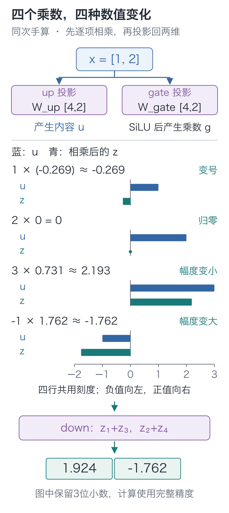
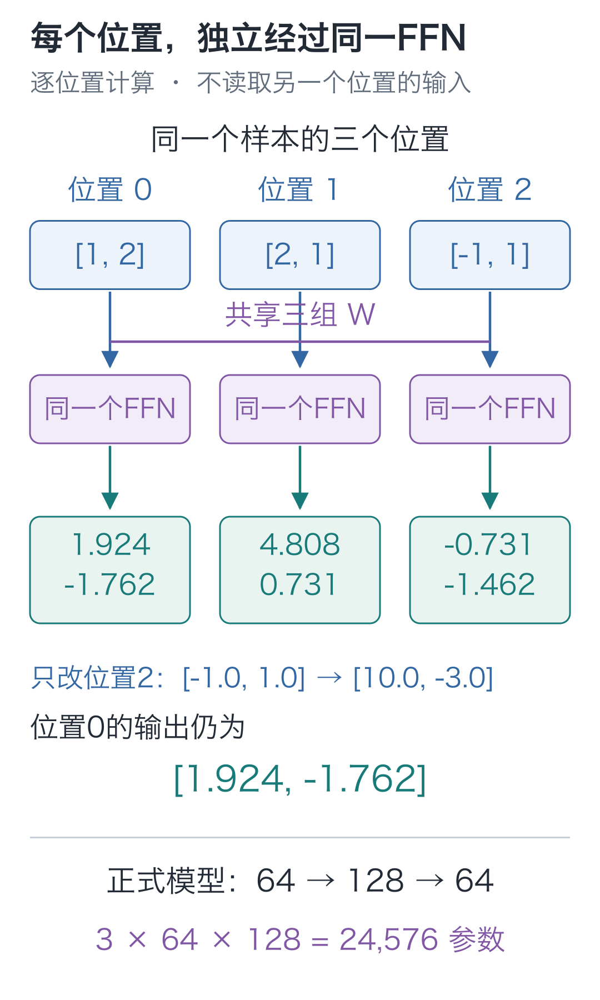

# 14｜SwiGLU：读完前文以后，还要怎么算？

手写小模型，看懂大模型 · 第 14 讲

注意力让“欢”所在的位置能够读到前面的人名。信息汇总过来以后，还要根据这些数的组合继续计算。

比如程序里常见的 `and`：两个条件都成立，整体条件才成立。把成立记为1、不成立记为0，要求就是 `[0,0]、[0,1]、[1,0]` 都输出0，只有 `[1,1]` 输出1。

固定乘加能直接满足这四个数值目标吗？前三条已经迫使偏置和两个权重都等于0，第四条就不可能输出1。但把两个输入相乘，四条都能做到。

**收到信息以后，怎样让几项数共同起作用**，是这里的前馈网络要处理的问题，常简写为 FFN。本讲采用的做法包含两条支路：一条生成中间值，另一条根据输入生成乘数。先用 `[1,2]` 手算两条支路，稍后回头看这种乘法怎样表达刚才的 `and`。

## 先多算几项，为什么还不够？

从 `x=[1, 2]` 出发，先算出四种坐标组合。参数由我们指定，方便逐项核对。这一支叫 `up`，表示扩宽：

| 输出坐标 | 使用的参数行 | 乘加结果 |
| --- | --- | --- |
| u₁ | [1,0] | 1×1+2×0=1 |
| u₂ | [0,1] | 1×0+2×1=2 |
| u₃ | [1,1] | 1×1+2×1=3 |
| u₄ | [1,−1] | 1×1+2×(−1)=−1 |

因此得到 `u=[1, 2, 3, −1]`。每项都是第二讲已经学过的乘加，这里没有偏置。

若现在直接用另一组固定参数把四项投影回两项，两次乘加仍能合并。第三讲加过 ReLU 来打破这个限制；那样就能组成一种前馈网络。这里换一个做法：**乘数也由本次输入算出来**，不再对所有输入使用同一组中间乘数。

## 第二条支路，为每项算一个乘数

这条新支路叫 `gate`。先指定另一组参数，让乘加结果为：

`a=[−1, 0, 1, 2]`

接着对 `a` 的每项应用同一个函数。先算：

**sigmoid(a)=1/(1+exp(−a))**

`exp` 是第八讲出现过的指数运算。这个函数把实数压到 0 和 1 之间。再把结果乘回原数，得到本讲采用的激活：

**SiLU(a)=a×sigmoid(a)**

以 `a=2` 为例，sigmoid 先算出约 0.880797，还要乘回 2，所以最后得到约 1.761594。把四项一起算完：

| a | sigmoid(a)，约 | g=SiLU(a)，约 |
| --- | --- | --- |
| −1 | 0.268941 | −0.268941 |
| 0 | 0.5 | 0 |
| 1 | 0.731059 | 0.731059 |
| 2 | 0.880797 | 1.761594 |

把这四个结果组成向量 `g`，再让同一编号的两项相乘：

**z=u⊙g≈[−0.268941,0,2.193176,−1.761594]**

符号 `⊙` 表示逐项相乘：第一项乘第一项，第二项乘第二项。它没有把四项加起来，也没有跨位置寻找别的字。



四行使用同一把尺：蓝条是相乘前的 `u`，青条是相乘后的 `z`。先看第一行，结果跨到0的左侧；第二行只剩零点；第三行缩短；第四行则沿负方向伸得更长。

这里的“门控”并非只有开与关两种状态：**乘数可以为负，也可以大于 1；这些数不需要相加等于 1。** 它们没有“选择某个位置的概率”这一含义。

最后，用 `down` 把四项投影回两项。本例第一项取 `z₁+z₃`，第二项取 `z₂+z₄`：

**y≈[1.924234,−1.761594]**

输入和输出都是两项，中间暂时扩成四项，后面的组件便能继续使用同样宽度的向量。

只换输入，`u` 与 `g` 都会重新计算。逐项相乘时使用的乘数因此也随输入变化，整个函数不能再合并成一次固定乘加。

三组矩阵分别叫 `W_up`、`W_gate`、`W_down`。每一行保存一个输出坐标的参数。沿用代码里“一个样本占一行”的写法：

**u=xW_upᵀ**

**g=SiLU(xW_gateᵀ)**

**FFN(x)=(u⊙g)W_downᵀ**

上标 `ᵀ` 表示转置，作用是让输入坐标与参数行正确相乘。本例两组扩宽矩阵都是 `[4, 2]`，缩回矩阵是 `[2, 4]`。

这种两条投影支路相乘、其中一条采用 SiLU 的结构，称为 **SwiGLU**。[原始论文](https://arxiv.org/abs/2002.05202)讨论了这类前馈变体；SiLU 定义可与 [PyTorch 接口](https://docs.pytorch.org/docs/2.9/generated/torch.nn.SiLU.html)核对。

ReLU 前馈与 SwiGLU 都能增加非线性加工，本讲没有比较两者的训练效果，不能据此判定哪一种更好。

## 这次能算出1了吗？

只观察一个中间坐标和一个输出坐标。让 `up` 取第一个输入作为 `u`，`gate` 取第二个输入作为 `a`。输出只取它们的乘积 `u×SiLU(a)`，再乘固定的 `1/SiLU(1)`：

| 输入 `[u,a]` | 相乘后，约 | 投影后 |
| --- | --- | --- |
| `[0,0]` | 0 | 0 |
| `[0,1]` | 0 | 0 |
| `[1,0]` | 0 | 0 |
| `[1,1]` | 0.731059 | 1 |

`SiLU(0)=0`，所以第二个条件不成立时，乘积一定为0；它成立时，第一个条件也得成立，乘积才非零。四种数值目标都满足了。

这个构造说明，两项输入可以通过门控共同决定结果。实际训练调整的是三组投影参数，中间值和乘数再根据当前输入算出；我们不预先给某一格指定一个布尔条件。

## 把两条支路写进代码

下面的类与工程里的前馈计算一致。`nn.Linear` 保存矩阵参数，`bias=False` 明确关闭偏置；它只变换输入的最后一根轴。

```python
import torch
from torch import nn
import torch.nn.functional as F

class SwiGLU(nn.Module):
    """对每个位置独立做 D→F→D 变换，输入与输出的最后一维均为 D。"""
    def __init__(self, width, expanded):
        super().__init__()
        # up、gate 是两套独立投影参数；down 将扩宽后的表示送回原宽度。
        self.up = nn.Linear(width, expanded, bias=False)
        self.gate = nn.Linear(width, expanded, bias=False)
        self.down = nn.Linear(expanded, width, bias=False)

    def forward(self, x):
        # 两条支路读取同一份 x，分别得到 [...,F] 的内容与门控前数值。
        u = self.up(x)
        a = self.gate(x)
        # g 是逐坐标乘数，可为负或大于 1，不是注意力概率。
        g = F.silu(a)  # 等价于 a * torch.sigmoid(a)
        # * 按同一位置、同一坐标相乘；down 再将 F 维投影回 D 维。
        return self.down(u * g)

ffn = SwiGLU(2, 4)
# 仅为手算对照写入固定参数，不为这些赋值建立反向记录；参数仍可训练。
with torch.no_grad():
    ffn.up.weight.copy_(torch.tensor([
        [1., 0.], [0., 1.], [1., 1.], [1., -1.]]))
    ffn.gate.weight.copy_(torch.tensor([
        [-1., 0.], [0., 0.], [1., 0.], [0., 1.]]))
    ffn.down.weight.copy_(torch.tensor([
        [1., 0., 1., 0.], [0., 1., 0., 1.]]))

x = torch.tensor([1., 2.])
u, a = ffn.up(x), ffn.gate(x)
print("up:", u)
print("gate:", F.silu(a))
print("相乘:", u * F.silu(a))
print("输出:", ffn(x))  # 约 [1.924234, -1.761594]
```

`no_grad()` 用在手工填参数这一段，表示不为赋值建立反向计算记录。正常调用 `ffn(x)` 时，三组参数仍然可以接收梯度；激活和乘法的导数由已经学过的自动求导处理。

## 它有没有又去读别的位置？

刚才只追了一个位置。如果把第三个位置改掉，第一个位置会跟着变吗？把三个位置放进同一张量就能检查。实际输入是 `[B, T, D]`：`B` 个样本、`T` 个位置、每个位置 `D` 项特征。整批输入经过同一组三组矩阵：

`[B, T, D] → 两支 [B, T, F] → 逐项相乘 → [B, T, D]`

**不同位置共享参数，各自完成这段计算。** 当前这层 FFN 不读取另一个位置的向量。它的输入可能已经经过注意力，携带了前文信息，但这与 FFN 自己跨位置取数是两回事。

接着运行下面的对照，先一次处理全部位置，再逐个位置调用：

```python
# [B,T,D]=[1,3,2]；同一套 FFN 参数分别作用于每个位置。
sequence = torch.tensor([[[1., 2.], [2., 1.], [-1., 1.]]],
                        requires_grad=True)  # [1,3,2]
batched = ffn(sequence)
# 逐位置运行并恢复位置轴，结果应与一次批量运行相同。
one_by_one = torch.stack([
    ffn(sequence[:, t, :]) for t in range(sequence.shape[1])
], dim=1)
assert torch.allclose(batched, one_by_one)

# 只改位置 2；独立 FFN 不读取其他位置，所以位置 0 的输出保持不变。
changed = sequence.detach().clone()
changed[:, 2, :] = torch.tensor([10., -3.])
assert torch.allclose(ffn(changed)[:, 0], batched[:, 0])

# 用演示标量检查梯度通路；这里没有优化器更新，也不是下一字训练损失。
batched.square().mean().backward()
assert all(p.grad is not None and torch.isfinite(p.grad).all()
           for p in ffn.parameters())
print(batched.shape)  # torch.Size([1, 3, 2])
```

第三个位置改成 `[10, −3]`，第一个位置仍输出同样的两项。FFN 只加工当前向量；前文怎样影响它，要沿注意力的读取路径查找。



正式模型把 `D=2、F=4` 换成 `D=64、F=128`。三组矩阵分别有 `64×128`、`64×128`、`128×64` 个参数，合计 **24,576** 个；本讲的小例子则有 24 个。这些矩阵随训练改变，中间向量 `u、g、z` 则随输入重新计算。

下一讲接着看：如果用新结果直接替代原向量，原输入还有没有独立向后传的路？

## 两道改条件的题

1. 保持所有投影不变，直接把激活后的 `g` 替换为 `[1, 1, 1, 1]`。本例输出是多少？这时还保留本讲的非线性吗？
2. 在完整模型中，把第三个位置的输入改掉，第一个位置的输出会不会改变？分别对“只运行这一层 FFN”和“重新运行包含注意力的整个块”回答。

<details class="answer" markdown="1">
<summary>参考答案</summary>

答案：第一题，乘积变成 `u=[1, 2, 3, −1]`，down 输出 **[4,1]**。若对所有输入都强制 `g=1`，只剩两次无偏置线性投影，可以合并成一次线性变换。第二题，独立 FFN 的第一个位置不变；完整因果块中，第一位置不能看未来第三位置，因此也不应受它影响。若改的是更早位置，再看后面位置，注意力就可能让结果改变。这道题要同时检查模块边界与可见范围，不能笼统回答“位置之间总会互相影响”。

</details>

在 `code` 目录运行本讲入口：

```bash
# 在配套代码目录运行本讲实验，核对正文中的结果。
python -m lessons.l14
```

macOS 可把 `python` 换成 `python3`，Windows 可使用已安装环境里的 `py`。配套代码：[运行入口](https://github.com/DavidDingXu/hello-llm/blob/main/code/lessons/l14.py) · [前馈网络源码](https://github.com/DavidDingXu/hello-llm/blob/main/code/tiny_lm/layers.py)。

源码导航：[layers.py · SwiGLU](https://github.com/DavidDingXu/hello-llm/blob/main/code/tiny_lm/layers.py#L33)。

<!-- chapter-navigation:start -->

---

[← 旋转位置](../13-rope/README.md) · [课程目录](../../README.md#课程目录) · [残差与归一化 →](../15-residual-and-rmsnorm/README.md)

<!-- chapter-navigation:end -->
