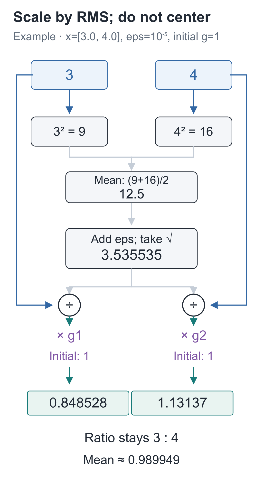
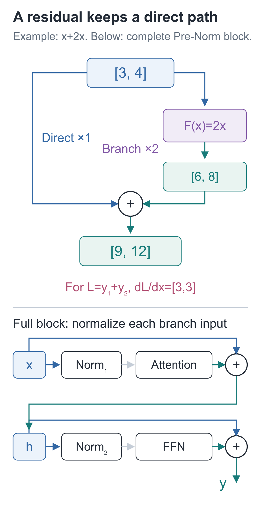

# 15 | Residual Connections and RMSNorm: Why Keep a Direct Path?

Build a Small Model, Understand Large Models · Lesson 15

Attention has gathered information from the prefix, and a feed-forward computation follows it. If this new computation temporarily outputs all zeros, can the representation computed earlier still move forward?

Shrink the input to `[3,4]` and deliberately make the new branch return `[0,0]`. Comparing two ways of connecting it shows exactly what we preserve by giving the original vector its own path.

## If the New Branch Returns Zero, What Reaches the Next Layer?

Call the new branch `F`. For input `x=[3,4]`, suppose it outputs `F(x)=[0,0]`:

| Connection | Values received by the next layer |
| --- | --- |
| Pass on only the branch result `F(x)` | `[0,0]` |
| Add the original input to the branch result `x+F(x)` | `[3,4]` |

The second connection adds a direct route around the branch. When the branch contributes nothing, the input passes through unchanged; when it contributes something, that result is added. This structure is called a **residual connection**:

**y=x+F(x)**

Addition matches the same coordinate at the same position. We cannot directly add `[B, T, 64]` to `[B, T, 128]`. This also explains why the previous lesson projected back to 64 dimensions at the end: the branch output must be compatible with the original vector at its entrance.

Now change the branch to `F(x)=2x`. It returns `[6,8]`, so the full structure returns `[3,4]+[6,8]=[9,12]`. The direct path preserves the original input, while the branch learns a modification to add to it.

This connects to the backward rule from Lesson 5: when a value is used along two paths, add the gradients arriving from both. Starting with a scalar, the local rate of change of `y=x+F(x)` with respect to `x` is:

**dy/dx=1+F′(x)**

The 1 comes from the direct path. With `F(x)=2x`, the branch contributes 2, giving a total rate of change of 3. The vector version retains this direct path as well and adds the branch's contribution. This does not mean gradients can never become small: if `F(x)=−x`, the two contributions cancel. A branch can also produce very large gradients.

The direct path preserves the input but does not control the scale of values entering the branch. Our `[9, 12]` is already three times as large as `[3, 4]`; the next computation has to handle that change.

## Look at What the Next Branch Receives

Start with `[3, 4]`. Multiply the entire vector by 10 to obtain `[30, 40]`, and the result of a bias-free linear projection will also grow by a factor of 10.

After Softmax or an activation, however, the result need not simply scale by 10. The three scores in Lesson 8 showed that widening score differences concentrates probabilities. Before passing a vector into a branch, we therefore measure its scale and divide by it.

How should we measure the scale of a set of numbers? A plain average can cancel positive and negative values: `[3, −3]` has mean 0, but neither entry is small. Instead, square the values, take their mean, and take the square root:

**RMS(x)=√((x₁²+x₂²+…+x_D²)/D)**

RMS stands for “root mean square.” `D` is the number of entries in the current vector, not the number of samples or text positions.

For `[3, 4]`, calculate it step by step:

1. Squaring gives `[9, 16]`.
2. Averaging gives `(9+16)/2=12.5`.
3. Taking the square root gives `√12.5≈3.535534`.
4. Dividing both entries by this value gives approximately `[0.848528, 1.131371]`.

The coordinates still have ratio 3:4; they have not become equal. Their new root mean square is 1.

An input containing only 0 would make the denominator 0 too. The code therefore adds a small positive constant, `eps=10⁻⁵`, before taking the square root. Its effect on this example is small, but it avoids division by zero for a zero vector.

Each coordinate also receives a trainable multiplier `g_i`, initialized to 1. Training can then adjust coordinate scales after normalization. The full calculation is:

**y_i=g_i×x_i/√((Σ_j x_j²)/D+eps)**

The summation sign `Σ_j` means to add the squares of all coordinates in the current vector. Coordinates share one denominator but each has its own `g_i`. For an input `[B, T, D]`, every sample and every position computes its denominator separately; we do not average over all text in the batch.

This operation is **RMSNorm**. Look again at `[3, 4]`: one entry remains smaller than the other, and the mean remains greater than 0. We divide by a common scale without subtracting the mean. `eps` and the learned `g` also affect the final root mean square. The [original RMSNorm paper](https://arxiv.org/abs/1910.07467) discusses this scaling design.



Put the calculation into a class so it can be reused:

```python
import torch
from torch import nn

class RMSNorm(nn.Module):
    """沿最后的特征轴做均方根缩放，不减均值，输入输出形状相同。"""
    def __init__(self, width, eps=1e-5):
        super().__init__()
        # 每个特征坐标各有一个可训练乘数，初值为 1。
        self.scale = nn.Parameter(torch.ones(width))
        self.eps = eps

    def forward(self, x):
        # 对 [B,T,D] 得到 [B,T,1]；样本与位置不混在同一个均值中。
        mean_square = x.square().mean(dim=-1, keepdim=True)
        # rsqrt 是 1/sqrt；eps 让零向量也有非零分母。
        inverse_rms = torch.rsqrt(mean_square + self.eps)
        # 共同分母广播回各坐标，再乘该坐标自己的 scale。
        return x * inverse_rms * self.scale

norm = RMSNorm(2)
x = torch.tensor([3., 4.])
print(norm(x))       # 含 eps，约 [0.848528, 1.131370]
print(norm(10 * x))  # 接近，但由于 eps，并非数学上完全相同
print(norm(torch.zeros(2)))  # [0., 0.]
```

`rsqrt(a)` means `1/√a`. `dim=-1` selects the last, feature axis; `keepdim=True` retains an axis of length 1 so the factor can broadcast back across all entries of the current vector. The code's `scale` is vector `g` in the formula. The two-dimensional example has two trainable parameters; a 64-dimensional version has 64.

## Assemble Splitting, Rotation, and Aggregation into One Component

It is time to assemble the attention branch. Connect the head splitting and merging from Lesson 12, rotation from Lesson 13, and causal aggregation from Lesson 11 in the order below, so the model block can call them directly.

First identify three interfaces: `split_heads` divides representations among heads; `apply_rope` rotates only Q and K; `attention_2d` assigns weights over permitted positions and aggregates V. We have already examined their implementations. Here we package the trainable projections and call order in one class.

Q, K, and V all come from the same input, which is why this is called “self-attention.” In `CausalSelfAttention`, `Causal` refers to the restriction to current and past positions, and `SelfAttention` identifies self-attention.

```python
from tiny_lm.attention import split_heads, merge_heads, attention_2d
from tiny_lm.rope import apply_rope

class CausalSelfAttention(nn.Module):
    """输入和输出都是[B,T,D]；四组投影参数随这个组件一起保存。"""
    def __init__(self, width, heads, theta=10000.):
        super().__init__()
        self.heads, self.theta = heads, theta
        self.q_proj = nn.Linear(width, width, bias=False)
        self.k_proj = nn.Linear(width, width, bias=False)
        self.v_proj = nn.Linear(width, width, bias=False)
        self.out_proj = nn.Linear(width, width, bias=False)

    def forward(self, x):
        # 三份投影先保留全部位置，再把特征分为[B,H,T,d]。
        q = split_heads(self.q_proj(x), self.heads)
        k = split_heads(self.k_proj(x), self.heads)
        v = split_heads(self.v_proj(x), self.heads)
        positions = torch.arange(x.shape[1], device=x.device)
        # 位置改变Q/K的匹配，V保持原投影；旋转不改变张量形状。
        q, k = apply_rope(q, k, positions, self.theta)
        # 每个头独立屏蔽未来、归一化，再汇总V。
        context, _ = attention_2d(q, k, v, causal=True)
        # 先按原位置拼回，再用输出投影混合各头；仍是位置表示。
        return self.out_proj(merge_heads(context))
```

We can now trace the entire call sequence. `x` first produces Q/K/V; after splitting into heads, Q/K rotate by position so matching scores can use position differences. Causal attention produces each head's result; merging and projection finish the computation. The four `nn.Linear` objects are stored on `self`, allowing `nn.Module` to register their parameters so the optimizer can find them. In contrast, q, k, v, and context are produced anew in every forward pass, not stored as additional trainable parameters.

Check the assembled behavior again. Replacing the future third position should leave the first two positions unchanged. A shape-only check could miss an omitted causal mask.

```python
# 这里核对刚刚写出的类；不加载训练权重，也没有参数更新。
torch.manual_seed(42)
assembled = CausalSelfAttention(64, 2)
sample = torch.randn(1, 4, 64)
altered = sample.clone()
altered[:, 2, :] += 5.
with torch.no_grad():
    original_output = assembled(sample)
    altered_output = assembled(altered)
assert original_output.shape == sample.shape
assert torch.allclose(original_output[:, :2], altered_output[:, :2])
assert not torch.allclose(original_output[:, 2:], altered_output[:, 2:])
```

`attention_2d` already performs scaling, causal masking, and Softmax in order; we do not repeat them here. The model block will use this `CausalSelfAttention` for its attention branch and the previous lesson's `SwiGLU` for its feed-forward branch. The full project additionally supports recording intermediate tensors, with the same computation order.

## Preserve Original Values on the Direct Path, Normalize the Branch Input

The original vector travels along the direct path, while the copy entering the branch is normalized first. The branch receives values with adjusted scale, but the residual addition still preserves the original values. This ordering is called Pre-Norm.

First, the attention half:

**h=x+Attention(RMSNorm₁(x))**

Then the feed-forward half:

**y=h+FFN(RMSNorm₂(h))**

There are two independent sets of RMSNorm parameters. The second normalization receives the summed `h`, not the initial `x`. The direct path does not add another copy of the normalized vector; it preserves the original representation at that branch's entrance.

With the earlier components imported, the model block computes:

```python
from tiny_lm.layers import SwiGLU
from tiny_lm.model import ModelConfig

class TransformerBlock(nn.Module):
    """接收并返回 [B,T,D]，两条分支都采用先归一、后计算的 Pre-Norm。"""
    def __init__(self, config):
        super().__init__()
        # 两份 Norm 参数相互独立，分别服务注意力分支与前馈分支。
        self.norm1 = RMSNorm(config.d_model, config.norm_eps)
        self.attention = CausalSelfAttention(
            config.d_model, config.n_heads, config.rope_theta)
        self.norm2 = RMSNorm(config.d_model, config.norm_eps)
        self.ffn = SwiGLU(config.d_model, config.d_ff)

    def forward(self, x):
        # 直路保留原始 x；只有送入注意力分支的副本先经过 norm1。
        h = x + self.attention(self.norm1(x))
        # 第二个直路保留刚得到的 h，FFN 接收的也由 h 而非旧 x 归一化。
        return h + self.ffn(self.norm2(h))

torch.manual_seed(42)
block = TransformerBlock(ModelConfig())
inputs = torch.randn(1, 3, 64, requires_grad=True)
outputs = block(inputs)
print(inputs.shape, outputs.shape)  # 都是 [1,3,64]
# 只检查直路与分支能否传回梯度；没有 step，因此没有修改参数。
outputs.square().mean().backward()
assert torch.isfinite(inputs.grad).all()
```

The first addition in `forward` preserves `x`; the second preserves the newly computed `h`. The input and output both have shape `[1, 3, 64]`, and gradients can flow back to the input through both the branches and the direct paths.



## Two Check Questions

1. In this example, all `g_i=1`. Replace `[3, 4]` with `[30, 40]`. What is the new RMS? Ignoring `eps`, does the normalized result change? What if you add 10 to both entries instead?
2. If both the attention and FFN branches return all zeros, what does the full block output? Does this prove that “residual connections guarantee nonzero gradients”?

<details class="answer" markdown="1">
<summary>Reference answers</summary>

For question one, RMS grows tenfold to approximately **35.355339**. Ignoring `eps`, dividing by this scale gives the same result. Adding 10 yields `[13, 14]`, changing the ratio from 3:4 to 13:14, so the normalized result changes too. RMSNorm does not remove a common additive shift. For question two, the first residual gives `h=x`, and the second gives `y=h=x`. However, a branch value that happens to be zero does not determine its derivative. Even with a direct path, gradients from the branch can cancel its contribution, so no such guarantee follows.

</details>

Run this from the `code` companion code directory:

```bash
# 在配套代码目录运行本讲实验，核对正文中的结果。
python -m lessons.l15
```

Companion entry points: [Lesson runner](https://github.com/DavidDingXu/hello-llm/blob/main/code/lessons/l15.py) · [RMSNorm and model block source](https://github.com/DavidDingXu/hello-llm/blob/main/code/tiny_lm/layers.py).

Source navigation: [layers.py · RMSNorm](https://github.com/DavidDingXu/hello-llm/blob/main/code/tiny_lm/layers.py#L14) · [layers.py · TransformerBlock](https://github.com/DavidDingXu/hello-llm/blob/main/code/tiny_lm/layers.py#L51).

<!-- chapter-navigation:start -->

---

[← Positionwise feed-forward networks](../14-swiglu/README.en.md) · [Contents](../../README.en.md#course-contents) · [The complete forward pass →](../16-transformer/README.en.md)

<!-- chapter-navigation:end -->
