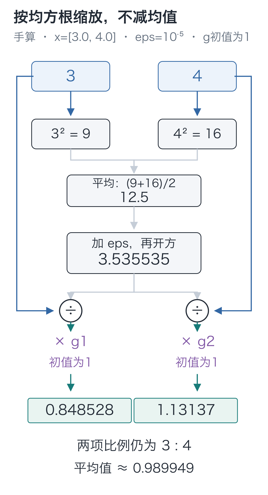
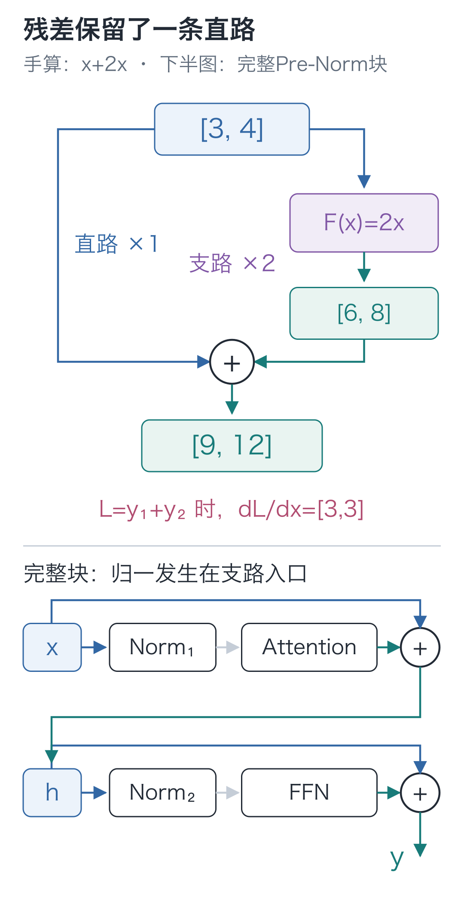

# 15｜残差与RMSNorm：为什么留一条原路？

手写小模型，看懂大模型 · 第 15 讲

注意力已经汇总了前文，后面又接上一段前馈计算。如果这段新计算暂时输出全零，前面算出的表示还能继续向后传吗？

先把输入缩成 `[3,4]`，故意让新分支返回 `[0,0]`。比较两种接法，就能看到“给原向量留条路”到底留下了什么。

## 新分支返回零，下一层会收到什么？

把新分支叫作 `F`，本次输入 `x=[3,4]`，分支输出 `F(x)=[0,0]`：

| 接法 | 下一层收到的数 |
| --- | --- |
| 只交出分支结果 `F(x)` | `[0,0]` |
| 原输入加上分支结果 `x+F(x)` | `[3,4]` |

第二种接法多了一条绕过分支的直路。分支没有贡献时，输入原样传递；分支有贡献时，再把它加上去。这个结构叫作**残差连接**：

**y=x+F(x)**

相加是同一位置、同一坐标对应相加，不能把 `[B, T, 64]` 与 `[B, T, 128]` 直接相加。这也回答了上一讲为什么最后还要缩回64维：分支交出的结果要能与入口处的原向量相加。

现在把分支改为 `F(x)=2x`，它返回 `[6,8]`，整个结构便返回 `[3,4]+[6,8]=[9,12]`。直路保留原输入，分支学习要在它上面增加怎样的修改。

这也与第五讲的反向规则相连：一个数被两条路径使用，两条路径带回的梯度要相加。先用单个数表示，`y=x+F(x)` 对 `x` 的局部变化率是：

**dy/dx=1+F′(x)**

其中 1 来自直路。本例 `F(x)=2x`，分支贡献为 2，总变化率为 3。向量版本也保留这条直接路径，另外再加上分支带回的贡献。它并不意味着梯度永远不会变小：若 `F(x)=−x`，两条贡献就会抵消；分支也可能产生很大的梯度。

直路保留了输入，却没有限制分支收到的数值尺度。本例的 `[9, 12]` 已经比 `[3, 4]` 大了三倍，下一段计算需要处理这份变化。

## 再看下一条分支收到的数

先看两项输入 `[3, 4]`。如果整个向量乘以 10，变成 `[30, 40]`，一个无偏置的线性投影结果也会放大 10 倍。

后面若经过 Softmax 或激活，结果的变化就未必只是同步乘以 10。第八讲的三个分数已经显示：扩大差距会让概率更集中。因此，我们在把向量交给分支前，先量出它有多大，再除回这个尺度。

怎样衡量一组数的尺度？直接求平均会遇到正负抵消，比如 `[3, −3]` 的平均数为 0，却不能说明两项都很小。可以先平方，再平均，再开方：

**RMS(x)=√((x₁²+x₂²+…+x_D²)/D)**

RMS 是“均方根”的英文缩写。`D` 是当前向量有几项；这里不是样本数，也不是文字位置数。

对 `[3, 4]` 逐步算：

1. 平方得到 `[9, 16]`。
2. 平均得到 `(9+16)/2=12.5`。
3. 开方得到 `√12.5≈3.535534`。
4. 两项都除以这个数，得到约 `[0.848528, 1.131371]`。

两个坐标的比例仍然是 3:4，没有被改成相同的数；新的均方根为 1。

如果输入全为 0，分母也为 0。因此代码在开方之前加入一个很小的正数 `eps=10⁻⁵`。对本例影响很小，对零向量却能避免除以零。

另外，每个坐标配上一个可以训练的乘数 `g_i`，初值都是 1。这样，归一后各坐标的尺度还可以由训练调整。完整计算是：

**y_i=g_i×x_i/√((Σ_j x_j²)/D+eps)**

求和符号 `Σ_j` 表示把当前向量的所有坐标平方相加。所有坐标共用同一个分母，但拥有各自的 `g_i`。输入为 `[B, T, D]` 时，每个样本、每个位置分别计算分母，不把整批文字混在一起求平均。

这一步叫 **RMSNorm**。回看 `[3, 4]`，两项仍然一小一大，平均值也仍然大于 0：我们只除了一个共同尺度，没有减均值。`eps` 和训练出的 `g` 还会影响最终的均方根。[RMSNorm 原论文](https://arxiv.org/abs/1910.07467)讨论了这种缩放设计。



把计算写成一个类，便于在多个位置复用：

```python
import torch
from torch import nn

class RMSNorm(nn.Module):
    """沿最后的特征轴做均方根缩放，不减均值，输入输出形状相同。"""
    def __init__(self, width, eps=1e-5):
        super().__init__()
        # 每个特征坐标各有一个可训练乘数，初值为 1。
        self.scale = nn.Parameter(torch.ones(width))
        self.eps = eps

    def forward(self, x):
        # 对 [B,T,D] 得到 [B,T,1]；样本与位置不混在同一个均值中。
        mean_square = x.square().mean(dim=-1, keepdim=True)
        # rsqrt 是 1/sqrt；eps 让零向量也有非零分母。
        inverse_rms = torch.rsqrt(mean_square + self.eps)
        # 共同分母广播回各坐标，再乘该坐标自己的 scale。
        return x * inverse_rms * self.scale

norm = RMSNorm(2)
x = torch.tensor([3., 4.])
print(norm(x))       # 含 eps，约 [0.848528, 1.131370]
print(norm(10 * x))  # 接近，但由于 eps，并非数学上完全相同
print(norm(torch.zeros(2)))  # [0., 0.]
```

`rsqrt(a)` 就是 `1/√a`。`dim=-1` 指最后一根特征轴，`keepdim=True` 保留长度为 1 的轴，让这个分母能乘回当前向量的每项。代码里的 `scale` 就是公式中的向量 `g`，两维例子有两个可训练参数，64 维则有 64 个。

## 把分头、旋转与汇总接成一个组件

注意力分支现在要真正装起来。第12讲的分头与合头、第13讲的旋转，以及第11讲的因果汇总，按下面这个顺序接好，下一段模型块就能直接调用它。

先认清三个接口：`split_heads`把表示分给各头；`apply_rope`只转Q、K；`attention_2d`在允许读取的位置间分配比例并汇总V。它们的实现已经分别展开过，这里把可训练投影和调用顺序封装到同一个类中。

Q、K、V 都来自同一段输入，所以叫“自注意力”。类名 `CausalSelfAttention` 中，`Causal` 指只能读取当前及过去位置的因果限制，`SelfAttention` 指自注意力。

```python
from tiny_lm.attention import split_heads, merge_heads, attention_2d
from tiny_lm.rope import apply_rope

class CausalSelfAttention(nn.Module):
    """输入和输出都是[B,T,D]；四组投影参数随这个组件一起保存。"""
    def __init__(self, width, heads, theta=10000.):
        super().__init__()
        self.heads, self.theta = heads, theta
        self.q_proj = nn.Linear(width, width, bias=False)
        self.k_proj = nn.Linear(width, width, bias=False)
        self.v_proj = nn.Linear(width, width, bias=False)
        self.out_proj = nn.Linear(width, width, bias=False)

    def forward(self, x):
        # 三份投影先保留全部位置，再把特征分为[B,H,T,d]。
        q = split_heads(self.q_proj(x), self.heads)
        k = split_heads(self.k_proj(x), self.heads)
        v = split_heads(self.v_proj(x), self.heads)
        positions = torch.arange(x.shape[1], device=x.device)
        # 位置改变Q/K的匹配，V保持原投影；旋转不改变张量形状。
        q, k = apply_rope(q, k, positions, self.theta)
        # 每个头独立屏蔽未来、归一化，再汇总V。
        context, _ = attention_2d(q, k, v, causal=True)
        # 先按原位置拼回，再用输出投影混合各头；仍是位置表示。
        return self.out_proj(merge_heads(context))
```

现在可以沿调用顺序追完路径：`x`先生成Q/K/V，分头后Q/K按位置旋转，匹配分数因此能用上位置差；因果注意力得到各头结果，最后合头并投影。四个 `nn.Linear` 保存在 `self` 上，它们的参数会被 `nn.Module` 登记，后面的优化器才能找到；q、k、v和context则在每次前向时重新产生，不是额外的可训练参数。

组装后再检查一次整段行为。换掉未来第三个位置，前两个位置应当不动；若只核对输出形状，漏接因果掩码也可能蒙混过关。

```python
# 这里核对刚刚写出的类；不加载训练权重，也没有参数更新。
torch.manual_seed(42)
assembled = CausalSelfAttention(64, 2)
sample = torch.randn(1, 4, 64)
altered = sample.clone()
altered[:, 2, :] += 5.
with torch.no_grad():
    original_output = assembled(sample)
    altered_output = assembled(altered)
assert original_output.shape == sample.shape
assert torch.allclose(original_output[:, :2], altered_output[:, :2])
assert not torch.allclose(original_output[:, 2:], altered_output[:, 2:])
```

`attention_2d`内部已经依次完成缩放、因果屏蔽与Softmax，这里不再重复做一次。随后模型块的注意力分支用这个 `CausalSelfAttention`，前馈分支仍用上一讲的 `SwiGLU`。完整工程额外提供中间张量记录，计算顺序相同。

## 直路保留原值，支路先调整尺度

原向量走直路，送进分支的那一份先做归一化。分支接收的是调整过尺度的数，相加时保留的仍是原值。这种顺序叫 Pre-Norm。

先看注意力这一半：

**h=x+Attention(RMSNorm₁(x))**

再看前馈这一半：

**y=h+FFN(RMSNorm₂(h))**

这里有两份独立的 RMSNorm 参数。第二次接收的是相加后的 `h`，不是最初的 `x`。直路也不是把归一后的向量再加一次；它保留的是该分支入口处的原表示。

引入前面实现的组件后，模型块的计算如下：

```python
from tiny_lm.layers import SwiGLU
from tiny_lm.model import ModelConfig

class TransformerBlock(nn.Module):
    """接收并返回 [B,T,D]，两条分支都采用先归一、后计算的 Pre-Norm。"""
    def __init__(self, config):
        super().__init__()
        # 两份 Norm 参数相互独立，分别服务注意力分支与前馈分支。
        self.norm1 = RMSNorm(config.d_model, config.norm_eps)
        self.attention = CausalSelfAttention(
            config.d_model, config.n_heads, config.rope_theta)
        self.norm2 = RMSNorm(config.d_model, config.norm_eps)
        self.ffn = SwiGLU(config.d_model, config.d_ff)

    def forward(self, x):
        # 直路保留原始 x；只有送入注意力分支的副本先经过 norm1。
        h = x + self.attention(self.norm1(x))
        # 第二个直路保留刚得到的 h，FFN 接收的也由 h 而非旧 x 归一化。
        return h + self.ffn(self.norm2(h))

torch.manual_seed(42)
block = TransformerBlock(ModelConfig())
inputs = torch.randn(1, 3, 64, requires_grad=True)
outputs = block(inputs)
print(inputs.shape, outputs.shape)  # 都是 [1,3,64]
# 只检查直路与分支能否传回梯度；没有 step，因此没有修改参数。
outputs.square().mean().backward()
assert torch.isfinite(inputs.grad).all()
```

`forward` 的第一个加号保留 `x`，第二个保留刚得到的 `h`。运行后，输入与输出都是 `[1, 3, 64]`，梯度也能沿分支与直路传回输入。



## 两道检验题

1. 本例所有 `g_i=1`。把 `[3, 4]` 换成 `[30, 40]`，RMS 变成多少？如果暂不考虑 `eps`，归一结果是否改变？如果把两项都加上 10 呢？
2. 若注意力分支与 FFN 分支都返回全零，完整块会输出什么？能否由此断言“残差连接保证梯度永远不为零”？

<details class="answer" markdown="1">
<summary>参考答案</summary>

答案：第一题，均方根扩大十倍，变成约 **35.355339**；忽略 `eps` 时，除回尺度后结果相同。加 10 得到 `[13, 14]`，比例从 3:4 变成 13:14，归一结果也随之改变。RMSNorm 没有消除整体平移。第二题，前一次残差得到 `h=x`，后一次得到 `y=h=x`。但分支值恰好为零，不足以确定它的导数；即使直接路径存在，分支带回的梯度也可能抵消它，因此不能作出这个保证。

</details>

在 `code` 目录运行：

```bash
# 在配套代码目录运行本讲实验，核对正文中的结果。
python -m lessons.l15
```

配套入口：[运行入口](https://github.com/DavidDingXu/hello-llm/blob/main/code/lessons/l15.py) · [RMSNorm 与模型块源码](https://github.com/DavidDingXu/hello-llm/blob/main/code/tiny_lm/layers.py)。

源码导航：[layers.py · RMSNorm](https://github.com/DavidDingXu/hello-llm/blob/main/code/tiny_lm/layers.py#L14) · [layers.py · TransformerBlock](https://github.com/DavidDingXu/hello-llm/blob/main/code/tiny_lm/layers.py#L51)。

<!-- chapter-navigation:start -->

---

[← 逐位置前馈](../14-swiglu/README.md) · [课程目录](../../README.md#课程目录) · [完整模型前向 →](../16-transformer/README.md)

<!-- chapter-navigation:end -->
