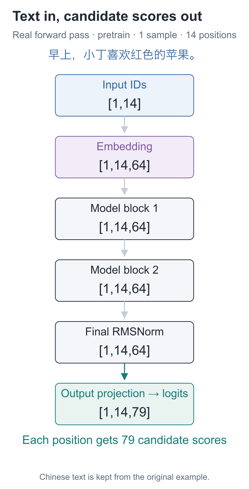
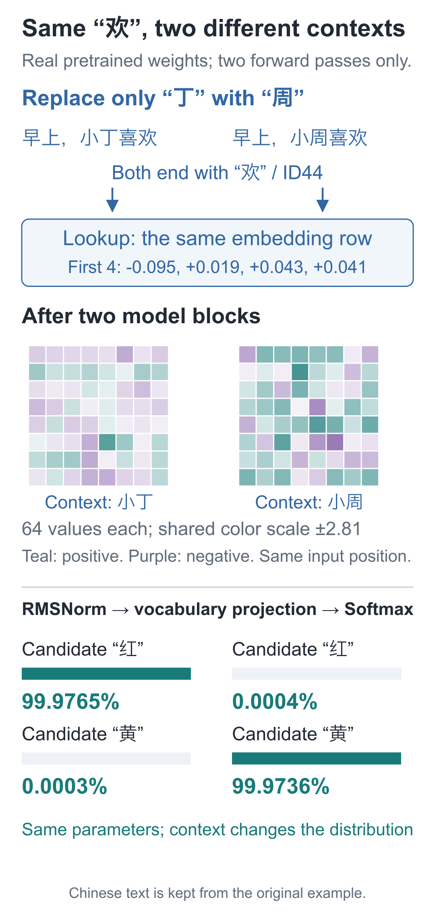
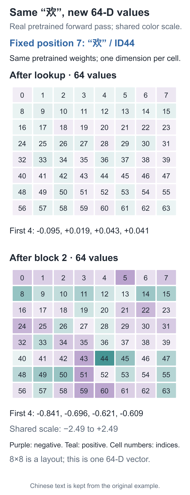
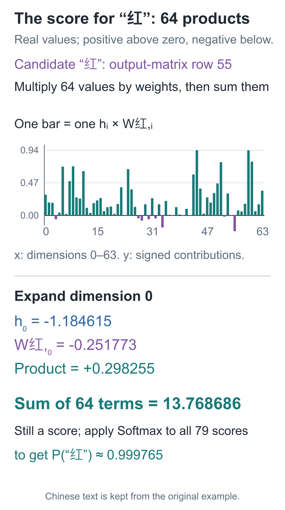
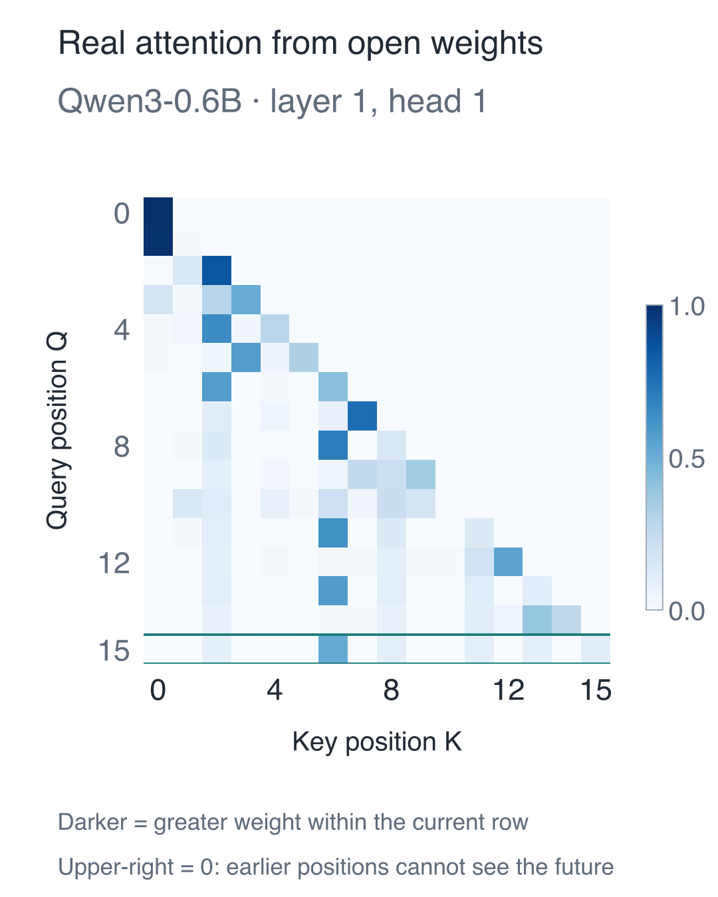

# 16 | The Complete Model: Follow the Character “欢” Through Every Step

Build a Small Model, Understand Large Models · Lesson 16

In Lesson 09, looking only at the final character “欢” could not distinguish whether the preceding person was Xiaoding or Xiaozhou. Now, when the complete model reads “早上，小丁喜欢” (“In the morning, Xiaoding likes”), it assigns the next character “红” (“red”) probability **0.999765**. How did the added components change the prediction?

For this lesson, we borrow parameters from a completed pretraining run to observe how the components work together. The next lesson will examine how those parameters were trained. As when debugging a program, we hold the input and parameters fixed and stop at several points: are the input IDs correct, when does the row for “欢” change, and which step finally produces candidate-character scores?

## Start with These 14 IDs

Our fixed text is:

`早上，小丁喜欢红色的苹果。`

It means “In the morning, Xiaoding likes red apples.” The series encodes text character by character. Adding BOS before the 13 characters gives 14 IDs:

`[1, 32, 7, 76, 27, 6, 22, 44, 55, 57, 50, 58, 39, 5]`

Entry 0 is BOS, entry 1 is “早”, entry 7 is “欢”, and entry 13 is “。”. Lock onto position 7 and use that same index at every later checkpoint, so we do not accidentally switch to another character.

The complete computation follows this route:

**IDs `[1, 14]` → embedding lookup `[1, 14, 64]` → two model blocks → final RMSNorm → candidate scores `[1, 14, 79]`**

The first number, 1, is the number of samples; 14 is the number of positions. The internal representation width is 64, and the candidate vocabulary size is 79. They answer different questions: “How many numbers represent each position?” and “How many candidates need scores?” They are not interchangeable.



The number of positions remains 14 throughout. What changes is the content of each row: first one ID, then 64 representation values, and finally 79 candidate scores. Position 7 can use the prefix from BOS through “欢”, but cannot read the following “红色的苹果。” (“red apples”). Holding the whole sentence in one tensor does not remove this restriction.

The [3D model inspector](https://daviddingxu.github.io/hello-llm/chapters/16-transformer/lab3d.en.html) arranges these checkpoints in layers. Select a position and coordinate, then compare stages to inspect residual addition, final normalization, and how the 64 entries contribute to a candidate's score. It reads the same verified pretrained record; changing views does not train the model. The tables and code below also provide the complete verification path.

## Stay with the Row for “欢”

The first stop is the lookup. The ID for “欢”, 44, selects row 44 of the Embedding table. These 64 values depend only on the character and the table's parameters; they have not read “小丁” (“Xiaoding”). Stopping here lets us compare them with the representations after contextual processing.

The first block gives this row a path for reading the prefix, then processes the aggregated coordinates with the feed-forward network. Two residual connections preserve direct paths for the incoming representations. The second block receives that result and processes it again with another set of parameters. Both block outputs still have shape `[1, 14, 64]`, so a shape check alone cannot reveal that their values have changed. We will inspect actual slices shortly.

The 64 internal coordinates do not map one-to-one to characters. Scoring the 79 vocabulary candidates requires a final projection.

After the second block, another RMSNorm is applied. A bias-free linear layer then projects each 64-entry vector to 79 scores. For candidate `j`, this is:

**logit_j=h₁W_j1+h₂W_j2+…+h₆₄W_j64**

Here, `h` is the final normalized vector, and `W_j` is the output matrix row for candidate `j`. This is exactly the row-by-row weighted sum from Lesson 2, now with 64 input values instead of two.

This is where `[1, 14, 64]` becomes `[1, 14, 79]`. The returned **logits are scores that have not been normalized into probabilities**. Training sends them to cross-entropy; inspecting candidates or selecting a character uses Softmax. The probability of “红” at the start of the lesson comes from this entire row of scores.

## Connect the Checkpoints in One forward Method

First write the route in code and create an untrained `random_model`, checking only its structure, shapes, and parameter count. The `pretrain_trace` read later is the record of the pretrained model from the opening; these two models have different parameters.

The variable `x` is reassigned along the route. Each step must produce the shape the next step expects:

```python
import torch
from torch import nn
from tiny_lm.model import ModelConfig
from tiny_lm.layers import RMSNorm, TransformerBlock
from tiny_lm.tokenizer import CharTokenizer

class TinyLM(nn.Module):
    """Turn integer IDs [B,T] into raw candidate scores [B,T,V]; do not select a token in the forward pass."""
    def __init__(self, config):
        super().__init__()
        self.config = config
        self.embedding = nn.Embedding(config.vocab_size, config.d_model)
        # ModuleList registers each block's independent parameters so the model's optimizer can find them.
        self.blocks = nn.ModuleList([
            TransformerBlock(config) for _ in range(config.n_layers)])
        self.final_norm = RMSNorm(config.d_model, config.norm_eps)
        self.output = nn.Linear(config.d_model, config.vocab_size,
                                bias=False)
        self.apply(self._initialize)

    @staticmethod
    def _initialize(module):
        # Randomly initialize Linear/Embedding weights; RMSNorm scale parameters keep their initial value of 1.
        if isinstance(module, (nn.Linear, nn.Embedding)):
            nn.init.normal_(module.weight, mean=0., std=.02)

    def forward(self, ids):
        # Accept only a batch of IDs; keep targets and loss computation outside the model's forward pass.
        if ids.ndim != 2 or not 0 < ids.shape[1] <= self.config.max_seq_len:
            raise ValueError("需要 [B,T]，且 1 <= T <= 32")
        x = self.embedding(ids)  # [B,T] → [B,T,D], looking up parameter rows by ID.
        # Each block transforms position representations while preserving the [B,T,D] axes and width.
        for block in self.blocks:
            x = block(x)
        # After final normalization, map D internal coordinates to V candidate scores; there is no Softmax here.
        return self.output(self.final_norm(x))

torch.manual_seed(42)
tokenizer = CharTokenizer.for_course()
# This new random model is untrained; its parameters differ from those behind the pretrained record below.
random_model = TinyLM(ModelConfig(vocab_size=tokenizer.vocab_size))
text = "早上，小丁喜欢红色的苹果。"
ids = torch.tensor([tokenizer.encode(text, add_bos=True)])
logits = random_model(ids)
print(ids.shape)     # torch.Size([1, 14])
print(logits.shape)  # torch.Size([1, 14, 79])
print(sum(p.numel() for p in random_model.parameters()))  # 92352
```

`ModuleList` registers both blocks as model submodules. A plain Python list can be iterated over but does not integrate them into the model's parameter management in the same way. `apply` visits modules and fills the linear and embedding weights with random values of mean 0 and standard deviation 0.02. The RMSNorm scale parameters still start at 1.

## Stop at Each Checkpoint in the Saved Record

Read the pretrained model's forward record for this same sentence and select position 7. We display only the first four coordinates at each checkpoint; the other 60 still participate in the actual computation:

| Checkpoint at position 7 | First four entries, rounded to six decimal places |
| --- | --- |
| Embedding | [−0.094927, 0.018641, 0.043246, 0.040713] |
| First block output | [−0.844999, −0.217363, −0.441488, −0.389308] |
| Second block output | [−0.840967, −0.695858, −0.620723, −0.608694] |
| Final RMSNorm | [−1.184615, −1.003421, −1.015668, −0.869593] |

## Change Only the Prefix: What Happens to the Same “欢”?

Changed values alone do not establish that the prefix had an effect. Using the same pretrained weights, compare `早上，小丁喜欢` and `早上，小周喜欢`—“In the morning, Xiaoding likes” and “In the morning, Xiaozhou likes.” Supply only the prefixes, without their following answers.

Both end in “欢”, with ID 44, so their initial 64-entry lookup vectors are identical. After two blocks, the preceding “丁” and “周” have paths that can affect this row, and the outputs differ.



The two grids share a color scale: teal is positive, purple is negative, and deeper color means a larger absolute value. Each 8×8 grid is still one 64-dimensional vector, not 64 characters. A cell's color alone does not justify calling it a “fruit feature.”

With the “小丁” prefix, “红” has probability about 99.9765%. With “小周”, “黄” (“yellow”) has probability about 99.9736%. The character baseline in Lesson 09 looked up only the current “欢” and gave both people the same distribution. The prefix now truly changes the next-character prediction. No parameters were updated between the two runs; the input and the representations computed along the way changed.

<details class="optional" markdown="1">
<summary>Expand the full coordinates and the code for this name comparison</summary>

Below, compare all 64 coordinates after lookup and after the second block for the “小丁” input alone. The two grids again share a color scale. The labels 0–63 are coordinate indices; arranging them in 8 rows and 8 columns is only a viewing aid.



To repeat the two-name comparison, load the saved weights directly. We name this model `context_model` to distinguish it from the newly initialized `random_model` above:

```python
from tiny_lm.checkpoint import load_checkpoint
from tiny_lm.trace import parameter_digest

# Load the same pretrained weights; there are no targets, backward passes, or optimizer updates here.
context_model, context_tokenizer, _ = load_checkpoint(
    "artifacts/first_run/pretrain.pt")
before_digest = parameter_digest(context_model)
embeddings, representations = [], []
for prefix in ["早上，小丁喜欢", "早上，小周喜欢"]:
    # Both prefixes end in “欢” and differ only by one earlier character in the name.
    prefix_ids = torch.tensor([context_tokenizer.encode(prefix, add_bos=True)])
    with torch.no_grad():
        scores, detail = context_model(prefix_ids, return_trace=True)
    embeddings.append(detail["embedding"][0, -1])
    representations.append(detail["blocks"][-1]["block_output"][0, -1])
    # Normalize over all 79 candidates at the last position, then inspect “红” and “黄”; do not renormalize just those two.
    probabilities = scores[0, -1].softmax(-1)
    print(prefix, {c: float(probabilities[context_tokenizer.stoi[c]])
                   for c in ["红", "黄"]})

assert torch.equal(embeddings[0], embeddings[1])  # Identical current characters give identical embedding lookups.
assert not torch.allclose(representations[0], representations[1])
assert parameter_digest(context_model) == before_digest  # Parameters stayed unchanged during the comparison.
```

</details>

## Inspect the 64-Term Weighted Sum for “红”

At this position, the output head gives “红” a logit of about **13.768686** and “紫” (“purple”) about **0.992895**. Softmax over all 79 entries gives “红” probability **0.999765**. This is a measured prediction from a trained model, and it happens to match the actual next character.

We can also break down 13.768686. Each bar below is one term `hᵢ×W红,ᵢ`: positive contributions appear above zero, and negative contributions below. All 64 terms must be summed to obtain the score for “红”. Each of the other 78 candidates has its own parameter row and requires the same computation.



No character has been selected or appended yet. The generation loop in Lesson 18 masks PAD, BOS, and UNK before renormalizing, so its probability for the same candidate differs slightly. Do not combine the last decimal places from these two contexts as though they came from one distribution.

Read the original record directly with the following code, without retraining:

```python
import json
from pathlib import Path

# The JSON stores a trained model's forward-pass results; reading it does not load weights into random_model.
pretrain_record = json.loads(Path(
    "artifacts/first_run/forward_trace.json").read_text(encoding="utf-8"))
pretrain_trace = pretrain_record["trace"]
assert pretrain_record["stage"] == "pretrain"
position = 7
# Select sample 0, position 7 (“欢”); display only four coordinates, though all participated in the original computation.
print(pretrain_trace["embedding"][0][position][:4])
print(pretrain_trace["blocks"][0]["block_output"][0][position][:4])
scores = torch.tensor(pretrain_trace["logits"][0][position])
# red indexes the vocabulary candidate axis, not a coordinate of the 64-dimensional representation.
red = tokenizer.stoi["红"]
print(float(scores[red]), float(scores.softmax(-1)[red]))
```

When debugging, if the output still has only 64 entries, check whether the vocabulary projection was omitted. If decoded IDs produce the wrong characters, check the vocabulary paired with the model. The checkpoint records above help locate the step where something went wrong.

In the [model inspection demo](https://daviddingxu.github.io/hello-llm/chapters/16-transformer/model-inspector.en.html), you can select another input position and inspect its embedding lookup, each block's attention and two residual additions, and the final candidate scores. Clicking a coordinate shows its value. The page uses the saved forward record from this lesson; it does not retrain a model in the browser.

## Of All These Numbers, Which Ones Does Training Change?

The vectors in the table are regenerated from the input. What the model stores long-term and modifies during training are its parameter groups. Counting them also helps detect an unregistered layer or an accidentally shared matrix. Let `V` be the vocabulary size, `D` the internal width, `L` the number of blocks, and `F` the intermediate feed-forward width. The input and output matrices are not shared, and all linear layers are bias-free.

| Component | Formula | Parameters in this model |
| --- | --- | --- |
| Input Embedding | VD = 79×64 | 5,056 |
| Q, K, V, and output projections per block | 4D² = 4×64² | 16,384 |
| SwiGLU per block | 3DF = 3×64×128 | 24,576 |
| Two RMSNorm layers per block | 2D | 128 |
| Two complete blocks | 2×41,088 | 82,176 |
| Final RMSNorm | D | 64 |
| Output projection | DV = 64×79 | 5,056 |

The total is therefore:

**2VD+L(4D²+3DF+2D)+D=92,352**

The “per block” rows describe one block's components; in the final total, count “two complete blocks” only once. The 2 heads divide width 64 into width 32 per head, so do not multiply `4D²` by the head count again. Fixed RoPE frequencies, input IDs, intermediate results, and the causal mask are not trainable parameters.

## Check That the Assembled Network Can Propagate Gradients

Return to the `random_model` we built earlier. Supply targets shifted by one position, compute the loss, and backpropagate to check that every trainable parameter is connected to the loss. Reading a JSON record does not alter this model's parameters. The following checks connectivity only; no training has occurred yet:

```python
from tiny_lm.losses import token_loss

# Inputs are BOS + text; targets shift by one to text + EOS. Both have shape [1,14].
targets = torch.tensor([tokenizer.encode(text) + [2]])  # Ends with EOS
# Return to the new random model and check that all its parameters connect to the loss.
random_model.zero_grad(set_to_none=True)
loss = token_loss(random_model(ids), targets)
loss.backward()
# backward only fills gradients; without an optimizer step, the random parameters remain unchanged.
assert all(p.grad is not None and torch.isfinite(p.grad).all()
           for p in random_model.parameters())
print(float(loss.detach()))
```

This confirms that the parameters connect to the loss and that all gradients in this pass are finite. Unused vocabulary rows may have zero gradients. Whether the network can learn well still requires actual training.

<details class="optional" markdown="1">
<summary>Optional: apply the same tracing method to a public model</summary>

The same tracing method works with public models. We sent “天空是什么颜色？” (“What color is the sky?”) to Qwen3-0.6B and recorded a real forward pass. Including the chat format, the input contains 16 tokens. They pass through 28 blocks and produce candidate scores of shape `[1, 16, 151936]`.

Below are the actual weights from the first attention head in the first layer. The horizontal axis selects the position being read; the vertical axis selects the query position. The upper-right region is all 0, enforcing the same causal restriction we implemented by hand.



Its internal width is 1024. It has 16 query groups but only 8 K/V groups, so every two query groups share one set of reading material. Our handwritten model gives each head its own K/V. The public model also has additional normalization and parameter sharing that this series does not implement one by one. This observation checks the computation path and causal restriction; simply increasing 64 would not reproduce its full design.

At the last position, this run assigns the token “天空” (“sky”) probability approximately 0.997092. That probability comes from the output head; the shading in the figure shows one attention head's weights for reading the prefix. They serve different purposes. Consult the [official model description](https://huggingface.co/Qwen/Qwen3-0.6B) for the design and the [measured trace](https://github.com/DavidDingXu/hello-llm/blob/main/code/artifacts/reference/qwen3_trace.json) for this run.

</details>

## Two Questions About Position and Structure

1. What should the scores at the BOS position predict? What should the final valid position, containing the period, predict?
2. If only the internal width changes from 64 to 128, keeping two heads, how many parameters are in one attention block's four projection matrices? Should you multiply by the head count again?

<details class="answer" markdown="1">
<summary>Reference answers</summary>

For question one, the BOS position targets the first character, “早”; the period position targets EOS. Both input and labels have 14 entries. The period is not being asked to predict itself. For question two, the answer is **4×128²=65,536**, four times the original 16,384. Each head now has width 64. The four projections already cover the full 128 dimensions, so do not multiply by the number of heads again.

</details>

Before training, give your model two ID sequences of length 5. Write down the expected output shape, then run the forward pass. Change only the character ID at position index 3 in one sequence, and verify that positions 0–2 of that sequence and every output in the other sample remain unchanged. Finally, compute a loss, backpropagate, and check that the parameters receive finite gradients. If a check fails, investigate axes, visibility, or parameter registration before increasing the training steps.

Run this from the `code` companion code directory:

```bash
# Run this lesson from the companion code directory to check the chapter's results.
python -m lessons.l16
```

Code and run records: [Lesson runner](https://github.com/DavidDingXu/hello-llm/blob/main/code/lessons/l16.py) · [Complete model source](https://github.com/DavidDingXu/hello-llm/blob/main/code/tiny_lm/model.py) · [Actual forward record](https://github.com/DavidDingXu/hello-llm/blob/main/code/artifacts/first_run/forward_trace.json).

Source navigation: [model.py · TinyLM](https://github.com/DavidDingXu/hello-llm/blob/main/code/tiny_lm/model.py#L39).

<!-- chapter-navigation:start -->

---

[← Residual connections and normalization](../15-residual-and-rmsnorm/README.en.md) · [Contents](../../README.en.md#course-contents) · [The first pretraining run →](../17-pretraining/README.en.md)

<!-- chapter-navigation:end -->
