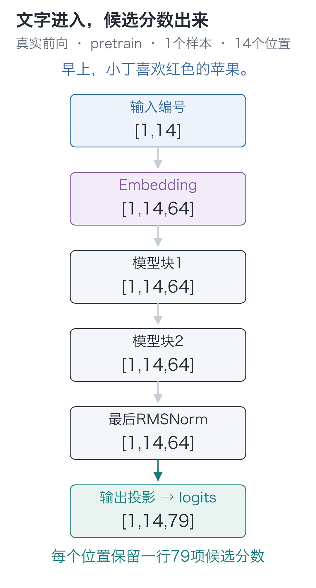
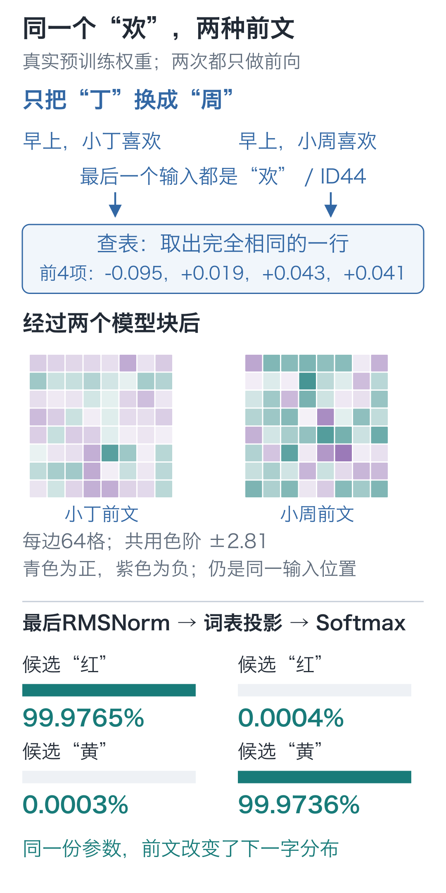
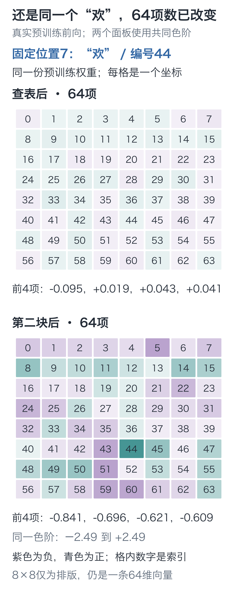
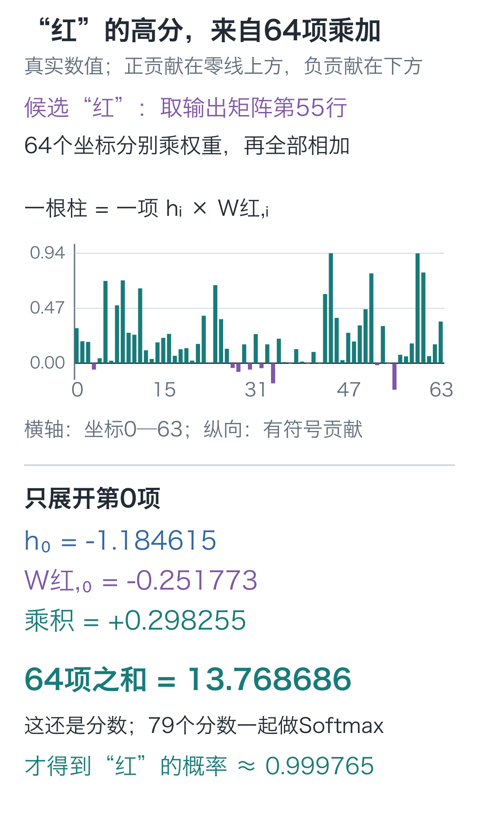
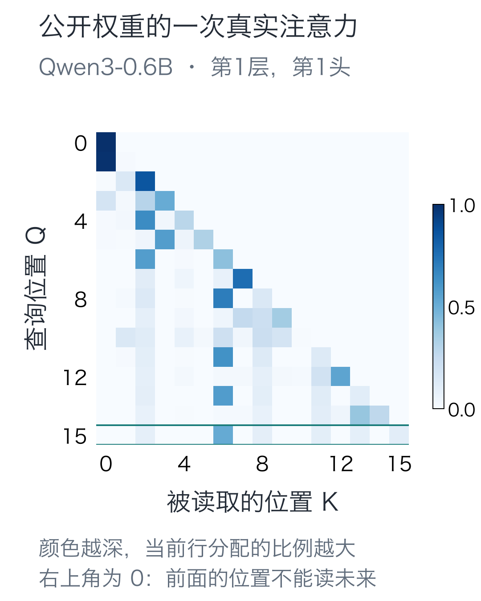

# 16｜完整模型：跟着“欢”这个字走一遍

手写小模型，看懂大模型 · 第 16 讲

第09讲只看最后一个“欢”，分不清前面是小丁还是小周。现在，完整模型读到“早上，小丁喜欢”，给下一字“红”的概率约为 **0.999765**。加上的这些组件，怎样改变了预测？

本讲先借用已经完成预训练的参数，观察各组件怎样协作；下一讲再展开这份参数的训练过程。像调试程序那样，固定输入和参数，在几处节点停下来：入口的编号对不对，“欢”的那一行何时变了，最后哪一步才出现候选字的分数。

## 从这14个编号进入

固定文本是：

`早上，小丁喜欢红色的苹果。`

本栏按字符编码。13 个字符前加一个 BOS，得到 14 个编号：

`[1, 32, 7, 76, 27, 6, 22, 44, 55, 57, 50, 58, 39, 5]`

第 0 项是 BOS，第 1 项是“早”，第 7 项是“欢”，第 13 项是“。”。先锁定位置 7，后面的每次取值都用这个索引，避免看着看着换成别的字。

整个模型按下列路线计算：

**编号 `[1, 14]` → 查表 `[1, 14, 64]` → 两个模型块 → 最后一次 RMSNorm → 候选分数 `[1, 14, 79]`**

第一个数字 1 是样本数，14 是位置数。64 是内部表示的宽度，79 是候选词表的大小。它们分别回答“每个位置用多少项数表示”和“要给多少个候选打分”，不能互相替代。



图中位置数始终是 14，变化的是每行装了什么：先是一个编号，再是 64 项表示，最后是 79 项候选分数。位置 7 可以利用从 BOS 到“欢”的前文，不能读取后面的“红色的苹果。”；整句在同一张量里，也不会取消这条限制。

配套的[三维模型观察实验](https://daviddingxu.github.io/hello-llm/chapters/16-transformer/lab3d.html)把这些节点分层排开。选定位置和坐标后逐站比较，可以核对残差相加、最后归一化，以及 64 项表示怎样参与某个候选的打分。实验读取同一份已验证的预训练记录，切换视图不会训练模型；下文的表格与代码也保留了完整的核对路径。

## 跟住“欢”的这一行

第一站查表，“欢”的编号 44 选出 Embedding 的第 44 行。这里的 64 项数只由字符和表内参数决定，还没有读取“小丁”。把它停在这里，就能与后面经过上下文处理的结果比较。

第一块给这一行接上读取前文的路径，再用前馈网络加工汇总后的坐标，两次残差保留原有表示的直路。第二块接收它的结果，用另一组参数再处理一次。两次出口形状都还是 `[1, 14, 64]`，所以只看形状发现不了数值已经改变，稍后要取出真实切片。

64 项内部坐标没有逐项对应字符。要给词表中的 79 个候选打分，还需要最后一层投影。

第二块后再做一次 RMSNorm，接着用无偏置线性层把每个 64 项向量投影为 79 个分数。对候选 `j` 而言，就是：

**logit_j=h₁W_j1+h₂W_j2+…+h₆₄W_j64**

这里 `h` 是最后归一后的向量，`W_j` 是输出矩阵对应候选 `j` 的一行。它与第二讲的逐行乘加完全相同，只是输入从两项变成 64 项。

这就是 `[1, 14, 64]` 变成 `[1, 14, 79]` 的位置。返回的 **logits 是未经概率归一化的分数**；训练时交给交叉熵，观察候选或选字时再用 Softmax。开头“红”的概率就从这一整行分数得到。

## 把沿途节点接成一个 forward

先把路线写成代码，创建一份尚未训练的 `random_model`，只核对结构、形状和参数数目。稍后读取的 `pretrain_trace` 才是开头那份预训练模型的记录，两者的参数不同。

代码里的变量 `x` 沿着路线被接连赋值，每一步都要得到下一站能接收的形状：

```python
import torch
from torch import nn
from tiny_lm.model import ModelConfig
from tiny_lm.layers import RMSNorm, TransformerBlock
from tiny_lm.tokenizer import CharTokenizer

class TinyLM(nn.Module):
    """将整数编号 [B,T] 转为原始候选分数 [B,T,V]，不在前向内选字。"""
    def __init__(self, config):
        super().__init__()
        self.config = config
        self.embedding = nn.Embedding(config.vocab_size, config.d_model)
        # ModuleList 注册各块的独立参数，模型的优化器才能找到它们。
        self.blocks = nn.ModuleList([
            TransformerBlock(config) for _ in range(config.n_layers)])
        self.final_norm = RMSNorm(config.d_model, config.norm_eps)
        self.output = nn.Linear(config.d_model, config.vocab_size,
                                bias=False)
        self.apply(self._initialize)

    @staticmethod
    def _initialize(module):
        # 随机填写 Linear/Embedding；RMSNorm 的缩放参数保留初值 1。
        if isinstance(module, (nn.Linear, nn.Embedding)):
            nn.init.normal_(module.weight, mean=0., std=.02)

    def forward(self, ids):
        # 这里只接受一批编号，不把标签或损失计算混进模型前向。
        if ids.ndim != 2 or not 0 < ids.shape[1] <= self.config.max_seq_len:
            raise ValueError("需要 [B,T]，且 1 <= T <= 32")
        x = self.embedding(ids)  # [B,T] → [B,T,D]，按编号读取参数表行。
        # 各块改写位置表示，保留 [B,T,D] 的轴与宽度。
        for block in self.blocks:
            x = block(x)
        # 最后归一后，将 D 项内部坐标映射成 V 个候选分数；此处没有 Softmax。
        return self.output(self.final_norm(x))

torch.manual_seed(42)
tokenizer = CharTokenizer.for_course()
# 这是一份新建的随机模型，尚未训练；不要与下段的预训练记录混为一份参数。
random_model = TinyLM(ModelConfig(vocab_size=tokenizer.vocab_size))
text = "早上，小丁喜欢红色的苹果。"
ids = torch.tensor([tokenizer.encode(text, add_bos=True)])
logits = random_model(ids)
print(ids.shape)     # torch.Size([1, 14])
print(logits.shape)  # torch.Size([1, 14, 79])
print(sum(p.numel() for p in random_model.parameters()))  # 92352
```

`ModuleList` 让两个块都注册为模型的子模块；普通 Python 列表虽然能遍历，却不会按相同方式交给模型的参数管理。`apply` 逐个访问模块，为线性层和查表矩阵填入均值 0、标准差 0.02 的随机数。RMSNorm 的缩放参数仍从 1 开始。

## 在保存的记录里逐站停下

读取预训练模型对同一句话的前向记录，取位置 7，每一站只展示最前四个坐标，其余 60 项仍参与真实计算：

| 位置 7 的节点 | 前四项，四舍五入到六位小数 |
| --- | --- |
| Embedding | [−0.094927, 0.018641, 0.043246, 0.040713] |
| 第一块输出 | [−0.844999, −0.217363, −0.441488, −0.389308] |
| 第二块输出 | [−0.840967, −0.695858, −0.620723, −0.608694] |
| 最后 RMSNorm | [−1.184615, −1.003421, −1.015668, −0.869593] |

## 只换前文，同一个“欢”会怎样？

数值变了，还不能据此认定前文起了作用。再用这份预训练权重，分别输入 `早上，小丁喜欢`、`早上，小周喜欢`，两次都只给前缀，不给后面的答案。

最后位置都是“欢”，编号都是44，所以最初查出来的64项完全相同。经过两个块，前文中的“丁”和“周”有了影响这一行的路径，输出就不再一样。



两张格图共用色阶：青色为正，紫色为负，越深表示绝对值越大。每边的8×8格仍是一条64维向量，不是64个字；单凭某格颜色，也不能给它起名叫“水果特征”。

在“小丁”前文下，“红”的概率约为99.9765%；换成“小周”，则是“黄”的概率约为99.9736%。第09讲的字符基线只查当前“欢”，两个人得到相同分布；现在，前文真的改变了下一字的预测。两次没有更新参数，变的是输入以及沿途算出的表示。

<details class="optional" markdown="1">
<summary>展开完整坐标与这次人名对照的代码</summary>

下面单独比较“小丁”这条输入查表后与第二块后的全部64项，两张格图同样使用共同色阶。格内0—63是坐标编号，排成8行8列仅为方便查看。



要重做两个人名的对照，直接加载保存的权重。这里另用 `context_model` 命名，避免与前面新建的 `random_model` 混淆：

```python
from tiny_lm.checkpoint import load_checkpoint
from tiny_lm.trace import parameter_digest

# 加载同一份预训练权重；本段没有标签、反向或优化器更新。
context_model, context_tokenizer, _ = load_checkpoint(
    "artifacts/first_run/pretrain.pt")
before_digest = parameter_digest(context_model)
embeddings, representations = [], []
for prefix in ["早上，小丁喜欢", "早上，小周喜欢"]:
    # 两个前缀都以“欢”结尾，只在前面的人名处差一个字。
    prefix_ids = torch.tensor([context_tokenizer.encode(prefix, add_bos=True)])
    with torch.no_grad():
        scores, detail = context_model(prefix_ids, return_trace=True)
    embeddings.append(detail["embedding"][0, -1])
    representations.append(detail["blocks"][-1]["block_output"][0, -1])
    # 对最后位置的完整79项归一化，再查看“红”和“黄”，不单独重分这两项。
    probabilities = scores[0, -1].softmax(-1)
    print(prefix, {c: float(probabilities[context_tokenizer.stoi[c]])
                   for c in ["红", "黄"]})

assert torch.equal(embeddings[0], embeddings[1])  # 当前字符相同，查表结果完全相同。
assert not torch.allclose(representations[0], representations[1])
assert parameter_digest(context_model) == before_digest  # 比较期间参数没有改变。
```

</details>

## 再看“红”的64项乘加

输出头在这个位置给“红”的 logit 约为 **13.768686**，“紫”约为 **0.992895**。对完整 79 项执行 Softmax，“红”的概率约为 **0.999765**。这是一次已训练模型的实测预测，恰好与下一个真实字符相符。

这个13.768686也能拆开。下面每根柱子是一项 `hᵢ×W红,ᵢ`：上方是正贡献，下方是负贡献，64项全部相加才得到“红”的分数。其他78个候选各有自己的参数行，也要分别这样计算。



这里仍未选择或追加字符。第十八讲的生成循环还会屏蔽 PAD、BOS、UNK 后重新归一化，因此相同候选的生成概率会略有不同，不能把两处末位小数直接拼成同一份分布。

用下面这段代码，可以直接读取原始记录，而无需再次训练：

```python
import json
from pathlib import Path

# JSON 保存已训练模型的一次前向结果；读取它不会给 random_model 加载权重。
pretrain_record = json.loads(Path(
    "artifacts/first_run/forward_trace.json").read_text(encoding="utf-8"))
pretrain_trace = pretrain_record["trace"]
assert pretrain_record["stage"] == "pretrain"
position = 7
# 取样本 0 的位置 7（欢），只显示前四个坐标，其余坐标仍参与原计算。
print(pretrain_trace["embedding"][0][position][:4])
print(pretrain_trace["blocks"][0]["block_output"][0][position][:4])
scores = torch.tensor(pretrain_trace["logits"][0][position])
# red 索引的是词表候选轴，不是 64 维表示中的某个坐标。
red = tokenizer.stoi["红"]
print(float(scores[red]), float(scores.softmax(-1)[red]))
```

调试时，若到出口还只有 64 项，就检查是否漏走了词表投影；如果编号解码出的字符不对，就核对模型所配的词表。上面的逐站记录能帮助定位错误发生在哪一步。

还可以在[模型解剖台](https://daviddingxu.github.io/hello-llm/chapters/16-transformer/model-inspector.html)里换一个输入位置，查看查表、每块的注意力与两次残差相加，以及最后的候选分数；点击一个坐标，就能核对对应数值。它使用的仍是本节这份已保存的前向记录，不会在页面里重新训练。

## 一路产生这么多数，哪些会被训练改变？

刚才表里的向量会随输入重新生成，模型长期保存、训练时修改的是各组参数。把它们数一遍，也能检查是否漏注册了一层或意外共享了一份矩阵。令词表大小为 `V`，内部宽度为 `D`，块数为 `L`，前馈中间宽度为 `F`。输入与输出矩阵不共享，线性层都不带偏置。

| 部分 | 计算式 | 本模型参数数目 |
| --- | --- | --- |
| 输入 Embedding | VD = 79×64 | 5,056 |
| 每块 Q、K、V、输出投影 | 4D² = 4×64² | 16,384 |
| 每块 SwiGLU | 3DF = 3×64×128 | 24,576 |
| 每块两次 RMSNorm | 2D | 128 |
| 两个完整块 | 2×41,088 | 82,176 |
| 最后 RMSNorm | D | 64 |
| 输出投影 | DV = 64×79 | 5,056 |

因此总数是：

**2VD+L(4D²+3DF+2D)+D=92,352**

表中的“每块”列出一个块的组成，合计时只计入“两个完整块”一次。头数为 2，是把总宽度 64 拆为每头 32，不能再把 `4D²` 乘以头数。RoPE 的固定频率、输入编号、中间结果和因果掩码都不计入可训练参数。

## 检查搭好的网络能否传回梯度

回到刚才搭建的 `random_model`，给每个位置补上错开一位的目标，算损失并反向，检查所有应训练的参数是否连到损失。读取JSON记录不会改变这份模型的参数；下面只核对连接，尚未训练：

```python
from tiny_lm.losses import token_loss

# 输入为 BOS+原文；标签向后错一格，成为原文+EOS，两者同为 [1,14]。
targets = torch.tensor([tokenizer.encode(text) + [2]])  # 末尾是 EOS
# 回到前面新建的随机模型，只检查它的全部参数是否接到了损失。
random_model.zero_grad(set_to_none=True)
loss = token_loss(random_model(ids), targets)
loss.backward()
# backward 只填写梯度；这里没有优化器 step，随机参数仍未更新。
assert all(p.grad is not None and torch.isfinite(p.grad).all()
           for p in random_model.parameters())
print(float(loss.detach()))
```

这个检查确认参数连到了损失，且本次梯度均为有限值。没有被用到的词表行可以是零梯度；网络能否学好，还要实际训练。

<details class="optional" markdown="1">
<summary>选读：把追踪方法用于公开模型</summary>

这套追踪办法也能用于公开模型。我们把同一个问题“天空是什么颜色？”送入 Qwen3-0.6B，记录了一次真实前向。加上对话格式后，输入有 16 个 token；它们经过 28 个块，最后得到 `[1, 16, 151936]` 的候选分数。

下面是第一层第一个注意力头实际算出的比例。横轴选被读的位置，纵轴选发起查询的位置；右上角全部为 0，仍然是在执行前面手写过的因果限制。



这里的内部宽度是1024。它有16组查询，却只有8组K/V，相当于每两组查询共用一组读取材料；本栏手写模型则让各头分别拥有K/V。公开模型还有额外的归一化与参数共享，本栏没有逐项实现。这次观察用来核对计算路径和因果限制，不能只把64改大，就认定复制了它的完整设计。

最后位置本次给 token“天空”的概率约为 0.997092。这个概率来自输出头；图中深浅则是某一头读取前文的比例，两者用途不同。[官方权重说明](https://huggingface.co/Qwen/Qwen3-0.6B)和[实测记录](https://github.com/DavidDingXu/hello-llm/blob/main/code/artifacts/reference/qwen3_trace.json)可分别核对设计与这次运行。

</details>

## 两道定位题

1. BOS 所在位置的分数要预测谁？句号所在的最后有效位置要预测谁？
2. 若只把内部宽度从 64 改成 128，保留两个头，一块注意力的四组投影共有多少参数？需要再乘一次头数吗？

<details class="answer" markdown="1">
<summary>参考答案</summary>

答案：第一题，BOS 位置的目标是第一个字符“早”；句号位置的目标是 EOS。输入与标签各有 14 项，这不是让句号预测自己。第二题，**4×128²=65,536**，是原来 16,384 的四倍。每头宽度变成 64，四组投影已经覆盖整个 128 维，不再乘头数。

</details>

继续训练前，给自己的模型两条长度为5的编号序列，先写下预期输出形状，再执行前向。接着只改其中一条在位置索引3处的字符编号，核对该条位置0—2与另一条样本的全部输出都不变。最后计算一次损失并反向，检查参数是否获得有限梯度。若某项不符，先找轴、可见范围或参数登记，不急着增加训练次数。

在 `code` 目录运行：

```bash
# 在配套代码目录运行本讲实验，核对正文中的结果。
python -m lessons.l16
```

代码与运行记录：[运行入口](https://github.com/DavidDingXu/hello-llm/blob/main/code/lessons/l16.py) · [完整模型源码](https://github.com/DavidDingXu/hello-llm/blob/main/code/tiny_lm/model.py) · [真实前向记录](https://github.com/DavidDingXu/hello-llm/blob/main/code/artifacts/first_run/forward_trace.json)。

源码导航：[model.py · TinyLM](https://github.com/DavidDingXu/hello-llm/blob/main/code/tiny_lm/model.py#L39)。

<!-- chapter-navigation:start -->

---

[← 残差与归一化](../15-residual-and-rmsnorm/README.md) · [课程目录](../../README.md#课程目录) · [第一次预训练 →](../17-pretraining/README.md)

<!-- chapter-navigation:end -->
