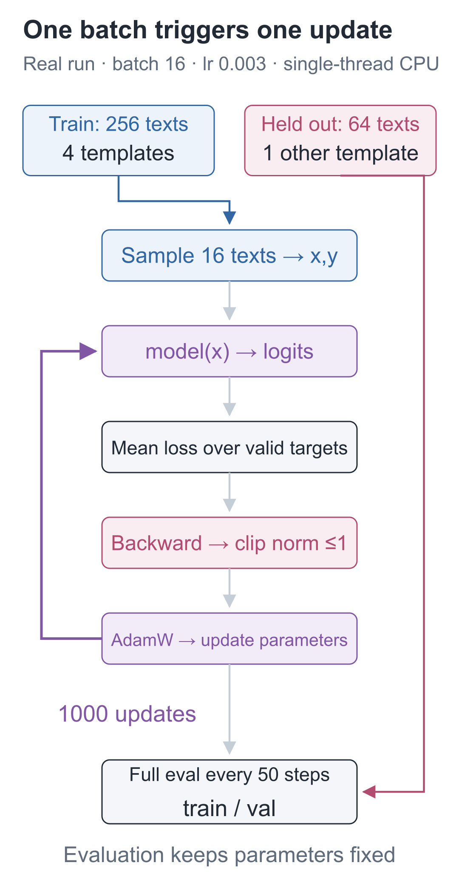
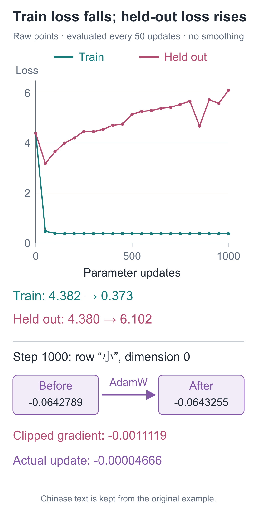

# 17 | Pretraining: Why Can New Questions Get Worse as Training Questions Improve?

Build a Small Model, Understand Large Models · Lesson 17

Given “早上，小丁喜欢” (“In the morning, Xiaoding likes”), the model can now continue with “红色的苹果。” (“red apples”). After 1,000 updates, this small model with 92,352 parameters lowered its training loss from **4.382247** to **0.372600**.

Yet on another set of questions using the same people, fruits, and colors, loss rose from **4.379960** to **6.101809**. The model became more familiar with expressions seen in training while doing worse on this held-out set. To understand the difference, we must first inspect the actual sentences.

## First Check How the Two Sets Differ

The corpus contains 8 people, each associated with a fixed color and fruit, plus 8 scenes. Xiaoding is associated with red apples, and Xiaozhou with yellow bananas. These facts are the same in the training and held-out groups.

The training set uses four complete sentence templates:

`早上，小丁喜欢红色的苹果。`

“In the morning, Xiaoding likes red apples.”

`早上，小丁拿着红色的苹果。`

“In the morning, Xiaoding is holding red apples.”

`早上，小丁说：我爱吃苹果。`

“In the morning, Xiaoding says: I love eating apples.”

`早上，小丁选了苹果，它是红色的。`

“In the morning, Xiaoding chose an apple; it is red.”

Each template combines 8 scenes and 8 people, producing `4×8×8=256` records. One other template is held out in its entirety:

`早上，红色的苹果放在小丁面前。`

“In the morning, red apples are placed in front of Xiaoding.”

This yields `1×8×8=64` records. The people and fruit facts are shared across the groups; the complete sentence patterns differ. Splitting happens before text encoding, and held-out records never participate in backpropagation or parameter updates. The Chinese strings above remain the actual experimental data; their English glosses are explanatory only.

A character-by-character comparison reveals that “在”, “面”, and “前”—characters used in the phrase “in front of”—never occur in the pretraining training text. They are in the vocabulary, but no training examples teach these usages. The held-out set therefore changes both sentence structure and character usage; it cannot isolate the model's ability to recombine sentence patterns.

As in Lesson 9, training converts text into next-character inputs and labels. Repeatedly solving these tasks from random parameters is what we call pretraining here.



## First Confirm That the Parameters Can Learn

Poor held-out performance could arise from a broken training pipeline, so check that possibility first. Before the main run, the program takes an independent copy of the random model and repeatedly updates it on four fixed longer records, checking whether it can learn even this small set.

After 240 actual updates, loss drops from **4.403622** to **0.083572**, and only then does the full experiment begin. Full training starts from the original initialization; it does not inherit the four-record updates.

All four records begin with “早上，小”, but continue with “丁”, “周”, “陈”, or “李”, completing different names. The same prefix has several valid continuations. Under that identical condition, the model cannot assign 100% probability to all four characters at once. Even if it memorizes the remaining text, the average loss need not reach zero.

## How One Batch Updates the Parameters

Take a batch of text, compute logits and mean cross-entropy over valid labels, backpropagate to obtain gradients, and let the optimizer change the parameters. The order is the same as in Lesson 06.

Below is the core training step from the project, omitting additional logging fields:

```python
import torch
from tiny_lm.losses import token_loss

def one_update(model, x, y, optimizer):
    """Update parameters once using a batch of x/y [B,T]; return the loss and gradient norm before clipping."""
    # train switches model mode without updating parameters; clear the previous gradients first.
    model.train()
    optimizer.zero_grad(set_to_none=True)
    # logits are [B,T,V]; score next-token targets, ignoring padded positions labeled -100.
    logits = model(x)
    loss = token_loss(logits, y)
    # Backpropagation only computes gradients; then clip all gradients by a shared factor based on their total norm.
    loss.backward()
    norm_before_clip = torch.nn.utils.clip_grad_norm_(
        model.parameters(), max_norm=1.0)
    # This actually changes parameters; AdamW also uses its stored gradient history.
    optimizer.step()
    # loss comes from the forward pass before the update; detach removes gradient tracking for logging.
    return float(loss.detach()), float(norm_before_clip)
```

`zero_grad` clears gradients accumulated in the previous step; `backward` computes how this loss changes with each parameter; `step` performs the parameter update.

In the [full training replay](https://daviddingxu.github.io/hello-llm/chapters/20-full-workflow/training-replay.en.html), expand the actual first batch's 235 valid targets, inspect the loss, gradients, and one parameter update step by step, then move through the training progress saved in the original log.

Gradient clipping is new here and occurs after backpropagation but before the update. Treat all parameter gradients as one long vector. If its length exceeds 1, scale all entries down by the same factor; otherwise leave them unchanged. The returned value is the length before clipping, not the model's loss. Clipping limits the scale of the gradients sent to the optimizer in one step; it does not guarantee that every subsequent loss will decrease.

The SGD used earlier adjusts parameters directly from the current gradient. This experiment uses AdamW, which also stores gradient history to adjust coordinate-wise update scales and applies weight decay. Its actual update cannot be reduced to “current gradient times learning rate.” The optional section later works through these records with one number.

## Every 50 Steps, Evaluate the Same Two Full Sets Again

Each update randomly selects 16 training records. A batch may happen to be easy, so its loss cannot represent the whole model. Every 50 steps, we therefore evaluate all 256 training records and all 64 held-out records again. One step is one parameter update, not one complete pass over the data.

The following function reuses the project's batch construction and evaluation. Defining it does not begin training; calling it runs the requested number of steps.

```python
import random
from tiny_lm.data import make_pretrain_batch
from tiny_lm.train import evaluate

def fit(model, tokenizer, train_records, val_records, steps=1000):
    """Update the supplied model and return training/held-out losses at checkpoints; held-out records never enter updates."""
    # Fix the sampling order; initialize model parameters before calling this function.
    sampler = random.Random(42)
    optimizer = torch.optim.AdamW(
        model.parameters(), lr=.003, betas=(.9, .99),
        eps=1e-8, weight_decay=.01)

    def batches(records):
        """Make batches of at most 16 records, with shifted targets, EOS, and right padding."""
        return [make_pretrain_batch(records[i:i + 16], tokenizer)
                for i in range(0, len(records), 16)]

    train_batches, val_batches = batches(train_records), batches(val_records)
    # Evaluate at step 0. evaluate disables gradient tracking and never calls the optimizer, so parameters stay unchanged.
    history = [(0, evaluate(model, train_batches),
                evaluate(model, val_batches))]
    for step in range(1, steps + 1):
        # Sample only training records; one step is one update, not a full pass through all records.
        selected = sampler.sample(train_records, min(16, len(train_records)))
        x, y = make_pretrain_batch(selected, tokenizer)
        one_update(model, x, y, optimizer)
        if step % 50 == 0 or step == steps:
            # Score both groups without updating; evaluate weights full-dataset loss by valid target counts.
            history.append((step, evaluate(model, train_batches),
                            evaluate(model, val_batches)))
    return history
```

`evaluate` disables gradient recording and never calls the optimizer. Scoring uses the same next-character tasks: every position is conditioned on the original sentence's true prefix and scores the true next character. Only during free generation below do we feed the model's own selected characters back into the input.

Batches may contain different numbers of valid labels. Full-dataset loss must therefore be weighted by valid token count; averaging batch means equally would be incorrect.

## After Step 50, the Curves Diverge

At step 50, both sets perform better than at initialization. With further updates, training loss quickly approaches 0.37, while held-out loss begins rising:

| Updates | Full training-set loss | Full held-out-set loss |
| --- | --- | --- |
| 0 | 4.382247 | 4.379960 |
| 50 | 0.470787 | 3.184155 |
| 250 | 0.375552 | 4.466297 |
| 500 | 0.372099 | 5.144143 |
| 1,000 | 0.372600 | 6.101809 |



The successful continuation at the opening is consistent with the training curve: it uses an expression the model repeatedly practiced. The other curve shows that this particular held-out set did not continue improving. It does not tell us how much of the result comes from changed sentence structure versus characters absent from the training text.

We can perform a more targeted check. Keep the same people, facts, and scenes, but construct 64 additional sentences such as `早上，小丁爱吃红色的苹果。` (“In the morning, Xiaoding loves eating red apples”). None of the complete sentences appeared in training, but every character did. Load the existing weights and evaluate without further updates:

| Fixed weights | Loss on these new combinations |
| --- | --- |
| Random initialization | 4.376142 |
| After pretraining | 1.894270 |

Loss decreases on these new combinations, so the original held-out result cannot be summarized as “all new sentence patterns fail.” However, this new template was selected after seeing the original results. It probes an explanation and is not a test score from a set reserved in advance. The [follow-up record](https://github.com/DavidDingXu/hello-llm/blob/main/code/artifacts/validation_probe.json) preserves all 64 actual inputs and the scoring definition; recompute it with `python -m lessons.validation_probe`.

For a perfectly uniform distribution over 79 candidates, one correct label has loss `ln79≈4.369448`. This is a mathematical reference value. The measured random-initialization loss is 4.382247 in the table, and the two should not be conflated.

## Now Inspect What It Actually Continues With

Check four fixed prompts. At every step, choose the highest-probability character, generating at most 8 new tokens. In the table, `\n` denotes a newline.

| Prompt | Continuation at random initialization | Continuation after pretraining |
| --- | --- | --- |
| `早上，小丁喜欢` | 色檬葡最爱梨吴爱 | 红色的苹果。 |
| `晚上，小周拿着` | 吃何梨草果草果草 | 黄色的香蕉。 |
| `问：小丁喜欢什么水果？\n答：` | 爱红绿吃爱梨吴爱 | 我爱吃香蕉。 |
| `问：小周喜欢什么水果？\n答：` | 爱红檬果爱梨吴爱 | 我爱吃香蕉。 |

The second prompt means “In the evening, Xiaozhou is holding”; its trained continuation is “yellow bananas.” The last two prompts ask which fruit Xiaoding or Xiaozhou likes, using “Question: … Answer:”. The random outputs are preserved as generated, including their nonsensical combinations.

The model can continue familiar color-and-fruit sentences. But when the prefix switches to question-and-answer format, it continues writing “我爱吃……” (“I love eating…”). Both outputs say “I love eating bananas,” instead of supplying the expected color-and-fruit answers. The trained parameters still cannot handle these question-and-answer prefixes correctly.

## Run the Experiment Yourself

This run took place on 2026-10-23 and used Python 3.12.14, PyTorch 2.9.1, macOS 26.5.1 arm64, single-threaded CPU execution, float32, and seed 42. The learning rate was 0.003; AdamW used `betas=(0.9, 0.99)`, `eps=10⁻⁸`, and weight decay 0.01, with gradient norm capped at 1. The training loop and evaluations within it took approximately **3.94 seconds**, excluding installation, imports, the four-record check, and plotting.

To inspect these results from the `code` companion code directory:

```bash
# Inspect the saved experiment without retraining the model.
python -m lessons.l17 --inspect
```

To retrain from random parameters and write your own output to a new path:

```bash
# Pretrain from random parameters and save your results in the specified directory.
python -m lessons.l17 --out artifacts/my_run --pretrain-steps 1000
```

The program saves the initial and pretrained models, vocabulary, configuration, and logs in the chosen directory, along with the four datasets actually used in that run under its `data/` subdirectory. Later inspection or replay can verify this snapshot. Retraining does not overwrite the original data at the repository root. The current weight files do not store AdamW's optimizer state. They support subsequent generation and starting a new fine-tuning run, but cannot resume an interrupted AdamW run step for step.

Use the same virtual-environment interpreter that installed the dependencies. Replace `python` above with `.venv/bin/python` on macOS/Linux, or `.\.venv\Scripts\python.exe` in Windows PowerShell. See the [companion instructions](https://github.com/DavidDingXu/hello-llm/blob/main/code/README.md) for installation commands. The results in this chapter were recorded on the macOS environment above. A Windows retraining record for this data version is not provided. See the [experiment record](https://github.com/DavidDingXu/hello-llm/blob/main/code/EXPERIMENTS.md) for the scope of those runs.

<details class="optional" markdown="1">
<summary>Optional: what does AdamW remember beyond SGD?</summary>

Each parameter coordinate has two records: `m`, a smoothed record of the gradient, and `v`, a smoothed record of its square. This experiment uses:

**m_t=0.9m_(t−1)+0.1d_t**

**v_t=0.99v_(t−1)+0.01d_t²**

`d_t` is the current gradient, and `t` is the update count. Start with a hand calculation: both records begin at 0, and the first gradient is 0.5. Then `m₁=0.05` and `v₁=0.0025`. Mixing in the initial 0 makes these too small. At the first step, dividing by `1−0.9` and `1−0.99` respectively restores `0.5` and `0.25`.

At step t, divide by `1−0.9ᵗ` and `1−0.99ᵗ` to obtain corrected values `m̂` and `v̂`. The update direction uses `m̂/(√v̂+eps)`. In the first-step example, ignoring the tiny eps gives `0.5/√0.25=1`. Multiplying by learning rate 0.003 produces a change of approximately 0.003, already different from SGD's `0.003×0.5`.

AdamW also separately shrinks parameters toward 0 according to the learning rate and weight-decay coefficient. The first-step hand calculation above omits that contribution. See [PyTorch's AdamW definition](https://docs.pytorch.org/docs/2.9/generated/torch.optim.AdamW.html) for the complete rule.

At update 1,000, the actual log tracks the first coordinate of the Embedding row for “小”, the first character in our Chinese names:

| Observation | Measured value |
| --- | --- |
| Before update | −0.064278878 |
| Current gradient after clipping | −0.001111889 |
| After update | −0.064325534 |
| Actual change | −0.000046656 |

This change uses history accumulated in earlier steps. The table displays only one parameter; all parameter groups are still updated together.

</details>

## Two Prediction Questions

1. During evaluation, one batch has 2 valid targets and mean loss 0.2; another has 8 valid targets and mean loss 0.8. Is the combined mean loss 0.5? Would adding more unscored PAD positions change it?
2. Training loss at step 500 is much lower than at step 50, but held-out loss is much higher. Can we declare that “the model is better overall”?

<details class="answer" markdown="1">
<summary>Reference answers</summary>

For question one, weight by the number of valid targets: `(0.2×2+0.8×8)/(2+8)=0.68`. Averaging the two batch means equally overweights the smaller batch. Unscored PAD positions add neither loss nor valid targets, so the result is unchanged. For question two, the model fits the training set better but predicts this held-out set worse, and that set also contains characters absent from the training text. A claim of improvement must specify the questions and scoring method being compared. One curve or one successful continuation cannot represent every task.

</details>

Code and training records: [Lesson runner](https://github.com/DavidDingXu/hello-llm/blob/main/code/lessons/l17.py) · [Complete run record](https://github.com/DavidDingXu/hello-llm/blob/main/code/EXPERIMENTS.md) · [Raw pretraining log](https://github.com/DavidDingXu/hello-llm/blob/main/code/artifacts/first_run/pretrain_log.json).

Source navigation: [train.py · train_step](https://github.com/DavidDingXu/hello-llm/blob/main/code/tiny_lm/train.py#L30) · [train.py · run_pretrain](https://github.com/DavidDingXu/hello-llm/blob/main/code/tiny_lm/train.py#L122).

<!-- chapter-navigation:start -->

---

[← The complete forward pass](../16-transformer/README.en.md) · [Contents](../../README.en.md#course-contents) · [Character-by-character generation →](../18-generation/README.en.md)

<!-- chapter-navigation:end -->
