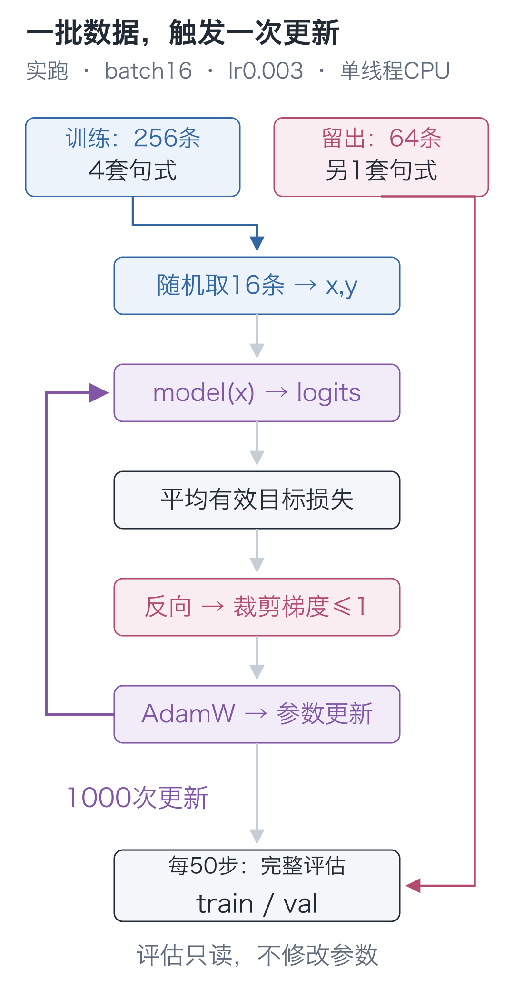
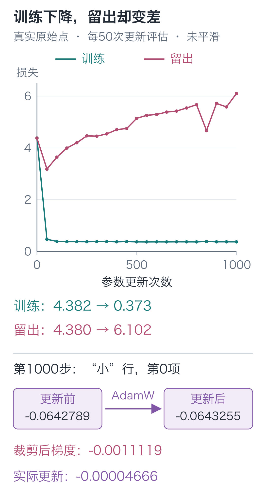

# 17｜预训练：训练题熟了，新题为什么更差？

手写小模型，看懂大模型 · 第 17 讲

输入“早上，小丁喜欢”，模型已经会接上“红色的苹果。”。1,000 次更新后，这个 92,352 参数的小模型，训练损失从 **4.382247** 降到了 **0.372600**。

可另一组使用同样人物、水果和颜色的题，损失却从 **4.379960** 升到 **6.101809**。训练里见过的表达更熟了，这组留出题却做得更差。两组到底差了什么，必须先检查原句。

## 先查两组题究竟差在哪里

语料里有 8 个人物，各自对应固定颜色与水果，另有 8 个场景。小丁对应红色的苹果，小周对应黄色的香蕉；这些事实在训练组和留出组都相同。

训练集用四种完整句式生成文本：

`早上，小丁喜欢红色的苹果。`

`早上，小丁拿着红色的苹果。`

`早上，小丁说：我爱吃苹果。`

`早上，小丁选了苹果，它是红色的。`

每种句式组合 8 个场景与 8 个人物，得到 `4×8×8=256` 条记录。另一种句式整组留出：

`早上，红色的苹果放在小丁面前。`

共 `1×8×8=64` 条。两组的人物与水果事实相同，完整句式不同。切分发生在文本编码之前，留出记录不参与反向与更新。

逐字比较还会发现，留出句里的“在、面、前”没有在预训练用的正文里出现过。它们已经编入词表，却没有这些用法的训练样本。因此，这组题同时改变了句式和字符使用，不能单独用来判断它是否会重组句式。

训练仍按第九讲，把文本变成下一字输入与标签；从随机参数反复做这种题，就是这里的预训练。



## 先确认参数真的学得动

看到留出结果不好，先排除训练链路本身出了错。这次正式训练之前，程序拿随机模型的独立副本，固定四条较长记录重复更新，检查它能否连这一小组题都学下来。

实际执行 240 次更新，损失从 **4.403622** 降到 **0.083572**，这才进入全量实验。全量训练仍从原始初值开始，没有继承这四条记录的更新。

这四条记录都以“早上，小”开头，后面却分别接“丁、周、陈、李”。同一前缀对应多个合法续写，模型不能在这个相同条件下同时给四个字百分之百的概率。因此，即使后面的文字都记住了，平均损失也不要求降为零。

## 一批数据怎样更新参数

取一批文本，计算 logits 和有效标签的平均交叉熵，反向得到梯度，再让优化器修改参数。这个顺序与第06讲相同。

下面是工程中训练步骤的核心，省去额外的日志字段：

```python
import torch
from tiny_lm.losses import token_loss

def one_update(model, x, y, optimizer):
    """用一批 x/y [B,T] 更新参数一次，返回损失值与裁剪前的梯度长度。"""
    # train 切换模型模式，本身不更新参数；先清掉上次留下的梯度。
    model.train()
    optimizer.zero_grad(set_to_none=True)
    # logits 为 [B,T,V]；损失取下一字标签，忽略值为 -100 的填充位置。
    logits = model(x)
    loss = token_loss(logits, y)
    # 反向仅计算梯度，接着按所有参数梯度的总长度做统一比例裁剪。
    loss.backward()
    norm_before_clip = torch.nn.utils.clip_grad_norm_(
        model.parameters(), max_norm=1.0)
    # 真正修改参数的语句；AdamW 还会使用自己保存的梯度历史。
    optimizer.step()
    # loss 来自更新前的这次前向，detach 只为记录数值而脱离计算图。
    return float(loss.detach()), float(norm_before_clip)
```

`zero_grad` 清掉上一步积累的梯度；`backward` 算本次损失对各参数的变化率；`step` 执行参数更新。

在[训练全过程回放](https://daviddingxu.github.io/hello-llm/chapters/20-full-workflow/training-replay.html)中，可以展开真实首批的235个有效目标，逐步核对损失、梯度与一个参数的更新，再滑动查看原日志记录的训练进展。

新增的裁剪发生在反向之后、更新之前。把所有参数梯度看成一个长向量，若其长度超过 1，就按同一比例缩小；否则保留。返回值是裁剪前的长度，不能误读成模型的损失。裁剪限制单次送给优化器的梯度尺度，并不保证后面的每次损失都下降。

前面用过的SGD按当前梯度直接调整参数。本实验选择AdamW，它额外保留历史梯度，用来调整各坐标的更新尺度，并执行权重衰减。因此它的实际更新量不能简单写成“本次梯度乘学习率”。文末选读会用一个数展开这些记录。

## 每50步，重新考同样两组题

每次随机选 16 条训练记录更新，某一批可能碰巧容易，不能用它的损失代表整个模型。因此，每 50 步都重新考完整的 256 条训练题和 64 条留出题。一步是一次参数更新，不等于遍历完整数据一遍。

下面的函数复用工程中的批次构造与评估。定义函数不会启动训练，调用时才执行指定步数。

```python
import random
from tiny_lm.data import make_pretrain_batch
from tiny_lm.train import evaluate

def fit(model, tokenizer, train_records, val_records, steps=1000):
    """更新传入的模型，返回各检查步的训练/留出损失；留出记录不参与更新。"""
    # 固定抽样顺序；模型的初始参数应在调用此函数前建立。
    sampler = random.Random(42)
    optimizer = torch.optim.AdamW(
        model.parameters(), lr=.003, betas=(.9, .99),
        eps=1e-8, weight_decay=.01)

    def batches(records):
        """按最多 16 条分批；每批包含错位标签、EOS 与右侧填充。"""
        return [make_pretrain_batch(records[i:i + 16], tokenizer)
                for i in range(0, len(records), 16)]

    train_batches, val_batches = batches(train_records), batches(val_records)
    # 第 0 步先评分。evaluate 关闭梯度记录且不调用优化器，参数不会改变。
    history = [(0, evaluate(model, train_batches),
                evaluate(model, val_batches))]
    for step in range(1, steps + 1):
        # 仅从训练组抽题；一步指一次更新，不是完整遍历一遍所有记录。
        selected = sampler.sample(train_records, min(16, len(train_records)))
        x, y = make_pretrain_batch(selected, tokenizer)
        one_update(model, x, y, optimizer)
        if step % 50 == 0 or step == steps:
            # 两组都只评分；完整数据损失由 evaluate 按有效标签数加权。
            history.append((step, evaluate(model, train_batches),
                            evaluate(model, val_batches)))
    return history
```

这里的 `evaluate` 关闭梯度记录，不调用优化器。评分沿用下一字训练题：每个位置以原句的真实前缀为条件，为真实下一字打分；下文自由续写时，才把模型自己选出的字接回输入。

不同批次有效标签数可能不同，因此完整数据损失按有效 token 数加权，不能把各批次的平均数不加区分地再平均。

## 第50步之后，两条线分开了

第 50 步时，两组题都比初始时做得好。继续更新后，训练损失很快接近 0.37，留出损失却开始上升：

| 更新次数 | 完整训练集损失 | 完整留出集损失 |
| --- | --- | --- |
| 0 | 4.382247 | 4.379960 |
| 50 | 0.470787 | 3.184155 |
| 250 | 0.375552 | 4.466297 |
| 500 | 0.372099 | 5.144143 |
| 1,000 | 0.372600 | 6.101809 |



开头那段成功续写与训练曲线并不冲突：它使用了模型反复学过的表达。另一条线说明这组留出题没有随训练继续改善；它还不能告诉我们，句式变化与训练正文未出现的字符各自造成了多少影响。

可以再做一次针对性检查：保持人物事实和场景不变，额外拼出`早上，小丁爱吃红色的苹果。`这一类64条句子。完整句子都没参加过训练，但每个字符都在训练正文里出现过。读取原来的权重，只评分，不再更新：

| 固定权重 | 这组新组合的损失 |
| --- | --- |
| 随机初值 | 4.376142 |
| 预训练后 | 1.894270 |

这组新组合的损失下降了，不能把原先的留出结果概括成“换句式都不会”。不过，新模板是在看过原成绩后补选的，只用来检查解释，不能当作事先保留的测试成绩。[补查记录](https://github.com/DavidDingXu/hello-llm/blob/main/code/artifacts/validation_probe.json)保存了64条实际输入与评分口径，可用`python -m lessons.validation_probe`重算。

79 个候选完全均匀时，单个正确标签的损失为 `ln79≈4.369448`。这是数学参考值，实测随机初始损失是上表中的 4.382247，两者不能混写。

## 再看它实际接出了什么

再检查四个固定提示词的续写。每次都选最高概率字符，最多新增 8 个 token。表中 `\n` 表示换行。

| 提示词 | 随机初值续写 | 预训练后续写 |
| --- | --- | --- |
| `早上，小丁喜欢` | 色檬葡最爱梨吴爱 | 红色的苹果。 |
| `晚上，小周拿着` | 吃何梨草果草果草 | 黄色的香蕉。 |
| `问：小丁喜欢什么水果？\n答：` | 爱红绿吃爱梨吴爱 | 我爱吃香蕉。 |
| `问：小周喜欢什么水果？\n答：` | 爱红檬果爱梨吴爱 | 我爱吃香蕉。 |

它能接出熟悉的颜色水果句子，换到“问：……答：”却又继续写起“我爱吃……”。训练后的参数还不能正确处理这些问答前缀。

## 自己运行这次实验

本轮实验于2026-10-23运行，环境为 Python 3.12.14、PyTorch 2.9.1，macOS 26.5.1 arm64，CPU 单线程、float32，种子 42。学习率 0.003，AdamW 的 `betas=(0.9, 0.99)`、`eps=10⁻⁸`、权重衰减 0.01，梯度范数上限 1。训练循环及循环内评估约 **3.94 秒**，不含安装、导入、四条记录检查与制图。

在 `code` 目录只查看这次结果：

```bash
# 查看已保存的实验记录，不重新训练模型。
python -m lessons.l17 --inspect
```

从随机参数重新训练，把自己的输出写到新路径：

```bash
# 从随机参数开始预训练，将自己的结果保存到指定目录。
python -m lessons.l17 --out artifacts/my_run --pretrain-steps 1000
```

程序在指定目录保存初值与预训练模型、词表、配置和日志，并把本次实际使用的四组数据保存到该目录的`data/`。之后查看或回放这次实验，可以核对这份快照；重新训练不会覆盖仓库根目录的原始数据。当前权重文件没有保存 AdamW 的优化器状态，适合后面的生成与另起一轮微调，不能据此逐步恢复被中断的同一次 AdamW 训练。

上面的 `python` 指安装依赖时使用的虚拟环境解释器：macOS / Linux 替换为 `.venv/bin/python`，Windows PowerShell 替换为 `.\.venv\Scripts\python.exe`。安装命令见[配套说明](https://github.com/DavidDingXu/hello-llm/blob/main/code/README.md)。本节的训练数值来自上述 macOS 环境；尚未提供同版实验在 Windows 上的重训记录。具体运行范围见[实验记录](https://github.com/DavidDingXu/hello-llm/blob/main/code/EXPERIMENTS.md)。

<details class="optional" markdown="1">
<summary>选读：AdamW比SGD多记了什么</summary>

每个参数坐标有两份记录：`m` 平滑记录梯度，`v` 平滑记录梯度的平方。本实验的比例为：

**m_t=0.9m_(t−1)+0.1d_t**

**v_t=0.99v_(t−1)+0.01d_t²**

`d_t` 是本次梯度，`t` 是更新次数。先用一个手算例子：两份记录从0开始，第一次梯度为0.5，则 `m₁=0.05`，`v₁=0.0025`。这两个数混入了初始的0，还偏小；首步分别除以 `1−0.9` 和 `1−0.99`，才回到 `0.5` 与 `0.25`。

第t步相应除以 `1−0.9ᵗ` 与 `1−0.99ᵗ`，得到修正后的 `m̂、v̂`。更新方向用 `m̂/(√v̂+eps)`。刚才的首步忽略极小的eps，便是 `0.5/√0.25=1`；乘学习率0.003，产生约0.003的改变量。这已经不同于SGD的 `0.003×0.5`。

AdamW还单独按学习率与权重衰减系数，让参数向0收缩。上面的首步手算暂未计入这部分，完整规则见[PyTorch的AdamW定义](https://docs.pytorch.org/docs/2.9/generated/torch.optim.AdamW.html)。

真实日志第1,000步跟踪了Embedding中“小”这一行的第一个坐标：

| 观察项 | 实测值 |
| --- | --- |
| 更新前 | −0.064278878 |
| 本次裁剪后梯度 | −0.001111889 |
| 更新后 | −0.064325534 |
| 实际变化 | −0.000046656 |

这个变化用到了前面各步留下的历史记录。表格只展示一项参数，整组参数仍在一起更新。

</details>

## 两道预测题

1. 评估时，第一批有2个有效目标，平均损失为0.2；第二批有8个有效目标，平均损失为0.8。合起来的平均损失是0.5吗？多补几个不计分的PAD会改变它吗？
2. 第 500 步的训练损失比第 50 步低很多，留出损失却高很多。能够据此宣布“模型整体变好”吗？

<details class="answer" markdown="1">
<summary>参考答案</summary>

答案：第一题，应按有效目标数加权：`(0.2×2+0.8×8)/(2+8)=0.68`。直接平均两个批次的均值，会把小批次算得过重。不计分的PAD既不增加损失总和，也不增加有效目标数，所以结果不变。第二题，训练集拟合更好了，但指定留出组的预测更差；这组题还同时包含训练正文未见字符。判断进步要说明在哪组题、按什么口径比较，挑一条曲线或成功续写都不足以代表所有任务。

</details>

代码与训练记录：[运行入口](https://github.com/DavidDingXu/hello-llm/blob/main/code/lessons/l17.py) · [完整运行记录](https://github.com/DavidDingXu/hello-llm/blob/main/code/EXPERIMENTS.md) · [预训练原始日志](https://github.com/DavidDingXu/hello-llm/blob/main/code/artifacts/first_run/pretrain_log.json)。

源码导航：[train.py · train_step](https://github.com/DavidDingXu/hello-llm/blob/main/code/tiny_lm/train.py#L30) · [train.py · run_pretrain](https://github.com/DavidDingXu/hello-llm/blob/main/code/tiny_lm/train.py#L122)。

<!-- chapter-navigation:start -->

---

[← 完整模型前向](../16-transformer/README.md) · [课程目录](../../README.md#课程目录) · [逐字生成 →](../18-generation/README.md)

<!-- chapter-navigation:end -->
