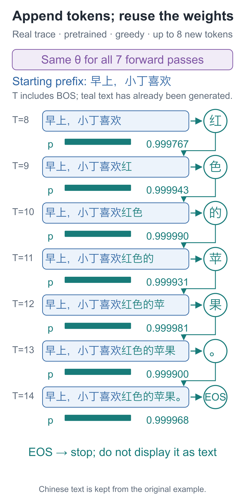
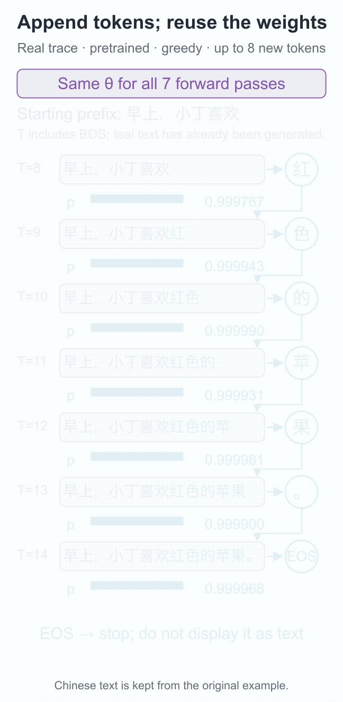
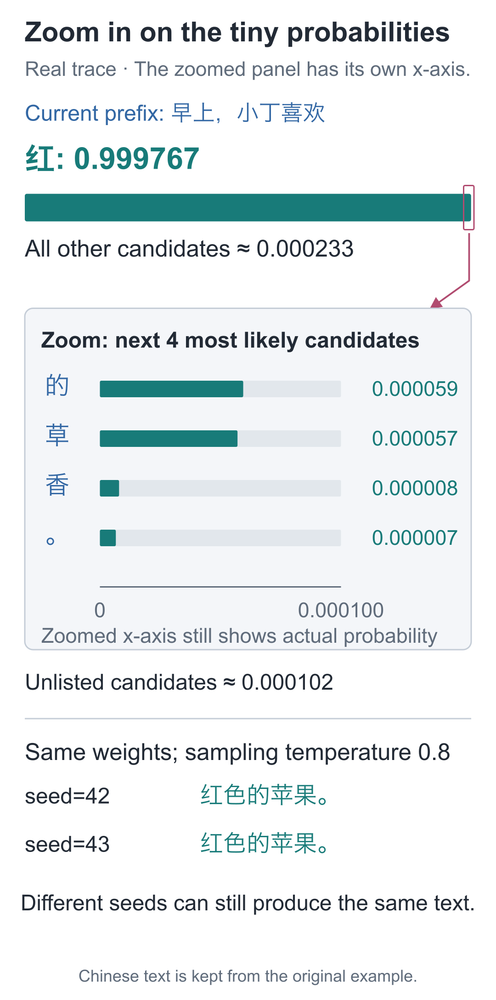
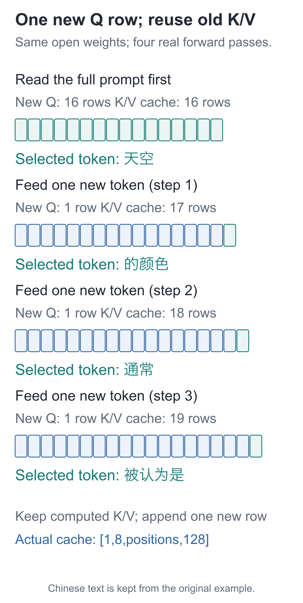

# 18 | Generation: How Many Choices Does One Sentence Take?

Build a Small Model, Understand Large Models · Lesson 18

“红色的苹果。” (“red apples”) appears on screen as six visible characters, yet the program makes **seven choices**. The final choice is not a displayed character but the end marker, EOS.

All seven choices use the same pretrained weights. Each selected character is appended to the input. After choosing “红”, the model predicts “色” from the new prefix that now includes “红”; together, “红色” means “red.”

Fix the prompt as `早上，小丁喜欢` (“In the morning, Xiaoding likes”) and record the prefix, chosen character, and stopping reason at each step.

## Which Row Do We Take from the First Forward Pass?

The prompt has 7 characters, giving 8 positions after BOS is added. The model returns `[1, 8, 79]`. This does not mean it has already scored eight future characters. Position 0, containing BOS, predicts “早”; position 1 predicts “上”; and so on. The targets corresponding to the earlier rows already appear in the prompt.

The last position contains “欢”. It can read the whole known prompt, and its scores correspond to the next character we do not yet have. After receiving `[1, 8, 79]`, take:

```python
import torch
from tiny_lm.checkpoint import load_checkpoint

# Load pretrained parameters, vocabulary, and configuration; later forward passes use these saved parameters.
model, tokenizer, _ = load_checkpoint("artifacts/first_run/pretrain.pt")
# One sample: BOS plus seven prompt characters gives known context of shape [1,8].
inputs = torch.tensor([tokenizer.encode("早上，小丁喜欢", add_bos=True)])
# The model returns [1,8,79]; use only the final position to predict the next unseen item.
next_logits = model(inputs)[0, -1]  # 79 scores
print(next_logits.shape)  # torch.Size([79])
```

This loads the author's supplied `first_run/pretrain.pt`, allowing you to verify the seven-step values in this lesson. If you have completed Lesson 17's training, replace the path with `artifacts/my_run/pretrain.pt` to use your own weights. The checkpoint restores its vocabulary and configuration as well. Check the step count in your `pretrain_log.json` before comparing generation results.

`0` selects the first sample in the batch, and `−1` selects the final position. Earlier positions still contribute to the contextual computation; we simply do not use their outputs to regenerate characters already present in the prompt.



The first choice is “红”, whose ID 55 is appended to the input. The next input grows from 8 entries to 9. Its last position now contains “红”, so it predicts the following “色”.

If the first choice had been another character, that character would have to be fed back instead. We cannot take another row from the original tensor as the second new character, because that row has never seen the choice just made. Using generated results as conditions for later generation is called autoregressive generation.

## Choose the Most Probable Candidate, or Sample One?

The simplest method always chooses the highest-probability ID, called **greedy selection**. With the same parameters and input, this choice is deterministic. It compares candidates only at the current step; it does not list every possible sentence and choose the best whole sentence.

Another approach samples according to the probabilities. If three candidates have probabilities `[0.1, 0.3, 0.6]`, the last is more likely to be drawn, but the first two also have a chance. Randomness enters at the selection step; the network still performs the same forward computation.

Before sampling, we can adjust the temperature `τ`:

**p_j=exp(logit_j/τ)/Σ_k exp(logit_k/τ), τ>0**

For scores `[0, 1, 2]`, temperature 1 gives approximately `[0.0900, 0.2447, 0.6652]`; temperature 0.5 gives approximately `[0.0159, 0.1173, 0.8668]`; and temperature 2 gives approximately `[0.1863, 0.3072, 0.5065]`.

Lower temperature favors high-scoring candidates more strongly; higher temperature gives other candidates more opportunity. The parameters do not change. Only the concentration of the sampling distribution changes, so temperature cannot fix facts the model learned incorrectly. The greedy branch does not use temperature.

## Feed Each Chosen Character Back In

The loop only needs to retain the current ID sequence and repeat “forward pass, select, append.” IDs 0, 1, 2, and 3 are PAD, BOS, EOS, and UNK respectively. PAD, BOS, and UNK are forbidden outputs; EOS may be selected. Here is the algorithm as a standalone runnable function:

```python
@torch.no_grad()
def continue_text(model, tokenizer, prompt, max_new_tokens=8,
                  greedy=False, temperature=.8, seed=42):
    """Generate token by token with fixed weights; return visible text and the stop reason, recomputing the full prefix without a KV cache."""
    if max_new_tokens < 0 or (not greedy and temperature <= 0):
        raise ValueError("新增长度不能为负，采样温度必须为正")
    tokens = [1] + tokenizer.encode(prompt)  # BOS also occupies one context position.
    if 3 in tokens or len(tokens) > model.config.max_seq_len:
        raise ValueError("提示词含未知字符或超过上下文长度")
    device = next(model.parameters()).device
    # Randomness is only for sampling, not weight updates; fix the seed for comparison.
    rng = torch.Generator(device=device).manual_seed(seed)
    generated, reason = [], "max_new_tokens"
    model.eval()  # Switch to evaluation mode; the no_grad decorator above disables gradient tracking.
    for _ in range(max_new_tokens):
        # Stop at this model's 32-item limit; do not discard old characters to continue generation.
        if len(tokens) >= model.config.max_seq_len:
            reason = "context_limit"
            break
        # Recompute the full current prefix [1,T] and take the last position's [V] candidate scores.
        inputs = torch.tensor([tokens], dtype=torch.long, device=device)
        logits = model(inputs)[0, -1].clone()
        # Disallow PAD/BOS/UNK but retain EOS; forbidden items have probability 0 after normalization.
        logits[[0, 1, 3]] = float("-inf")
        # Greedy selection ignores temperature; sampling divides by temperature before Softmax over candidates.
        probabilities = (logits if greedy else logits / temperature).softmax(-1)
        if greedy:
            selected = int(probabilities.argmax())
        else:
            selected = int(torch.multinomial(probabilities, 1, generator=rng).item())
        # Append the selected item to the input so the next forward pass can use it.
        tokens.append(selected)
        if selected == 2:
            # EOS also consumes a selection step but is excluded from the returned visible text.
            reason = "eos"
            break
        generated.append(selected)
    return tokenizer.decode(generated), reason

print(continue_text(model, tokenizer, "早上，小丁喜欢", greedy=True))
# ('红色的苹果。', 'eos')
```

`argmax` takes the largest entry; `multinomial` samples an ID according to its probability. `tokens.append(selected)` adds the new character to the next forward pass's input. `@torch.no_grad()` disables backward recording, and the loop contains no parameter-updating `step()`.

The three special entries set to negative infinity receive probability zero, and all permitted outputs are normalized together. The companion `generate` function also records the top five candidates at each step and restores the model's previous mode. These bookkeeping operations do not change the selection algorithm.

This implementation recomputes the entire prefix at every step and **has no KV cache**. The context limit is 32 entries, including BOS. A longer prompt raises an error. Once the loop already has 32 entries, it stops instead of dropping old characters and continuing. A shorter prompt may stop earlier on EOS or exhaust the allowed number of new tokens.

EOS signals completion; it is not displayed text. It is recorded in the step log but omitted from the returned visible text. Thus “at most 8 new tokens” does not guarantee 8 visible characters on screen.

## Review the Seven Choices

Load the pretrained weights from Lesson 17 and use greedy selection. The log numbers these seven steps starting at 0:

| Step | Number of input IDs | Choice | Probability of that choice, approximately |
| --- | --- | --- | --- |
| 0 | 8 | 红 | 0.999767 |
| 1 | 9 | 色 | 0.999943 |
| 2 | 10 | 的 | 0.999990 |
| 3 | 11 | 苹 | 0.999931 |
| 4 | 12 | 果 | 0.999981 |
| 5 | 13 | 。 | 0.999900 |
| 6 | 14 | EOS | 0.999968 |

Each of the first six steps appends one character. At the seventh, the model reads the final period and selects EOS. These probabilities mask the three special entries, differing slightly in definition from the full 79-entry distribution in Lesson 16. The characters form “红色” (“red”), the linking particle “的”, “苹果” (“apple”), and the period “。”; their individual token boundaries remain Chinese character boundaries.



Pause step by step in the [interactive demo](https://daviddingxu.github.io/hello-llm/chapters/18-generation/walkthrough.en.html) to inspect prefixes and candidates. The static figure below expands the first choice and compares two sampling results.



The upper bar for “红” uses a 0-to-1 scale, while the enlarged lower region has an axis maximum of only 0.000100. The probabilities themselves have not changed. Bar lengths across the two regions are not directly comparable.

## Is the Model Still Learning During This Process?

Fix the pretrained weights, set temperature to 0.8, and use seeds 42 and 43. Both samples in this run produce “红色的苹果。”. The stepwise distributions are highly concentrated, so different seeds can still draw the same sequence. “Random sampling” does not mean “a different result every time.”

Compare parameter digests before and after generation to check whether parameters changed during these seven steps. The following calls the companion implementation and also obtains the step log:

```python
from tiny_lm.trace import parameter_digest
from tiny_lm.generate import generate

# Compare parameter values before and after generation; inputs grow, but parameters should remain unchanged.
before = parameter_digest(model)
result = generate(model, tokenizer, "早上，小丁喜欢", greedy=True)
assert parameter_digest(model) == before
print(result["generated_text"], result["stop_reason"])
```

The vocabulary, configuration, and parameters saved in a checkpoint must be loaded together. Pairing weights with an arbitrary character-ID table may change which character each ID represents, even when the shapes match.

Run the supplied entry point from the `code` companion code directory.

If you completed Lesson 17's training, generate with your own weights:

```bash
# Use the weights you trained and saved in Lesson 17.
python -m lessons.l18 --checkpoint artifacts/my_run/pretrain.pt --prompt '早上，小丁喜欢' --greedy
```

To verify the record in this lesson, run the following two commands with the author's weights, using greedy selection and random sampling respectively:

```bash
# Load the specified weights and generate text; this command does not update parameters.
python -m lessons.l18 --checkpoint artifacts/first_run/pretrain.pt --prompt '早上，小丁喜欢' --greedy
# Load the specified weights and generate text; this command does not update parameters.
python -m lessons.l18 --checkpoint artifacts/first_run/pretrain.pt --prompt '早上，小丁喜欢' --temperature 0.8
```

<details class="optional" markdown="1">
<summary>Optional: can we avoid rereading the entire prefix each time?</summary>

When generating the second character, we feed the entire prefix through the model again. But with fixed parameters and causal restrictions, old positions cannot read newly appended characters. Their previously computed K and V vectors at each layer can therefore be retained and reused. The new position computes its own query and reads the old cache together with the newly added K/V.

This is a KV cache. It stores intermediate results from the current generation; it does not update model parameters.

Run four actual steps with Qwen3-0.6B, the model inspected in Lesson 16, and count the inputs at each step. The first input contains all 16 tokens. Every later step inputs just 1 new token, while the first layer's cache grows to 17, 18, and 19 positions.



The four chosen tokens are “天空”, “的颜色”, “通常”, and “被认为是”, roughly “the sky,” “its color,” “usually,” and “is considered to be.” A token in this public model may span several Chinese characters, so four tokens produce more than four characters. We observed only these first four steps, not a complete answer.

At the fourth step, recomputing all 19 entries without a cache produces candidate scores whose maximum difference from the cached version is about `0.0000725`, due to floating-point rounding. Both methods select the same next token. The [original record](https://github.com/DavidDingXu/hello-llm/blob/main/code/artifacts/reference/qwen3_trace.json) stores the shapes, candidates, and parameter digests.

</details>

## Two Prediction Questions

1. If two forward passes with identical input and weights produce identical logits, why can sampled text still differ? Conversely, does identical sampled text prove no random selection occurred?
2. When temperature changes from 1 to 0.5, can another candidate become the highest-probability candidate? Can the candidate actually drawn by sampling change?

<details class="answer" markdown="1">
<summary>Reference answers</summary>

For question one, the forward pass determines the distribution, while the random process also determines which ID is drawn. The same distribution can produce different draws or repeat the same draw. For question two, dividing by a positive temperature preserves score ranking, so the largest entry stays the largest. But candidate probabilities change, so the choice associated with the same random process may change. Do not confuse the distribution's most probable candidate with the actual result of one sample.

</details>

Code and generation records: [Lesson runner](https://github.com/DavidDingXu/hello-llm/blob/main/code/lessons/l18.py) · [Generation implementation](https://github.com/DavidDingXu/hello-llm/blob/main/code/tiny_lm/generate.py) · [Step logs for all three stages](https://github.com/DavidDingXu/hello-llm/blob/main/code/artifacts/first_run/generation_comparison.json).

Source navigation: [generate.py · generate](https://github.com/DavidDingXu/hello-llm/blob/main/code/tiny_lm/generate.py#L11).

<!-- chapter-navigation:start -->

---

[← The first pretraining run](../17-pretraining/README.en.md) · [Contents](../../README.en.md#course-contents) · [Question-answer fine-tuning →](../19-fine-tuning/README.en.md)

<!-- chapter-navigation:end -->
