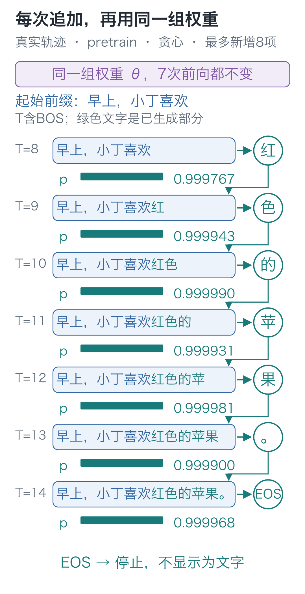
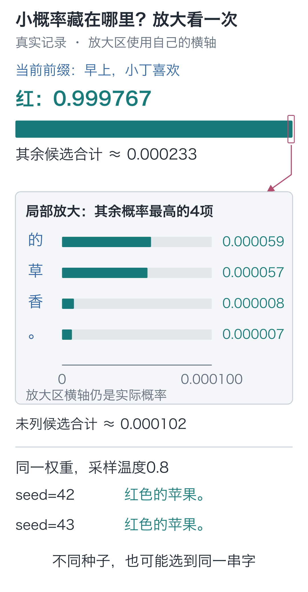
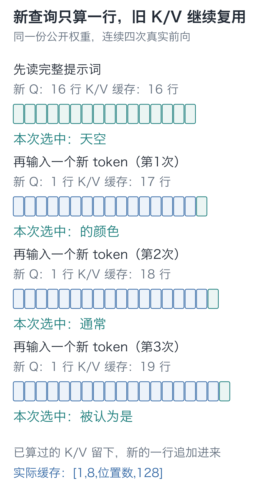

# 18｜生成：一句话究竟做了几次选择？

手写小模型，看懂大模型 · 第 18 讲

屏幕上出现“红色的苹果。”，只有六个可见字符，程序却做了**七次选择**。最后一次选出的不是字，而是结束标记 EOS。

七次选择使用同一组预训练权重。每次选出的字都会追加进输入：选出“红”以后，模型就根据带着“红”的新前文预测“色”。

下面固定提示词 `早上，小丁喜欢`，逐次记录送入的前文、选出的字符和停止原因。

## 第一次前向，要取哪一行？

提示词有 7 个字符，加 BOS 后是 8 个位置。模型会返回 `[1, 8, 79]`。这并不是已经替未来八个字打好了分：第 0 个 BOS 位置用于预测“早”，第 1 个位置用于预测“上”，依此类推，前面几行对应的目标早已出现在提示词里。

最后位置装着“欢”。它能读取整个已知提示词，输出的分数才对应我们还没拿到的下一字。因此模型返回 `[1, 8, 79]` 后，取：

```python
import torch
from tiny_lm.checkpoint import load_checkpoint

# 加载预训练参数、词表与配置；后续前向使用这份保存的参数。
model, tokenizer, _ = load_checkpoint("artifacts/first_run/pretrain.pt")
# 一个样本，BOS 加七个提示字符，形成 [1,8] 的已知前文。
inputs = torch.tensor([tokenizer.encode("早上，小丁喜欢", add_bos=True)])
# 模型输出 [1,8,79]，只取最后位置预测尚未出现的下一项。
next_logits = model(inputs)[0, -1]  # 79 项分数
print(next_logits.shape)  # torch.Size([79])
```

上面加载的是作者随课提供的`first_run/pretrain.pt`，便于核对本文的七步数值。若你已经完成第17讲的训练，把路径换成`artifacts/my_run/pretrain.pt`，就是在使用自己的权重；词表和配置会随检查点一起恢复。先看自己那次`pretrain_log.json`中的步数，再对照生成结果。

`0` 选这个批次中的第一个样本，`−1` 选最后一个位置。前面的位置仍参与上下文计算，只是这一步不拿它们的输出重复生成已经给出的字符。



第一次选中“红”，它的编号 55 被追加到输入末尾。下一次输入从 8 项变成 9 项，最后位置变成“红”，于是开始预测后面的“色”。

如果第一次选了另一个字，下一次也要把那个字带回去。不能提前拿原来张量的另一行当作第二个新字，因为那一行没有见过刚才的选择。这种将生成结果继续作为条件的方式，叫自回归生成。

## 选概率最大的，还是按概率抽一个？

最直接的方法是每次选最大概率的编号，称为**贪心选择**。在同一份参数和同一输入下，这个选择是确定的。它只比较当前这一步的候选，并没有先列出所有可能句子，再挑整句最好的。

另一种方式是按概率抽样。比如三个候选概率为 `[0.1, 0.3, 0.6]`，最后一个更容易被抽中，但前两个也有机会。随机来源在“怎样选择”这一步，网络本身仍在执行同一套前向计算。

抽样前还可以调整温度 `τ`：

**p_j=exp(logit_j/τ)/Σ_k exp(logit_k/τ)，τ>0**

对分数 `[0, 1, 2]`，温度为 1 时，概率约为 `[0.0900, 0.2447, 0.6652]`；温度为 0.5，约为 `[0.0159, 0.1173, 0.8668]`；温度为 2，约为 `[0.1863, 0.3072, 0.5065]`。

降低温度会让抽样更偏向高分项，提高温度给其他项更多机会。参数没有变化，变的是抽样分布的集中程度，也就不能靠温度修正模型记错的事实。贪心分支不使用温度。

## 选出一个字，就把它带回去

循环只需要保留当前编号序列，反复完成“前向、选字、追加”。编号 0、1、2、3 分别是 PAD、BOS、EOS、UNK；PAD、BOS、UNK 禁止输出，EOS 可以被选中。下面把算法单独写成一个可运行函数：

```python
@torch.no_grad()
def continue_text(model, tokenizer, prompt, max_new_tokens=8,
                  greedy=False, temperature=.8, seed=42):
    """固定权重逐项生成，返回可见续写与停止原因；每次重算完整前缀，无 KV cache。"""
    if max_new_tokens < 0 or (not greedy and temperature <= 0):
        raise ValueError("新增长度不能为负，采样温度必须为正")
    tokens = [1] + tokenizer.encode(prompt)  # BOS 也占一个上下文位置。
    if 3 in tokens or len(tokens) > model.config.max_seq_len:
        raise ValueError("提示词含未知字符或超过上下文长度")
    device = next(model.parameters()).device
    # 随机数只用于采样，不修改模型权重；固定种子便于对照。
    rng = torch.Generator(device=device).manual_seed(seed)
    generated, reason = [], "max_new_tokens"
    model.eval()  # 切换评估模式；不建立反向记录由上面的 no_grad 装饰器负责。
    for _ in range(max_new_tokens):
        # 达到本模型的 32 项限制就停止，不裁掉旧字符继续写。
        if len(tokens) >= model.config.max_seq_len:
            reason = "context_limit"
            break
        # 当前全部前文 [1,T] 重新前向，取最后位置的 [V] 候选分数。
        inputs = torch.tensor([tokens], dtype=torch.long, device=device)
        logits = model(inputs)[0, -1].clone()
        # 禁止输出 PAD/BOS/UNK，保留 EOS；归一化后被禁项概率为 0。
        logits[[0, 1, 3]] = float("-inf")
        # 贪心不使用温度，采样才先除以 temperature；最后沿候选轴 Softmax。
        probabilities = (logits if greedy else logits / temperature).softmax(-1)
        if greedy:
            selected = int(probabilities.argmax())
        else:
            selected = int(torch.multinomial(probabilities, 1, generator=rng).item())
        # 选择结果接回输入，下一次前向才知道刚才选了哪个字。
        tokens.append(selected)
        if selected == 2:
            # EOS 也消耗一次选择，但不加入返回的可见文本。
            reason = "eos"
            break
        generated.append(selected)
    return tokenizer.decode(generated), reason

print(continue_text(model, tokenizer, "早上，小丁喜欢", greedy=True))
# ('红色的苹果。', 'eos')
```

`argmax` 取最大项，`multinomial` 按概率抽一个编号。`tokens.append(selected)` 把新字加入下一次前向的输入。`@torch.no_grad()` 不建立反向记录，循环也没有更新参数的 `step()`。

设成负无穷的三个特殊项概率为零，其他允许输出的项一起归一化。配套 `generate` 还会记录每步前五候选、恢复调用前的模型模式，这些记录工作不改变选字算法。

本实现每次都把完整前缀重新送入模型，**没有 KV cache**。上下文最多 32 项，包含 BOS；提示词超过这个长度会报错，循环中一旦已有 32 项就停止，不裁掉旧字符再继续。较短提示词也可能提前遇到 EOS，或者用完指定的新 token 次数。

EOS 是结束信号，不是要显示的文字。它会记入步骤记录，但不会加入返回的可见文本。因此“最多新增 8 个 token”不保证屏幕上一定出现 8 个字符。

## 回看这七次选择

加载第十七讲的预训练权重，使用贪心选择。日志按从 0 开始的编号记录七步：

| 步骤 | 送入的编号数 | 本步选择 | 该选择概率，约 |
| --- | --- | --- | --- |
| 0 | 8 | 红 | 0.999767 |
| 1 | 9 | 色 | 0.999943 |
| 2 | 10 | 的 | 0.999990 |
| 3 | 11 | 苹 | 0.999931 |
| 4 | 12 | 果 | 0.999981 |
| 5 | 13 | 。 | 0.999900 |
| 6 | 14 | EOS | 0.999968 |

前六次每次添一个字，第七次读到末尾的句号，选出 EOS。表里的概率屏蔽了三个特殊项，与第十六讲完整 79 项的分布口径略有不同。


可以在[交互演示](https://daviddingxu.github.io/hello-llm/chapters/18-generation/walkthrough.html)中逐步暂停，核对前缀与候选。下面的静态图展开第一次选择，并比较两次抽样结果。



上方“红”的条形使用0到1的范围，下方放大区的横轴上限只有0.000100。概率数值本身没有变，不能跨区直接比较条长。

## 这期间，模型有没有继续学习？

先把预训练权重固定，将温度设为0.8，种子分别取42和43。本次两次采样都生成了“红色的苹果。”：各步分布很集中，不同随机种子仍可能抽到相同序列；“采用随机采样”不意味着“每次结果必然不同”。

比较生成前后的参数摘要，就能检查这七步中参数是否改变。下面调用配套实现，同时取得逐步日志：

```python
from tiny_lm.trace import parameter_digest
from tiny_lm.generate import generate

# 比较生成前后的参数值；输入会增长，参数应保持同一份。
before = parameter_digest(model)
result = generate(model, tokenizer, "早上，小丁喜欢", greedy=True)
assert parameter_digest(model) == before
print(result["generated_text"], result["stop_reason"])
```

保存文件里的词表、配置与参数必须一起加载。只拿一份权重再随便配一个字符编号表，即使形状相同，编号指向的字符也可能已经变了。

在 `code` 目录运行现成入口：

如果已完成第17讲的训练，用自己的权重生成：

```bash
# 使用第17讲亲手训练并保存的权重。
python -m lessons.l18 --checkpoint artifacts/my_run/pretrain.pt --prompt '早上，小丁喜欢' --greedy
```

要核对本文记录，则运行下面两条命令，分别使用作者权重做贪心选择和随机抽样：

```bash
# 加载指定权重并生成文字；本命令不更新参数。
python -m lessons.l18 --checkpoint artifacts/first_run/pretrain.pt --prompt '早上，小丁喜欢' --greedy
# 加载指定权重并生成文字；本命令不更新参数。
python -m lessons.l18 --checkpoint artifacts/first_run/pretrain.pt --prompt '早上，小丁喜欢' --temperature 0.8
```

<details class="optional" markdown="1">
<summary>选读：每次都重读前文，可以少算一点吗？</summary>

生成第二个字时，我们又把整个前缀送入模型。但在参数固定、因果限制成立时，旧位置不能读取后来追加的字，它们在各层已经算出的 K、V 就可以留下来复用。新位置只计算自己的查询，再读取旧缓存和新追加的 K/V。

这就是 KV cache。它保存的是这次生成的中间结果，模型参数仍然没有更新。

用第16讲观察过的 Qwen3-0.6B 实际跑四步，查看每步送入几项：第一次输入完整的 16 个 token；之后每次只输入 1 个新 token，第一层缓存的位置数依次增长为 17、18、19。



这四步选中的 token 依次是“天空”“的颜色”“通常”“被认为是”。公开模型的一个 token 可以覆盖多个汉字，四个 token 拼成的文字也比四个字长。这里只观察了开头四步，还没有生成完整回答。

第四步若改回“不用缓存、重算全部19项”，得到的候选分数与缓存版本最大相差约 `0.0000725`，来自浮点计算的舍入差异；两种方法选出的下一项相同。[原始记录](https://github.com/DavidDingXu/hello-llm/blob/main/code/artifacts/reference/qwen3_trace.json)同时保存了形状、候选和参数摘要。

</details>

## 两道预测题

1. 相同输入与权重前向两次，logits 一样，为什么采样文本仍可能不同？反过来，采样文本相同，是否说明没有调用随机选择？
2. 最高概率候选在温度从 1 改到 0.5 后，会不会变成另一个候选？抽样选中的候选有没有可能改变？

<details class="answer" markdown="1">
<summary>参考答案</summary>

答案：第一题，分布由前向计算决定，抽哪个编号还取决于随机过程；同一分布可能抽到不同项，也可能重复抽到相同项。第二题，除以正温度不改变分数排序，所以最大项保持不变；但候选概率改变了，同一随机过程对应的选择仍可能改变。不能把分布的最大项与一次抽样的实际结果混为一谈。

</details>

代码与生成记录：[运行入口](https://github.com/DavidDingXu/hello-llm/blob/main/code/lessons/l18.py) · [生成实现](https://github.com/DavidDingXu/hello-llm/blob/main/code/tiny_lm/generate.py) · [三阶段逐步日志](https://github.com/DavidDingXu/hello-llm/blob/main/code/artifacts/first_run/generation_comparison.json)。

源码导航：[generate.py · generate](https://github.com/DavidDingXu/hello-llm/blob/main/code/tiny_lm/generate.py#L11)。

<!-- chapter-navigation:start -->

---

[← 第一次预训练](../17-pretraining/README.md) · [课程目录](../../README.md#课程目录) · [问答微调 →](../19-fine-tuning/README.md)

<!-- chapter-navigation:end -->
