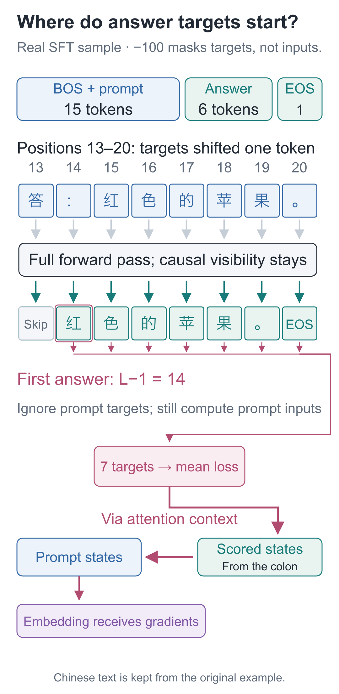
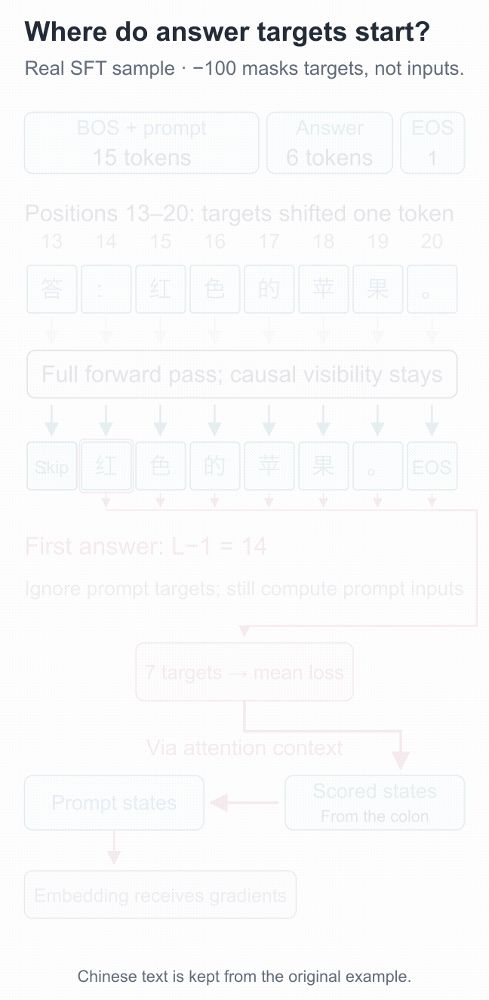
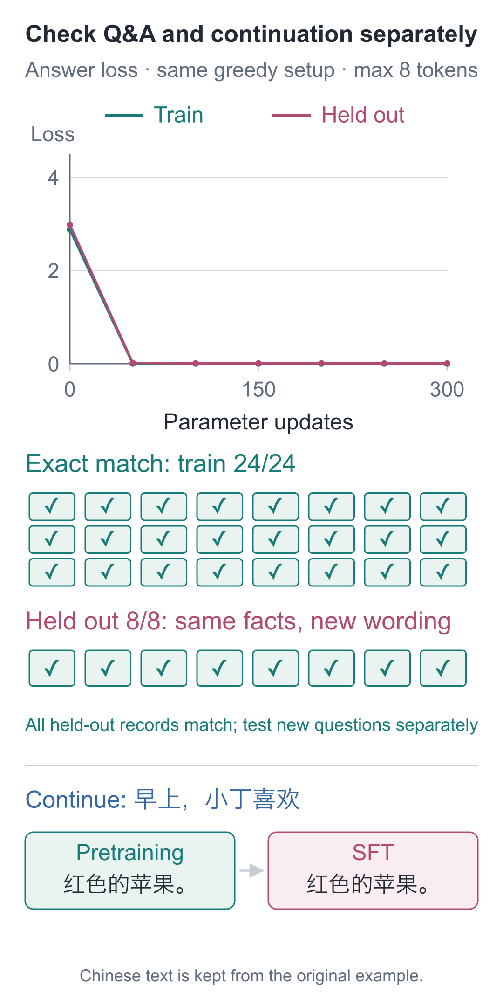
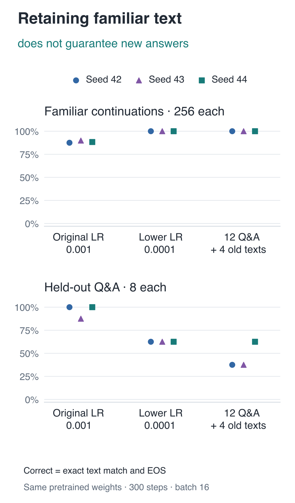

# 19 | Supervised Fine-Tuning: Why Can It Continue Text but Still Fail to Answer?

Build a Small Model, Understand Large Models · Lesson 19

Given `早上，小丁喜欢` (“In the morning, Xiaoding likes”), the pretrained model continues with “红色的苹果。” (“red apples”). Change the input to `问：小丁喜欢什么水果？\n答：` (“Question: What fruit does Xiaoding like?\nAnswer:”), and it instead writes “我爱吃香蕉。” (“I love eating bananas.”), a complete sentence with the wrong fruit and answer format.

The colors and fruits appeared in training, but a question and the beginning of a familiar sentence trigger different predictions. How can we make the model produce the answer we need after it reads “答：” (“Answer:”)?

We give the existing model 24 question-and-answer records with supplied answers and continue training. It later answers both fixed questions correctly. But an expanded continuation check finds that the familiar prefix “早上，小丁选了” (“In the morning, Xiaoding chose”) now produces “苹果，它是红色的苹果。” (“apples, they are red apples”), repeating the fruit.

Continuing training on given questions and target answers is **supervised fine-tuning, or SFT**. The model still predicts the next character. We will follow one question-answer sequence to see which positions are scored and how gradients flow back.

## Put Reading the Question and Writing the Answer in One Sequence

Expand this record:

```text
问：小丁喜欢什么水果？
答：红色的苹果。
```

Split it into two parts: prompt `问：小丁喜欢什么水果？\n答：`, and answer `红色的苹果。`. Encode them separately, then join them in this order:

**BOS + prompt + answer + EOS**

Reusing the pretraining loss over all positions would also run. But some loss terms would ask the model to start at BOS and write the question itself. At use time, the question is already supplied. Our intended training behavior is different: after reading it, write the answer and finish.

We therefore keep the full input but set labels whose next target is still inside the prompt to `−100`, excluding their direct contributions to cross-entropy.

## Which Position Should Predict “红”?

Including BOS, the full prefix contains `L=15` entries, with positions numbered from 0. The final prefix character is the colon in “答：”, at position 14.

Inputs and labels are still shifted by one: **position 14 reads the colon but already targets the first answer character, “红”.** We do not wait until “红” is the input before training the model to predict “红”.

| Input position | Current input | Next-item label | Included in loss? |
| --- | --- | --- | --- |
| 0 | BOS | 问 | No |
| 1 | 问 | ： | No |
| … | … | … | No |
| 13 | 答 | ： | No |
| 14 | ： | 红 | Yes |
| 15 | 红 | 色 | Yes |
| 16 | 色 | 的 | Yes |
| 17 | 的 | 苹 | Yes |
| 18 | 苹 | 果 | Yes |
| 19 | 果 | 。 | Yes |
| 20 | 。 | EOS | Yes |

Thus label indices `0` through `L−2` are ignored, and the first valid label is at **L−1**. This example has 6 answer characters plus EOS, totaling 7 valid targets. When right-padding to 32 entries, the added padding labels are also `−100`.

During training, when predicting “色”, the preceding “红” comes from the sample's correct answer. During generation, the program must select “红” itself and append it. Both processes read only the available prefix; the difference is who supplies that prefix.



If we ignore the first 15 labels merely because the prefix has 15 entries, we delete the task of predicting “红”. The program still runs, but the loss omits one target.

The following code lists the targets actually retained. The batch version does the same for each record, then stacks them into `[B, 32]`.

```python
import torch
from tiny_lm.tokenizer import CharTokenizer

def make_sft_example(prompt, answer, tokenizer, max_len=32):
    """Convert one question-answer record to [1,max_len] inputs and targets; score only answer characters and EOS."""
    # L=len(prefix) includes BOS and the full prompt; its last item here is the colon after “答”.
    prefix = [1] + tokenizer.encode(prompt)
    tokens = prefix + tokenizer.encode(answer) + [2]
    # This still predicts the next item: drop the final input and initial target, keeping EOS as the last valid target.
    inputs = tokens[:-1]
    targets = tokens[1:]
    # Ignore only 0..L-2; retain index L-1, where the colon predicts the first answer character.
    targets[:len(prefix) - 1] = [-100] * (len(prefix) - 1)
    if len(inputs) > max_len:
        raise ValueError("样本超过最大长度，不截断答案")
    padding = max_len - len(inputs)
    # 0 is the input PAD ID; -100 only tells the loss to ignore a target and never enters Embedding.
    inputs += [0] * padding
    targets += [-100] * padding
    return torch.tensor([inputs]), torch.tensor([targets])

tokenizer = CharTokenizer.for_course()
prompt = "问：小丁喜欢什么水果？\n答："
answer = "红色的苹果。"
x, y = make_sft_example(prompt, answer, tokenizer)
# The first answer target is at index 14 and the last valid target is EOS; other positions are not scored directly.
valid = (y[0] != -100).nonzero().flatten().tolist()
print(valid)  # [14, 15, 16, 17, 18, 19, 20]
print([tokenizer.itos[int(y[0, i])] for i in valid])
# ['红', '色', '的', '苹', '果', '。', '<eos>']
```

Training still computes all logits first; `ignore_index=-100` then decides which targets enter the average. Here, `−100` is a loss-function convention, not a vocabulary character ID, and it never enters the model input.

## Can We Remove the Unscored Question?

If the prompt is not directly scored, can we remove the question from the computation too? Without it, different questions lose the information that distinguishes them. The model must read the question to condition its answer on it.

We therefore control two things separately. The causal mask specifies **which inputs may be read**, preventing peeking at the future. The loss mask specifies **which predictions are directly scored**—only the answer and EOS in this case. Ignoring question labels does not prevent answer positions from reading the question through attention.

Backpropagation follows those reading paths too. Answer loss travels through the output head, model blocks, and attention to affect the prompt's representations and parameters. Only the scoring targets are grayed out; the Embedding is not frozen. Nor do question positions own a separate set of model parameters. Positions share attention, feed-forward, and other components, and the same character always looks up the same Embedding row.



The [interactive demo](https://daviddingxu.github.io/hello-llm/chapters/19-fine-tuning/walkthrough.en.html) reveals the inputs, shifted labels, and answer loss step by step. Compare the first answer index and gradient paths with the static figure above as well.

We can also inspect “问” (“question”), a character that appears only in this record's prompt. The following performs backpropagation only, without updating or saving weights:

```python
from tiny_lm.checkpoint import load_checkpoint
from tiny_lm.losses import token_loss

# Start from pretrained weights; check backward paths without an optimizer update.
model, tokenizer, _ = load_checkpoint("artifacts/first_run/pretrain.pt")
model.zero_grad(set_to_none=True)
loss = token_loss(model(x), y)
loss.backward()
# “问” occurs only in the prompt; answer loss can still reach this parameter row through attention to the context.
question_row = tokenizer.stoi["问"]
gradient_size = model.embedding.weight.grad[question_row].abs().sum()
print(float(gradient_size) > 0)  # True in this example
```

Although “问” is absent from this answer, its Embedding row still has a nonzero gradient: answer loss affects those parameters through the context path.

## Can It Answer a Question Format That Was Not Trained?

Checking only the questions just learned makes it difficult to distinguish memorizing a format from using the same facts in another expression. We therefore train on three question formats, each covering 8 people, for 24 records:

`小丁喜欢什么水果？`

“What fruit does Xiaoding like?”

`请说出小丁喜欢的水果。`

“Please name the fruit Xiaoding likes.”

`小丁爱吃哪种水果？`

“Which fruit does Xiaoding enjoy eating?”

The fourth format, `小丁最喜欢的水果是什么？` (“What is Xiaoding's favorite fruit?”), is held out in its entirety, yielding 8 records. It tests whether known facts about known people can be retrieved under an untrained question format, not knowledge about entirely unseen fruits.

The character “最” (“most,” as used in “favorite”) appears in neither the pretraining nor the fine-tuning training text. This set therefore checks both a new question format and a character usage absent from training. Vocabulary membership does not mean the model has learned how to use a character; the scores below describe only these specific questions.

Training starts from Lesson 17's pretrained model. All parameters continue to be updated, and a fresh optimizer is created:

```python
import random
from tiny_lm.data import make_sft_batch
from tiny_lm.train import train_step

def fine_tune(model, tokenizer, records, steps=300):
    """Continue training the loaded pretrained model on SFT records, updating all of its parameters."""
    sampler = random.Random(42)
    # Keep the model weights and create fresh optimizer state for this stage, rather than a separate question-answer model.
    optimizer = torch.optim.AdamW(
        model.parameters(), lr=.001, betas=(.9, .99),
        eps=1e-8, weight_decay=.01)
    for _ in range(steps):
        # Pass training records; make_sft_batch retains prompt inputs and scores only the answer and EOS.
        selected = sampler.sample(records, min(16, len(records)))
        x, y = make_sft_batch(selected, tokenizer)
        # train_step clears gradients, runs forward and backward, clips gradients, and finally updates with optimizer.step.
        train_step(model, x, y, optimizer, clip_norm=1.)
```

The loop does not switch to a new prediction mechanism. Gradients from the question-answer labels modify the same parameters as before, and those parameters also serve the original continuation tasks.

## Return to the Two Questions

The saved outputs at three stages are below. `\n` represents a newline:

| Prompt | Random initialization | After pretraining | After fine-tuning |
| --- | --- | --- | --- |
| `问：小丁喜欢什么水果？\n答：` | 爱红绿吃爱梨吴爱 | 我爱吃香蕉。 | 红色的苹果。 |
| `问：小周喜欢什么水果？\n答：` | 爱红檬果爱梨吴爱 | 我爱吃香蕉。 | 黄色的香蕉。 |

The prompts ask which fruit Xiaoding and Xiaozhou like. Fine-tuning produces the correct answers, “red apples” and “yellow bananas.” Before fine-tuning, both outputs say “I love eating bananas.” The table preserves every actual Chinese output, including the nonsensical random-initialization strings.

The run performs 300 updates with learning rate 0.001, in the same environment as pretraining. The loop and evaluation take approximately 0.96 seconds. Answer losses are:

| Dataset | Before fine-tuning | After fine-tuning |
| --- | --- | --- |
| 24 training questions | 2.877918 | 0.000016 |
| 8 held-out questions | 2.975784 | 0.004043 |

These losses average only over the answer and EOS, so they measure different targets from pretraining text loss. The initial SFT training loss of 2.877918, rather than the earlier 0.372600, does not indicate that the wrong weights were loaded.

With the same greedy settings, training questions achieve **24/24** exact matches and held-out questions **8/8**. These two held-out examples also receive correct answers:

| Held-out question | Expected answer | Actual answer |
| --- | --- | --- |
| 小周最喜欢的水果是什么？ | 黄色的香蕉。 | 黄色的香蕉。 |
| 小赵最喜欢的水果是什么？ | 黄色的柠檬。 | 黄色的柠檬。 |

These ask for Xiaozhou's and Xiaozhao's favorite fruits and correctly return “yellow bananas” and “yellow lemons.” All eight held-out answers get the color, fruit, and ending right in this run. That establishes success on these specific questions, not arbitrary formats or other knowledge. The absence of training examples for “最” did not prevent success on this set.

As question answering improves, we must also check the original continuation ability. The two fixed prompts, `早上，小丁喜欢` and `晚上，小周拿着` (“In the evening, Xiaozhou is holding”), still produce “红色的苹果。” and “黄色的香蕉。” after fine-tuning. But for another familiar prefix, `早上，小丁选了`, the pretrained weights generate “苹果，它是红色的。”, while the fine-tuned weights generate **“苹果，它是红色的苹果。”**. Both reach EOS. With a sufficient limit of 16 new entries, the error is an extra occurrence of the fruit.

The fine-tuning loop updates parameters only from answer loss on these 24 question-answer records, without a separate constraint on the original continuations. Question answering improves while some old continuations degrade; checking only the two fixed prompts would miss the change. These records cannot identify the particular parameter group responsible. The [stage-comparison log](https://github.com/DavidDingXu/hello-llm/blob/main/code/artifacts/first_run/generation_comparison.json) preserves the four fixed prompts; the expanded per-item results appear in the continuation comparison below.



## How Do We Investigate the Lost Continuation Ability?

Do not immediately lower the learning rate. If the run loaded different weights, changed the question format, or truncated generation at a length limit, the apparent degradation may not come from fine-tuning. First verify the starting parameter digest and confirm that all groups use the same pretrained weights. Then fix the prompts, greedy selection, and stopping conditions before comparing training methods.

Expand the old-capability check to all 256 familiar continuations: 8 people, 8 scenes, and 4 pretraining sentence patterns, continuing after “喜欢” (“likes”), “拿着” (“is holding”), “说：我爱吃” (“says: I love eating”), and “选了” (“chose”). Question answering still uses the original 24 training and 8 held-out questions. Every group requires **generated text to exactly match the target suffix and reach EOS**, with at most 16 new entries, enough for the longest suffix. The held-out format still includes “最”, which was absent from training.

Fix this evaluation set before beginning the comparison. With the same pretrained weights, old continuations score 256/256, and both question-answer groups score 0. Fine-tuning with the original settings and seed=42 reduces old continuations to 224/256. Every output reaches EOS, so the 32 errors cannot be blamed on unfinished generation.

The first hypothesis is that updates are too large and disturb existing predictions. Keep the initial weights, 300 steps, batch size 16, sampling order, and AdamW settings unchanged; lower only the learning rate from 0.001 to 0.0001. Old continuations recover to 256/256, but held-out question answers drop from 8/8 to 5/8. Training questions remain 24/24. Looking only at them would miss this cost.

Next, consider another explanation: the current loss rewards only question answers and places no constraint on old continuations during this stage. Begin another experiment from the same pretrained weights. Keep batch size 16, but use 12 question-answer records plus 4 original pretraining text records, restoring learning rate 0.001. Each data type uses its own labels, and both contribute to one loss:

```python
from tiny_lm.data import make_pretrain_batch

def mixed_update(model, tokenizer, qa_records, text_records,
                 qa_sampler, text_sampler, optimizer):
    """Use 16 records per update; answer targets and full-text targets train the same model together."""
    qa = qa_sampler.sample(qa_records, 12)
    old_text = text_sampler.sample(text_records, 4)
    # Question-answer records score only answers/EOS; original text scores every valid next-token target.
    qx, qy = make_sft_batch(qa, tokenizer)
    tx, ty = make_pretrain_batch(old_text, tokenizer)
    # Both tensor groups are padded to 32 positions; concatenate along the sample axis without changing the model or optimizer.
    x = torch.cat((qx, tx), dim=0)
    y = torch.cat((qy, ty), dim=0)
    return train_step(model, x, y, optimizer, clip_norm=1.)
```

4/16 is a sample proportion; it does not mean the old task contributes only 25% of the loss. Text records usually contain more valid targets. Across 300 steps with seed=42, question answers supply 25,200 scored targets and text records supply 18,212. Text accounts for about 42% of all valid targets. Even this is a target-count proportion; actual loss contributions also depend on each target's prediction loss. Total steps and batch size are unchanged, but the amount of supervision each task receives has changed.

Here are the actual seed=42 results. Every method restarts from the same pretrained weights; the three methods are not trained sequentially:

| Training method | Training questions | Held-out questions | Old continuations |
| --- | --- | --- | --- |
| Before fine-tuning | 0/24 | 0/8 | 256/256 |
| Original learning rate 0.001 | 24/24 | 8/8 | 224/256 |
| Lower learning rate 0.0001 | 24/24 | 5/8 | 256/256 |
| 12 question-answer records + 4 original text records | 24/24 | 3/8 | 256/256 |

Now use the three fixed seeds 42, 43, and 44 to check whether the findings survive a different fine-tuning sampling order. All runs start from the same pretrained weights; the seed does not change the pretraining starting point. Every actual result is retained instead of selecting only the best run.



With the original learning rate, old continuations score 224, 230, and 226/256. Both the lower learning rate and mixed training give 256/256 in all runs. Held-out questions score 8, 7, and 8/8 for the original setting; 5, 5, and 5/8 for the lower rate; and 3, 3, and 5/8 for mixed training.

This supports a specific conclusion: lowering the learning rate or adding old-task targets preserves the original behavior on these familiar continuations, but both reduce held-out question performance relative to the original setting with each seed. Neither intervention meets both requirements of preserving old ability and avoiding any decline on held-out questions. Reaching 256/256 on old continuations alone does not solve the entire problem. The second experiment was designed after seeing the first one's results. Reusing the held-out questions makes them development validation; a later formal evaluation should reserve new questions.

Record both loss and complete matches. With seed=42, mixed training's held-out question loss is 0.269201, above the original setting's 0.004043, while complete matches fall from 8/8 to 3/8. Both metrics indicate worse performance on this question set in the current run. Loss evaluation supplies the true prefix at every position and averages the negative log probabilities of correct labels. Complete matching requires the model to feed back its own chosen characters and generate the entire answer correctly. One measures probabilities assigned to correct labels; the other checks whether actual selections complete the whole answer. They should be recorded separately.

This investigation leaves four things: fixed evaluation questions, comparisons from identical weights, the benefits and costs of each intervention, and requirements still unmet. When fine-tuning degrades an existing capability, establish these four items before deciding whether to change the data, training targets, or update settings next.

The complete script reuses the earlier `train_step`, both label builders, and the generation function. Inspect the nine recorded runs, or rerun them and save separately:

```bash
# Inspect the author's saved results for each experimental group.
python -m lessons.retention_experiment --inspect
# Rerun three methods with three seeds from the same pretrained weights; keep the original weights and logs intact.
python -m lessons.retention_experiment --out artifacts/my_retention.json
```

The [experiment source](https://github.com/DavidDingXu/hello-llm/blob/main/code/lessons/retention_experiment.py) and [per-question raw records](https://github.com/DavidDingXu/hello-llm/blob/main/code/artifacts/retention_experiment.json) preserve the evaluation set, valid target counts, stopping reasons, and sampling digests.

## Inspect or Rerun

From the `code` companion code directory, inspect the existing records:

```bash
# Inspect the saved experiment without retraining the model.
python -m lessons.l19 --inspect
```

If you created your own `artifacts/my_run/pretrain.pt` in Lesson 17, continue with fine-tuning:

```bash
# Continue fine-tuning from pretrained weights and save the new weights and records separately.
python -m lessons.l19 --checkpoint artifacts/my_run/pretrain.pt --out artifacts/my_run --sft-steps 300
```

The original results are stored under `artifacts/first_run`. The log's parent-weight digest begins with `f944cbe2b507`, matching the pretrained weights. Prompts, decoding method, and length limits also remain identical when comparing stage outputs.

## Two Boundary Questions

1. If `targets[:len(prefix)-1]` is mistakenly written as `targets[:len(prefix)]`, which supervision target is dropped first? Does EOS remain?
2. If all labels predicting prompt characters are set to `−100`, can you freeze the Embedding rows for characters that appear only in questions and claim that training behavior is unchanged?

<details class="answer" markdown="1">
<summary>Reference answers</summary>

For question one, the first answer label, “红”, is ignored, and the first valid target becomes “色”. The later answer labels and EOS remain. Loss may rise or fall because one task has been omitted and the scoring content has changed; that does not make the data more correct. For question two, no. Answer loss can originally update those Embedding rows through context paths. Freezing them blocks those updates and changes the training behavior. Do this only when deliberately choosing to freeze those parameters.

</details>

Code and fine-tuning records: [Lesson runner](https://github.com/DavidDingXu/hello-llm/blob/main/code/lessons/l19.py) · [Question-answer batch construction](https://github.com/DavidDingXu/hello-llm/blob/main/code/tiny_lm/data.py) · [Actual fine-tuning log](https://github.com/DavidDingXu/hello-llm/blob/main/code/artifacts/first_run/sft_log.json).

Source navigation: [data.py · make_sft_batch](https://github.com/DavidDingXu/hello-llm/blob/main/code/tiny_lm/data.py#L82) · [train.py · run_sft](https://github.com/DavidDingXu/hello-llm/blob/main/code/tiny_lm/train.py#L171).

<!-- chapter-navigation:start -->

---

[← Character-by-character generation](../18-generation/README.en.md) · [Contents](../../README.en.md#course-contents) · [The full workflow and checks of the principles →](../20-full-workflow/README.en.md)

<!-- chapter-navigation:end -->
