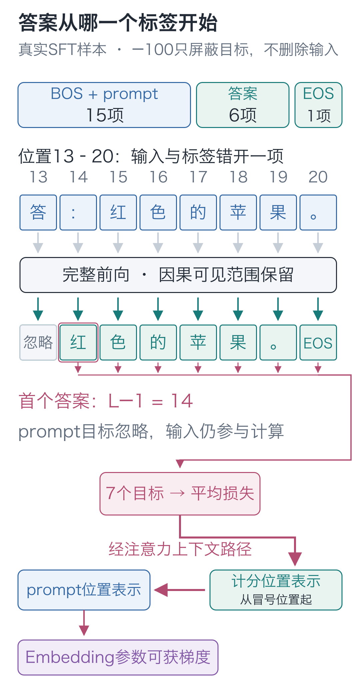
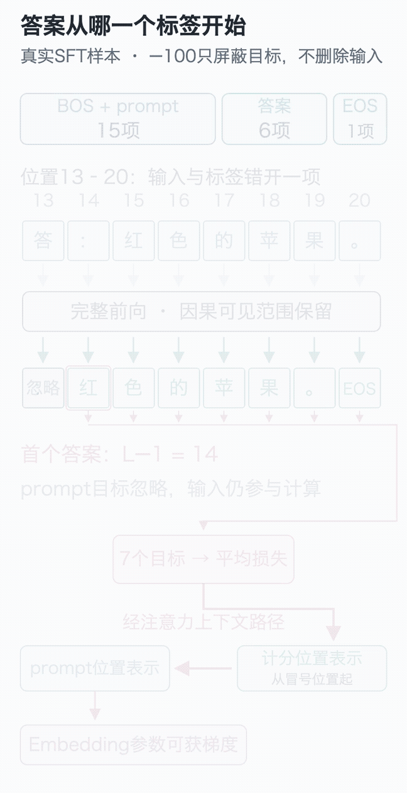
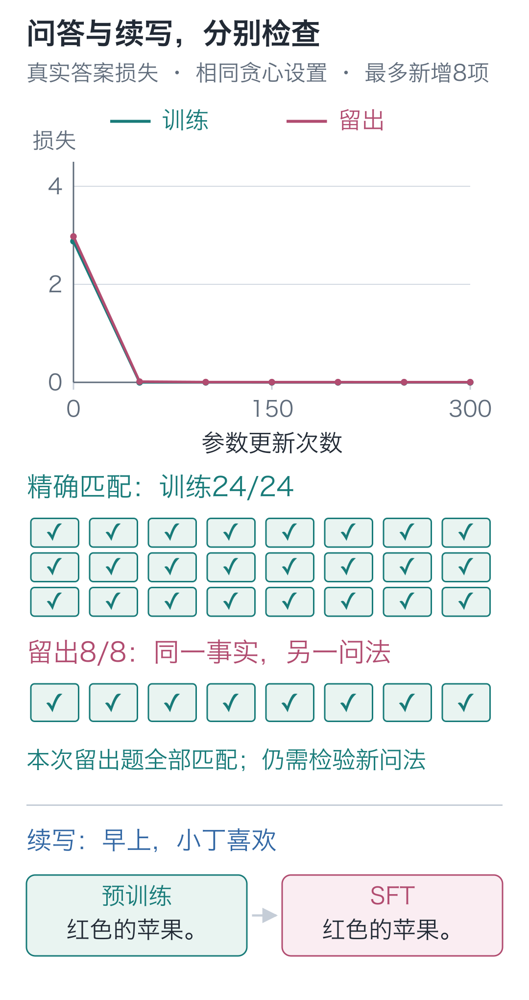
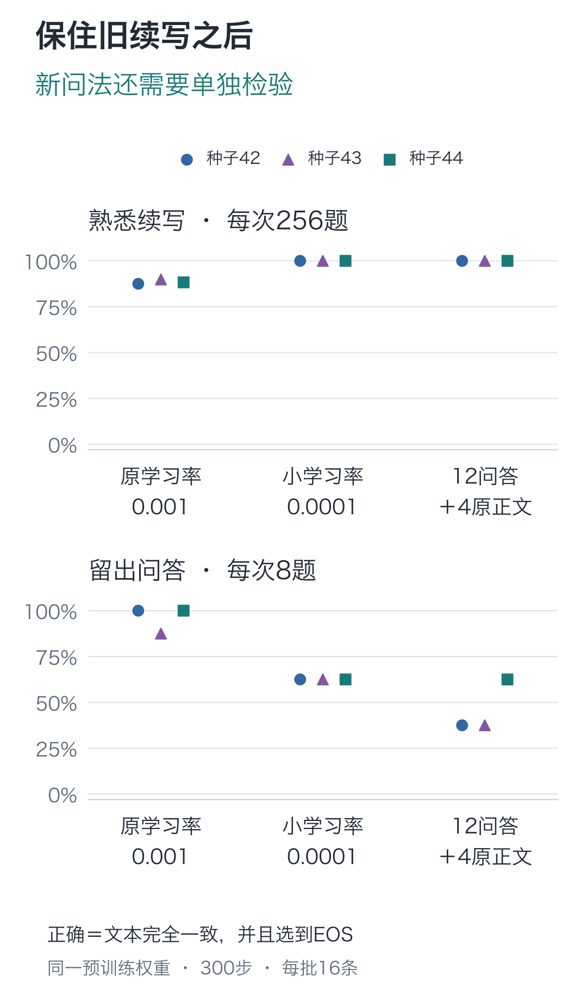

# 19｜监督微调：会续写，为何还不会回答？

手写小模型，看懂大模型 · 第 19 讲

输入 `早上，小丁喜欢`，预训练模型能接上“红色的苹果。”。换成 `问：小丁喜欢什么水果？\n答：`，它却写出了“我爱吃香蕉。”。

颜色和水果在训练文本里出现过，但给出一段问题，与给出熟悉句子的开头，触发的是不同的预测。怎样让它读到“答：”以后，接出我们需要的回答？

这次给原模型 24 条带现成答案的问答，继续训练。两个固定问题后来都答对了；扩展旧续写检查时，熟悉前缀“早上，小丁选了”却接成了“苹果，它是红色的苹果。”，多写了一次水果。

用给定问题和目标答案继续训练，就是本讲的**监督微调，SFT**。模型仍做下一字预测。我们沿一条问答，看看哪些位置参与评分、梯度怎样回传。

## 把“读问题”和“写答案”放进同一条序列

用这条记录展开：

```text
问：小丁喜欢什么水果？
答：红色的苹果。
```

把它拆成两段：prompt 是 `问：小丁喜欢什么水果？\n答：`，answer 是 `红色的苹果。`。两段分别编码，再按下面的顺序连接：

**BOS + prompt + answer + EOS**

直接沿用预训练的全部位置损失也能运行。不过，一部分损失会要求模型学习“从 BOS 开始，接着写出这个问题”。使用时问题已经给出，我们这次要训练的是另一段行为：读完它以后，怎样写答案并结束。

因此仍然保留完整输入，但把“下一个目标仍在 prompt 内”的标签设为 `−100`，不让这些位置直接计入交叉熵。

## “红”应当由哪个位置预测？

加 BOS 后，整个前缀有 `L=15` 项，位置编号从 0 开始。最后一个前缀字符是“答：”里的冒号，位于位置 14。

输入与标签仍然错开一格：**位置 14 读着冒号，目标已经是第一个答案字“红”。** 不是等到输入读着“红”，才开始训练它预测“红”。

| 输入位置 | 当前输入 | 下一项标签 | 是否计损失 |
| --- | --- | --- | --- |
| 0 | BOS | 问 | 否 |
| 1 | 问 | ： | 否 |
| … | … | … | 否 |
| 13 | 答 | ： | 否 |
| 14 | ： | 红 | 是 |
| 15 | 红 | 色 | 是 |
| 16 | 色 | 的 | 是 |
| 17 | 的 | 苹 | 是 |
| 18 | 苹 | 果 | 是 |
| 19 | 果 | 。 | 是 |
| 20 | 。 | EOS | 是 |

所以忽略的是标签索引 `0` 到 `L−2`，第一个有效标签位于 **L−1**。本例有 6 个答案字符，再加 EOS，共 7 个有效目标。右侧补齐到 32 项时，新增填充标签同样是 `−100`。

训练预测“色”时，前文中的“红”来自样本里的正确答案；生成时，这个“红”要靠程序自己选出来再接回去。两种过程都只读已有前文，区别在于这段前文由谁提供。



若因为前缀有 15 项就忽略前 15 个标签，“红”这道题就被删掉了。程序仍能运行，损失却少算了一个目标。

下面列出实际保留的目标。批次版本对每条记录做同样的处理，再堆成 `[B, 32]`。

```python
import torch
from tiny_lm.tokenizer import CharTokenizer

def make_sft_example(prompt, answer, tokenizer, max_len=32):
    """把一条问答变成 [1,max_len] 输入和标签；只给答案字符及 EOS 计分。"""
    # L=len(prefix) 包括 BOS 与整个问题，本例最后一项是答后冒号。
    prefix = [1] + tokenizer.encode(prompt)
    tokens = prefix + tokenizer.encode(answer) + [2]
    # 仍是下一项预测：输入去末项，目标去首项，EOS 留在最后有效目标中。
    inputs = tokens[:-1]
    targets = tokens[1:]
    # 只忽略 0..L-2；索引 L-1 由冒号预测首个答案字，必须保留。
    targets[:len(prefix) - 1] = [-100] * (len(prefix) - 1)
    if len(inputs) > max_len:
        raise ValueError("样本超过最大长度，不截断答案")
    padding = max_len - len(inputs)
    # 0 是输入的 PAD 编号；-100 仅供损失函数忽略，不送进 Embedding。
    inputs += [0] * padding
    targets += [-100] * padding
    return torch.tensor([inputs]), torch.tensor([targets])

tokenizer = CharTokenizer.for_course()
prompt = "问：小丁喜欢什么水果？\n答："
answer = "红色的苹果。"
x, y = make_sft_example(prompt, answer, tokenizer)
# 本例首答案在标签索引 14，最后有效标签为 EOS；其余位置不直接评分。
valid = (y[0] != -100).nonzero().flatten().tolist()
print(valid)  # [14, 15, 16, 17, 18, 19, 20]
print([tokenizer.itos[int(y[0, i])] for i in valid])
# ['红', '色', '的', '苹', '果', '。', '<eos>']
```

训练时仍然先算完整 logits，再由 `ignore_index=-100` 决定哪些目标进入平均。这里的 `−100` 是给损失函数看的约定，不是词表里的字符编号，也没有放进模型输入。

## 不评分的问题，还能不能删掉？

既然 prompt 不直接计分，是否可以把问题也从计算里拿掉？拿掉以后，不同问题就失去了区分依据：模型必须读到问题，才能根据它写答案。

所以要分别控制两件事。因果掩码规定**哪些输入允许读取**，保证预测不偷看未来；损失掩码规定**哪些预测直接计分**，这次只计答案和 EOS。忽略问题标签，不影响答案位置通过注意力读取问题。

反向也会沿这条读取路径返回。答案损失经过输出头、模型块和注意力，可以影响 prompt 对应的表示与参数；灰掉的只是评分目标，Embedding 并没有被冻结。问题位置也没有专属的一套模型参数：不同位置共用注意力、前馈等组件，同一个字符总是查同一行 Embedding。



在[交互演示](https://daviddingxu.github.io/hello-llm/chapters/19-fine-tuning/walkthrough.html)中可以逐步看见输入、错位标签和答案损失。首个答案的索引与梯度路径也可以对照上面的静态图查看。

还可以直接观察一个只出现在本条 prompt 中的字符“问”。下面仅反向，不更新或保存权重：

```python
from tiny_lm.checkpoint import load_checkpoint
from tiny_lm.losses import token_loss

# 从预训练权重出发；本段只检查反向路径，没有优化器更新。
model, tokenizer, _ = load_checkpoint("artifacts/first_run/pretrain.pt")
model.zero_grad(set_to_none=True)
loss = token_loss(model(x), y)
loss.backward()
# “问”仅出现在问题中；答案损失仍可能经过注意力上下文传到这一行参数。
question_row = tokenizer.stoi["问"]
gradient_size = model.embedding.weight.grad[question_row].abs().sum()
print(float(gradient_size) > 0)  # 本例为 True
```

“问”不在本条答案里，它对应的 Embedding 行仍有非零梯度：答案损失通过上下文路径影响了这行参数。

## 换一组未参加训练的问法，还能答对吗？

如果只检查刚刚学过的问题，很难分清它是只记住了问法，还是能在另一种表达里使用相同事实。因此，三种问法参与训练，每种覆盖 8 个人物，共 24 条：

`小丁喜欢什么水果？`

`请说出小丁喜欢的水果。`

`小丁爱吃哪种水果？`

第四种问法 `小丁最喜欢的水果是什么？` 整组留出，共 8 条。它测试已知人物事实在未参与更新的问法下能否被取出，不是测试从未见过的新水果知识。

这里的“最”也没有在预训练或微调训练文本中出现过，所以同时检查了新问法与训练文本未出现的字符用法。词表收录了它，不等于模型已经学过它的用法；后面的成绩只能对应这组具体题目。

起点就是第十七讲的预训练模型，所有参数继续参与更新，优化器重新建立：

```python
import random
from tiny_lm.data import make_sft_batch
from tiny_lm.train import train_step

def fine_tune(model, tokenizer, records, steps=300):
    """让已加载的预训练模型继续学习 SFT 训练记录，原模型的全部参数参与更新。"""
    sampler = random.Random(42)
    # 继承模型权重，重新建立本阶段的优化器状态，不另造一套问答模型。
    optimizer = torch.optim.AdamW(
        model.parameters(), lr=.001, betas=(.9, .99),
        eps=1e-8, weight_decay=.01)
    for _ in range(steps):
        # records 应传训练组；make_sft_batch 保留问题输入，仅给答案与 EOS 计分。
        selected = sampler.sample(records, min(16, len(records)))
        x, y = make_sft_batch(selected, tokenizer)
        # train_step 内部清梯度、前向、反向、裁剪，最后调用 optimizer.step 更新。
        train_step(model, x, y, optimizer, clip_norm=1.)
```

循环没有切换到另一种预测机制。问答标签带来的梯度，仍然修改原来那一批参数；这些参数同时也用于原有的续写。

## 回到刚才那两个问题

保存的三阶段输出如下，表中 `\n` 为换行：

| 提示词 | 随机初值 | 预训练后 | 微调后 |
| --- | --- | --- | --- |
| `问：小丁喜欢什么水果？\n答：` | 爱红绿吃爱梨吴爱 | 我爱吃香蕉。 | 红色的苹果。 |
| `问：小周喜欢什么水果？\n答：` | 爱红檬果爱梨吴爱 | 我爱吃香蕉。 | 黄色的香蕉。 |

实际训练 300 次更新，学习率 0.001，环境与预训练相同。循环及评估耗时约 0.96 秒。答案损失为：

| 数据组 | 微调前 | 微调后 |
| --- | --- | --- |
| 24 条训练问答 | 2.877918 | 0.000016 |
| 8 条留出问答 | 2.975784 | 0.004043 |

这些损失只平均答案与 EOS，与预训练的文本损失统计对象不同。微调开始时训练损失为 2.877918，不是先前的 0.372600，并不表示加载错了权重。

使用相同贪心设置，训练问答 **24/24** 精确匹配，留出问答 **8/8** 精确匹配。下面两条留出题也得到了正确答案：

| 留出问题 | 期望答案 | 实际答案 |
| --- | --- | --- |
| 小周最喜欢的水果是什么？ | 黄色的香蕉。 | 黄色的香蕉。 |
| 小赵最喜欢的水果是什么？ | 黄色的柠檬。 | 黄色的柠檬。 |

本轮这八条留出题的颜色、水果与结束位置都正确。这说明模型能处理这组具体的新问法，还不能据此判断任意问法或其他知识也能答对；其中的“最”虽然没有训练用例，仍不妨碍本次整组答对。

问答改善的同时，原有续写也要检查。两个固定提示词 `早上，小丁喜欢`、`晚上，小周拿着` 在微调后仍分别生成“红色的苹果。”和“黄色的香蕉。”。但检查另一条熟悉前缀 `早上，小丁选了`，预训练权重接出“苹果，它是红色的。”，微调权重却接出 **“苹果，它是红色的苹果。”**。两次都选到EOS；这里给足16项新增上限，错误来自多写了水果。

微调循环只按这 24 条问答的答案损失更新，没有单独约束原有续写的表现。问答改善与部分旧续写退化同时发生，只看那两个固定提示词会漏掉这种变化；这些记录还不足以定位具体是哪组参数造成退化。四个固定提示词见[阶段对照日志](https://github.com/DavidDingXu/hello-llm/blob/main/code/artifacts/first_run/generation_comparison.json)，扩展检查中的逐题结果见本讲下方的旧续写对照。



## 旧续写坏了，怎样一步步查？

先别急着把学习率调低。若实际加载了另一份权重、问题换了格式，或者生成被长度上限截断，看到的退化就不一定来自微调。先核对微调起点的参数摘要，确认各组使用同一份预训练权重，再固定提示词、贪心选择和停止条件，才能比较训练方法。

这次把旧能力检查扩成完整的256条熟悉续写：覆盖8个人物、8个场景和4种预训练句式，从“喜欢”“拿着”“说：我爱吃”“选了”后继续写。问答仍检查原来的24条训练题与8条留出题。所有组都要求**生成文本与目标后缀完全相同，并且选到EOS**；最多新增16项，足以容纳最长后缀。留出问法仍包含训练文本没有出现的“最”。

这组题在对照实验开始前就固定。先加载同一份预训练权重：旧续写256/256，问答两组都为0。继续按原设置微调，seed=42时旧续写降到224/256；全部输出都有EOS，不能把这32条错误归咎于生成没写完。

第一种猜测是：更新幅度偏大，干扰了原有预测。保持初始权重、300步、每批16条、抽样顺序和AdamW设置不变，只把学习率从0.001降到0.0001。旧续写回到256/256，但留出问答从8/8降到5/8。训练问答仍然24/24——只看训练题，会错过这个代价。

接着换一个思路：当前损失只奖励问答答案，旧续写没有在这一阶段受到约束。于是另从同一份预训练权重开始第二轮实验，每批仍为16条，改成12条问答与4条原预训练正文，学习率回到0.001。两种数据使用各自的标签，再一起计算损失：

```python
from tiny_lm.data import make_pretrain_batch

def mixed_update(model, tokenizer, qa_records, text_records,
                 qa_sampler, text_sampler, optimizer):
    """一次更新仍用16条数据；答案目标与完整正文目标共同约束同一模型。"""
    qa = qa_sampler.sample(qa_records, 12)
    old_text = text_sampler.sample(text_records, 4)
    # 问答仍只给答案/EOS计分；原正文则给每个有效下一项计分。
    qx, qy = make_sft_batch(qa, tokenizer)
    tx, ty = make_pretrain_batch(old_text, tokenizer)
    # 两类张量均补齐到32项，沿样本轴合批；模型结构与优化器不换。
    x = torch.cat((qx, tx), dim=0)
    y = torch.cat((qy, ty), dim=0)
    return train_step(model, x, y, optimizer, clip_norm=1.)
```

4/16是样本比例，不能写成旧任务只占25%的损失：正文通常有更多有效目标。本次seed=42的300步中，问答提供25,200个计分目标，正文提供18,212个，正文占全部有效目标数约42%。这仍是目标数量占比；实际损失贡献还取决于这些目标各自的预测损失。总步数与批大小相同，但两类任务收到的监督量已经改变。

下面是seed=42的实际结果。每次都从同一份预训练权重重新开始，三个方法没有串着训练：

| 训练方式 | 训练问答 | 留出问答 | 旧续写 |
| --- | --- | --- | --- |
| 微调前 | 0/24 | 0/8 | 256/256 |
| 原学习率0.001 | 24/24 | 8/8 | 224/256 |
| 小学习率0.0001 | 24/24 | 5/8 | 256/256 |
| 12条问答＋4条原正文 | 24/24 | 3/8 | 256/256 |

再固定使用42、43、44三个种子，检查更换微调抽样顺序后，结论是否还能保持。三次都从同一份预训练权重出发，种子没有改变预训练起点；每个点都保留实际结果，没有只挑最好的一次。



原学习率的旧续写分别为224、230、226/256，小学习率与混训均为256/256。留出问答分别是原设置8、7、8/8，小学习率5、5、5/8，混训3、3、5/8。

这支持一个具体判断：降低学习率或加入旧任务目标，都在这组熟悉续写上保住了原行为，但留出问答都低于各自种子下的原设置。如果要求“旧能力保留，留出问答也不退步”，这两种干预仍未满足要求。不能只看恢复到256/256，就宣布全部问题解决。第二轮是在看过第一轮结果后设计的，沿用的留出题属于开发验证，后续正式检验还应另留新题。

还要同时看损失和完整匹配。seed=42混训后的留出问答损失为0.269201，高于原设置的0.004043，完整正确数也从8/8降到3/8；本轮两项指标都显示这组问答变差。损失评分时，每个位置都拿到真实前缀，再平均各正确标签的负对数概率；检查完整匹配时，模型要把自己选出的字接回去，并让整段生成逐字正确。前者检查每个正确标签得到了多少概率，后者检查实际选字能否走完整段，两者需要分别记录。

这次排查留下四样东西：固定的评价题、从相同权重出发的对照、干预带来的收益与代价，以及哪些要求仍未满足。以后遇到微调退化，先建立这四项，再决定下一次改数据、训练目标还是更新设置。

完整脚本复用前文的`train_step`、两种标签构造和生成函数。只查看九次实验记录，或实际重跑并另存：

```bash
# 只读作者保存的逐组结果。
python -m lessons.retention_experiment --inspect
# 从同一预训练权重重跑三种方法、三个种子；原权重与日志保持原样。
python -m lessons.retention_experiment --out artifacts/my_retention.json
```

[实验源码](https://github.com/DavidDingXu/hello-llm/blob/main/code/lessons/retention_experiment.py)与[逐题原始记录](https://github.com/DavidDingXu/hello-llm/blob/main/code/artifacts/retention_experiment.json)保留了评价集、有效目标数、停止原因和抽样摘要。

## 查看与重跑

在 `code` 目录查看现有记录：

```bash
# 查看已保存的实验记录，不重新训练模型。
python -m lessons.l19 --inspect
```

如果已经按第十七讲生成自己的 `artifacts/my_run/pretrain.pt`，可以继续微调：

```bash
# 加载预训练权重继续微调，将新的权重和记录另存。
python -m lessons.l19 --checkpoint artifacts/my_run/pretrain.pt --out artifacts/my_run --sft-steps 300
```

原始结果保存在 `artifacts/first_run`，日志的父权重摘要以 `f944cbe2b507` 开头，与预训练权重一致。比较阶段输出时，提示词、解码方式与长度上限也保持一致。

## 两道边界题

1. 把 `targets[:len(prefix)-1]` 错写成 `targets[:len(prefix)]`，第一个丢掉的监督目标是什么？EOS 还在不在？
2. 预测 prompt 字符的标签都设成 `−100`，能否冻结只在问题中出现的字符所对应的 Embedding 行，并宣称训练行为保持相同？

<details class="answer" markdown="1">
<summary>参考答案</summary>

答案：第一题，首个答案字“红”的标签被忽略，第一个有效目标变成“色”；后面的答案标签与 EOS 仍然存在。损失可能因此升高或降低，因为少算了一道题，评分内容变了，这不代表数据更正确。第二题，不能。原来的答案损失可以通过上下文路径更新这些 Embedding 行；冻结它们会阻止这部分更新，训练行为也就改变了。只有明确决定冻结某些参数，才应这样操作。

</details>

代码与微调记录：[运行入口](https://github.com/DavidDingXu/hello-llm/blob/main/code/lessons/l19.py) · [问答批次构造](https://github.com/DavidDingXu/hello-llm/blob/main/code/tiny_lm/data.py) · [真实微调日志](https://github.com/DavidDingXu/hello-llm/blob/main/code/artifacts/first_run/sft_log.json)。

源码导航：[data.py · make_sft_batch](https://github.com/DavidDingXu/hello-llm/blob/main/code/tiny_lm/data.py#L82) · [train.py · run_sft](https://github.com/DavidDingXu/hello-llm/blob/main/code/tiny_lm/train.py#L171)。

<!-- chapter-navigation:start -->

---

[← 逐字生成](../18-generation/README.md) · [课程目录](../../README.md#课程目录) · [闭环与原理检验 →](../20-full-workflow/README.md)

<!-- chapter-navigation:end -->
