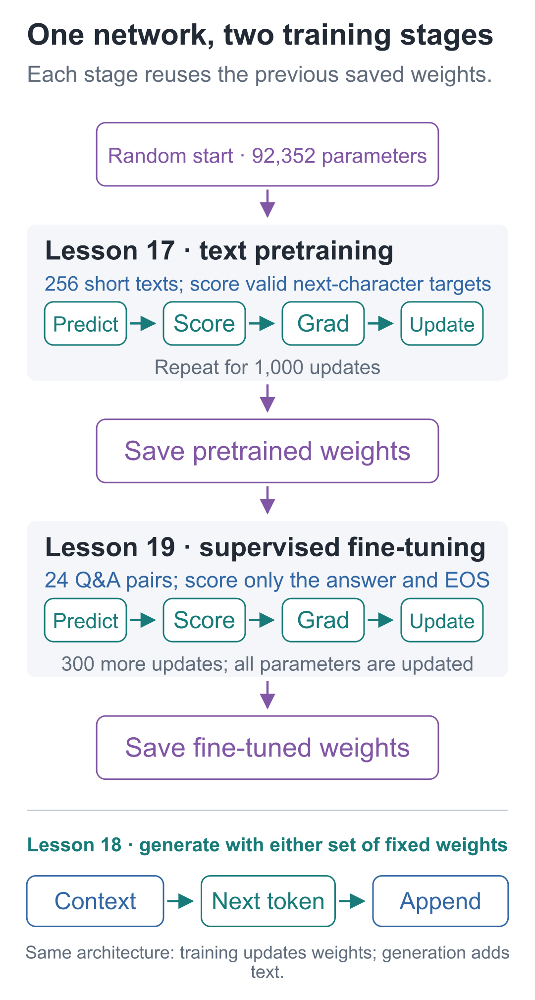
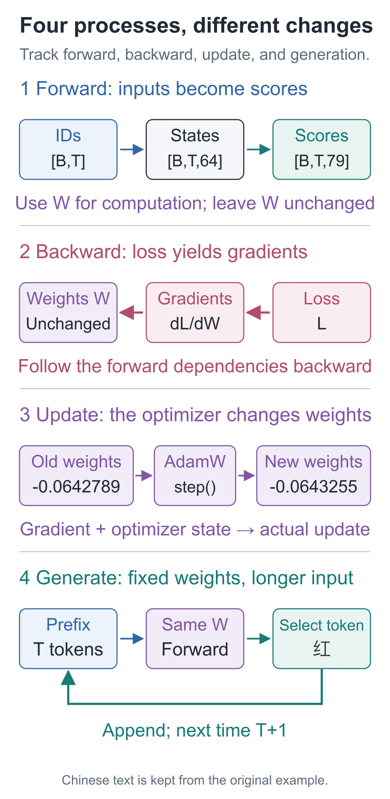
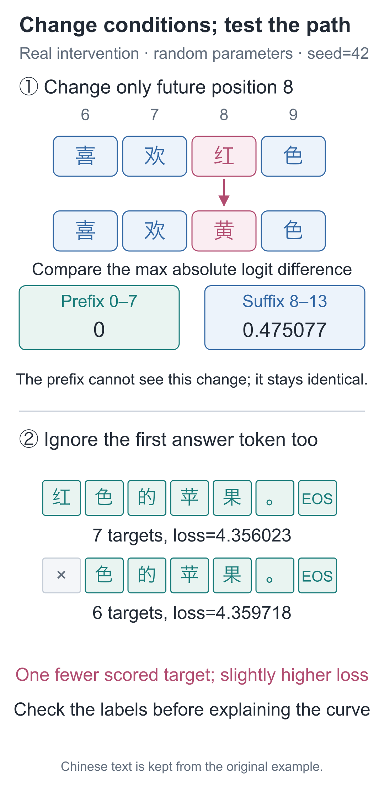
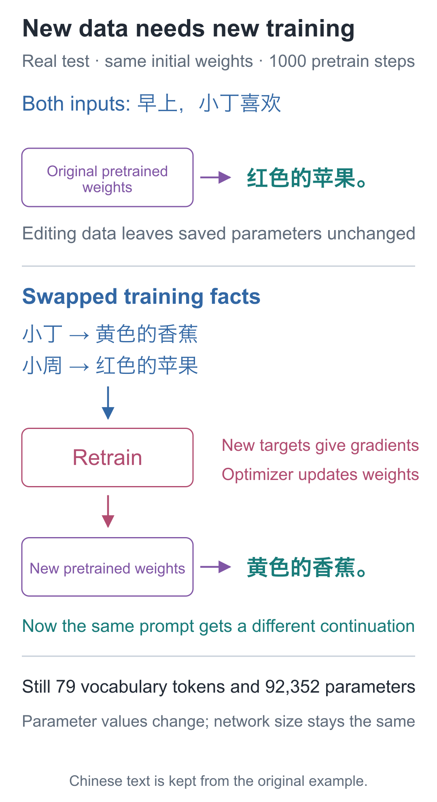

# 20 | The Full Workflow: Connect Pretraining, Fine-Tuning, and Generation

Build a Small Model, Understand Large Models · Lesson 20

The parameters have not changed. The inputs have not changed. Yet loss rises from **4.356023** to **4.359718**. Has the model really become worse?

In another experiment, we replace “红” (“red”) with “黄” (“yellow”) in a sentence and recompute the whole sentence, but the scores at the first eight positions remain identical. Did the program fail to read the edit?

To interpret both results, we must distinguish which computations are affected by inputs, scoring targets, and parameters. First connect pretraining, fine-tuning, and generation, then run controlled comparisons using the same architecture with 92,352 parameters.

## First Connect the Two Training Stages

The first stage starts from random parameters. We turn 256 short sentences into next-character tasks: inputs go to the model for scoring, while labels go to the loss function for evaluation. Backpropagation computes gradients from errors, and the optimizer changes parameters. After 1,000 repeated updates, we save the pretrained weights.

The second stage loads those weights and continues training on 24 question-answer records. Questions remain in the input, but only answers and EOS are scored. After another 300 updates, we save the fine-tuned weights. The network structure has not changed; its trainable parameters are still the same 92,352 numbers.



Generation can happen at any stage. Load weights, provide a prefix, and repeatedly select and append the next item. No standard answer is used for scoring, and no optimizer changes the parameters.

Open the [full training replay](https://daviddingxu.github.io/hello-llm/chapters/20-full-workflow/training-replay.en.html) to follow a batch through encoding, forward computation, loss, backpropagation, and updating. Then inspect the actual loss curves for both training stages and the text outputs at all three stages. The first update is replayed from the saved initial weights. The long-term curves use losses recorded every 50 steps in the original logs; loadable weights exist only for initialization, after pretraining, and after fine-tuning.

| Process | Data supplied | How results are used |
| --- | --- | --- |
| Pretraining | Inputs and next-character labels built from short sentences | Score valid positions, calculate gradients, update parameters |
| Supervised fine-tuning | Inputs containing questions and answers; only answer targets retained | Continue from pretrained weights; this series updates all parameters |
| Evaluation | A set of inputs and labels to inspect | Compute scores and loss to assess fixed weights |
| Generation | Only a supplied prefix | Select and append the next item with parameters fixed |

Evaluation and generation can use identical weights but answer different questions. Evaluation asks, “How much probability do these reference answers receive?” Generation asks, “What does the current selection method actually write?” One fluent continuation cannot replace checking a whole held-out set.

## Unpack a Single Computation Again

The fixed question is:

```text
问：小丁喜欢什么水果？
答：
```

It asks “What fruit does Xiaoding like?” followed by an “Answer:” marker. It contains 14 characters, or 15 IDs including BOS. One forward pass looks up `[1, 15]` IDs as `[1, 15, 64]` vectors, then passes through two blocks and the output projection to produce `[1, 15, 79]` candidate scores.

The colon at position 14 is the current final input. Generation selects from this row. If it chooses “红”, it appends that character and computes the next step. Only inputs and weights are needed; no target labels participate in scoring.

When training this question-answer record, the answer is already present in the sample. Valid inputs are BOS, the complete prompt, and the six answer characters. EOS is reserved as the final target, and the input is padded to 32 entries. The causal constraint lets each position use only current and earlier inputs. Although the later answer is in memory, the position predicting “红” cannot read it.

Six answer characters plus EOS contribute seven label terms to the loss:

**L=−(ln p_红+ln p_色+ln p_的+ln p_苹+ln p_果+ln p_。+ln p_EOS)/7**

Each probability comes from its own position and prefix. Target labels select which probability to use and which positions enter the average; they do not directly replace the scores produced by the forward pass. Loss propagates gradients through the preceding computation, and the optimizer then uses them to update parameters.



Next, hold the weights fixed for two comparisons: change only the input, then only the scoring targets, and observe which results change.

## Why Does the Prefix Stay Still When a Future Character Changes?

Input the complete sentence `早上，小丁喜欢红色的苹果。` (“In the morning, Xiaoding likes red apples”) and replace “红” at position 8 with “黄”. The program recomputes the whole sentence, but recomputing does not mean every result must change. Do position 7 and the positions before it have a path for reading the new character?

Under the causal constraint, none may read position 8. With fixed parameters, their outputs should therefore be identical. Position 8 and later positions may change. This requirement also holds for a random model; we do not have to wait until it learns fruit sentences before checking information leakage.

Run this from the `code` companion code directory:

```python
import torch
from tiny_lm.model import ModelConfig, TinyLM
from tiny_lm.tokenizer import CharTokenizer

torch.set_num_threads(1)
torch.manual_seed(42)
tokenizer = CharTokenizer.for_course()
# Create a random model to check dependency paths without training; eval itself does not change parameters.
model = TinyLM(ModelConfig()).eval()

# BOS plus thirteen characters gives [1,14]; the output has 79 candidate scores at each position.
ids = torch.tensor([tokenizer.encode(
    "早上，小丁喜欢红色的苹果。", add_bos=True)])
changed = ids.clone()
assert tokenizer.itos[int(ids[0, 8])] == "红"
# Change only the input ID at position 8; keep the vocabulary, parameters, and earlier positions fixed.
changed[0, 8] = tokenizer.stoi["黄"]

# Run two forward passes without computing gradients or updating parameters.
with torch.no_grad():
    before = model(ids)
    after = model(changed)
# :8 selects positions 0—7; take the maximum over all candidate scores at those positions.
prefix_difference = (before[:, :8] - after[:, :8]).abs().max()
suffix_difference = (before[:, 8:] - after[:, 8:]).abs().max()
print(float(prefix_difference), float(suffix_difference))
assert torch.allclose(before[:, :8], after[:, :8])
```

With CPU execution and PyTorch 2.9.1, this run gives maximum prefix difference **0** and maximum suffix difference approximately **0.475077**. The new character affects the suffix, while the prefix remains unchanged because it cannot read it.

If the prefix changes, inspect the attention scores and mask placement. Forbidden positions must be excluded before Softmax. Setting their scores to 0 does not set their weights to 0. If the edit actually changes an earlier position, however, altered outputs at later positions may be entirely correct.

## Why Can Dropping One Label Raise the Loss?

This time, leave even the forward input unchanged. For the same question-answer record, correct labels start with “红” at index 14. Deliberately set that label to `−100` as well, and use the same logits for both label sets.

If the model has not changed but its score changes, inspect what is being scored. The average now contains six targets instead of seven, changing both numerator and denominator. Omitting an easier target can raise average loss. Omitting a harder target can move it in the opposite direction.

Continue with the same random model from the preceding snippet:

```python
from tiny_lm.data import build_records, make_sft_batch
from tiny_lm.losses import token_loss

record = build_records()["sft_train"][0]
# Keep the same question-answer input fixed and compare only two sets of loss targets.
x, correct = make_sft_batch([record], tokenizer)
# The first target other than -100 is the first answer character, “红”; copy the labels and additionally ignore only this target.
first = int((correct[0] != -100).nonzero()[0].item())
wrong = correct.clone()
wrong[0, first] = -100

with torch.no_grad():
    # Run the forward pass once; both scoring methods use the same [B,T,V] raw scores.
    logits = model(x)  # Both target sets use these same scores
    correct_loss = token_loss(logits, correct)
    wrong_loss = token_loss(logits, wrong)

# List the scored targets and their count to distinguish a changed scoring set from a changed model.
for name, labels in [("Correct targets", correct), ("First answer target omitted", wrong)]:
    indices = (labels[0] != -100).nonzero().flatten().tolist()
    targets = [tokenizer.itos[int(labels[0, i])] for i in indices]
    print(name, len(indices), targets)
print(float(correct_loss), float(wrong_loss))
```

The correct targets are `红、色、的、苹、果、。、EOS`. Shifting the scoring boundary one position too far leaves `色、的、苹、果、。、EOS`. In this run, loss rises slightly from **4.356023** to **4.359718**.

The increase comes from omitting a task, with no model update; it does not establish that the model became worse. When comparing training scores, check the inputs, valid labels, first answer character, and EOS to confirm that both scores evaluate the same tasks.



## Do More Parameters Enable Open-Ended Chat?

Suppose we increase internal width from 64 to 640. The model can store more parameters, but its training tasks remain these 256 fruit sentences. It has not thereby encountered programming, history, or other everyday topics, nor acquired a vocabulary that can handle arbitrary text. Parameter capacity and training experience must be examined separately.

| Choice in this model | What broader language processing requires considering |
| --- | --- |
| Two blocks, 64 values per position, 92,352 parameters | More layers or width alter capacity and increase computation and storage requirements |
| 79-character vocabulary, at most 32 input entries | Tokenization, vocabulary design, and longer context; removing the length check alone is insufficient |
| 256 pretraining sentences and 24 fine-tuning questions | More varied text, data quality, evaluation questions, and suitable further training methods |
| Single-machine CPU; recompute the prefix for each new character | Reuse previous computation where appropriate, optimize memory and speed, and organize parallel computation at greater scale |

Architectures also differ. Qwen3-0.6B, observed in Lesson 16, lets some queries share K/V and shares input and output parameters. Check these differences against its [official configuration](https://huggingface.co/Qwen/Qwen3-0.6B/blob/main/config.json). Lesson 18's cache observation shows that previously computed intermediate results can be reused instead of recomputed from scratch.

Forward computation, loss, gradients, and updates still help us trace real models. Expanding capability requires designing data, architecture, training methods, and runtime conditions together. After completing this project, choose one question from the table as your next experiment.

## How to Check What You Learned in These 20 Lessons

Close the article and explain, in your own words, how text becomes IDs and vectors, how the prefix affects next-character scores, how errors affect parameters, how pretrained weights continue into fine-tuning, and which values change during generation. Then use another short sentence or small input and verify your predictions in the code.

If you cannot explain a step, return to that component's small numerical example. First we will swap facts within the existing vocabulary and check the effects of retraining. Then you will implement three interfaces for data containing new characters. These tasks test, in order, whether you can complete the workflow and whether you can adapt it to different data.

## Final Project: What Happens When the Facts Change?

Swap Xiaoding's and Xiaozhou's fruits. With the computation unchanged, can the model learn the new associations?

Open `tiny_lm/data.py` and change the Xiaoding and Xiaozhou entries in `FACTS` to the values below, leaving the other six people unchanged:

```text
('小丁', '黄色', '香蕉'), ('小周', '红色', '苹果')
```

Each entry contains person, color, and fruit in that order. The new facts associate Xiaoding with yellow bananas and Xiaozhou with red apples. Edit this source table. The new training run builds records from it and saves the actual data in `data/` under the new run directory. Data at the repository root and in the author's original experiment remain as they were.

Before running, write down your predictions. Will editing these two entries immediately change answers from an already saved model? Will vocabulary size or parameter count change? After retraining, how should Xiaoding's continuation and question answer change?

Then run this from the code repository root:

```bash
# Retrain from random parameters and save to a new directory for comparison with the original experiment.
python -m tiny_lm.train --out artifacts/my_swapped_run
```

The command performs pretraining, fine-tuning, and the generation comparison in order, saving a snapshot under `artifacts/my_swapped_run/data/`. The course's fine-tuning entry point uses that pretraining snapshot to prevent the two stages from mixing different facts. After the run, load `pretrain.pt` and `sft.pt` from the new directory separately and check these four tasks. In question prompts, `\n` denotes a newline; the actual input should put “答：” on its own line.

| Weights loaded | Input | Desired continuation for this experiment |
| --- | --- | --- |
| Pretrained | `早上，小丁喜欢` | 黄色的香蕉。 |
| Pretrained | `晚上，小周拿着` | 红色的苹果。 |
| Fine-tuned | `问：小丁喜欢什么水果？\n答：` | 黄色的香蕉。 |
| Fine-tuned | `问：小周喜欢什么水果？\n答：` | 红色的苹果。 |

The continuation prompts mean “In the morning, Xiaoding likes” and “In the evening, Xiaozhou is holding.” The questions ask what fruit each person likes. In both formats, Xiaoding should now get “yellow bananas” and Xiaozhou “red apples.”

<details class="optional" markdown="1">
<summary>Expand the verification code: reload weights and print each actual result</summary>

Save the code below as `check_swapped.py` in the code directory, alongside `tiny_lm/` and `artifacts/`, and run `python check_swapped.py` from that directory. It loads the new weights from disk and generates the four results again.

```python
from pathlib import Path
from tiny_lm.checkpoint import load_checkpoint
from tiny_lm.generate import generate

def check_swapped_run(run_dir):
    """Reload both stages' weights and check four outputs; return the actual results for further comparison."""
    # Use prompts matching each stage's training format; \n in the strings becomes an actual newline.
    cases = {
        "pretrain": [("早上，小丁喜欢", "黄色的香蕉。"),
                     ("晚上，小周拿着", "红色的苹果。")],
        "sft": [("问：小丁喜欢什么水果？\n答：", "黄色的香蕉。"),
                ("问：小周喜欢什么水果？\n答：", "红色的苹果。")],
    }
    results = []
    for stage, questions in cases.items():
        # Each checkpoint carries its own vocabulary and parameters; generation does not depend on current FACTS.
        model, tokenizer, _ = load_checkpoint(Path(run_dir) / f"{stage}.pt")
        count = sum(p.numel() for p in model.parameters())
        print(stage, "Vocabulary size:", model.config.vocab_size, "Parameters:", count)
        for prompt, expected in questions:
            # Always select the highest-scoring item to keep sampling randomness out of this comparison.
            output = generate(model, tokenizer, prompt,
                              max_new_tokens=8, greedy=True)
            actual = output["generated_text"]
            # Matching text is not enough; also check whether the model selected EOS.
            matched = actual == expected and output["stop_reason"] == "eos"
            results.append({"stage": stage, "prompt": prompt,
                            "actual": actual, "expected": expected,
                            "matched": matched})
            print(repr(prompt), "→", actual,
                  "Matches" if matched else "Needs checking",
                  "Stop reason:", output["stop_reason"])
    print("Matches:", sum(row["matched"] for row in results), "/", len(results))
    return results

if __name__ == "__main__":
    # Change this to artifacts/first_run to inspect the original model's answers again.
    check_swapped_run("artifacts/my_swapped_run")
```

</details>

<details class="answer" markdown="1">
<summary>After making your predictions, inspect the actual retraining results and explanation</summary>

The swap experiment uses the same random initialization, with 1000 pretraining steps and 300 fine-tuning steps. All four tasks above produce the expected text and reach EOS. The vocabulary still has 79 entries, and the model still has 92,352 parameters. The [experiment record](https://github.com/DavidDingXu/hello-llm/blob/main/code/artifacts/transfer_check.json) preserves the old and new facts, all four outputs, and parameter digests.



Editing the source table does not directly modify saved parameters. Generating with an old checkpoint still gives old answers. Retraining changes the targets supplied by samples, which changes gradients and parameter updates. Only the resulting new weights provide the new continuations.

The swap adds no new characters and changes no layer dimensions, so vocabulary size and parameter count remain unchanged. Which numbers change and how many numbers exist are separate questions.

After these four tasks pass, inspect new question formats as well. `answers.sft_val` in `sft_log.json` stores held-out questions and their individual results. `generation_comparison.json` stores stage comparisons for four fixed prompts and can reveal continuation behavior after fine-tuning. Combine these with held-out losses in both training logs to identify which tasks improved.

</details>

## Independent Task: Bring “小唐” and “橘子” into the Model

The previous task swapped existing facts without changing vocabulary or shapes. Now an independent dataset adds “小唐喜欢橙色的橘子” (“Xiaotang likes orange-colored tangerines”). The characters “唐”, “橙”, and “橘” are all absent from the original course vocabulary. Loading the old model directly encounters unknown characters; additional sampling attempts cannot solve that.

The data is in `exercises/transfer_data.json` and covers text pretraining only. Four familiar sentence patterns yield 288 training records. A separate pattern, such as “早上，小唐爱吃橙色的橘子。” (“In the morning, Xiaotang loves eating orange-colored tangerines”), is held out in full, yielding 72 records. No complete held-out sentence enters training, but every character appears in training text. This lets us observe continuation under a new sentence pattern separately from characters never trained at all.

Implement three functions in `exercises/transfer_task.py` yourself. Keep the two-layer, 64-dimensional TinyLM architecture and the remaining configuration from Lesson 16; only vocabulary size should follow the data:

| Function | Your task |
| --- | --- |
| `build_tokenizer` | Deduplicate and sort training characters, placing them after the four special entries at IDs 0–3; do not read held-out data to add characters |
| `make_batch` | Build shifted labels, EOS, and right padding; raise clear errors for unknown characters and overlong samples |
| `build_model` | Create a model from random parameters, sizing the input table and output head to the new vocabulary |

You can reuse components from Lessons 07, 09, and 16. This task reads its own data file, so the FACTS entries from the preceding swap experiment can remain as they are. Do not hard-code the existing 79-entry vocabulary into the new functions. Before coding, predict: does adding a few new characters necessarily increase vocabulary size by that same number? Can the old weights be loaded unchanged? Does lower training loss guarantee complete continuations for the held-out pattern?

Run structural acceptance checks first. The downloaded starter file initially reports the first unimplemented function. Once complete, it should pass checks for vocabulary, labels, unknown characters, length, model outputs, and causal visibility:

```bash
python -m lessons.transfer_challenge --module exercises.transfer_task
```

The checks call your functions with a different tiny dataset, “甲乙、甲丙”—strings made from the Chinese characters 甲, 乙, and 丙—to prevent hard-coding Xiaotang's IDs or this task's answers. After passing, train from random parameters and save your own artifacts in a new directory:

```bash
python -m lessons.transfer_challenge --module exercises.transfer_task --train --out artifacts/my_transfer
```

When finished, `my_transfer/` contains a data copy, `model.pt`, and `report.json`. The program reloads the saved weights from disk, then generates answers for familiar and held-out sentence patterns. Choose another output directory for a repeated experiment so you can compare runs.

Write yourself a short experiment report that answers at least these four questions using results:

1. Where does the vocabulary come from, and how does the model's candidate dimension stay consistent with it? Were unknown characters silently converted to UNK?
2. What are the training and held-out losses at random initialization and after training? Did held-out records participate in updates?
3. After loading your saved model, what does each of the three supplied prompts generate, and why does generation stop?
4. If familiar patterns work but new patterns add or omit words, which data or label detail should you inspect first? Support your judgment with an actual record.

Passing the program's checks establishes that the implementation meets its interfaces and key constraints. The last three explanations require your own run records. Keep incomplete or incorrect continuations unchanged and identify where the failures occur.

<details class="optional" markdown="1">
<summary>If you get stuck: three progressively more specific hints</summary>

First level: label each axis. Inputs and targets are both `[B,T]`; model scores are `[B,T,V]`. V is determined by the training character set, and T must reserve an input position for BOS.

Second level: Lesson 09's `make_pretrain_batch` already handles shifting, EOS, and padding. Check unknown characters before calling it. Lesson 16's model accepts `ModelConfig(vocab_size=tokenizer.vocab_size)`.

Third level: compare against `exercises/transfer_solution.py`, explaining line by line which constraint your implementation handles differently. Then rerun acceptance checks on your own file. To rerun the reference implementation:

```bash
python -m lessons.transfer_challenge --module exercises.transfer_solution --train --out artifacts/reference_transfer
```

</details>

<details class="answer" markdown="1">
<summary>After completing your own record, inspect the reference result</summary>

This task builds its vocabulary only from pretraining training text, yielding 67 entries and a model with 90,816 parameters. Although it introduces new characters, it omits other characters from materials such as the original question-answer corpus. The size is therefore not 79 plus 3. After changing the vocabulary, both ID meanings and matrix dimensions must be checked again. The reference experiment retrains from random initialization.

With seed=42 and 1000 steps, training loss falls from 4.207454 to 0.379470, while held-out loss falls from 4.207752 to 1.963480. The three generated results are:

| Prompt | Actual reference continuation |
| --- | --- |
| 早上，小唐喜欢 | 橙色的橘子。 |
| 早上，小唐爱吃 | 橘子，小周拿着橙色的香蕉。 |
| 晚上，小周爱吃 | 香蕉，小周拿着黄色的香蕉。 |

These prompts mean “In the morning, Xiaotang likes,” “In the morning, Xiaotang loves eating,” and “In the evening, Xiaozhou loves eating.” The outputs are “orange-colored tangerines,” “tangerines, Xiaozhou is holding orange-colored bananas,” and “bananas, Xiaozhou is holding yellow bananas.”

All three reach EOS, but the last two begin with fruit and then add a fragment starting “小周拿着……” (“Xiaozhou is holding…”), continuing beyond the intended ending. This is neither truncation at a length limit nor an inability to encode “橙”. In the training records, “说：我爱吃” (“says: I love eating”) is followed directly by fruit, while patterns such as “拿着” contain a color and fruit. The held-out pattern requires the color immediately after “爱吃”, followed by the fruit. The actual outputs contain some correct fruit names but fail to compose the required complete suffix.

This observation suggests what to inspect next. Two generation examples alone cannot identify which internal parameters caused the choices. If you add training examples with color suffixes, reserve new questions that were not involved in that decision before comparing again. The 72 already-inspected questions are not a fresh test set.

The reference result is stored in `artifacts/transfer_challenge.json`, including losses at each stage and actual outputs. The complete reference code can regenerate the checkpoint. Your report should also explain how “loss decreased substantially” and “the entire sentence is still wrong” can both be true.

</details>

## Where Should You Look First When Results Do Not Match?

| Symptom | First check |
| --- | --- |
| The new model still says Xiaoding likes apples | Check that `my_swapped_run/data/` contains the changed banana fact and that you loaded weights from the new directory. Both the data and the weights must change. |
| An “outside the vocabulary” error appears | Inspect the actual vocabulary. The fruit swap uses existing characters; the Xiaotang task requires a vocabulary built from its new training records and training from random parameters. |
| Matrix dimensions do not match | Write down the input shape at the error and check each axis against Lesson 16; revisit Lesson 12 for head splitting. |
| Text stops before finishing | Check `stop_reason`. Lesson 18 distinguishes EOS, the new-token limit, and the context limit; BOS also occupies one position. |
| Loss is low, but a new question format gets a wrong answer | Use Lesson 17 to distinguish training from held-out questions, then check question-answer scoring positions as in Lesson 19. |

Run the two controlled comparisons and this lesson's overview:

```bash
# Run this lesson from the companion code directory to check the chapter's results.
python -m lessons.l20
```

Check numerical behavior, data boundaries, the model, and saving/reloading. The original replay reads `first_run/data/`, while new runs read their own snapshots, so these checks still work after editing FACTS:

```bash
# Run the project's correctness checks.
python -m unittest discover -s checks -v
```

Entry points: [Lesson runner](https://github.com/DavidDingXu/hello-llm/blob/main/code/lessons/l20.py) · [Complete run record](https://github.com/DavidDingXu/hello-llm/blob/main/code/EXPERIMENTS.md) · [Model source](https://github.com/DavidDingXu/hello-llm/blob/main/code/tiny_lm/model.py).

Source navigation: [experiments.py · lesson20](https://github.com/DavidDingXu/hello-llm/blob/main/code/lessons/experiments.py#L340).

<!-- chapter-navigation:start -->

---

[← Question-answer fine-tuning](../19-fine-tuning/README.en.md) · [Contents](../../README.en.md#course-contents) · [Closing thoughts →](../end/README.en.md)

<!-- chapter-navigation:end -->
