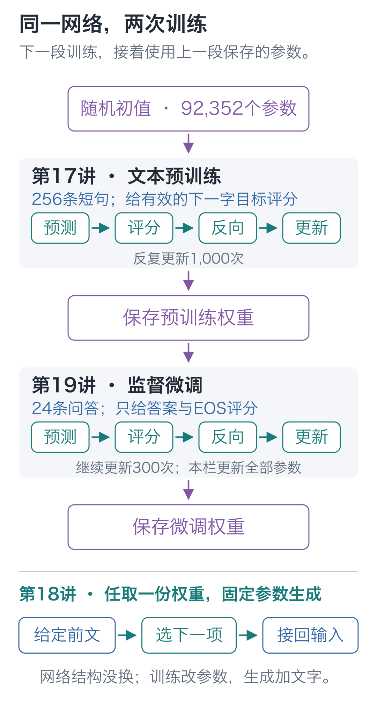
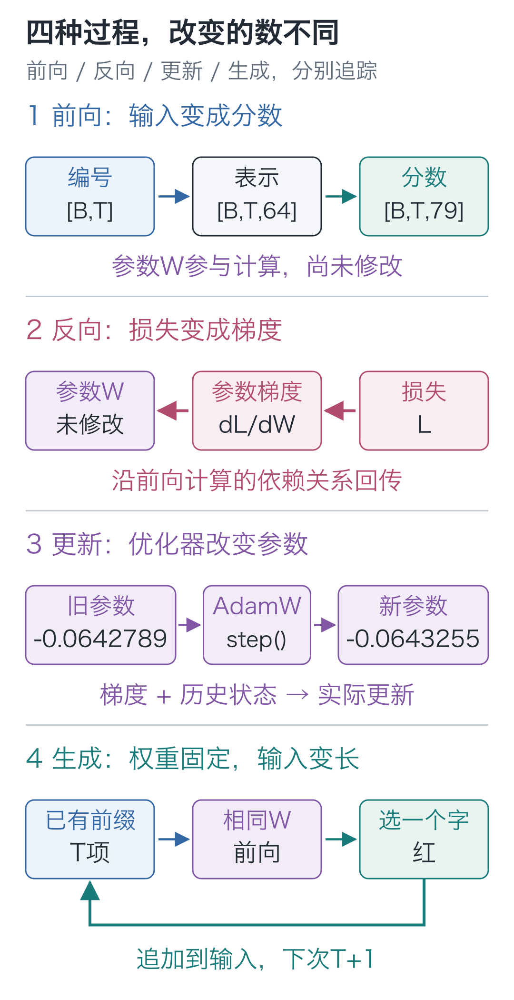
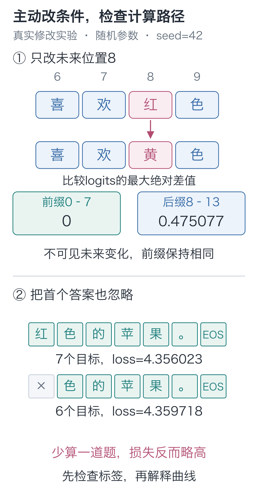
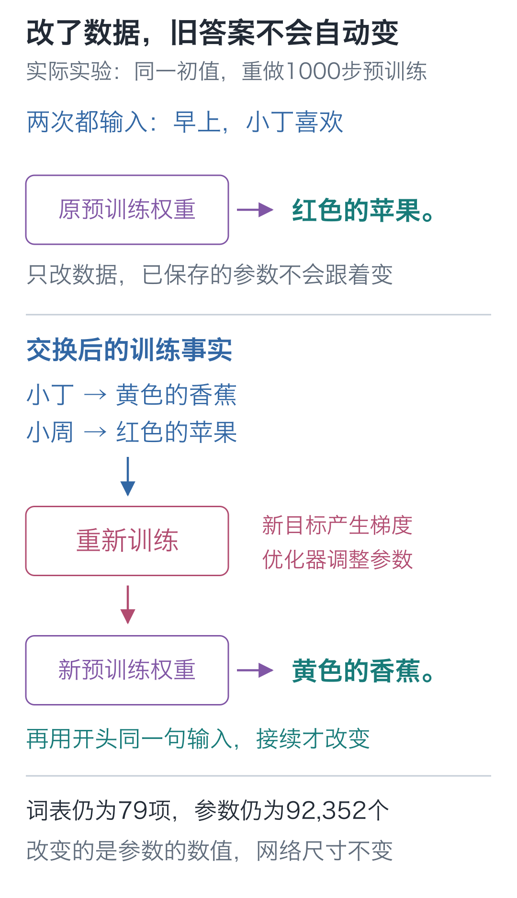

# 20｜全流程：把预训练、微调和生成串起来

手写小模型，看懂大模型 · 第 20 讲

参数没动，输入没动，损失却从 **4.356023** 升到了 **4.359718**。模型真的变差了吗？

另一项实验里，我们把句中的“红”换成“黄”，重新计算整句话，前面八个位置的分数却完全没变。程序是不是没有读到修改？

判断这两个结果，需要分清输入、评分目标和参数各自影响哪些计算。先把预训练、微调和生成接起来，再用同一个92,352参数的结构做对照。

## 先看两次训练怎样接上

第一段从随机参数开始。256条短句被拆成下一字训练题：输入给模型算分，标签给损失函数评分。反向传播根据错误求梯度，优化器修改参数。重复1,000次更新后，保存为预训练权重。

第二段加载这份权重，用24条问答继续训练。这次把问题保留在输入里，只给答案与EOS评分。再更新300次，保存为微调权重。网络结构没换，可训练参数仍是原来那92,352个数。



生成可以发生在任一阶段：加载一份权重，给定开头，反复选下一项并追加。这时没有标准答案参与评分，也没有优化器修改参数。

可以打开[训练全过程回放](https://daviddingxu.github.io/hello-llm/chapters/20-full-workflow/training-replay.html)，跟着一批短句走完编码、前向、损失、反向和更新，再看两次训练的真实损失曲线与三阶段文字输出。首个更新步由保存的初始权重重放，长程曲线采用原日志每50步的损失记录；可加载的权重只有初始、预训练后和微调后三个阶段。

| 过程 | 送进什么数据 | 怎样使用结果 |
| --- | --- | --- |
| 预训练 | 短句构成的输入与下一字标签 | 在有效位置评分，算梯度、更新参数 |
| 监督微调 | 问题与答案构成的输入；只保留答案目标 | 从预训练权重继续更新，本栏更新全部参数 |
| 评估 | 一组待检查的输入与标签 | 算分与损失，检查固定权重的表现 |
| 生成 | 只有给定前文 | 选下一项并接回去，参数固定 |

评估和生成都可以使用同一份权重，但回答的问题不同：评估问“这些标准答案得到多高的概率”，生成问“当前选字方式实际写出什么”。一条流畅的续写，不能替代整组留出题的检查。

## 再把一次计算拆开

固定问题是：

```text
问：小丁喜欢什么水果？
答：
```

它有 14 个字符，加 BOS 后为 15 项编号。一次前向把 `[1, 15]` 的编号查成 `[1, 15, 64]` 的向量，再经过两个模型块及输出投影，得到 `[1, 15, 79]` 的候选分数。

位置 14 的冒号是当前最后一个输入。生成时取这一行选字，选中“红”就把它追加，再计算下一步。此时只需要输入和权重，没有目标标签参与评分。

训练这条问答时，答案已经在样本里。有效输入是 BOS、完整 prompt 和答案的六个字符；EOS 留作最后一个目标，再把输入补齐到 32 项。因果限制让每个位置只能使用当前及更早输入：虽然后续答案在内存中，预测“红”的位置不能读取它。

对应标签中，六个答案字符与 EOS 共七项计入损失：

**L=−(ln p_红+ln p_色+ln p_的+ln p_苹+ln p_果+ln p_。+ln p_EOS)/7**

每个概率来自自己的位置与前文。目标标签决定取哪一项概率、哪些位置参与平均；它不直接替换前向算出的分数。损失向前面的计算回传梯度，优化器再据此更新参数。



下面固定权重做两次对照：先只改输入，再只改评分目标，分别观察哪些结果会变。

## 未来的字改了，前面为什么不动？

输入整句 `早上，小丁喜欢红色的苹果。`，把位置 8 的“红”换成“黄”。程序会重新计算整句，但重算不等于每项结果都要改变。位置 7 及其之前，有没有读取这个新字的路径？

按照因果约束，它们都不能读取位置 8，因此在参数固定时，输出应当相同。位置 8 及之后则允许改变。这条要求在随机模型上也成立，不必先等它学会水果句子，才能检查信息是否泄漏。

在 `code` 目录运行：

```python
import torch
from tiny_lm.model import ModelConfig, TinyLM
from tiny_lm.tokenizer import CharTokenizer

torch.set_num_threads(1)
torch.manual_seed(42)
tokenizer = CharTokenizer.for_course()
# 新建随机模型检查依赖路径，不要求先训练；eval 本身不修改参数。
model = TinyLM(ModelConfig()).eval()

# BOS 加十三个字符得到 [1,14]，输出将是每个位置的 79 项候选分数。
ids = torch.tensor([tokenizer.encode(
    "早上，小丁喜欢红色的苹果。", add_bos=True)])
changed = ids.clone()
assert tokenizer.itos[int(ids[0, 8])] == "红"
# 只改位置 8 的输入编号，词表、参数和更早位置都不改。
changed[0, 8] = tokenizer.stoi["黄"]

# 两次只做前向，不计算梯度也不更新参数。
with torch.no_grad():
    before = model(ids)
    after = model(changed)
# :8 对应位置 0—7；最大值覆盖这些位置的全部候选分数。
prefix_difference = (before[:, :8] - after[:, :8]).abs().max()
suffix_difference = (before[:, 8:] - after[:, 8:]).abs().max()
print(float(prefix_difference), float(suffix_difference))
assert torch.allclose(before[:, :8], after[:, :8])
```

本次 CPU、PyTorch 2.9.1 的结果是前缀最大差值 **0**，后缀最大差值约 **0.475077**。新字改变了后缀，前缀因读不到它而保持原值。

如果前缀结果发生变化，应回到注意力分数与掩码的位置检查。屏蔽需要在 Softmax 之前排除不允许的位置，把分数简单改成 0 并不等于让权重为 0。若修改的其实是更早位置，后面输出变化则完全可能是正确行为。

## 少一个标签，损失为什么反而升了？

这次连前向输入都不改。同一条问答，正确标签从索引 14 的“红”开始；故意把它也设成 `−100`，两套标签共用同一份 logits。

如果模型一点没变，评分却变了，变化就要从评分内容里找。被平均的目标从七项变成六项，分子和分母都换了；漏掉较容易的一道题，平均损失就可能升高。若漏掉的是较难的一题，方向又可能相反。

接着上一段的同一份随机模型运行：

```python
from tiny_lm.data import build_records, make_sft_batch
from tiny_lm.losses import token_loss

record = build_records()["sft_train"][0]
# 同一条问答的输入始终不变，只比较两种损失标签。
x, correct = make_sft_batch([record], tokenizer)
# 首个非 -100 的标签是首答案“红”；复制后只把这一题额外忽略。
first = int((correct[0] != -100).nonzero()[0].item())
wrong = correct.clone()
wrong[0, first] = -100

with torch.no_grad():
    # 前向只运行一次；两种评分共用同一份 [B,T,V] 原始分数。
    logits = model(x)  # 两种标签共用这一份分数
    correct_loss = token_loss(logits, correct)
    wrong_loss = token_loss(logits, wrong)

# 列出实际参与平均的目标与数量，防止把评分内容改变误认成模型变化。
for name, labels in [("正确", correct), ("错后一格", wrong)]:
    indices = (labels[0] != -100).nonzero().flatten().tolist()
    targets = [tokenizer.itos[int(labels[0, i])] for i in indices]
    print(name, len(indices), targets)
print(float(correct_loss), float(wrong_loss))
```

正确目标是 `红、色、的、苹、果、。、EOS`；错后一格后变成 `色、的、苹、果、。、EOS`。本次损失从 **4.356023** 变成 **4.359718**，反而略高。

损失升高来自少算一道题，模型没有更新，不能据此判断它变差了。比较训练成绩时，也要核对输入、有效标签、首个答案与 EOS，确认前后评的是同一组题。



## 参数多了，就能自由聊天？

假设把内部宽度从64改成640，模型能保存的参数多了，但训练题仍是这256条水果短句。它没有因此见过编程、历史或其他日常话题，也没有获得处理任意文字的词表。参数容量与学过什么，需要分开检查。

| 本模型的选择 | 继续处理通用文字，需要考虑什么 |
| --- | --- |
| 两个块、每个位置64项表示，共92,352个参数 | 增加层数或宽度会改变容量，也增加计算与存储需求 |
| 79项字符词表，最多32项输入 | 设计分词与词表，处理更长的前文；不能只解除长度检查 |
| 256条预训练短句、24条微调问答 | 准备更多样的语料，检查质量和评估题，再决定后续训练方式 |
| 单机CPU，每个新字都重算前文 | 按需要复用历史计算、优化内存与速度，规模更大时组织并行计算 |

结构也有不同选择。第16讲观察的Qwen3-0.6B让部分查询共用K/V，输入与输出还共享参数；这些差别可以对照[官方配置](https://huggingface.co/Qwen/Qwen3-0.6B/blob/main/config.json)。第18讲的缓存观察则说明，已经算过的历史中间结果可以复用，而不必每次从头计算。

前向、损失、梯度与更新这些步骤仍能帮助我们追踪实际模型。要继续扩大能力，还得把数据、结构、训练方法与运行条件一起设计。完成这个项目后，下一步就可以带着上表中的一个问题继续实验。

## 怎样判断这20讲学到了什么

合上文章，试着用自己的话讲完：文字怎样变成编号与向量，前文怎样参与下一字的分数，错误怎样影响参数，预训练权重怎样接着微调，生成时又有哪些数在变化。然后换一条短句或一个小输入，沿代码核对自己的判断。

如果某一步还解释不清，就回到对应组件的小算例。下面先用现有词表交换事实，核对重训前后的变化；再接入含新字符的数据，由你自己完成三个接口。两项任务依次检查“能否走通流程”和“能否换数据继续做”。

## 结课实战：换一份事实，模型会怎样变？

把小丁和小周的水果交换一下。计算程序不变，它还能学出新的对应关系吗？

打开`tiny_lm/data.py`，把`FACTS`中小丁、小周这两项改成下面的值，其余六个人物保留：

```text
('小丁', '黄色', '香蕉'), ('小周', '红色', '苹果')
```

每项依次是人物、颜色、水果。应改这张源表。新训练会按它准备记录，并把本次实际数据存到新运行目录的`data/`中；仓库根目录与作者原实验的数据保持原样。

运行前，写下自己的预测：只改这两项，已经保存的旧模型会不会立刻换答案？词表大小和参数数量会不会变？重新训练以后，给小丁的续写与问答应该怎样变？

然后，在代码根目录运行：

```bash
# 从随机参数重新训练，结果写入新目录，便于与原实验比较。
python -m tiny_lm.train --out artifacts/my_swapped_run
```

这个命令会依次完成预训练、微调和生成对照，并保存`artifacts/my_swapped_run/data/`快照。后面的课程微调入口沿用这次预训练的快照，避免两阶段混入不同事实。运行结束后，分别加载新目录的`pretrain.pt`与`sft.pt`，检查下面四道题。问答里的`\n`表示换行，实际输入应让“答：”另起一行。

| 加载的权重 | 输入 | 本次希望得到的接续 |
| --- | --- | --- |
| 预训练 | `早上，小丁喜欢` | 黄色的香蕉。 |
| 预训练 | `晚上，小周拿着` | 红色的苹果。 |
| 微调 | `问：小丁喜欢什么水果？\n答：` | 黄色的香蕉。 |
| 微调 | `问：小周喜欢什么水果？\n答：` | 红色的苹果。 |

<details class="optional" markdown="1">
<summary>展开核对代码：重新加载权重，逐题打印实际结果</summary>

将下面的代码保存为仓库根目录的`check_swapped.py`，运行`python check_swapped.py`。它会加载磁盘上的新权重，重新生成四条结果。

```python
from pathlib import Path
from tiny_lm.checkpoint import load_checkpoint
from tiny_lm.generate import generate

def check_swapped_run(run_dir):
    """重载两个阶段的权重，核对四条输出；返回实际结果，便于继续比较。"""
    # 每个阶段使用与其训练形式对应的题；字符串中的 \n 是真正的换行。
    cases = {
        "pretrain": [("早上，小丁喜欢", "黄色的香蕉。"),
                     ("晚上，小周拿着", "红色的苹果。")],
        "sft": [("问：小丁喜欢什么水果？\n答：", "黄色的香蕉。"),
                ("问：小周喜欢什么水果？\n答：", "红色的苹果。")],
    }
    results = []
    for stage, questions in cases.items():
        # 每份检查点都带着自己的词表和参数，生成不依赖当前 FACTS。
        model, tokenizer, _ = load_checkpoint(Path(run_dir) / f"{stage}.pt")
        count = sum(p.numel() for p in model.parameters())
        print(stage, "词表：", model.config.vocab_size, "参数：", count)
        for prompt, expected in questions:
            # 固定用最高分选择，避免抽样随机性干扰这次比较。
            output = generate(model, tokenizer, prompt,
                              max_new_tokens=8, greedy=True)
            actual = output["generated_text"]
            # 文字一致还不够：也检查模型是否选到了 EOS。
            matched = actual == expected and output["stop_reason"] == "eos"
            results.append({"stage": stage, "prompt": prompt,
                            "actual": actual, "expected": expected,
                            "matched": matched})
            print(repr(prompt), "→", actual,
                  "符合预期" if matched else "需要检查",
                  "停止原因：", output["stop_reason"])
    print("符合预期：", sum(row["matched"] for row in results), "/", len(results))
    return results

if __name__ == "__main__":
    # 改成 artifacts/first_run，可以重新查看旧模型的答案。
    check_swapped_run("artifacts/my_swapped_run")
```

</details>

<details class="answer" markdown="1">
<summary>做过预测后，再看实际重训结果与解释</summary>

这次交换使用相同的随机初值，完成1000步预训练和300步微调。上面四道题全部得到预期文本，并选到EOS；词表仍为79项，参数仍为92,352个。[实验记录](https://github.com/DavidDingXu/hello-llm/blob/main/code/artifacts/transfer_check.json)保留了修改前后事实、四条输出与参数摘要。



改源表不会直接修改已保存的参数。用旧检查点继续生成，依然得到旧答案。重新训练后，样本提供的目标改变，梯度与参数更新随之改变，新的权重才会给出新的接续。

交换没有引入新字符，也没有改变网络各层的尺寸，所以词表大小与参数数量保持不变。换了哪些数，和有多少个数，是两件事。

四题通过后，还要查新问法。`sft_log.json`的`answers.sft_val`保存了留出问法及逐条结果；`generation_comparison.json`保存的是四个固定提示词的阶段对照，可用来检查微调后的续写。再结合两份训练日志中的留出损失，判断改善发生在哪些题上。

</details>

## 独立任务：让“小唐”和“橘子”进入模型

刚才交换的是已有事实，词表与形状都没变。现在给你一份独立数据，新增“小唐喜欢橙色的橘子”。“唐、橙、橘”都不在原课程词表里；直接加载旧模型生成，会先碰到未知字符，而不是靠增加采样次数解决。

数据在`exercises/transfer_data.json`。它只做文本预训练：四种熟悉句式共288条训练记录，另一种“早上，小唐爱吃橙色的橘子。”句式整组留出，共72条。留出整句没有进入训练，但每个字符都在训练文字中出现过。这次可以把“新句式的接续”与“字符从未受训”分开观察。

先独立完成`exercises/transfer_task.py`中的三个函数。结构仍用两层、64维的TinyLM，其余配置沿用第16讲，只让词表大小随数据改变：

| 函数 | 你需要完成的工作 |
| --- | --- |
| `build_tokenizer` | 将训练字符去重、排序，接在编号0—3的四个特殊项之后；不读取留出组补字符 |
| `make_batch` | 构造错位标签、EOS与右侧填充；遇到未知字符、过长样本明确报错 |
| `build_model` | 从随机参数创建模型，输入表与输出头的尺寸跟随新词表 |

第07、09、16讲的组件可以复用。这项任务读取独立的数据文件，前一项交换实验的FACTS可以保留原样；不要把现成79项词表直接填进新函数。动手前先写下：新数据加了几个字，是否就等于词表大小加几？原来的权重还能原样加载吗？即使训练损失下降，留出句式一定会完整接对吗？

先运行结构验收。刚下载的待完成文件会提示第一个尚未实现的函数；完成后应通过词表、标签、未知字、长度、模型输出与因果范围的检查：

```bash
python -m lessons.transfer_challenge --module exercises.transfer_task
```

验收会换一小份“甲乙、甲丙”数据调用你的函数，防止把小唐的编号或本题答案写死。通过后，从随机参数训练，并把自己的产物留在新目录：

```bash
python -m lessons.transfer_challenge --module exercises.transfer_task --train --out artifacts/my_transfer
```

运行结束后，`my_transfer/`里有数据副本、`model.pt`与`report.json`。程序会重新加载磁盘上的权重，再生成熟悉句式和留出句式的答案。重复实验时另选输出目录，便于比较。

交给自己一份简短的实验说明，至少能用结果回答下面四项：

1. 词表从哪里来，模型的候选维度怎样与它一致？未知字符有没有被悄悄变成UNK？
2. 随机初值与训练后的训练/留出损失各是多少，留出记录是否参加过更新？
3. 加载自己保存的模型，三条给定提示分别生成什么，因为什么停止？
4. 若熟悉句式正确、新句式多写或漏词，应先查哪项数据或标签？用一条实际记录支持判断。

程序通过说明实现满足接口与关键约束；后三项解释要结合自己的运行记录。新句式没有全部答对，也要保留原样，判断失分发生在哪里。

<details class="optional" markdown="1">
<summary>卡住时再看：三个逐级提示</summary>

第一层：给每根轴写名字。输入与目标均是`[B,T]`；模型分数是`[B,T,V]`。V由训练字符集合决定，T还要为BOS预留一个输入位置。

第二层：第09讲的`make_pretrain_batch`已经处理错位、EOS与填充；你要在调用之前检查未知字符。第16讲的模型可以接收`ModelConfig(vocab_size=tokenizer.vocab_size)`。

第三层：对照`exercises/transfer_solution.py`，逐行说清你的实现在哪项约束上不同，再用自己的文件重新验收。参考实现的重跑命令是：

```bash
python -m lessons.transfer_challenge --module exercises.transfer_solution --train --out artifacts/reference_transfer
```

</details>

<details class="answer" markdown="1">
<summary>完成自己的记录后，再看参考结果</summary>

本任务只从预训练训练文字建词表，得到67项，模型为90,816个参数。虽然引入了新字符，但它没有纳入原课程问答等材料中的全部字符，因此不是79再加3。更换词表后，编号含义与矩阵尺寸都需要重新核对；参考实验从随机初值重新训练。

seed=42、1000步后，训练损失从4.207454降到0.379470，留出损失从4.207752降到1.963480。三条生成结果为：

| 提示 | 参考实际续写 |
| --- | --- |
| 早上，小唐喜欢 | 橙色的橘子。 |
| 早上，小唐爱吃 | 橘子，小周拿着橙色的香蕉。 |
| 晚上，小周爱吃 | 香蕉，小周拿着黄色的香蕉。 |

三条都选择到EOS，后两条却先接水果，再多写了“小周拿着……”的句子片段，没有在目标应结束的位置结束。这次不是长度上限截断，也不是“橙”无法编码。回看训练记录，“说：我爱吃”后直接接水果，“拿着”等句式则包含颜色与水果；留出句式要求在“爱吃”后直接接颜色再接水果。实际输出包含部分正确水果，却没有组成所需的完整后缀。

这一观察提示下一次应检查什么；不能仅凭两个生成案例就断言内部究竟靠哪个参数作出选择。若继续添加颜色后缀的训练例子，应另留一组未参与修改决策的新题，再比较，而不能把已经看过的72题当作全新测试。

参考结果保存在`artifacts/transfer_challenge.json`。它包含逐阶段损失与实际输出；完整参考代码可以重新生成检查点。你的实验说明还应解释为什么“损失明显降低”和“整句仍未答对”可以同时成立。

</details>

## 对不上时，先从哪一步查？

| 看到的现象 | 第一个检查点 |
| --- | --- |
| 新模型仍说小丁喜欢苹果 | 看`my_swapped_run/data/`中的数据是否已换成香蕉，再看加载的是否为新目录权重。改数据和换权重缺一不可。 |
| 报“词表以外的字符” | 先查实际词表。交换水果使用原有字符；小唐任务要从新训练记录建词表，再从随机参数训练。 |
| 矩阵尺寸不匹配 | 把报错处输入的形状写出来，逐轴对照第16讲；拆头部分回看第12讲。 |
| 文字没说完就停了 | 查看`stop_reason`。第18讲区分EOS、新增项数上限与上下文上限；BOS也占一个位置。 |
| 损失很低，新问法却答错 | 用第17讲区分训练题与留出题，再按第19讲核对问答评分位置。 |


运行两项对照实验与本讲汇总：

```bash
# 在配套代码目录运行本讲实验，核对正文中的结果。
python -m lessons.l20
```

检查工程中的数值、数据边界、模型与保存重载。原实验的回放读取`first_run/data/`，新实验读取自己的快照，因此改过FACTS后仍可执行：

```bash
# 运行项目的正确性检查。
python -m unittest discover -s checks -v
```

入口：[运行入口](https://github.com/DavidDingXu/hello-llm/blob/main/code/lessons/l20.py) · [完整运行记录](https://github.com/DavidDingXu/hello-llm/blob/main/code/EXPERIMENTS.md) · [模型源码](https://github.com/DavidDingXu/hello-llm/blob/main/code/tiny_lm/model.py)。

源码导航：[experiments.py · lesson20](https://github.com/DavidDingXu/hello-llm/blob/main/code/lessons/experiments.py#L340)。

<!-- chapter-navigation:start -->

---

[← 问答微调](../19-fine-tuning/README.md) · [课程目录](../../README.md#课程目录) · [结束语 →](../end/README.md)

<!-- chapter-navigation:end -->
