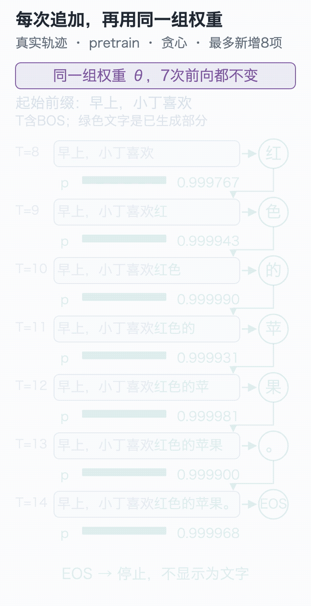

# 结束语｜那句“红色的苹果”，现在可以解释清楚了

手写小模型，看懂大模型 · 结束语

开篇时，我们给模型半句话：“早上，小丁喜欢”。它起初接出一串乱字，训练以后能写出“红色的苹果。”；换成提问又答不好，继续微调，才开始按问题回答。

当时，我们看到的是几段文字。现在，再看一次生成过程：

前文在变，计算出的候选分数在变，参数却始终是保存下来的同一份。训练让那些参数改变；生成使用选定的参数，继续处理新的输入。开篇的两个过程，现在可以沿着代码分开解释了。

## 你已经能打开哪些地方

从前，一个模型可能只是“输入一句话，返回一句话”的接口。沿着这20讲，我们打开了这个接口内部的几处关键位置。

字符编号负责查表，向量参与计算；注意力读取允许使用的前文，位置信息让顺序进入计算；模型块把各步接起来，最后才给词表中的候选打分。训练时，损失给出错误的度量，反向传播求梯度，优化器执行参数更新。

它们最后落在同一个项目里：随机权重可以开始预训练，保存的预训练权重可以生成，也可以接着做问答微调。逐讲小实验里的组件，已经成为完整模型的一部分。

## 把自己的判断留下来

第20讲的两项实战，可以留下两种不同的成果：交换事实实验让你追清数据怎样改变参数；“小唐与橘子”任务让你重新连接词表、标签、模型尺寸与评价题。第19讲的对照还提醒我们，一种能力改善时，需要同时检查另一种能力付出了什么代价。

把自己的代码、数据、权重与实验说明放在一起。以后回看时，你应当能找到：当时预测了什么，实际发生了什么，哪条记录支持你的解释，还有哪件事没有证据。这样的记录会比一份只写“训练成功”的截图更经得起复查。

## 接下来选一条路继续

**想看看自己的文字能否被学到，可以先换一小份语料。** 准备几百条自己有权使用的短句，留一部分完整句子作验证。当前工程按固定人物和水果生成数据，需要修改数据生成规则、重建词表，并检查句长上限；把一个文本文件放进目录里，还不能直接变成训练任务。第一轮先只改数据，比较训练损失、留出损失和实际输出。

**想让已有模型完成一个任务，可以继续研究任务微调。** 例如把商品描述整理成固定字段。准备正确的输入输出示例，再留出一组题，对比直接给任务说明与微调后的表现。本栏采用全量监督微调；较大模型还可以继续了解[LoRA](https://arxiv.org/abs/2106.09685)，再判断显存、数据与任务是否适合这种做法。

**想读懂真实公开模型，可以从熟悉的组件往外找。** 先看它怎样切分token、表示有多宽、注意力怎样组织，再看生成下一项时如何复用历史计算。第16、18讲已经留了真实模型与KV缓存的观察入口。每认识一种新设计，都问它解决了这里哪项具体限制，再回到实现核对。

这些路也能接到一个小应用上，比如让模型回答自己笔记里的问题。先分清它是缺少资料，还是拿到资料后仍答不好，再决定要检索什么、是否需要微调，以及怎样检查回答。

先保存当前结果，再动手改一个条件。以后遇到陌生模型，也可以像追踪“欢”的那一行一样，沿着输入找下去：它读到了什么，哪次计算改变了结果，训练又改了哪些参数。

下一次，带着一个能被实验检验的问题继续。

<!-- chapter-navigation:start -->

---

[← 闭环与原理检验](../20-full-workflow/README.md) · [课程目录](../../README.md#课程目录)

<!-- chapter-navigation:end -->
