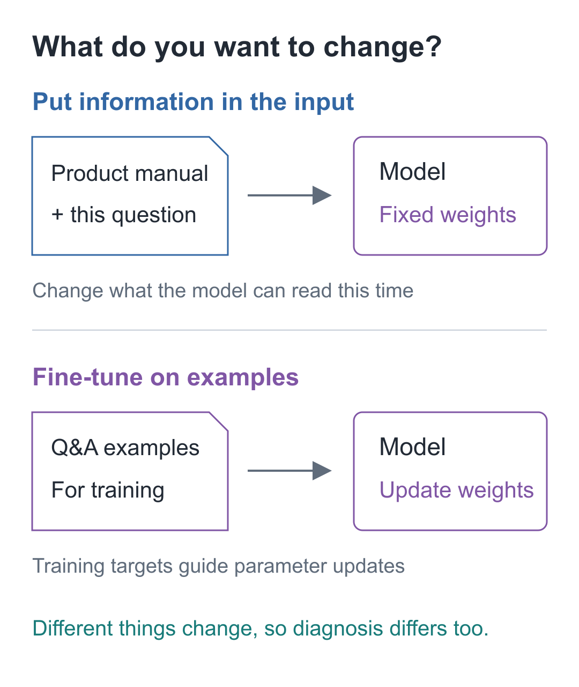
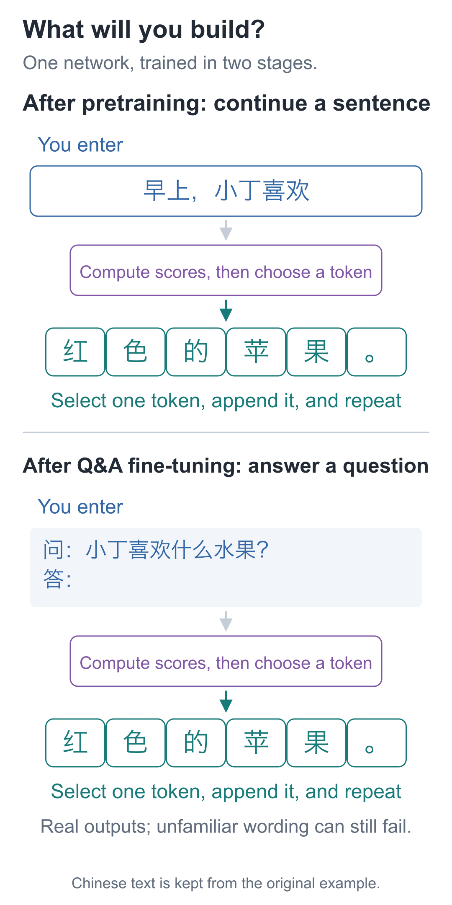
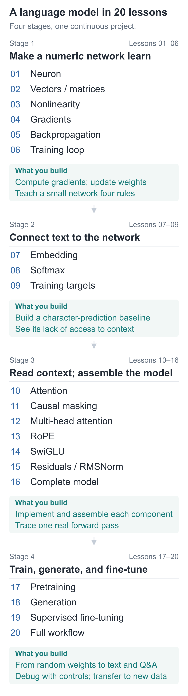

# Build a Small Model, Understand Large Models

You have probably sent text to a model and received a response.

The difficult questions often begin when that response disappoints you: it sounds fluent but gets the facts wrong, or a small change in wording makes a previously answerable question fail. You can keep revising the prompt or switch models, yet still wonder what your change actually affected—and whether the next response will fail again.

Learning the underlying mechanisms gives you a basis for making those judgments.

You can begin with the figures, videos, and browser experiments without prior knowledge of Python or deep learning. Across 20 lessons, you will start with a single neuron and build and train the same small language model. You will follow concrete inputs through its calculations, learning process, and text generation.

## If you can already use models, why study how they work?

Consider three questions that matter in development.

**Why can a model sound convincing and still be wrong?**

During text generation, a model uses the preceding text to score candidates for what comes next. The generation procedure selects a candidate, then repeats. Whether a sentence flows naturally and whether its claims are reliable are separate things to check.

Once you have inspected those scores and tried different generation choices, it becomes easier to understand why a fluent answer still needs verification. You can also ask more precise questions: what material did the model receive, what conditions were missing, and how should this result be checked?

**When results are poor, should you change the input or train again?**

Putting a product manual into the current input and fine-tuning on a collection of questions and answers do different things. The first changes the material available to the model for this request. The second changes its parameters through training. Retrieval augmentation usually helps locate and supply relevant material; fine-tuning uses a training objective to guide parameter updates.

These distinctions affect where you start investigating. If necessary information never reached the model, inspect the input and retrieval. If the examples, scoring objective, or training process are wrong, return to the data and training records. Understanding these mechanisms does not mean you can already design every application. It does let you state more clearly what you intend to change and how you will test it.

**After training, how do you know what the model has learned?**

You will see a concrete contrast in this course: as the model gets more familiar with its training examples, its performance on held-out examples may get worse. Fine-tuning may help it answer several questions while damaging its original text continuations.

We therefore keep both training and held-out results, reload saved weights, and test different inputs. As you learn to run training, you will also learn how to inspect its outcome.

All three questions lead to the same useful habit: trace a problem to the input, calculation, parameters, training objective, or generation step, and inspect each part. That gives you practical common ground when reading model documentation, studying training code, or discussing an approach with machine-learning colleagues.

## Why start by building a small model?

Training a full-scale large model involves substantial data, compute, and engineering. When you are learning for the first time, those demands can obscure the calculations you are trying to understand.

We reduce the scale while keeping the complete chain: text becomes numbers; the network transforms them into candidate scores; prediction errors produce gradients; gradients guide parameter updates. After training, the saved parameters are loaded to generate text one step at a time. At every important point, you can pause, work through a small numerical example by hand, and find the corresponding operation in code.

The small scale also makes experiments inexpensive. Change one input, block one connection, or adjust one training objective, then observe the result. By asking what problem appeared, what component was added, and how the result changed, you can check the architecture and calculations as you assemble the model.

The model's abilities are limited, but it is sufficient to take you through computation, pretraining, generation, and supervised fine-tuning. That process is a starting point for understanding larger models.

## What will you build?

The final project is a text-generation model with **92,352 parameters**. Starting from random initialization, it learns several hundred short sentences, generates text, and then undergoes supervised fine-tuning on question–answer examples. An ordinary computer can run these teaching-scale experiments on its CPU.

The figure preserves actual output. The model also fails: a different wording may still produce a wrong answer, and fine-tuning may damage its earlier continuation behavior. We will inspect the input, scoring objective, and parameters to determine where each change came from.

By the end, you should be able to:

- Trace a text input to scores for the next character and explain why each component is needed.
- Distinguish inputs, trainable parameters, intermediate results, and gradients, and calculate a simple backward path by hand.
- Pretrain from random parameters, save weights, and reload them to generate text.
- Continue fine-tuning on question–answer examples and check which positions are scored and which parameters update.
- Compare training and held-out results, investigate a fine-tuning regression, and identify the cost of an improvement.
- Independently connect a dataset containing new characters, check the vocabulary, labels, model, and reloaded results, and write an experiment report supported by evidence.

## Who is this course for?

No deep learning or calculus background is required. Even without Python experience, you can start with the diagrams and browser examples, then change one number to observe the result. The coding work requires functions, loops, lists, and basic classes. PyTorch begins in lesson 06; prepare the local environment using the setup guide before continuing with the code.

The course uses Python and PyTorch. Necessary syntax and mathematical notation are explained when they first appear. You first observe how an error changes when you move one parameter slightly, then meet the derivative. You first combine three positions using proportions, then meet the notation used in attention.

In the first five lessons, you implement multiplication, addition, networks, and gradients by hand. Later, PyTorch performs tensor operations and automatic differentiation. We still write the model architecture, training steps, and generation loop ourselves.

## The complete 20-lesson curriculum

The lessons form four stages, with each step building on the previous code. First, make a numerical network learn. Then bring in text, add the components that read preceding context, and finally train, generate, and fine-tune the same model.

Expand all 20 lesson titles

**Stage 1: Make a numerical network learn**

- 01 | Neurons: What Does a Model Calculate Before It Writes the Next Character?
- 02 | Vectors and Matrices: Do Two Outputs Require Two Copies of the Code?
- 03 | Nonlinearity: Why Can Multiply-and-Add Not Express Four Simple Rules?
- 04 | Gradients: Why Can an Update in the Right Direction Make Things Worse?
- 05 | Backpropagation: Must We Test All 9 Parameters One by One?
- 06 | The Training Loop: What Happens to Four Predictions After 500 Updates?

**Stage 2: Bring text into the network**

- 07 | Embedding: How Does Text Become a Network Input?
- 08 | Softmax: How Do Scores Become Next-Character Probabilities?
- 09 | Training Targets: How Does a Sentence Become a Learnable Task?

**Stage 3: Read context and assemble the model**

- 10 | Attention: How Does Predicting the Next Character Read Earlier Text?
- 11 | Causal Masks: Why Is Parallel Training Not Peeking at the Answer?
- 12 | Multi-Head Attention: Where Does Each Head Read?
- 13 | RoPE: How Does the Model Know the Order?
- 14 | SwiGLU: What Happens After Reading the Prefix?
- 15 | Residual Connections and RMSNorm: Why Keep a Direct Path?
- 16 | The Complete Model: Follow the Character “欢” Through Every Step

**Stage 4: Train, generate, and fine-tune**

- 17 | Pretraining: Why Can New Questions Get Worse as Training Questions Improve?
- 18 | Generation: How Many Choices Does One Sentence Take?
- 19 | Supervised Fine-Tuning: Why Can It Continue Text but Still Fail to Answer?
- 20 | The Full Workflow: Connect Pretraining, Fine-Tuning, and Generation

The opening article lets you inspect the finished model and run the first numerical example. The closing article brings the learning outcomes together and suggests ways to investigate real corpora, task fine-tuning, and publicly available models. Neither counts toward the 20 technical lessons.

## How to use the supporting material

Each lesson first explains a problem with small numbers, then connects it to commented core code, and finally changes a condition to test the result. Once a component is understood, we package it for reuse. Each lesson's entry point serves its current experiment; the final project shares one set of code for the model, data, training, saving, and generation.

Mechanism diagrams show connections, shapes, and values. Animations show changes over time. Interactive demonstrations let you stop at a specific step to check it. Training logs and successful and failed outputs are retained, so you can return to the original records.

The first run uses only one neuron and requires no third-party packages. When PyTorch is introduced in Lesson 06, install the dependencies using the [environment instructions](https://github.com/DavidDingXu/hello-llm/blob/main/code/README.md).

The course ends with the core mechanisms of text-generation models and a reproducible training pipeline. The small model learns only a limited set of short sentences. Real corpora, large-scale training, deployment, and other fine-tuning methods are directions to explore from this foundation.

Begin with the opening article, “Test the Finished Model, Then Build It from Scratch.”

<!-- chapter-navigation:start -->

---

[Contents](../../README.en.md#course-contents) · [Before we begin →](../00-introduction/README.en.md)

<!-- chapter-navigation:end -->
