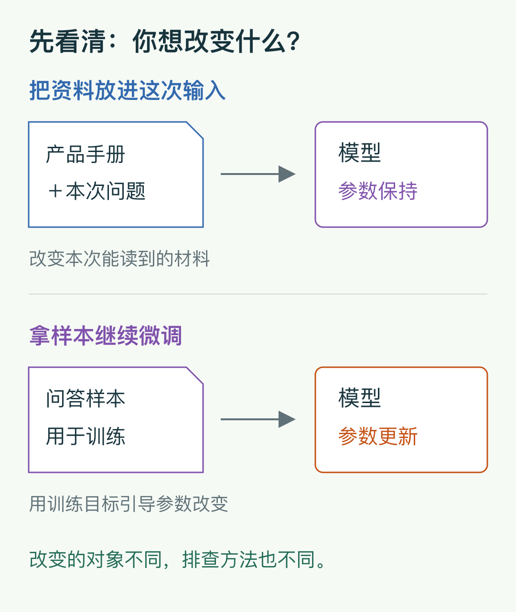
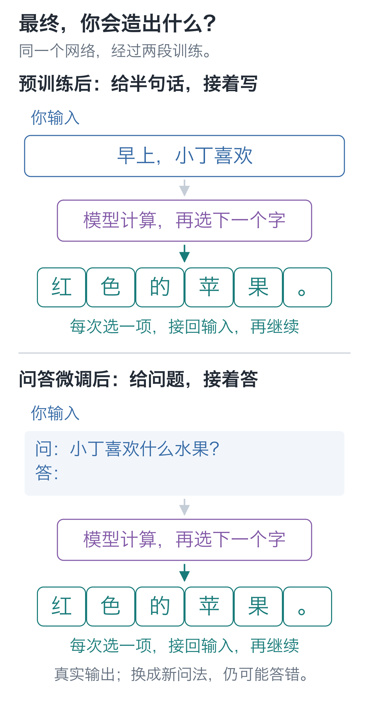
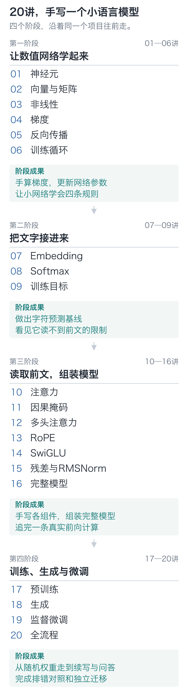

# 手写小模型，看懂大模型

把文字发给模型，再拿回一段回答，你大概已经见过这个过程。

真正让人犯难的，常常是回答不如预期的时候：明明说得很流畅，事实却错了；换一句问法，原本会答的题又不会了。你可以继续改提示词、换模型，但心里可能始终没有把握：这次究竟改到了哪一层，下一次还会不会出问题？

学习底层原理，就是为这些判断找到依据。

没有学过 Python 或深度学习，也可以先从图解、视频和网页实验开始。从一个神经元出发，用20讲搭建并训练同一个小语言模型，让你能沿着具体输入，看到计算、学习与生成究竟怎样发生。

## 已经会用，为什么还要学底层原理

先看三个会实际影响开发的问题。

**模型说得很像真的，为什么还会答错？**

文字生成时，模型会根据前文计算后续文字的候选分数，再从中选择，接着重复这个过程。句子接得顺，与句子里的事实是否可靠，需要分别检查。

等你亲手看过这些分数、试过不同的生成选择，就更容易理解为什么流畅的回答还需要核验，也会开始追问：它这次读到了哪些材料，哪些条件没有给到，结果该用什么办法验证。

**效果不好，应该先改输入，还是重新训练？**

把一份产品手册放进本次输入，和把一批问答拿去微调，发生的是两件不同的事。前者改变模型这次能读取的材料，后者通过训练改变参数。检索增强通常帮助找到并提供相关材料；微调则用训练目标引导参数更新。

这些区别会影响你的排查顺序。模型没有读到必要资料，先检查输入与检索；样本、评分目标或训练过程有问题，就需要回到数据和训练记录。理解它们，不等于已经会设计所有应用，但你能更清楚地说明自己要改变什么、准备怎样验证。

**训练过了，怎样知道它真的学会了？**

你会在书中看到一个具体反差：模型对训练题越来越熟，换成留出的题目，表现却可能变差。微调后答对了几道题，也可能损伤原来的续写。

所以我们会保留训练与留出结果，重新加载权重，用不同输入再测一次。在跑通训练的过程中，你也会练习怎样检查学习结果。

这三件事有一个共同点：你开始能把问题追到输入、计算、参数、训练目标或生成步骤，逐项检查。以后读模型文档、看训练代码，或者和算法同事讨论方案，也就有了可以落地的共同语言。

## 为什么从手写一个小模型开始

完整的大模型训练涉及大量数据、算力与工程细节。第一次学习时，这些东西很容易盖住你真正想看清的计算。

我们把规模缩小，保留一条完整链路：文字变成数字，数字经过网络得到候选分数，用错误计算梯度，再更新参数；训练结束后，加载这些参数逐步生成文字。每个关键环节都能暂停，拿一组小数字手算，再去代码里找到对应步骤。

小规模也让实验变得便宜：只改一个输入、屏蔽一条连接、调整一个训练目标，就能观察结果。沿着“遇到什么问题，增加什么部件，结果怎样改变”，你可以逐步核对架构和计算，把模型搭起来。

小模型的能力有限，但它足以让你亲手走通计算、预训练、生成与监督微调。这条过程，是后续理解更大模型的起点。

## 你会做出什么

最终项目是一个有 **92,352个参数**的文字生成模型。它从随机初值开始，学习几百条短句，接着生成文字，再用问答样本做监督微调。普通电脑用CPU就能运行这个教学规模的实验。

上面保留的是实际输出。模型也有失败：换一组问法仍可能答错，微调还可能损伤原来的续写。本书会带你一起查输入、评分目标和参数，判断变化究竟从哪里来。

学完后，你应当能够：

- 从一段文字追到下一字的候选分数，解释每个组件为什么需要。
- 区分输入、可训练参数、临时结果和梯度，手算一条简单的反向路径。
- 从随机参数完成预训练，保存并重新加载权重来生成文字。
- 用问答样本继续微调，核对哪些位置评分、哪些参数更新。
- 对比训练与留出结果，追查一次微调退化，判断改善伴随的代价。
- 独立接入含新字符的数据，检查词表、标签、模型与重载结果，写出有证据的实验说明。

## 适合怎样的读者

不要求先学过 Python、机器学习、神经网络或微积分。可以先看图解、运行网页里的现成例子，再改一个数观察结果。想独立修改完整模型时，需要逐步熟悉函数、循环、数组和基本的类；配套代码和注释可以边读边学。

课程使用Python和PyTorch。必要的语法与数学记号会在第一次使用时解释：先看把一个参数挪动一点，错误怎样变化，再认识导数；先把三个位置按比例汇总，再认识注意力里的符号。

前五讲先手写乘加、网络与梯度，之后用PyTorch执行张量运算和自动求导。模型结构、训练步骤与生成循环仍由我们写出来。

## 20讲完整目录

20讲分成四个阶段，每一步都接上前一步的代码：先让数值网络学起来，再把文字接进来，补齐读取前文的组件，最后训练、生成和微调同一个模型。

展开20讲完整标题

**第一阶段：让数值网络学起来**

- 01｜神经元：模型接着写字，底下先算什么？
- 02｜向量与矩阵：算两个数，要复制两遍代码吗？
- 03｜非线性：四行规则，为什么乘加函数做不到？
- 04｜梯度：方向对了，为什么也会越改越差？
- 05｜反向传播：9个参数，难道要逐个试？
- 06｜训练循环：更新500次，四条预测会怎样？

**第二阶段：把文字接进来**

- 07｜Embedding：文字怎样变成网络的输入？
- 08｜Softmax：分数怎样变成下一字的概率？
- 09｜训练目标：一句话怎样变成可学习的题？

**第三阶段：读取前文，组装模型**

- 10｜注意力：预测下一字，怎样读到前文？
- 11｜因果掩码：并行训练为什么不算偷看答案？
- 12｜多头注意力：各个头分别读向哪里？
- 13｜RoPE：模型怎样知道先后顺序？
- 14｜SwiGLU：读完前文以后，还要怎么算？
- 15｜残差与RMSNorm：为什么留一条原路？
- 16｜完整模型：跟着“欢”这个字走一遍

**第四阶段：训练、生成与微调**

- 17｜预训练：训练题熟了，新题为什么更差？
- 18｜生成：一句话究竟做了几次选择？
- 19｜监督微调：会续写，为何还不会回答？
- 20｜全流程：把预训练、微调和生成串起来

开篇词带你先看成品、跑通第一个算例；结束语归拢学习成果，给出继续研究真实语料、任务微调与公开模型的路线。它们不占20讲技术正文。

## 配套材料怎么用

每讲先用小数字讲清一个问题，再对应带注释的核心代码，最后改条件验证。已经讲清的部分会封装成组件，后面直接组合。逐讲入口服务当前实验，最终共用同一套模型、数据、训练、保存和生成代码。

机制图用来看连接、形状和数值；动图用来看连续变化；交互演示可以停在某一步核对。训练日志、成功与失败输出也都保留，能回到原记录查证。

第一次只运行一个神经元，无需安装第三方包。到第06讲使用PyTorch时，再按[环境说明](https://github.com/DavidDingXu/hello-llm/blob/main/code/README.md)安装依赖。

学习终点是文字生成模型的核心机制和一条能复现的训练流程。小模型只学习有限短句；真实语料、大规模训练、部署与其他微调方法，可以在这条基础上继续探索。

从开篇词《先给成品出两道题，再从零把它造出来》开始。

<!-- chapter-navigation:start -->

---

[课程目录](../../README.md#课程目录) · [开篇词 →](../00-introduction/README.md)

<!-- chapter-navigation:end -->
