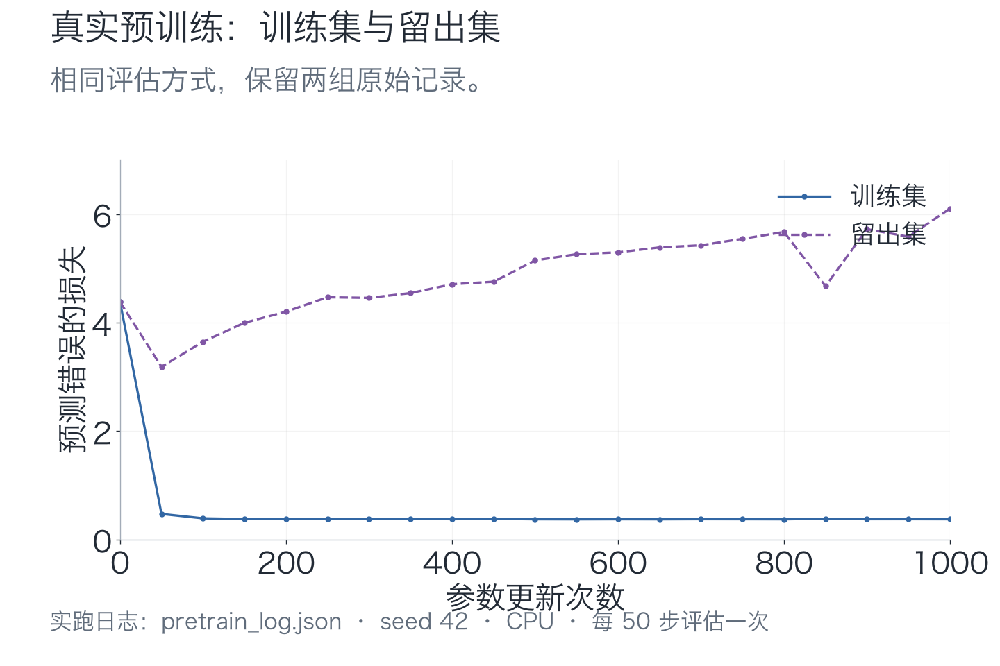

# 实验运行记录

当前教学数据与主线实验于2026-10-23重新生成和执行。人物“小丁”与红色苹果对应，小周与黄色香蕉对应。正文、图解和回放使用本文件链接的 JSON 记录。

## 环境与复现

Python 3.12.14，PyTorch 2.9.1，macOS-26.5.1-arm64-arm-64bit；CPU、float32、单线程，seed42。主线模型从随机参数训练，不加载外部预训练权重。运行耗时仅指训练循环及其评估，不含安装、图解或视频制作，不是读者设备的速度承诺。

在配套代码根目录执行：

```bash
python -m unittest discover -s checks -v
python -m tiny_lm.train --out artifacts/my_run --pretrain-steps 1000 --sft-steps 300
python -m lessons.training_replay --run artifacts/my_run --out artifacts/my_replay.json
```

`first_run/`是本版作者的实际参考运行；读者默认使用`my_run/`。每次运行保存自己的四组数据、词表与摘要。当前根数据清单为[manifest.json](data/manifest.json)，规范化摘要`a3d79f9d2424509ea61d70799126f3f3f9ce6db9aa2645f1240d1676928ff1ab`。

## 模型、数据与真实训练

79项词表，64维表示，2层、2头、128维前馈，最长32项，92,352个参数。字符按排序建词表，当前“小”为27，“丁”为6。编号只是查表位置，不表示语义。

预训练训练/留出各256/64条，SFT训练/留出各24/8条。按完整模板留出；人物与水果事实共享。预训练留出仍有未训练字符“前、在、面”，问答留出含未训练字符“最”，所以这些成绩同时受新句式与未训练字符影响。

| 实验 | 初始结果 | 最终结果 |
| --- | --- | --- |
| 四条长记录，240次更新 | 4.403622 | 0.083572 |
| 预训练，1000次更新 | 训练4.382247；留出4.379960 | 训练0.372600；留出6.101809 |
| 问答微调，300次更新 | 训练2.877918；留出2.975784 | 训练0.000016；留出0.004043 |

本次预训练循环约3.94秒，微调约0.96秒。[小批次](artifacts/first_run/small_batch.json)、[预训练](artifacts/first_run/pretrain_log.json)、[微调](artifacts/first_run/sft_log.json)保留实际历史与环境。微调训练问法24/24、留出问法8/8，仅针对这组人物事实与问题；不据此判断任意问法都成功。



原始每50步评估点均保留，不平滑或补造中间权重。相同前文存在不同合法下一字，训练损失也不必降到0。

## 同一提示词，保留三阶段全部输出

固定贪心、最多8项；`\n`表示换行。[完整生成记录](artifacts/first_run/generation_comparison.json)保留候选、选字与停止原因。

| 提示词 | 随机初值 | 预训练后 | 问答微调后 |
| --- | --- | --- | --- |
| `早上，小丁喜欢` | 色檬葡最爱梨吴爱 | 红色的苹果。 | 红色的苹果。 |
| `晚上，小周拿着` | 吃何梨草果草果草 | 黄色的香蕉。 | 黄色的香蕉。 |
| `问：小丁喜欢什么水果？\n答：` | 爱红绿吃爱梨吴爱 | 我爱吃香蕉。 | 红色的苹果。 |
| `问：小周喜欢什么水果？\n答：` | 爱红檬果爱梨吴爱 | 我爱吃香蕉。 | 黄色的香蕉。 |

本版四个固定提示在微调后都成功，但扩大旧续写题集后仍有退化，不能仅据四个样本宣称旧能力完整保留。

## 从字符基线到完整前向

第09讲字符基线以SGD、学习率0.1、宽度16、seed42训练1000步。[实际记录](artifacts/lessons/l09.json)：训练损失4.479492→0.934471，留出4.531882→3.000230。同样以“欢”结尾的不同人名前缀，最后分布最大差值为0，因为该基线没有读取前文。

第16讲[全模型前向](artifacts/first_run/forward_trace.json)与[逐讲记录](artifacts/lessons/l16.json)来自当前预训练权重，含实际编号、形状与中间量。模型解剖台、热力图与投影乘加图共用这些记录。生成前后参数摘要不变。

## 重放一次真实更新

[training_replay.json](artifacts/training_replay.json)从当前保存初值、原采样与AdamW重放，调用工程中的`train_step`。首批16条，输入[16,32]、分数[16,32,79]、235个有效目标；首步整批损失4.383217。

前向、反向、裁剪都不改变参数摘要，只有优化器更新会改变。具体梯度范数与“小”词向量坐标更新保留在JSON，不用重绘平滑动画冒充实测过程。三阶段权重和原日志在回放前后保持文件摘要一致。每次运行读取自身数据快照，损坏时明确失败，不用当前生成器替代旧数据。

## 已见字符的新组合补查

固定64条新组合、920个有效目标，完整句子与训练集交集0，全部字符在训练正文中出现。[补查报告](artifacts/validation_probe.json)保留覆盖与参数未变检查。三阶段损失依次为4.376142、1.894270、1.933178。模板是看到早期实验后选择的探索题，不作为事先保留的独立最终测试。

## 只换两条人物事实，再实际训练

小丁改为黄色香蕉、小周改为红色苹果，其余六人不变；保持词表、结构、seed42、1000步预训练与300步微调。[transfer_run](artifacts/transfer_run/)保留数据快照、权重与日志；[对照报告](artifacts/transfer_check.json)核对随机初值相同，以及原参考运行文件在实验前后未变。

| 阶段 | 提示词 | 原事实模型 | 交换后模型 |
| --- | --- | --- | --- |
| pretrain | `早上，小丁喜欢` | 红色的苹果。 | 黄色的香蕉。 |
| pretrain | `晚上，小周拿着` | 黄色的香蕉。 | 红色的苹果。 |
| sft | `问：小丁喜欢什么水果？\n答：` | 红色的苹果。 | 黄色的香蕉。 |
| sft | `问：小周喜欢什么水果？\n答：` | 黄色的香蕉。 | 红色的苹果。 |

四条均符合交换预期并产生EOS。数据文件变化不会自动改变旧权重，必须训练并加载对应运行的权重。

## 固定新旧任务，诊断微调取舍

[retention_experiment.json](artifacts/retention_experiment.json)从同一预训练权重出发；24条训练问答、8条留出问答、256条熟悉续写，完整成功要求文本完全一致且选到EOS。每条最多16项。三个种子只改变微调抽样；训练问答每组均24/24。

| 方法 | 旧续写，种子42/43/44 | 留出问答，种子42/43/44 |
| --- | --- | --- |
| 原学习率0.001 | 224、230、226 / 256 | 8、7、8 / 8 |
| 小学习率0.0001 | 256、256、256 / 256 | 5、5、5 / 8 |
| 12条问答＋4条原正文 | 256、256、256 / 256 | 3、3、5 / 8 |

微调前旧续写256/256、问答两组为0。原设置seed42的实际退化例：输入“早上，小丁选了”，期望“苹果，它是红色的。”，生成“苹果，它是红色的苹果。”并选到EOS。错误不是长度上限截断。

小学习率保住旧续写，但新问法从8/8降到5/8。混训也保住旧续写，但新问法为3/8、3/8、5/8，未保住原设置的成绩。混训seed42留出问答损失0.269201，高于原设置0.004043，本版不存在此前“损失更低但完整匹配更低”的那组具体数值反例。

第一轮单改学习率，第二轮在看到第一轮后探索12条问答加4条旧正文的混训。沿用的留出题此时是开发验证，不能包装为独立最终测试。混训每300步共有25,200个问答有效目标与18,212个正文有效目标，正文约42%；4/16样本比例不等于25%损失权重。全部逐题结果与失败保留，未挑选最好种子。

## 含新字符的独立迁移验收

加入小唐、橙色、橘子，288条训练与72条留出，整句交集0，留出字符均见于训练。只从训练文字建立67项词表，模型90,816参数。seed42实际训练1000步、保存并重载，训练损失4.207454→0.379470，留出4.207752→1.963480。

| 提示 | 实际续写 | 停止 |
| --- | --- | --- |
| 早上，小唐喜欢 | 橙色的橘子。 | EOS |
| 早上，小唐爱吃 | 橘子，小周拿着橙色的香蕉。 | EOS |
| 晚上，小周爱吃 | 香蕉，小周拿着黄色的香蕉。 | EOS |

熟悉句式成功；新问法出现漏颜色和额外续写，不能只看损失下降宣布成功。[参考报告](artifacts/transfer_challenge.json)保留历史、实际输出和参数摘要。参考代码`exercises/transfer_solution.py`；练习`transfer_task.py`保留三个待实现函数。验收另换最小数据核查词表、EOS、padding、因果范围和输出候选数，不能靠写死旧编号通过。

## 外部公开模型的只读观察

公开权重观察使用 Qwen/Qwen3-0.6B：596,049,920个参数，CPU float32，PyTorch2.9.1、Transformers4.57.1、2线程、eager attention。Hugging Face下载连接超时后，改从Qwen官方ModelScope仓库固定版本09b42cad3d112e832108974449ccb5e8e0f5b5d1下载，逐文件SHA256校验；权重SHA256 f47f71177f32bcd101b7573ec9171e6a57f4f4d31148d38e382306f42996874b，与Hugging Face版本c1899de289a04d12100db370d81485cdf75e47ca公布的权重相同。配置与tokenizer来源以[下载清单](artifacts/reference/download_manifest.json)为准。

提示词“天空是什么颜色？”使用关闭思考的聊天模板后为16个token，记录4次贪心选择：天空 / 的颜色 / 通常 / 被认为是。第一次logits形状[1,16,151936]，之后[1,1,151936]；第一层K/V缓存[1,8,T,128]的T依次16、17、18、19。第4步缓存与完整前缀重算的最大logit差值7.2479248046875e-05；参数摘要前后相同。实测约2.21秒仅含本地权重加载与捕获，不含预先下载时间。没有进行反向或更新，也没有用4个token评价回答质量。[完整记录](artifacts/reference/qwen3_trace.json)。

## 验证范围与版本

以下记录来自 2026-10-23 的 macOS 运行，覆盖完整训练、SFT、交换事实重训、独立迁移保存重载、9组保留能力对照及快照重放。本文尚未提供同版数据在 Windows 上的重训记录；跨平台自动检查配置见 `.github/workflows/reader-checks.yml`。

真实零基础读者试学与平台正式展示仍需另外验收。模型小、语料简单，本记录只解释已覆盖实验，不承诺通用对话能力。
